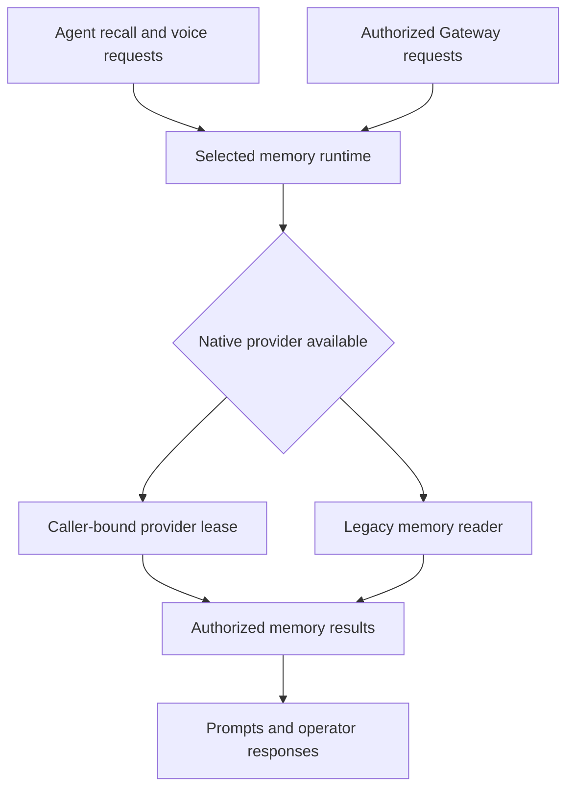

Codex review: blocked before merge. _Reviewed October 2, 2026, 4:23 PM ET / 20:23 UTC (Revision 12)._

# ClawSweeper review

## What this changes

Adds a caller-bound memory provider interface so record-based plugins can serve recall, voice context, Memory Wiki, and Gateway reads while preserving legacy file-backed readers.

## Merge readiness

⛔ **Blocked before merge - 1 item remains**

Keep open: current main lacks this provider-neutral memory capability, and this maintainer-authored PR remains useful. No blocking correctness finding was established; the previous migration-proof request does not apply because this patch changes no persisted-data contract.

**Priority:** P2
**Reviewed head:** `7baaf4bd0361d06f1334723c47ee6e2a0a166c85`

## Review scores

| Measure | Result | What it means |
|---|---|---|
| **Overall readiness** | 🐚 platinum hermit **(4/6)** | A coherent additive implementation with focused compatibility and authority coverage and no established blocking defect. |
| **Proof confidence** | 🌊 off-meta tidepool | Not applicable: The verified maintainer author is exempt from the external-contributor proof gate. The body reports isolated Gateway calls through the new provider owner and differential legacy compatibility; inspected boundary tests supplement those claims. No material unresolved authority violation was established, and no stored-data contract changes require migration proof. |
| **Patch quality** | 🐚 platinum hermit **(4/6)** | No actionable review findings were identified. |

## Verification

| Check | Result | Evidence |
|---|---|---|
| **Real behavior** | Not applicable | Not applicable: The verified maintainer author is exempt from the external-contributor proof gate. The body reports isolated Gateway calls through the new provider owner and differential legacy compatibility; inspected boundary tests supplement those claims. No material unresolved authority violation was established, and no stored-data contract changes require migration proof. |
| **Evidence reviewed** | 10 items | Pinned introduction: Reviewed changes between the verified merge base ec9f39d1f803d90417609d858d15aa8a580b6442 and original PR head 7baaf4bd0361d06f1334723c47ee6e2a0a166c85; fetched main was treated separately as behavioral context. Still necessary on current main: Current main’s MemoryPluginCapability exposes the legacy runtime but no providerRuntime registration; its resolver still acquires file-shaped search managers. The latest released contract likewise lacks providerRuntime. Released contract comparison: The v2026.9.7 registration contract contains runtime and existing memory hooks, without the proposed neutral provider capability. |
| **Findings** | None | None. |
| **Security** | None | None. |

## How this fits together

OpenClaw’s memory runtime connects the selected memory plugin to agent recall and operator searches. It translates caller authority and retrieval requests into provider results that feed prompts, voice context, and memory diagnostics.

## Before merge

- [ ] **Add data-model compatibility proof** - Confirm migration or upgrade compatibility proof before merge.

<strong>Agent review details</strong>

### Security

None.

### PR surface

Source +1887, Tests +2517, Docs +143, Config 0. Total +4547 across 62 files.

View PR surface stats

| Area | Files | Added | Removed | Net |
|---|---:|---:|---:|---:|
| Source | 33 | 2240 | 353 | +1887 |
| Tests | 24 | 3086 | 569 | +2517 |
| Docs | 3 | 148 | 5 | +143 |
| Config | 2 | 5 | 5 | 0 |
| Generated | 0 | 0 | 0 | 0 |
| Other | 0 | 0 | 0 | 0 |
| **Total** | **62** | **5479** | **932** | **+4547** |

### Review metrics

| Metric | Value | Why it matters |
|---|---|---|
| **Production versus test growth** | production/tooling +2245/-358; tests/support +3086/-569 | Production growth has a stated purpose: the shared provider lease contract, legacy adapter, and consumer integration. |
| **Gateway API expansion** | 2 new methods; 1 new search response version | Clients gain retrieval and health operations while legacy search keeps its established response shape. |

### Stored data model

Persistent data-model change detected: `unknown-data-model-change: extensions/memory-core/src/cli-memory-slot.ts`, `unknown-data-model-change: extensions/memory-core/src/cli-runtime-common.ts`, `unknown-data-model-change: extensions/memory-core/src/cli-status.runtime.ts`, `unknown-data-model-change: extensions/memory-wiki/src/gateway.ts`, `unknown-data-model-change: extensions/memory-wiki/src/query-memory-provider.ts`, `unknown-data-model-change: extensions/memory-wiki/src/query-shared-memory.ts`, and 24 more. Confirm migration or upgrade compatibility proof before merge.

### Technical review

Best possible solution:

Keep one selected memory owner behind the additive caller-bound contract, with legacy readers preserved and provider-owned visibility enforced before data is released.

Do we have a high-confidence way to reproduce the issue?

Not applicable as a feature reproduction: current-main source confirms memory consumers still depend on the legacy file-shaped runtime.

Is this the best way to solve the issue?

Yes: extending the existing selected-slot owner with a neutral read contract addresses the missing capability while retaining established legacy readers and cleanup ownership.

AGENTS.md: found and applied where relevant.

Codex review notes: model internal, reasoning medium; reviewed against [b4d1a0efc8a9](https://github.com/openclaw/openclaw/commit/b4d1a0efc8a9f6797e7cd03f8f92814a8ca96782).

### Labels

Label changes:

No label changes.

Label justifications:

- `P2`: This is a useful, bounded memory-platform feature without an established urgent user regression.
- `merge-risk: 🚨 compatibility`: The maintainer explicitly accepts changed foreign-slot CLI behavior and strict search-version validation; legacy runtime and released voice-call contracts remain supported.
- `rating: 🐚 platinum hermit`: Overall readiness is 🐚 platinum hermit; proof is 🌊 off-meta tidepool and patch quality is 🐚 platinum hermit.
- `status: 👀 ready for maintainer look`: ClawSweeper has no concrete contributor-facing blocker left for this PR. Not applicable: The verified maintainer author is exempt from the external-contributor proof gate. The body reports isolated Gateway calls through the new provider owner and differential legacy compatibility; inspected boundary tests supplement those claims. No material unresolved authority violation was established, and no stored-data contract changes require migration proof.

### Evidence

What I checked:

- **Pinned introduction:** Reviewed changes between the verified merge base ec9f39d1f803d90417609d858d15aa8a580b6442 and original PR head 7baaf4bd0361d06f1334723c47ee6e2a0a166c85; fetched main was treated separately as behavioral context. ([7baaf4bd0361](https://github.com/openclaw/openclaw/commit/7baaf4bd0361d06f1334723c47ee6e2a0a166c85))
- **Still necessary on current main:** Current main’s MemoryPluginCapability exposes the legacy runtime but no providerRuntime registration; its resolver still acquires file-shaped search managers. The latest released contract likewise lacks providerRuntime. ([`src/plugins/registry-contribution-types.ts:284`](https://github.com/openclaw/openclaw/blob/b4d1a0efc8a9f6797e7cd03f8f92814a8ca96782/src/plugins/registry-contribution-types.ts#L284), [b4d1a0efc8a9](https://github.com/openclaw/openclaw/commit/b4d1a0efc8a9f6797e7cd03f8f92814a8ca96782))
- **Released contract comparison:** The v2026.9.7 registration contract contains runtime and existing memory hooks, without the proposed neutral provider capability. ([`src/plugins/registry-contribution-types.ts`](https://github.com/openclaw/openclaw/blob/c074824a27c96d3983043f9eeb33823cd1772d8c/src/plugins/registry-contribution-types.ts), [c074824a27c9](https://github.com/openclaw/openclaw/commit/c074824a27c96d3983043f9eeb33823cd1772d8c))
- **No stored-data migration introduced:** The new runtime is an additive registration and caller-bound handle contract. Provider references travel in query results and RPC payloads; the inspected patch adds no schema, stored format, persistence writer, or migration. The preceding review’s generic migration blocker is therefore withdrawn. ([`src/plugins/registry-contribution-types.ts:278`](https://github.com/openclaw/openclaw/blob/7baaf4bd0361d06f1334723c47ee6e2a0a166c85/src/plugins/registry-contribution-types.ts#L278), [7baaf4bd0361](https://github.com/openclaw/openclaw/commit/7baaf4bd0361d06f1334723c47ee6e2a0a166c85))
- **Authorization and lease lifetime:** Gateway methods retain operator.read authorization, synthetic callers require admitted operator authority, and provider handles check caller cancellation, connection currency, plugin lifetime, reference ownership, and closure around asynchronous operations. Boundary tests cover scope denial and authority loss before search I/O. ([`src/gateway/server-methods/memory-provider.ts:109`](https://github.com/openclaw/openclaw/blob/7baaf4bd0361d06f1334723c47ee6e2a0a166c85/src/gateway/server-methods/memory-provider.ts#L109), [7baaf4bd0361](https://github.com/openclaw/openclaw/commit/7baaf4bd0361d06f1334723c47ee6e2a0a166c85))
- **Prior compatibility findings resolved:** Released voice callers without liveness retain legacy lookup; native reads require live-call authority. Project recall contains cleanup failures and rechecks authority after cleanup. Wiki retains legacy session visibility, conversation recall, and wiki-only fallback when provider opening fails. ([`src/talk/fast-context-runtime.ts:137`](https://github.com/openclaw/openclaw/blob/7baaf4bd0361d06f1334723c47ee6e2a0a166c85/src/talk/fast-context-runtime.ts#L137), [7baaf4bd0361](https://github.com/openclaw/openclaw/commit/7baaf4bd0361d06f1334723c47ee6e2a0a166c85))

Likely related people:

- **Peter Steinberger:** Suggested for follow-up; no historical authorship or introduction is verified. (role: unverified routing candidate; confidence: low)
- **ruel225:** Suggested for follow-up; no historical authorship or introduction is verified. (role: unverified routing candidate; confidence: low)
- **Josh Avant:** Suggested for follow-up; no historical authorship or introduction is verified. (role: unverified routing candidate; confidence: low)

### Rating scale

| Score | Internal tier | Crab rank | Meaning |
|---:|:---:|---|---|
| **6/6** | S | 🦀 challenger crab | Exceptional readiness |
| **5/6** | A | 🦞 diamond lobster | Very strong readiness |
| **4/6** | B | 🐚 platinum hermit | Good normal PR; ordinary maintainer review |
| **3/6** | C | 🦐 gold shrimp | Useful, but confidence is limited |
| **2/6** | D | 🦪 silver shellfish | Proof or implementation needs work |
| **1/6** | F | 🧂 unranked krab | Not merge-ready |
| N/A | NA | 🌊 off-meta tidepool | Rating does not apply |

Overall follows the weaker of proof and patch quality.
Shiny media proof means a screenshot, video, or linked artifact directly shows the changed behavior. Runtime, network, CSP, and security claims still need visible diagnostics.

### Workflow

- ClawSweeper keeps one durable marker-backed review comment per issue or PR.
- Re-runs edit this comment so the latest verdict, findings, and automation markers stay together instead of adding duplicate bot comments.
- A fresh review can be triggered by eligible `@clawsweeper re-review` comments, exact-item GitHub events, scheduled/background review runs, or manual workflow dispatch.
- PR/issue authors and users with repository write access can comment `@clawsweeper re-review` or `@clawsweeper re-run` on an open PR or issue to request a fresh review only.
- Maintainers can also comment `@clawsweeper review` to request a fresh review only.
- Fresh-review commands do not start repair, autofix, rebase, CI repair, or automerge.
- Maintainer-only repair and merge flows require explicit commands such as `@clawsweeper autofix`, `@clawsweeper automerge`, `@clawsweeper fix ci`, or `@clawsweeper address review`.
- Maintainers can comment `@clawsweeper explain` to ask for more context, or `@clawsweeper stop` to stop active automation.

### History

Review history (11 earlier review cycles; latest 8 shown)

<!-- clawsweeper-review-history v=1 total=11 -->
- reviewed 2026-10-01T14:24:46.689Z sha 3e6aa3b7d7e284302917001acafd34b1336194e8 :: blocked before merge. :: [P2] Contain lease cleanup failures in optional project recall
- reviewed 2026-10-01T20:49:40.181Z sha 9b89d7a3c840169fa2f8741c34dd7c95331e6875 :: blocked before merge. :: none
- reviewed 2026-10-01T21:14:59.971Z sha 9b89d7a3c840169fa2f8741c34dd7c95331e6875 :: blocked before merge. :: none
- reviewed 2026-10-01T23:19:02.713Z sha 64edded5a1b94d03480e370a6381fe0e3836d544 :: blocked before merge. :: none
- reviewed 2026-10-02T06:23:03.274Z sha e191fe0021ebb3054d92c01b43ca51e7c3e4341b :: blocked before merge. :: [P1] [P1] Preserve the released voice helper caller contract
- reviewed 2026-10-02T12:14:56.948Z sha 27ea94bd1a9f5712be5671a8f1984d2ba89b6065 :: blocked before merge. :: none
- reviewed 2026-10-02T18:22:53.839Z sha 97217ad3dcdb772ba81acb009245ccb78c4d51f7 :: blocked before merge. :: none
- reviewed 2026-10-02T19:55:23.437Z sha 7baaf4bd0361d06f1334723c47ee6e2a0a166c85 :: blocked before merge. :: none

<!-- clawsweeper-verdict:needs-human item=162175 sha=7baaf4bd0361d06f1334723c47ee6e2a0a166c85 confidence=high updated_at=2026-10-02T20:19:16Z reviewed_at=2026-10-02T20:23:21.128Z lease_owner=github-run-37059658087-1 lease_comment_id=5960799328 source_revision=0d447f138b62807ab670032df60cbbd26345d01ea8765ae75a4b2d81ed57b036 live_verification=absent -->
<!-- clawsweeper-review-state:blocked item=162175 sha=7baaf4bd0361d06f1334723c47ee6e2a0a166c85 v=1 -->

<!-- clawsweeper-review-version item=162175 reviewed_at=2026-10-02T20:23:21.128Z sha=7baaf4bd0361d06f1334723c47ee6e2a0a166c85 source_revision=0d447f138b62807ab670032df60cbbd26345d01ea8765ae75a4b2d81ed57b036 lease_owner=github-run-37059658087-1 lease_comment_id=5960799328 v=1 -->

<!-- clawsweeper-review item=162175 -->