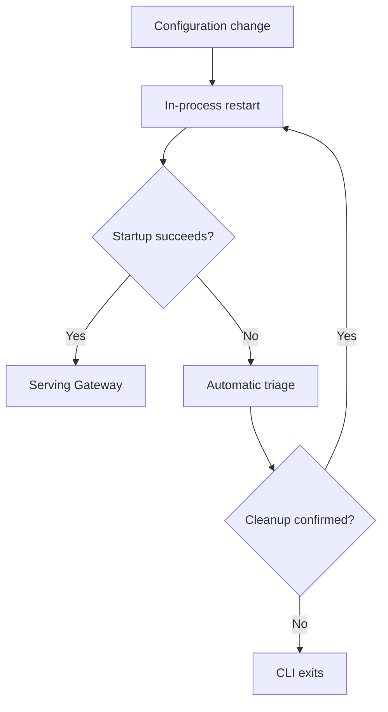

Codex review: blocked before merge. _Reviewed September 29, 2026, 9:47 AM ET / 13:47 UTC (Revision 8)._

# ClawSweeper review

## What this changes

The branch carries confirmed foreground triage completion into the Gateway restart loop, retries startup once, and updates lifecycle tests and triage guidance.

## Merge readiness

⛔ **Blocked before merge - 6 items remain**

Current main still has the reported outage, and this PR offers a credible repair. The two findings from the prior review remain unresolved at the unchanged head, so it is not ready to merge.

**Priority:** P0
**Reviewed head:** `71ebda15e4f7d92604cd19ddf9189f3bf752da24`
**Owner decision:** Required. See [Decision needed](#decision-needed).

## Review scores

| Measure | Result | What it means |
|---|---|---|
| **Overall readiness** | 🦐 gold shrimp **(3/6)** | The real CLI account and focused lifecycle coverage support the repair, but the unresolved recovery-contract finding and upgrade proof limit readiness. |
| **Proof confidence** | 🐚 platinum hermit **(4/6)** | Sufficient (terminal): The captured PR body records an isolated Linux full-CLI run through the changed Gateway restart and triage path: after a refused setting was repaired, the same PID served /healthz with HTTP 200, while an unrepaired case exited 1. The linked Testbox workflow was canceled, so its conclusion does not independently verify that account. No stored-data contract changes; the separate published-updater upgrade cell remains unproven. |
| **Patch quality** | 🦐 gold shrimp **(3/6)** | 2 actionable review findings remain. |

## Verification

| Check | Result | Evidence |
|---|---|---|
| **Real behavior** | Verified | Sufficient (terminal): The captured PR body records an isolated Linux full-CLI run through the changed Gateway restart and triage path: after a refused setting was repaired, the same PID served /healthz with HTTP 200, while an unrepaired case exited 1. The linked Testbox workflow was canceled, so its conclusion does not independently verify that account. No stored-data contract changes; the separate published-updater upgrade cell remains unproven. |
| **Evidence reviewed** | 13 items | Current main still waits: After a failed restart, current main awaits the triage callback and then waits for another restart signal; it does not use triage completion to start the Gateway. Introduced recovery path: The PR retries after a completed triage and treats failure of that retry as terminal. Declined triage becomes terminal: An installed failure handler returning no completion makes the new recovery helper throw the original startup error. |
| **Findings** | 2 actionable findings | [P1] Preserve manual restart recovery when triage declines [P3] Scope the triage exit-status promise to updates |
| **Security** | None | None. |

## How this fits together

The Gateway CLI keeps the server process running through configuration changes and in-process restarts. When startup fails, automatic triage can repair the installation; the CLI then decides whether to start serving again or end the process.

## Decision needed

| Question | Recommendation |
|---|---|
| Should a failed restart whose triage hook declines to run retain the existing operator-restart wait, or intentionally terminate the Gateway process? | **Retain operator recovery:** Keep the manual restart wait when no repair was admitted, while retaining the bounded automatic retry after confirmed cleanup. |

Why: The branch deliberately changes a shipped recovery path, and source review cannot authorize that operator-impacting upgrade choice.

## Before merge

- [ ] **Preserve manual restart recovery when triage declines (P1)** - The production handler legitimately returns no completion after an earlier triage attempt or other admission refusal. This new throw then exits a Gateway that previously stayed alive to accept an operator restart signal, which can strand foreground and Docker installs without a restart policy. Preserve that fallback or obtain explicit acceptance of the changed contract.
- [ ] **Scope the triage exit-status promise to updates (P3)** - This new paragraph says incomplete Gateway triage exits nonzero, but the later automatic-handoff guidance still promises that the original failure result and exit status remain unchanged. Clarify which guarantee applies to updates and which applies to Gateway recovery.
- [ ] **Resolve merge risk (P1)** - When triage declines or has already run, the PR turns the existing operator-restart wait into a process exit. A foreground or Docker Gateway without an automatic restart policy can remain down after upgrade.
- [ ] **Resolve merge risk (P1)** - The service-lifecycle change lacks a published-updater × candidate run using existing operator state, leaving upgrade recovery behavior unverified.
- [ ] **Complete next step (P2)** - Preserve the declined-triage operator-restart path or obtain explicit maintainer acceptance of terminal refusal; align the guide and provide published-updater × candidate proof using existing state.
- [ ] **Resolve maintainer decision** - Resolve the maintainer decision shown above before merge.

## Findings

- [P1] Preserve manual restart recovery when triage declines — `src/cli/gateway-cli/run-loop-startup.ts:51-52`
- [P3] Scope the triage exit-status promise to updates — `docs/cli/triage.md:129`

<strong>Agent review details</strong>

### Security

None.

### PR surface

Source +44, Tests +32, Docs +2. Total +78 across 12 files.

View PR surface stats

| Area | Files | Added | Removed | Net |
|---|---:|---:|---:|---:|
| Source | 6 | 68 | 24 | +44 |
| Tests | 5 | 145 | 113 | +32 |
| Docs | 1 | 2 | 0 | +2 |
| Config | 0 | 0 | 0 | 0 |
| Generated | 0 | 0 | 0 | 0 |
| Other | 0 | 0 | 0 | 0 |
| **Total** | **12** | **215** | **137** | **+78** |

### Review metrics

| Metric | Value | Why it matters |
|---|---|---|
| **Net code growth by role** | production +44, tests/support +32, docs +2 | The PR attributes production growth to the bounded recovery path and moves lifecycle cases into existing test support. |

### Root-cause cluster

Relationship: `fixed_by_candidate`
Canonical: https://github.com/openclaw/openclaw/issues/159539
Summary: This PR is the candidate repair for the linked, still-open report of a repaired configuration leaving the Gateway offline.

Members:
- `canonical`: https://github.com/openclaw/openclaw/issues/159539 - The PR explicitly targets the report's failed in-process restart followed by completed triage and no serving Gateway.

Proposal only: this assessment does not dispatch repair, suppress jobs, mutate sibling items, close, or merge anything.

### Merge-risk options

**Maintainer options:**
1. **Preserve declined-triage recovery (recommended)**  
   Retain the operator-restart wait when triage returns no completion, align the guide, and prove the resulting upgrade path with existing state.
2. **Accept the changed exit contract**  
   A maintainer can own terminal refusal if published-updater proof and operator guidance show how foreground and container Gateways recover.

### Technical review

Best possible solution:

Retry startup once after confirmed cleanup, retain operator restart when no repair was admitted, and verify final Gateway health or exit using an existing installation and a published updater.

Do we have a high-confidence way to reproduce the issue?

Yes. Current-main source waits for another restart signal after triage, and the linked report plus contributor's isolated Linux CLI account describe the refused-restart path; I did not execute it in this read-only review.

Is this the best way to solve the issue?

Not yet. One retry through the existing Gateway loop is focused, but a declined triage hook should retain operator recovery unless a maintainer explicitly accepts the changed contract.

Full review comments:

- [P1] Preserve manual restart recovery when triage declines — `src/cli/gateway-cli/run-loop-startup.ts:51-52`
  The production handler legitimately returns no completion after an earlier triage attempt or other admission refusal. This new throw then exits a Gateway that previously stayed alive to accept an operator restart signal, which can strand foreground and Docker installs without a restart policy. Preserve that fallback or obtain explicit acceptance of the changed contract.
  Confidence: 0.94
- [P3] Scope the triage exit-status promise to updates — `docs/cli/triage.md:129`
  This new paragraph says incomplete Gateway triage exits nonzero, but the later automatic-handoff guidance still promises that the original failure result and exit status remain unchanged. Clarify which guarantee applies to updates and which applies to Gateway recovery.
  Confidence: 0.98

Overall correctness: patch is incorrect
Overall confidence: 0.91

AGENTS.md: found and applied where relevant.

Codex review notes: model internal, reasoning high; reviewed against [099380708f99](https://github.com/openclaw/openclaw/commit/099380708f99e3f7be98c82d660700897f53a718).

### Labels

Label changes:

No label changes.

Label justifications:

- `P0`: The reported failure leaves the core Gateway and its channels unavailable even after configuration repair.
- `merge-risk: 🚨 compatibility`: Declined triage changes an existing manual-restart recovery contract into terminal failure.
- `merge-risk: 🚨 availability`: A foreground or container Gateway without automatic process restart may stay down after the new terminal refusal.
- `rating: 🦐 gold shrimp`: Overall readiness is 🦐 gold shrimp; proof is 🐚 platinum hermit and patch quality is 🦐 gold shrimp.
- `status: ⏳ waiting on author`: ClawSweeper has contributor-facing work open and is waiting for author action. Sufficient (terminal): The captured PR body records an isolated Linux full-CLI run through the changed Gateway restart and triage path: after a refused setting was repaired, the same PID served /healthz with HTTP 200, while an unrepaired case exited 1. The linked Testbox workflow was canceled, so its conclusion does not independently verify that account. No stored-data contract changes; the separate published-updater upgrade cell remains unproven.
- `proof: sufficient`: Contributor real behavior proof is sufficient. The captured PR body records an isolated Linux full-CLI run through the changed Gateway restart and triage path: after a refused setting was repaired, the same PID served /healthz with HTTP 200, while an unrepaired case exited 1. The linked Testbox workflow was canceled, so its conclusion does not independently verify that account. No stored-data contract changes; the separate published-updater upgrade cell remains unproven.

### Evidence

What I checked:

- **Current main still waits:** After a failed restart, current main awaits the triage callback and then waits for another restart signal; it does not use triage completion to start the Gateway. ([`src/cli/gateway-cli/run-loop.ts:1356`](https://github.com/openclaw/openclaw/blob/099380708f99e3f7be98c82d660700897f53a718/src/cli/gateway-cli/run-loop.ts#L1356), [099380708f99](https://github.com/openclaw/openclaw/commit/099380708f99e3f7be98c82d660700897f53a718))
- **Introduced recovery path:** The PR retries after a completed triage and treats failure of that retry as terminal. ([`src/cli/gateway-cli/run-loop.ts:1339`](https://github.com/openclaw/openclaw/blob/71ebda15e4f7d92604cd19ddf9189f3bf752da24/src/cli/gateway-cli/run-loop.ts#L1339), [71ebda15e4f7](https://github.com/openclaw/openclaw/commit/71ebda15e4f7d92604cd19ddf9189f3bf752da24))
- **Declined triage becomes terminal:** An installed failure handler returning no completion makes the new recovery helper throw the original startup error. ([`src/cli/gateway-cli/run-loop-startup.ts:51`](https://github.com/openclaw/openclaw/blob/71ebda15e4f7d92604cd19ddf9189f3bf752da24/src/cli/gateway-cli/run-loop-startup.ts#L51), [71ebda15e4f7](https://github.com/openclaw/openclaw/commit/71ebda15e4f7d92604cd19ddf9189f3bf752da24))
- **Normal no-completion cases:** The production handler returns without triage after an earlier attempt, when boot recording is unavailable, or before a supervised crash-loop threshold is reached. ([`src/cli/gateway-cli/run.ts:878`](https://github.com/openclaw/openclaw/blob/71ebda15e4f7d92604cd19ddf9189f3bf752da24/src/cli/gateway-cli/run.ts#L878), [71ebda15e4f7](https://github.com/openclaw/openclaw/commit/71ebda15e4f7d92604cd19ddf9189f3bf752da24))
- **Completion checks:** Foreground triage returns completion only after child exit, lease release, and cancellation checks; it does not claim Gateway health. ([`src/infra/triage-continuation.ts:376`](https://github.com/openclaw/openclaw/blob/71ebda15e4f7d92604cd19ddf9189f3bf752da24/src/infra/triage-continuation.ts#L376), [71ebda15e4f7](https://github.com/openclaw/openclaw/commit/71ebda15e4f7d92604cd19ddf9189f3bf752da24))
- **Test codifies terminal refusal:** The added unavailable-triage case expects the loop to reject without another startup attempt; the clean case expects a retry without another signal. ([`src/cli/gateway-cli/run-loop-startup.test-support.ts:75`](https://github.com/openclaw/openclaw/blob/71ebda15e4f7d92604cd19ddf9189f3bf752da24/src/cli/gateway-cli/run-loop-startup.test-support.ts#L75), [71ebda15e4f7](https://github.com/openclaw/openclaw/commit/71ebda15e4f7d92604cd19ddf9189f3bf752da24))

Likely related people:

- **steipete:** Suggested for follow-up; no historical authorship or introduction is verified. (role: unverified routing candidate; confidence: low)
- **obviyus:** Suggested for follow-up; no historical authorship or introduction is verified. (role: unverified routing candidate; confidence: low)
- **miorbnli:** Suggested for follow-up; no historical authorship or introduction is verified. (role: unverified routing candidate; confidence: low)

### Rank-up moves

Optional improvements that raise the rating; they are not merge blockers.

- Resolve the declined-triage exit contract and cover the operator-restart outcome.
- Record a published-updater × candidate run using existing operator state.
- Make the triage guide consistent about Gateway recovery and update exit status.

### Rating scale

| Score | Internal tier | Crab rank | Meaning |
|---:|:---:|---|---|
| **6/6** | S | 🦀 challenger crab | Exceptional readiness |
| **5/6** | A | 🦞 diamond lobster | Very strong readiness |
| **4/6** | B | 🐚 platinum hermit | Good normal PR; ordinary maintainer review |
| **3/6** | C | 🦐 gold shrimp | Useful, but confidence is limited |
| **2/6** | D | 🦪 silver shellfish | Proof or implementation needs work |
| **1/6** | F | 🧂 unranked krab | Not merge-ready |
| N/A | NA | 🌊 off-meta tidepool | Rating does not apply |

Overall follows the weaker of proof and patch quality.
Shiny media proof means a screenshot, video, or linked artifact directly shows the changed behavior. Runtime, network, CSP, and security claims still need visible diagnostics.

### Workflow

- ClawSweeper keeps one durable marker-backed review comment per issue or PR.
- Re-runs edit this comment so the latest verdict, findings, and automation markers stay together instead of adding duplicate bot comments.
- A fresh review can be triggered by eligible `@clawsweeper re-review` comments, exact-item GitHub events, scheduled/background review runs, or manual workflow dispatch.
- PR/issue authors and users with repository write access can comment `@clawsweeper re-review` or `@clawsweeper re-run` on an open PR or issue to request a fresh review only.
- Maintainers can also comment `@clawsweeper review` to request a fresh review only.
- Fresh-review commands do not start repair, autofix, rebase, CI repair, or automerge.
- Maintainer-only repair and merge flows require explicit commands such as `@clawsweeper autofix`, `@clawsweeper automerge`, `@clawsweeper fix ci`, or `@clawsweeper address review`.
- Maintainers can comment `@clawsweeper explain` to ask for more context, or `@clawsweeper stop` to stop active automation.

### History

Review history (7 earlier review cycles)

<!-- clawsweeper-review-history v=1 total=7 -->
- reviewed 2026-09-28T05:53:01.755Z sha 211fec1ff92ca20781cfd57550a5a9fb9380e0da :: needs maintainer review before merge. :: none
- reviewed 2026-09-28T08:37:32.546Z sha e0df8a814c6973015eb24249e3f0686bdbe96f04 :: blocked before merge. :: none
- reviewed 2026-09-28T12:07:48.230Z sha 63e02ceefbc0b382ea8439f81d1d855f64c800ab :: blocked before merge. :: none
- reviewed 2026-09-28T14:46:30.882Z sha baa5fd16aca8410af79eca92215a69a43ca61f22 :: blocked before merge. :: none
- reviewed 2026-09-29T04:32:42.237Z sha efa305484919b271f8a666e7cce965e9448a7b03 :: blocked before merge. :: [P3] Clarify the outcome contract in triage guidance
- reviewed 2026-09-29T10:02:06.417Z sha 0910090c44bece7a9589e4497d36619949c39d45 :: blocked before merge. :: [P3] Scope the triage exit-status guarantee to updates
- reviewed 2026-09-29T12:10:39.202Z sha 7c12fdaf1b66d5aea3ce25d20f2559228d54035c :: blocked before merge. :: [P1] Preserve restart recovery when triage declines to run | [P3] Scope the triage exit-status guarantee to updates

<!-- clawsweeper-verdict:needs-human item=160173 sha=71ebda15e4f7d92604cd19ddf9189f3bf752da24 confidence=high updated_at=2026-09-29T13:42:50Z reviewed_at=2026-09-29T13:47:26.712Z lease_owner=github-run-36576750987-1 lease_comment_id=5891523575 source_revision=878f58be141c3d29e896079d50409330b64918a7f5091b05b2670b4dcfd57d83 live_verification=absent -->
<!-- clawsweeper-review-state:blocked item=160173 sha=71ebda15e4f7d92604cd19ddf9189f3bf752da24 v=1 -->

<!-- clawsweeper-review-version item=160173 reviewed_at=2026-09-29T13:47:26.712Z sha=71ebda15e4f7d92604cd19ddf9189f3bf752da24 source_revision=878f58be141c3d29e896079d50409330b64918a7f5091b05b2670b4dcfd57d83 lease_owner=github-run-36576750987-1 lease_comment_id=5891523575 v=1 -->

<!-- clawsweeper-review item=160173 -->