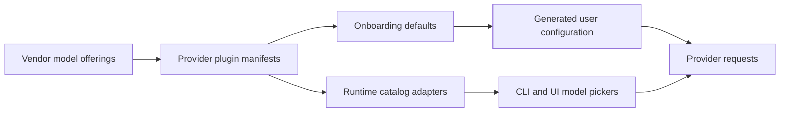

Codex review: needs real behavior proof before merge. _Reviewed July 25, 2026, 9:37 AM ET / 13:37 UTC._

# ClawSweeper review

## What this changes

This PR refreshes static model catalogs, metadata, picker lifecycle states, onboarding defaults, runtime catalog copies, tests, and provider documentation across bundled provider extensions.

## Merge readiness

⛔ **Blocked until real behavior proof from a real setup is added - 6 items remain**

Keep this PR open for maintainer review: it extends the already-merged picker-curation policy to a very broad, compatibility-sensitive catalog and onboarding surface, and the supplied evidence does not include inspectable after-fix runtime output. Likely related people: steipete is the strongest routing candidate (high confidence) from the merged catalog-visibility work and this follow-up.

**Priority:** P2
**Reviewed head:** `c38e894e7be10d033f75110555bd52dcbb9c55ac`
**Owner decision:** Required. See [Decision needed](#decision-needed).

## Review scores

| Measure | Result | What it means |
|---|---|---|
| **Overall readiness** | 🦪 silver shellfish **(2/6)** | The patch has substantial internal test coverage and a coherent policy basis, but its large external-metadata and setup surface lacks inspectable real behavior proof. |
| **Proof confidence** | 🦪 silver shellfish **(2/6)** | Needs real behavior proof before merge: The PR describes tests and CI but the supplied context contains no inspectable after-fix runtime transcript, terminal capture, log, recording, or linked artifact showing setup/catalog behavior; add redacted real-run proof before merge. After adding proof, update the PR body; ClawSweeper should re-review automatically. If it does not, the PR author or someone with repository write access can comment `@clawsweeper re-review`. |
| **Patch quality** | 🦐 gold shrimp **(3/6)** | No actionable review findings were identified. |

## Verification

| Check | Result | Evidence |
|---|---|---|
| **Real behavior** | Needs proof | Needs real behavior proof before merge: The PR describes tests and CI but the supplied context contains no inspectable after-fix runtime transcript, terminal capture, log, recording, or linked artifact showing setup/catalog behavior; add redacted real-run proof before merge. After adding proof, update the PR body; ClawSweeper should re-review automatically. If it does not, the PR author or someone with repository write access can comment `@clawsweeper re-review`. |
| **Evidence reviewed** | 5 items | Merged policy foundation: The related merged PR introduced the shared picker-visibility contract, including preservation of configured and uncataloged exact refs; this PR is a follow-up that applies that policy to remaining provider catalogs. Compatibility-sensitive defaults: The branch changes provider setup defaults and runtime fallback catalog representations, including Chutes, Novita, GitHub Copilot, and Ollama Cloud. These affect fresh setup and need focused upgrade-path confirmation even if existing stored configuration is not rewritten. Ollama identifier transition: The branch changes bundled Ollama Cloud IDs from the local-routing ':cloud' form to direct hosted IDs and adds compatibility handling. That is the highest-risk catalog transition because existing configuration and discovery output may use both forms. |
| **Findings** | None | None. |
| **Security** | None | None. |

## How this fits together

Provider plugins supply static fallback catalogs and setup defaults to the shared model-selection path. Those rows feed CLI/UI pickers and onboarding-generated configuration, while exact configured model references must remain usable even when a row is hidden or removed from a curated picker.

## Decision needed

| Question | Recommendation |
|---|---|
| Should maintainers accept this fleet-wide provider-catalog refresh after targeted live verification of changed onboarding defaults and the Ollama Cloud ID transition, or split the runtime/default changes from the metadata-only catalog updates? | **Verify representative live paths, then merge:** Confirm a fresh setup, an existing configured deprecated ref, and the Ollama direct-ID plus ':cloud' alias path against live provider behavior before accepting the catalog sweep. |

Why: The PR has a protected `maintainer` label and changes provider-controlled facts plus setup defaults across many extensions; repository tests establish internal consistency but cannot settle the external catalog and upgrade contract alone.

## Before merge

- [ ] **Add real behavior proof** - Needs real behavior proof before merge: The PR describes tests and CI but the supplied context contains no inspectable after-fix runtime transcript, terminal capture, log, recording, or linked artifact showing setup/catalog behavior; add redacted real-run proof before merge. After adding proof, update the PR body; ClawSweeper should re-review automatically. If it does not, the PR author or someone with repository write access can comment `@clawsweeper re-review`.
- [ ] **Resolve merge risk (P1)** - Fresh onboarding and generated configuration now select different defaults for several providers; those choices need focused proof that the new refs resolve for the intended provider/account surface.
- [ ] **Resolve merge risk (P1)** - Ollama Cloud changes the seeded catalog from ':cloud' routing aliases to direct hosted IDs. The stated dual-form handling needs live setup and request-path confirmation so existing configurations do not become unresolvable.
- [ ] **Resolve merge risk (P1)** - The PR updates vendor-controlled availability, limits, pricing, and capability metadata across many independent providers; green repository checks cannot independently establish that every external claim remains correct at merge time.
- [ ] **Complete next step (P2)** - The protected `maintainer` label and externally controlled catalog/default assertions require owner review and real behavior proof rather than an automated repair attempt.

<strong>Agent review details</strong>

### Security

None.

### Review metrics

| Metric | Value | Why it matters |
|---|---|---|
| **Catalog and setup scope** | 39 catalogs across 33 extensions | The PR combines many externally controlled catalog assertions with several setup/default changes, so representative live checks matter more than a single provider-unit result. |

### Stored data model

Persistent data-model change detected: `persistent cache schema: docs/providers/featherless.md`, `persistent cache schema: docs/providers/xiaomi.md`, `unknown-truncated-pull-files`, `vector/embedding metadata: extensions/zai/model-definitions.test.ts`. Confirm migration or upgrade compatibility proof before merge.

### Merge-risk options

**Maintainer options:**
1. **Add representative runtime proof before merge (recommended)**  
   Provide redacted after-fix terminal output from fresh provider setup and from existing exact references, including the Ollama direct-ID and ':cloud' compatibility cases.
2. **Accept the catalog refresh with explicit ownership**  
   A maintainer may accept the remaining vendor-metadata risk after independently sampling the changed defaults and confirming the upgrade contract.
3. **Split the upgrade-sensitive changes**  
   Pause the combined branch and submit the onboarding/default and identifier-normalization changes separately from the catalog-only curation if they cannot be verified together.

### Technical review

Best possible solution:

Retain the shared current-generation picker policy, but land this expansion only after targeted live checks confirm changed onboarding defaults, deprecated configured refs, and the Ollama direct-ID/':cloud' compatibility path for representative providers.

Do we have a high-confidence way to reproduce the issue?

Not applicable as a bug report. The changed behavior is nevertheless directly checkable through fresh provider onboarding, `openclaw models list`, and an existing configured deprecated model reference; no inspectable after-fix run was included here.

Is this the best way to solve the issue?

Unclear. Applying the merged picker-lifecycle policy at the provider-plugin boundary is the right architectural direction, but the combined catalog/default sweep still needs representative live verification before it can be called the best safe implementation.

AGENTS.md: found and applied where relevant.

Codex review notes: model internal, reasoning high; reviewed against [4c7e14f8afde](https://github.com/openclaw/openclaw/commit/4c7e14f8afde7f7615ad784ad13f450abeba062a).

### Labels

Label changes:

- add `P2`: This is a broad but non-emergency provider-catalog and setup maintenance change with bounded compatibility risk.
- add `merge-risk: 🚨 compatibility`: The branch changes static catalog rows and onboarding defaults, including an Ollama Cloud identifier transition that can affect existing configuration and fresh setup behavior.
- add `rating: 🦪 silver shellfish`: Overall readiness is 🦪 silver shellfish; proof is 🦪 silver shellfish and patch quality is 🦐 gold shrimp.
- add `status: 📣 needs proof`: The PR needs real behavior proof before ClawSweeper can clear the contributor ask. Needs real behavior proof before merge: The PR describes tests and CI but the supplied context contains no inspectable after-fix runtime transcript, terminal capture, log, recording, or linked artifact showing setup/catalog behavior; add redacted real-run proof before merge. After adding proof, update the PR body; ClawSweeper should re-review automatically. If it does not, the PR author or someone with repository write access can comment `@clawsweeper re-review`.

Label justifications:

- `P2`: This is a broad but non-emergency provider-catalog and setup maintenance change with bounded compatibility risk.
- `merge-risk: 🚨 compatibility`: The branch changes static catalog rows and onboarding defaults, including an Ollama Cloud identifier transition that can affect existing configuration and fresh setup behavior.
- `rating: 🦪 silver shellfish`: Overall readiness is 🦪 silver shellfish; proof is 🦪 silver shellfish and patch quality is 🦐 gold shrimp.
- `status: 📣 needs proof`: The PR needs real behavior proof before ClawSweeper can clear the contributor ask. Needs real behavior proof before merge: The PR describes tests and CI but the supplied context contains no inspectable after-fix runtime transcript, terminal capture, log, recording, or linked artifact showing setup/catalog behavior; add redacted real-run proof before merge. After adding proof, update the PR body; ClawSweeper should re-review automatically. If it does not, the PR author or someone with repository write access can comment `@clawsweeper re-review`.

### Evidence

What I checked:

- **Merged policy foundation:** The related merged PR introduced the shared picker-visibility contract, including preservation of configured and uncataloged exact refs; this PR is a follow-up that applies that policy to remaining provider catalogs. ([`src/agents/model-catalog-visibility.ts:1`](https://github.com/openclaw/openclaw/blob/91b5b43d788f/src/agents/model-catalog-visibility.ts#L1), [91b5b43d788f](https://github.com/openclaw/openclaw/commit/91b5b43d788f))
- **Compatibility-sensitive defaults:** The branch changes provider setup defaults and runtime fallback catalog representations, including Chutes, Novita, GitHub Copilot, and Ollama Cloud. These affect fresh setup and need focused upgrade-path confirmation even if existing stored configuration is not rewritten. ([`extensions/ollama/src/setup.ts:43`](https://github.com/openclaw/openclaw/blob/c38e894e7be1/extensions/ollama/src/setup.ts#L43), [c38e894e7be1](https://github.com/openclaw/openclaw/commit/c38e894e7be1))
- **Ollama identifier transition:** The branch changes bundled Ollama Cloud IDs from the local-routing ':cloud' form to direct hosted IDs and adds compatibility handling. That is the highest-risk catalog transition because existing configuration and discovery output may use both forms. ([`extensions/ollama/src/provider-models.ts:291`](https://github.com/openclaw/openclaw/blob/c38e894e7be1/extensions/ollama/src/provider-models.ts#L291), [c38e894e7be1](https://github.com/openclaw/openclaw/commit/c38e894e7be1))
- **Existing current-main baseline:** Current main's Ollama setup currently builds model configuration directly from the ':cloud' static defaults, so the branch is changing an established setup representation rather than only documentation. ([`extensions/ollama/src/setup.ts:2892`](https://github.com/openclaw/openclaw/blob/4c7e14f8afde/extensions/ollama/src/setup.ts#L2892), [4c7e14f8afde](https://github.com/openclaw/openclaw/commit/4c7e14f8afde))
- **PR validation is supplemental:** The PR body reports extension and catalog tests, and CI has many successful checks, but no terminal capture, runtime log, recording, or linked artifact was available in the supplied review context to demonstrate the changed setup/catalog behavior after the fix. ([c38e894e7be1](https://github.com/openclaw/openclaw/commit/c38e894e7be1))

Likely related people:

- **steipete:** Authored the merged picker-curation foundation and the current cross-provider follow-up, giving the strongest demonstrated history on this catalog lifecycle policy. (role: feature owner; confidence: high; commits: [91b5b43d788f](https://github.com/openclaw/openclaw/commit/91b5b43d788ff3880f74bcd73f37eca2ff83d3fc), [c38e894e7be1](https://github.com/openclaw/openclaw/commit/c38e894e7be10d033f75110555bd52dcbb9c55ac); files: `src/agents/model-catalog-visibility.ts`, `extensions/ollama/src/setup.ts`, `extensions/ollama/src/provider-models.ts`)

### Rank-up moves

Optional improvements that raise the rating; they are not merge blockers.

- Post redacted terminal evidence for a fresh changed-provider setup and the resulting `openclaw models list` output.
- Show that a previously configured hidden/deprecated exact ref still resolves, with special coverage for Ollama ':cloud' and direct hosted IDs.
- Have an owner independently sample vendor documentation or live APIs for the changed default rows before merge.

### Rating scale

| Score | Internal tier | Crab rank | Meaning |
|---:|:---:|---|---|
| **6/6** | S | 🦀 challenger crab | Exceptional readiness |
| **5/6** | A | 🦞 diamond lobster | Very strong readiness |
| **4/6** | B | 🐚 platinum hermit | Good normal PR; ordinary maintainer review |
| **3/6** | C | 🦐 gold shrimp | Useful, but confidence is limited |
| **2/6** | D | 🦪 silver shellfish | Proof or implementation needs work |
| **1/6** | F | 🧂 unranked krab | Not merge-ready |
| N/A | NA | 🌊 off-meta tidepool | Rating does not apply |

Overall follows the weaker of proof and patch quality.
Shiny media proof means a screenshot, video, or linked artifact directly shows the changed behavior. Runtime, network, CSP, and security claims still need visible diagnostics.

### Workflow

- ClawSweeper keeps one durable marker-backed review comment per issue or PR.
- Re-runs edit this comment so the latest verdict, findings, and automation markers stay together instead of adding duplicate bot comments.
- A fresh review can be triggered by eligible `@clawsweeper re-review` comments, exact-item GitHub events, scheduled/background review runs, or manual workflow dispatch.
- PR/issue authors and users with repository write access can comment `@clawsweeper re-review` or `@clawsweeper re-run` on an open PR or issue to request a fresh review only.
- Maintainers can also comment `@clawsweeper review` to request a fresh review only.
- Fresh-review commands do not start repair, autofix, rebase, CI repair, or automerge.
- Maintainer-only repair and merge flows require explicit commands such as `@clawsweeper autofix`, `@clawsweeper automerge`, `@clawsweeper fix ci`, or `@clawsweeper address review`.
- Maintainers can comment `@clawsweeper explain` to ask for more context, or `@clawsweeper stop` to stop active automation.

<!-- clawsweeper-verdict:needs-human item=113681 sha=c38e894e7be10d033f75110555bd52dcbb9c55ac confidence=medium updated_at=2026-07-25T13:36:02Z reviewed_at=2026-07-25T13:37:28.228Z lease_owner=github-run-30159984594-1 lease_comment_id=5078683610 source_revision=f3a1c1e7eac2a40eafa94a82708a02997393eab7dff7c93215f5d665ef5624ab -->

<!-- clawsweeper-review-version item=113681 reviewed_at=2026-07-25T13:37:28.228Z sha=c38e894e7be10d033f75110555bd52dcbb9c55ac source_revision=f3a1c1e7eac2a40eafa94a82708a02997393eab7dff7c93215f5d665ef5624ab lease_owner=github-run-30159984594-1 lease_comment_id=5078683610 v=1 -->

<!-- clawsweeper-review item=113681 -->