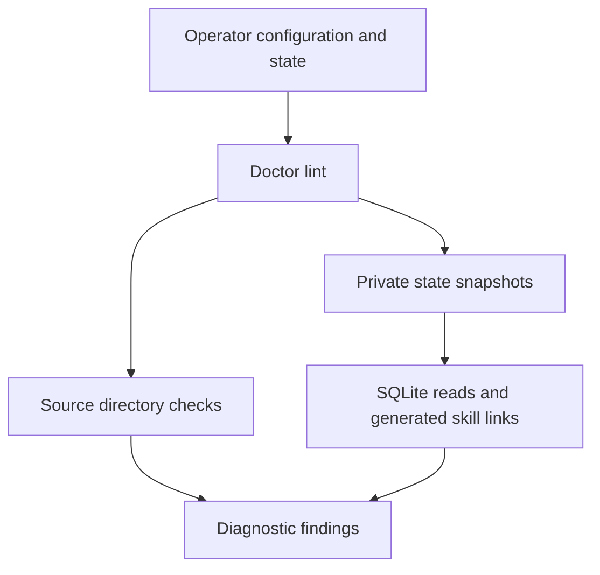

Codex review: blocked before merge. _Reviewed September 9, 2026, 3:15 AM ET / 07:15 UTC (Revision 4)._

# ClawSweeper review

## What this changes

Doctor lint checks the operator’s source directories while keeping generated skill links and SQLite reader artifacts in private snapshots.

## Merge readiness

⛔ **Blocked before merge - 1 item remains**

This PR remains useful: current main still has the source-directory diagnostic defect. The previous personal-skill finding is resolved, and no blocking introduced defect remains in the reviewed diff.

**Priority:** P2
**Reviewed head:** `e7f1b80a2fea94e1189d4a7afc2e83753b16b94c`

## Review scores

| Measure | Result | What it means |
|---|---|---|
| **Overall readiness** | 🐚 platinum hermit **(4/6)** | A coherent repair with relevant real-CLI evidence and the previous blocking finding resolved. |
| **Proof confidence** | 🦞 diamond lobster **(5/6)** | Sufficient (live_output): The matching captured PR body records isolated Linux runs of the built Doctor CLI showing corrected source-directory findings, preserved source artifacts, and default/separate-profile skill controls after the fix; full output retains all 62 checks. |
| **Patch quality** | 🐚 platinum hermit **(4/6)** | No actionable review findings were identified. |

## Verification

| Check | Result | Evidence |
|---|---|---|
| **Real behavior** | Verified | Sufficient (live_output): The matching captured PR body records isolated Linux runs of the built Doctor CLI showing corrected source-directory findings, preserved source artifacts, and default/separate-profile skill controls after the fix; full output retains all 62 checks. |
| **Evidence reviewed** | 8 items | Current main still needs the repair: The state-integrity contribution still passes process.env while full lint redirects ambient state to its private snapshot. The PR instead passes the prepared source environment. Latest release retains the original behavior: The v2026.9.3 source also uses process.env for state-integrity detection and repair previews; this is not an already-shipped repair. Previous finding resolved: The comparison with the previous reviewed head confirms that skill readiness now nests source-profile discovery inside private install roots. Added default/separate-profile cases protect warning visibility and exclusion respectively. |
| **Findings** | None | None. |
| **Security** | None | None. |

## How this fits together

Doctor turns configuration, installed skills, and local state into diagnostic findings. Its read-only mode must inspect the operator’s setup without changing that setup.

## Before merge

- [ ] **Add data-model compatibility proof** - Confirm migration or upgrade compatibility proof before merge.

<strong>Agent review details</strong>

### Security

None.

### PR surface

Source +45, Tests +290. Total +335 across 12 files.

View PR surface stats

| Area | Files | Added | Removed | Net |
|---|---:|---:|---:|---:|
| Source | 8 | 76 | 31 | +45 |
| Tests | 4 | 291 | 1 | +290 |
| Docs | 0 | 0 | 0 | 0 |
| Config | 0 | 0 | 0 | 0 |
| Generated | 0 | 0 | 0 | 0 |
| Other | 0 | 0 | 0 | 0 |
| **Total** | **12** | **367** | **32** | **+335** |

### Review metrics

| Metric | Value | Why it matters |
|---|---|---|
| **Production versus regression coverage** | Production net +45 lines; tests net +290 lines | Production growth supports private read isolation and cache scoping; regression coverage exercises source paths, profile eligibility, and artifact preservation. |

### Stored data model

Persistent data-model change detected: `migration/backfill/repair: src/commands/doctor-lint.ts`, `migration/backfill/repair: src/flows/doctor-health-contributions-initial.ts`, `serialized state: src/cron/store.ts`, `unknown-data-model-change: src/commands/doctor-lint.ts`, `unknown-data-model-change: src/cron/store.ts`. Confirm migration or upgrade compatibility proof before merge.

### Technical review

Best possible solution:

Keep source-profile diagnostics accurate while confining inspection artifacts to the existing private snapshot lifecycle.

Do we have a high-confidence way to reproduce the issue?

Yes: current-main source shows full lint redirecting ambient state while state-integrity checks consume that ambient environment; the recorded built-CLI baseline demonstrates the false OAuth finding. This review did not execute repository code.

Is this the best way to solve the issue?

Yes: the patch corrects environment ownership and reuses existing snapshot machinery while preserving profile eligibility, repair ownership, and ordinary runtime defaults.

AGENTS.md: found and applied where relevant.

Codex review notes: model internal, reasoning medium; reviewed against [b795af8a992e](https://github.com/openclaw/openclaw/commit/b795af8a992e75dafb0feb431a7097363428d1eb).

### Labels

Label changes:

- add `rating: 🐚 platinum hermit`: Overall readiness is 🐚 platinum hermit; proof is 🦞 diamond lobster and patch quality is 🐚 platinum hermit.
- add `status: 👀 ready for maintainer look`: ClawSweeper has no concrete contributor-facing blocker left for this PR. Sufficient (live_output): The matching captured PR body records isolated Linux runs of the built Doctor CLI showing corrected source-directory findings, preserved source artifacts, and default/separate-profile skill controls after the fix; full output retains all 62 checks.
- remove `rating: 🦐 gold shrimp`: Current PR rating is `rating: 🐚 platinum hermit`, so this older rating label is no longer current.
- remove `status: ⏳ waiting on author`: Current PR status label is `status: 👀 ready for maintainer look`.

Label justifications:

- `P2`: Repairs misleading Doctor diagnostics and inspection side effects within a bounded maintenance workflow.
- `rating: 🐚 platinum hermit`: Overall readiness is 🐚 platinum hermit; proof is 🦞 diamond lobster and patch quality is 🐚 platinum hermit.
- `status: 👀 ready for maintainer look`: ClawSweeper has no concrete contributor-facing blocker left for this PR. Sufficient (live_output): The matching captured PR body records isolated Linux runs of the built Doctor CLI showing corrected source-directory findings, preserved source artifacts, and default/separate-profile skill controls after the fix; full output retains all 62 checks.
- `proof: sufficient`: Contributor real behavior proof is sufficient. The matching captured PR body records isolated Linux runs of the built Doctor CLI showing corrected source-directory findings, preserved source artifacts, and default/separate-profile skill controls after the fix; full output retains all 62 checks.

### Evidence

What I checked:

- **Current main still needs the repair:** The state-integrity contribution still passes process.env while full lint redirects ambient state to its private snapshot. The PR instead passes the prepared source environment. ([`src/flows/doctor-health-contributions-initial.ts:334`](https://github.com/openclaw/openclaw/blob/b795af8a992e75dafb0feb431a7097363428d1eb/src/flows/doctor-health-contributions-initial.ts#L334), [b795af8a992e](https://github.com/openclaw/openclaw/commit/b795af8a992e75dafb0feb431a7097363428d1eb))
- **Latest release retains the original behavior:** The v2026.9.3 source also uses process.env for state-integrity detection and repair previews; this is not an already-shipped repair. ([`src/flows/doctor-health-contributions-initial.ts`](https://github.com/openclaw/openclaw/blob/1391f7cd2d40ab5bbcf2f5f831d3a64f520e72d7/src/flows/doctor-health-contributions-initial.ts), [1391f7cd2d40](https://github.com/openclaw/openclaw/commit/1391f7cd2d40ab5bbcf2f5f831d3a64f520e72d7))
- **Previous finding resolved:** The comparison with the previous reviewed head confirms that skill readiness now nests source-profile discovery inside private install roots. Added default/separate-profile cases protect warning visibility and exclusion respectively. ([`src/commands/doctor-lint.ts:436`](https://github.com/openclaw/openclaw/blob/e7f1b80a2fea94e1189d4a7afc2e83753b16b94c/src/commands/doctor-lint.ts#L436), [e7f1b80a2fea](https://github.com/openclaw/openclaw/commit/e7f1b80a2fea94e1189d4a7afc2e83753b16b94c))
- **Recorded real CLI proof:** The fetched body matches captured SHA-256 9086d3d43f84e4a2e69642564d2461265cb00f82b317c400cb9c566535b80566. Its isolated Linux built-CLI evidence records 62 checks with zero skipped before and after, removal of the false private-path OAuth finding, source-path missing-directory controls, preserved SQLite/WAL/SHM bytes, and updated targeted/full personal-skill output. JSON blocks were parsed for relevant findings; these are recorded contributor-side observations, not reviewer-executed tests. ([e7f1b80a2fea](https://github.com/openclaw/openclaw/commit/e7f1b80a2fea94e1189d4a7afc2e83753b16b94c))
- **Existing isolation mechanism reused:** The introduced production hunks reuse artifact-preserving SQLite snapshots, retain ordinary cron read behavior outside that scope, and include the resolved generated-link directory in both publication and discovery caches. No schema, stored-row format, dependency, public plugin API, or authorization policy changes are introduced. ([`src/cron/store.ts:250`](https://github.com/openclaw/openclaw/blob/e7f1b80a2fea94e1189d4a7afc2e83753b16b94c/src/cron/store.ts#L250), [e7f1b80a2fea](https://github.com/openclaw/openclaw/commit/e7f1b80a2fea94e1189d4a7afc2e83753b16b94c))
- **Related merged work is narrower:** https://github.com/openclaw/openclaw/pull/137610 merged the source-scoped auth-store inspection flow. Its scope does not cover this PR’s directory diagnostics, generated skill links, or nested reader artifact preservation. ([`src/commands/doctor-lint.ts:228`](https://github.com/openclaw/openclaw/blob/e5a7ecc3421ae2410eacd826704afeaf4ad3fc85/src/commands/doctor-lint.ts#L228), [e5a7ecc3421a](https://github.com/openclaw/openclaw/commit/e5a7ecc3421ae2410eacd826704afeaf4ad3fc85))

Likely related people:

- **unknown:** The claimed source-line change could not be verified from bounded local history. (role: source history unknown; confidence: low)

### Rating scale

| Score | Internal tier | Crab rank | Meaning |
|---:|:---:|---|---|
| **6/6** | S | 🦀 challenger crab | Exceptional readiness |
| **5/6** | A | 🦞 diamond lobster | Very strong readiness |
| **4/6** | B | 🐚 platinum hermit | Good normal PR; ordinary maintainer review |
| **3/6** | C | 🦐 gold shrimp | Useful, but confidence is limited |
| **2/6** | D | 🦪 silver shellfish | Proof or implementation needs work |
| **1/6** | F | 🧂 unranked krab | Not merge-ready |
| N/A | NA | 🌊 off-meta tidepool | Rating does not apply |

Overall follows the weaker of proof and patch quality.
Shiny media proof means a screenshot, video, or linked artifact directly shows the changed behavior. Runtime, network, CSP, and security claims still need visible diagnostics.

### Workflow

- ClawSweeper keeps one durable marker-backed review comment per issue or PR.
- Re-runs edit this comment so the latest verdict, findings, and automation markers stay together instead of adding duplicate bot comments.
- A fresh review can be triggered by eligible `@clawsweeper re-review` comments, exact-item GitHub events, scheduled/background review runs, or manual workflow dispatch.
- PR/issue authors and users with repository write access can comment `@clawsweeper re-review` or `@clawsweeper re-run` on an open PR or issue to request a fresh review only.
- Maintainers can also comment `@clawsweeper review` to request a fresh review only.
- Fresh-review commands do not start repair, autofix, rebase, CI repair, or automerge.
- Maintainer-only repair and merge flows require explicit commands such as `@clawsweeper autofix`, `@clawsweeper automerge`, `@clawsweeper fix ci`, or `@clawsweeper address review`.
- Maintainers can comment `@clawsweeper explain` to ask for more context, or `@clawsweeper stop` to stop active automation.

### History

Review history (3 earlier review cycles)

<!-- clawsweeper-review-history v=1 total=3 -->
- reviewed 2026-09-09T05:02:24.651Z sha 44def7bc4c958d64ec3f8ac9073df2efae924cea :: needs real behavior proof before merge. :: none
- reviewed 2026-09-09T05:08:12.927Z sha 44def7bc4c958d64ec3f8ac9073df2efae924cea :: needs real behavior proof before merge. :: none
- reviewed 2026-09-09T06:44:34.712Z sha 28f63093b6aeca0575b37be2479a80a461721a21 :: blocked before merge. :: [P2] Preserve source-profile eligibility during skill readiness checks

<!-- clawsweeper-verdict:needs-human item=142839 sha=e7f1b80a2fea94e1189d4a7afc2e83753b16b94c confidence=high updated_at=2026-09-09T07:12:27Z reviewed_at=2026-09-09T07:15:04.963Z lease_owner=github-run-34322570756-1 lease_comment_id=5597758504 source_revision=c871647a6d6471b30462edd51e58e6c7f4d66ae0216ed313832c54e21344e9b7 live_verification=absent -->
<!-- clawsweeper-review-state:blocked item=142839 sha=e7f1b80a2fea94e1189d4a7afc2e83753b16b94c v=1 -->

<!-- clawsweeper-review-version item=142839 reviewed_at=2026-09-09T07:15:04.963Z sha=e7f1b80a2fea94e1189d4a7afc2e83753b16b94c source_revision=c871647a6d6471b30462edd51e58e6c7f4d66ae0216ed313832c54e21344e9b7 lease_owner=github-run-34322570756-1 lease_comment_id=5597758504 v=1 -->

<!-- clawsweeper-review item=142839 -->