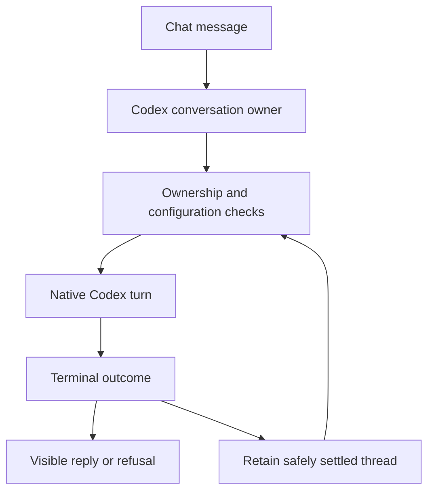

Codex review: needs maintainer review before merge. _Reviewed September 5, 2026, 1:58 PM ET / 17:58 UTC._

# ClawSweeper review

## What this changes

Preserves failed Codex conversations for guarded later messages and classifies misalignment refusals through the existing terminal-error path, with regression coverage and documentation.

## Merge readiness

✅ **Ready for maintainer review**

This repair remains necessary on current main. The revised head resolves the previous settlement-integration concern, and no blocking patch defect was found.

**Priority:** P1
**Reviewed head:** `dda04893deb433098864bc65a6fdf5208c0f4f3e`

## Review scores

| Measure | Result | What it means |
|---|---|---|
| **Overall readiness** | 🐚 platinum hermit **(4/6)** | A focused owner-level repair with credible native integration evidence, useful regression coverage, and no blocking findings. |
| **Proof confidence** | 🐚 platinum hermit **(4/6)** | Sufficient (logs): Captured exact-head evidence reports real Gateway/native Codex recovery after injected HTTP401 failures, same-thread authenticated resume, and rejected cross-conversation takeover; protocol fixtures separately cover refusal delivery without retry or fallback. |
| **Patch quality** | 🐚 platinum hermit **(4/6)** | No actionable review findings were identified. |

## Verification

| Check | Result | Evidence |
|---|---|---|
| **Real behavior** | Verified | Sufficient (logs): Captured exact-head evidence reports real Gateway/native Codex recovery after injected HTTP401 failures, same-thread authenticated resume, and rejected cross-conversation takeover; protocol fixtures separately cover refusal delivery without retry or fallback. |
| **Evidence reviewed** | 13 items | Current main still contains the defect: Fetched main retains the idle/notLoaded-only adoption checks. Its cleanup still retains ordinary threads only after success, and its refusal classifier lacks misalignmentPolicyViolation. Settled failure excludes interrupted outcomes: Finalization records failed settlement only after native failure completion and excludes cancellation, timeout, client closure, and execution disconnect. Existing retention owner is reused: Cleanup retains the existing configuration receipt under the binding lease and physical-client identity check. Incognito failure, one-shot cleanup, supervision, native-model preservation, and ring-zero exclusions remain. |
| **Findings** | None | None. |
| **Security** | None | None. |

## How this fits together

The Codex plugin connects OpenClaw chat turns to native Codex conversations. Its lifecycle owner retains reusable threads, validates later requests, and returns terminal outcomes for chat delivery.

## Before merge

None.

<strong>Agent review details</strong>

### Security

None.

### PR surface

Source +21, Tests +118, Docs +13. Total +152 across 11 files.

View PR surface stats

| Area | Files | Added | Removed | Net |
|---|---:|---:|---:|---:|
| Source | 5 | 38 | 17 | +21 |
| Tests | 5 | 308 | 190 | +118 |
| Docs | 1 | 13 | 0 | +13 |
| Config | 0 | 0 | 0 | 0 |
| Generated | 0 | 0 | 0 | 0 |
| Other | 0 | 0 | 0 | 0 |
| **Total** | **11** | **359** | **207** | **+152** |

### Review metrics

| Metric | Value | Why it matters |
|---|---|---|
| **Production versus regression coverage** | Production +21 lines; tests/support +118; docs +13 | Production growth extends existing settlement and refusal contracts without adding a configuration option, public error API, or parallel lifecycle. |

### Root-cause cluster

Relationship: `fixed_by_candidate`
Canonical: https://github.com/openclaw/openclaw/issues/138835
Summary: This PR is the replacement implementation candidate for the open failed-conversation report.

Members:
- `canonical`: https://github.com/openclaw/openclaw/issues/138835 - Documents the completed-failure status and refusal-classification defects addressed here.
- `same_root_cause`: https://github.com/openclaw/openclaw/pull/138846 - Original open repair proposal explicitly credited and replaced by this PR.

Proposal only: this assessment does not dispatch repair, suppress jobs, mutate sibling items, close, or merge anything.

### Technical review

Best possible solution:

Retain settled failures through the existing subscription owner while preserving configuration attestation and terminal refusals; distinguishing safe failure from success and interrupted teardown justifies the small state expansion.

Do we have a high-confidence way to reproduce the issue?

Yes—the native HTTP401 → completed failure → later message sequence is supported by current-main source and supplied before/after results; this review did not execute it.

Is this the best way to solve the issue?

Yes. Repairing retention at its lifecycle owner avoids unnecessary reconfiguration, while extending the existing refusal diagnostic avoids a competing core error contract.

AGENTS.md: found and applied where relevant.

Codex review notes: model internal, reasoning high; reviewed against [3e4becea5e2c](https://github.com/openclaw/openclaw/commit/3e4becea5e2ce38ede69e8ecf5302805ecbfc09c).

### Labels

Label justifications:

- `P1`: The linked report establishes blocked Codex conversations after completed failures and lost terminal-refusal classification.
- `rating: 🐚 platinum hermit`: Overall readiness is 🐚 platinum hermit; proof is 🐚 platinum hermit and patch quality is 🐚 platinum hermit.
- `status: 👀 ready for maintainer look`: ClawSweeper has no concrete contributor-facing blocker left for this PR. Sufficient (logs): Captured exact-head evidence reports real Gateway/native Codex recovery after injected HTTP401 failures, same-thread authenticated resume, and rejected cross-conversation takeover; protocol fixtures separately cover refusal delivery without retry or fallback.
- `proof: sufficient`: Contributor real behavior proof is sufficient. Captured exact-head evidence reports real Gateway/native Codex recovery after injected HTTP401 failures, same-thread authenticated resume, and rejected cross-conversation takeover; protocol fixtures separately cover refusal delivery without retry or fallback.

### Evidence

What I checked:

- **Current main still contains the defect:** Fetched main retains the idle/notLoaded-only adoption checks. Its cleanup still retains ordinary threads only after success, and its refusal classifier lacks misalignmentPolicyViolation. ([`extensions/codex/src/app-server/thread-lifecycle-adoption.ts:306`](https://github.com/openclaw/openclaw/blob/3e4becea5e2ce38ede69e8ecf5302805ecbfc09c/extensions/codex/src/app-server/thread-lifecycle-adoption.ts#L306), [3e4becea5e2c](https://github.com/openclaw/openclaw/commit/3e4becea5e2ce38ede69e8ecf5302805ecbfc09c))
- **Settled failure excludes interrupted outcomes:** Finalization records failed settlement only after native failure completion and excludes cancellation, timeout, client closure, and execution disconnect. ([`extensions/codex/src/app-server/run-attempt-finalize.ts:408`](https://github.com/openclaw/openclaw/blob/dda04893deb433098864bc65a6fdf5208c0f4f3e/extensions/codex/src/app-server/run-attempt-finalize.ts#L408), [dda04893deb4](https://github.com/openclaw/openclaw/commit/dda04893deb433098864bc65a6fdf5208c0f4f3e))
- **Existing retention owner is reused:** Cleanup retains the existing configuration receipt under the binding lease and physical-client identity check. Incognito failure, one-shot cleanup, supervision, native-model preservation, and ring-zero exclusions remain. ([`extensions/codex/src/app-server/run-attempt-cleanup.ts:98`](https://github.com/openclaw/openclaw/blob/dda04893deb433098864bc65a6fdf5208c0f4f3e/extensions/codex/src/app-server/run-attempt-cleanup.ts#L98), [dda04893deb4](https://github.com/openclaw/openclaw/commit/dda04893deb433098864bc65a6fdf5208c0f4f3e))
- **Direct native contract inspection:** The patch explicitly interprets native thread status, and its proof depends on Codex 0.153.4. Personally inspected the sibling checkout at this SHA; its cache origin resolves to https://github.com/openai/codex.git. Native system-error handling clears running state while retaining the error flag. ([`codex-rs/app-server/src/thread_status.rs:174`](https://github.com/openai/codex/blob/3d2ee51ca2d5db578f328aa75e20aa22c0197c9a/codex-rs/app-server/src/thread_status.rs#L174), [3d2ee51ca2d5](https://github.com/openai/codex/commit/3d2ee51ca2d5db578f328aa75e20aa22c0197c9a))
- **Configuration replacement requires observed teardown:** Native loaded-thread override replacement requires idle status, no subscribers, direct-input eligibility, and successful shutdown. Otherwise resume can acknowledge the thread while ignoring overrides; systemError alone is insufficient. ([`codex-rs/app-server/src/request_processors/thread_processor.rs:4183`](https://github.com/openai/codex/blob/3d2ee51ca2d5db578f328aa75e20aa22c0197c9a/codex-rs/app-server/src/request_processors/thread_processor.rs#L4183), [3d2ee51ca2d5](https://github.com/openai/codex/commit/3d2ee51ca2d5db578f328aa75e20aa22c0197c9a))
- **Native refusal confirmation remains separate:** The native contract makes the policy category terminal and defines a distinct confirmed-override submission. The patch does not introduce that override metadata or treat later ordinary input as confirmation. ([`codex-rs/app-server/README.md:1914`](https://github.com/openai/codex/blob/3d2ee51ca2d5db578f328aa75e20aa22c0197c9a/codex-rs/app-server/README.md#L1914), [3d2ee51ca2d5](https://github.com/openai/codex/commit/3d2ee51ca2d5db578f328aa75e20aa22c0197c9a))

Likely related people:

- **Peter Steinberger:** Suggested for follow-up; no historical authorship or introduction is verified. (role: unverified routing candidate; confidence: low)
- **lei\_lei:** Suggested for follow-up; no historical authorship or introduction is verified. (role: unverified routing candidate; confidence: low)

### Rating scale

| Score | Internal tier | Crab rank | Meaning |
|---:|:---:|---|---|
| **6/6** | S | 🦀 challenger crab | Exceptional readiness |
| **5/6** | A | 🦞 diamond lobster | Very strong readiness |
| **4/6** | B | 🐚 platinum hermit | Good normal PR; ordinary maintainer review |
| **3/6** | C | 🦐 gold shrimp | Useful, but confidence is limited |
| **2/6** | D | 🦪 silver shellfish | Proof or implementation needs work |
| **1/6** | F | 🧂 unranked krab | Not merge-ready |
| N/A | NA | 🌊 off-meta tidepool | Rating does not apply |

Overall follows the weaker of proof and patch quality.
Shiny media proof means a screenshot, video, or linked artifact directly shows the changed behavior. Runtime, network, CSP, and security claims still need visible diagnostics.

### Workflow

- ClawSweeper keeps one durable marker-backed review comment per issue or PR.
- Re-runs edit this comment so the latest verdict, findings, and automation markers stay together instead of adding duplicate bot comments.
- A fresh review can be triggered by eligible `@clawsweeper re-review` comments, exact-item GitHub events, scheduled/background review runs, or manual workflow dispatch.
- PR/issue authors and users with repository write access can comment `@clawsweeper re-review` or `@clawsweeper re-run` on an open PR or issue to request a fresh review only.
- Maintainers can also comment `@clawsweeper review` to request a fresh review only.
- Fresh-review commands do not start repair, autofix, rebase, CI repair, or automerge.
- Maintainer-only repair and merge flows require explicit commands such as `@clawsweeper autofix`, `@clawsweeper automerge`, `@clawsweeper fix ci`, or `@clawsweeper address review`.
- Maintainers can comment `@clawsweeper explain` to ask for more context, or `@clawsweeper stop` to stop active automation.

### History

Review history (1 earlier review cycle)

<!-- clawsweeper-review-history v=1 total=1 -->
- reviewed 2026-09-05T17:37:56.754Z sha 937c2b7307a7865b13c3132ce50416a51205b8e3 :: blocked before merge. :: none

<!-- clawsweeper-verdict:needs-human item=139246 sha=dda04893deb433098864bc65a6fdf5208c0f4f3e confidence=high updated_at=2026-09-05T17:53:58Z reviewed_at=2026-09-05T17:58:09.929Z lease_owner=github-run-33982307986-1 lease_comment_id=5553690722 source_revision=2c5482d2968d9fadd75b08b9997f8300eb9de9c8ba49b1bf25c08245be3dc79a live_verification=absent -->
<!-- clawsweeper-review-state:ready item=139246 sha=dda04893deb433098864bc65a6fdf5208c0f4f3e v=1 -->

<!-- clawsweeper-review-version item=139246 reviewed_at=2026-09-05T17:58:09.929Z sha=dda04893deb433098864bc65a6fdf5208c0f4f3e source_revision=2c5482d2968d9fadd75b08b9997f8300eb9de9c8ba49b1bf25c08245be3dc79a lease_owner=github-run-33982307986-1 lease_comment_id=5553690722 v=1 -->

<!-- clawsweeper-review item=139246 -->