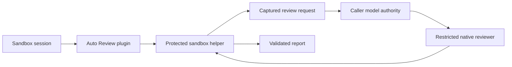

Codex review: needs maintainer review before merge.

## What this changes

Adds an optional Auto Review tool that captures sandbox changes and runs a restricted, caller-authorized reviewer on the host.

**Example:** A sandbox session calls autoreview with {"mode":"local"}.
- **Before:** The plugin cannot bind review execution to the prepared sandbox and original caller authority.
- **After:** The installed helper captures sandbox changes, the host runs the permitted reviewer, and the helper returns a complete validated report.

## Review scores

| Measure | Result | What it means |
|---|---|---|
| **Overall readiness** | 🦞 diamond lobster **(5/6)** | Coherent optional feature with shipped-entry-point evidence, a resolved authority-proof gap, compatible additive contracts, and no open findings. |
| **Proof confidence** | 🦞 diamond lobster **(5/6)** | Sufficient (live_output): Supplied guest execution exercises protected sandbox capture, helper defaults, model denial, concurrent reviews, and Stop cleanup; the real plugin/helper/native-CLI provider control records one allowed request and zero requests after model-policy revocation, resolving the prior rank-up request. |
| **Patch quality** | 🦞 diamond lobster **(5/6)** | No actionable review findings were identified. |

## Product

**Kind:** Feature · **Worth it:** Yes · **Fix scope:** Complete
**User problem:** Sandbox changes need review without substituting host Git state or exposing host credentials and tools.
**Reason:** Maintainer-authored direction delivers a concrete checkpoint through an optional plugin and narrow generic capabilities.

## Merge readiness

✅ **Ready for maintainer review**

This maintainer-authored PR adds a useful sandbox review capability; no actionable introduced defects remain in this review.

**Priority:** P2
**Reviewed head:** `5f6e79d2fb40889cf0ac077a2fde09dc882138c1`

## Before merge

None.

## Findings

None.

<strong>Agent review details</strong>

### How this fits together

The plugin connects the sandbox-owned review helper to host-native inference, carrying caller authority and returning complete reports through existing tool-result delivery.

### Technical review

Best possible solution:

Land the optional plugin with the merged native prerequisites and current canonical helper while retaining existing authority and result-delivery owners.

Do we have a high-confidence way to reproduce the issue?

This is a capability addition; source inspection confirms the missing sandbox-bound execution contract, and supplied guest runs exercise the added flow.

Is this the best way to solve the issue?

The implementation fits the existing plugin, sandbox, model-policy, native CLI, and canonical-helper owners without introducing a competing review engine or persistent job service.

AGENTS.md: found and applied where relevant.

Codex review notes: model internal, reasoning medium; reviewed against [d6687fdf5fde](https://github.com/openclaw/openclaw/commit/d6687fdf5fde222def02b210b1acbf0e38b34944).

### Provenance checked

- `Plugin invocation authority` keeps the original intent (861f60e0bc5c6ef585319db960d5b8ead190c4c7: Keep retained plugin effects bound to current invocation and plugin lifecycle authority.)
- `Prepared native tool context` keeps the original intent (ddcae5101d781c68de156ce5013c0778090bee64: Carry prepared execution facts through asynchronous tool construction while preserving live checks.)
- `Code Mode result projection and scheduling` keeps the original intent (https://github.com/openclaw/openclaw/pull/159359: Preserve nested-tool error messages in projected values; sequential-tool scheduling remains owned by the shared runtime.)
- `Sandbox mount interpretation` keeps the original intent (0ab1513aaedf83db66fab68693de1ee6dffe0a3f: Keep filesystem tools aligned with overlapping mounts and protected resource precedence.)

### Testing

Proof path: shipped entry point.

### Security

None.

### Evidence

What I checked:

- **Introduced execution boundary:** The pinned introduced diff binds helper requests to caller model admission, fixes the host CLI entry, clears reviewer tools and ambient context, and preserves helper-owned report validation. ([`extensions/autoreview/src/tool.ts:336`](https://github.com/openclaw/openclaw/blob/5f6e79d2fb40889cf0ac077a2fde09dc882138c1/extensions/autoreview/src/tool.ts#L336), [5f6e79d2fb40](https://github.com/openclaw/openclaw/commit/5f6e79d2fb40889cf0ac077a2fde09dc882138c1))
- **Updated authority proof resolves prior request:** The current body records an allowed production-path review making one synthetic HTTP provider request and a revoked-model control making zero requests after prompt handoff and native startup, with processes, exchanges, temporary state, and subscriptions settled. ([5f6e79d2fb40](https://github.com/openclaw/openclaw/commit/5f6e79d2fb40889cf0ac077a2fde09dc882138c1))
- **Protected installation and lifecycle ownership:** Capabilities retain the original invocation and plugin lifecycle; protected helper selection rejects workspace shadows, writable aliases, replacing overlays, and backends without enforced read-only resources. ([`src/agents/plugin-tool-execution.ts:48`](https://github.com/openclaw/openclaw/blob/5f6e79d2fb40889cf0ac077a2fde09dc882138c1/src/agents/plugin-tool-execution.ts#L48), [5f6e79d2fb40](https://github.com/openclaw/openclaw/commit/5f6e79d2fb40889cf0ac077a2fde09dc882138c1))
- **Authoritative helper dependency:** The patch executes the installed canonical helper, so its repository policy applies. The merged helper change at https://github.com/openclaw/agent-skills/pull/328 supplies admitted-model handoff, response ownership, terminal-model validation, and effective-model receipts; these responsibilities remain upstream. ([`skills/autoreview/scripts/autoreview:8057`](https://github.com/openclaw/agent-skills/blob/aa6f29ebe64e351b3028b63222e80934c7bb43a8/skills/autoreview/scripts/autoreview#L8057), [aa6f29ebe64e](https://github.com/openclaw/agent-skills/commit/aa6f29ebe64e351b3028b63222e80934c7bb43a8))
- **Native prerequisites landed:** https://github.com/openclaw/openclaw/pull/173636 provides run-only configuration overlays, and https://github.com/openclaw/openclaw/pull/173761 provides cooperative ephemeral-state cleanup; current remote main installs the signal bridge before state allocation. ([`src/commands/agent-exec.ts:209`](https://github.com/openclaw/openclaw/blob/a6632a1b2303ac09e91d7141ceb97642cf56f7f8/src/commands/agent-exec.ts#L209), [a6632a1b2303](https://github.com/openclaw/openclaw/commit/a6632a1b2303ac09e91d7141ceb97642cf56f7f8))
- **Exact-head validation:** The dependency-review, security-sensitive-review, and aggregate CI statuses are successful for the reviewed head; paginated check inspection found no failed checks. ([5f6e79d2fb40](https://github.com/openclaw/openclaw/commit/5f6e79d2fb40889cf0ac077a2fde09dc882138c1))

Likely related people:

- **Shakker:** Raw commit 08f5fb80f301d8236cadb8acc853d95566fd7f10 adds src/agents/sandbox/docker-backend.ts:222 relative to its recorded parents. This identifies author metadata, not feature responsibility or a PR merger. (role: source-line author; confidence: high; commits: [08f5fb80f301](https://github.com/openclaw/openclaw/commit/08f5fb80f301d8236cadb8acc853d95566fd7f10); files: `src/agents/sandbox/docker-backend.ts`)
- **Peter Steinberger:** Raw commit ddcae5101d781c68de156ce5013c0778090bee64 adds src/agents/harness/host-capability.ts:424 relative to its recorded parents. This identifies author metadata, not feature responsibility or a PR merger. (role: source-line author; confidence: high; commits: [ddcae5101d78](https://github.com/openclaw/openclaw/commit/ddcae5101d781c68de156ce5013c0778090bee64); files: `src/agents/harness/host-capability.ts`)
- **Vito Cappello:** Raw commit 861f60e0bc5c6ef585319db960d5b8ead190c4c7 adds src/plugins/tool-factory-context.ts:24 relative to its recorded parents. This identifies author metadata, not feature responsibility or a PR merger. (role: source-line author; confidence: high; commits: [861f60e0bc5c](https://github.com/openclaw/openclaw/commit/861f60e0bc5c6ef585319db960d5b8ead190c4c7); files: `src/plugins/tool-factory-context.ts`)
- **Vincent Koc:** Raw commit 0ab1513aaedf83db66fab68693de1ee6dffe0a3f adds src/agents/sandbox/fs-paths.ts:44 relative to its recorded parents. This identifies author metadata, not feature responsibility or a PR merger. (role: source-line author; confidence: high; commits: [0ab1513aaedf](https://github.com/openclaw/openclaw/commit/0ab1513aaedf83db66fab68693de1ee6dffe0a3f); files: `src/agents/sandbox/fs-paths.ts`)

### PR surface

Source +1002, Tests +829, Docs +127, Config +10, Generated 0, Other +10. Total +1978 across 35 files. Added test files: 2.

View PR surface stats

| Area | Files | Added | Removed | Net |
|---|---:|---:|---:|---:|
| Source | 19 | 1015 | 13 | +1002 |
| Tests | 6 | 831 | 2 | +829 |
| Docs | 6 | 129 | 2 | +127 |
| Config | 1 | 10 | 0 | +10 |
| Generated | 2 | 3 | 3 | 0 |
| Other | 1 | 10 | 0 | +10 |
| **Total** | **35** | **1998** | **20** | **+1978** |

### Labels

Label changes:

- add `proof: sufficient`: Contributor real behavior proof is sufficient.
- add `rating: 🦞 diamond lobster`: Overall readiness is 🦞 diamond lobster; proof is 🦞 diamond lobster and patch quality is 🦞 diamond lobster.
- add `status: 👀 ready for maintainer look`: ClawSweeper has no concrete contributor-facing blocker left for this PR.
- remove `rating: 🦪 silver shellfish`: Current PR rating is `rating: 🦞 diamond lobster`, so this older rating label is no longer current.
- remove `status: 📣 needs proof`: Current PR status label is `status: 👀 ready for maintainer look`.

Label justifications:

- `P2`: A useful optional developer capability with limited blast radius.
- `merge-risk: 🚨 compatibility`: Adds public version-2 plugin capabilities and sandbox stdin admission; existing signatures and default behavior remain compatible.
- `merge-risk: 🚨 security-boundary`: Connects sandbox requests to host inference; protected helper binding, restricted native execution, and allowed/revoked provider-effect controls address the boundary.
- `rating: 🦞 diamond lobster`: Overall readiness is 🦞 diamond lobster; proof is 🦞 diamond lobster and patch quality is 🦞 diamond lobster.
- `status: 👀 ready for maintainer look`: ClawSweeper has no concrete contributor-facing blocker left for this PR.
- `proof: sufficient`: Contributor real behavior proof is sufficient.

### Rating scale

6/6 🦀 challenger crab · 5/6 🦞 diamond lobster · 4/6 🐚 platinum hermit · 3/6 🦐 gold shrimp · 2/6 🦪 silver shellfish · 1/6 🧂 unranked krab. Overall follows the weaker of proof and patch quality; ✨ marks media proof (a screenshot, video, or linked artifact) that directly shows the changed behavior.

### Workflow

ClawSweeper edits this one comment on every review. Comment `@clawsweeper re-review` for a fresh review only. Repair and merge execution lanes are retired.

### History

Review history (2 earlier review cycles)

<!-- clawsweeper-review-history v=1 total=2 -->
- reviewed 2026-10-15T20:57:25.163Z sha b742ff94f6b2ec5593e97b6da697f229c3ec4990 :: needs real behavior proof before merge. :: [P2] Use the SDK temporary-directory owner for host review state | [P2] Explain the isolation contract for the two closed module mocks
- reviewed 2026-10-16T05:22:58.934Z sha 5f6e79d2fb40889cf0ac077a2fde09dc882138c1 :: needs real behavior proof before merge. :: none

_Reviewed October 16, 2026, 1:39 AM ET / 05:39 UTC (Revision 3)._

<!-- clawsweeper-verdict:needs-human item=173455 sha=5f6e79d2fb40889cf0ac077a2fde09dc882138c1 confidence=high updated_at=2026-10-16T05:34:43Z reviewed_at=2026-10-16T05:39:25.975Z lease_owner=github-run-38856431290-1 lease_comment_id=6208841979 source_revision=23770ce170a29ee2a4cd50f79d1a5a127c7d65967976a4e5c7b4b02920f152eb hold=not_opted_in findings=0 -->
<!-- clawsweeper-review-state:ready item=173455 sha=5f6e79d2fb40889cf0ac077a2fde09dc882138c1 v=1 -->

<!-- clawsweeper-review-version item=173455 reviewed_at=2026-10-16T05:39:25.975Z sha=5f6e79d2fb40889cf0ac077a2fde09dc882138c1 source_revision=23770ce170a29ee2a4cd50f79d1a5a127c7d65967976a4e5c7b4b02920f152eb lease_owner=github-run-38856431290-1 lease_comment_id=6208841979 v=1 -->

<!-- clawsweeper-review item=173455 -->