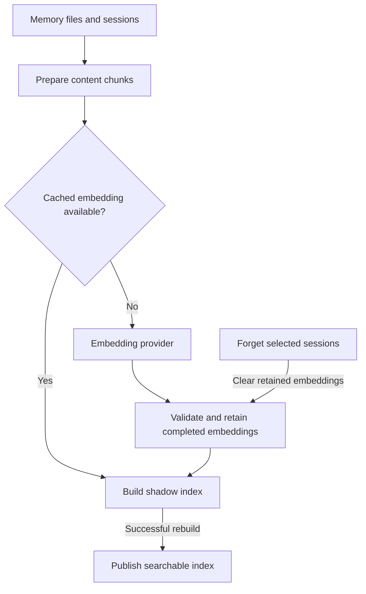

Codex review: blocked before merge. _Reviewed September 10, 2026, 8:02 PM ET / September 11, 2026, 00:02 UTC (Revision 2)._

# ClawSweeper review

## What this changes

Memory indexing retains completed embeddings across failed rebuilds, bounds the retained cache, clears unpublished cached results during Forget, and preserves structured provider error metadata.

## Merge readiness

⛔ **Blocked before merge - 1 item remains**

The prior cache-cap blocker is resolved, and no remaining blocking defect was found. The recovery improvement remains necessary on current main; the related merged cooldown work does not supersede it.

**Priority:** P2
**Reviewed head:** `b1d2cdcd5cd59d3e272067381275823d4b47aca4`

## Review scores

| Measure | Result | What it means |
|---|---|---|
| **Overall readiness** | 🐚 platinum hermit **(4/6)** | A coherent recovery repair with meaningful regression coverage; the prior actionable finding is resolved. |
| **Proof confidence** | 🌊 off-meta tidepool | Not applicable: The repository state identifies a MEMBER author, so the external-contributor proof gate does not apply. Inspected recovery fixtures use real SQLite with fake providers; the adapter test uses real loopback HTTP, without claiming external quota or billing coverage. |
| **Patch quality** | 🐚 platinum hermit **(4/6)** | No actionable review findings were identified. |

## Verification

| Check | Result | Evidence |
|---|---|---|
| **Real behavior** | Not applicable | Not applicable: The repository state identifies a MEMBER author, so the external-contributor proof gate does not apply. Inspected recovery fixtures use real SQLite with fake providers; the adapter test uses real loopback HTTP, without claiming external quota or billing coverage. |
| **Evidence reviewed** | 9 items | Prior finding addressed: The GitHub commit diff adds canonical-cache pruning after successful publication. The corresponding regression starts with three retained rows and a cap of one, requires zero embedding requests, and checks the surviving cache and published content. The adjacent failed-rebuild control still requires cache preservation. Current main still needs the recovery change: At the fetched main revision, full rebuilds still seed the shadow embedding cache and prune it before publication; publication still deletes and replaces the live cache from the shadow. Completed work therefore remains coupled to successful shadow publication. Latest release comparison: The supplied latest release revision also contains shadow-cache seeding and pre-publication pruning. This check does not establish the proposed recovery behavior as shipped. |
| **Findings** | None | None. |
| **Security** | None | None. |

## How this fits together

Memory Core converts workspace files and session transcripts into searchable text and vector indexes. Its embedding cache avoids repeated provider requests, while shadow databases keep incomplete rebuilds from replacing the published index.

## Before merge

- [ ] **Add data-model compatibility proof** - Confirm migration or upgrade compatibility proof before merge.

<strong>Agent review details</strong>

### Security

None.

### PR surface

Source +251, Tests +334, Docs +12, Other 0. Total +597 across 20 files.

View PR surface stats

| Area | Files | Added | Removed | Net |
|---|---:|---:|---:|---:|
| Source | 8 | 398 | 147 | +251 |
| Tests | 9 | 437 | 103 | +334 |
| Docs | 2 | 18 | 6 | +12 |
| Config | 0 | 0 | 0 | 0 |
| Generated | 0 | 0 | 0 | 0 |
| Other | 1 | 1 | 1 | 0 |
| **Total** | **20** | **854** | **257** | **+597** |

### Review metrics

| Metric | Value | Why it matters |
|---|---|---|
| **Production versus test growth** | Production net +251 lines; tests net +334 lines | Production growth implements durable cache writes and validation fences; test growth covers recovery, capacity, deletion, and publication failures. |

### Stored data model

Persistent data-model change detected: `unknown-data-model-change: extensions/memory-core/src/memory-forget.ts`, `unknown-data-model-change: extensions/memory-core/src/memory/manager-embedding-cache.ts`, `unknown-data-model-change: extensions/memory-core/src/memory/manager-embedding-ops.ts`, `unknown-data-model-change: extensions/memory-core/src/memory/manager-sync-base.ts`, `unknown-data-model-change: extensions/memory-core/src/memory/manager-sync-ops.ts`, `unknown-data-model-change: src/plugins/openai-compatible-embedding-provider.ts`, and 8 more. Confirm migration or upgrade compatibility proof before merge.

### Technical review

Best possible solution:

Keep one bounded, durable embedding cache independent of atomic index publication, with source validation and Forget invalidation preserving the documented deletion contract.

Do we have a high-confidence way to reproduce the issue?

Yes, from source: complete embeddings during a full rebuild, fail before shadow publication, restart, and retry. Current main discards that shadow work; the supplied regressions exercise this order, but were not run in this read-only review.

Is this the best way to solve the issue?

Yes. Separating reusable provider results from atomic index publication fixes the owning lifecycle without another cache or schema, and the follow-up restores successful-rebuild retention enforcement.

AGENTS.md: found and applied where relevant.

Codex review notes: model internal, reasoning medium; reviewed against [48b319e240fa](https://github.com/openclaw/openclaw/commit/48b319e240fa5e8024b88efabe9f1de492939238).

### Labels

Label justifications:

- `P2`: This is a bounded memory-index recovery improvement that avoids repeating completed embedding work after failures.
- `rating: 🐚 platinum hermit`: Overall readiness is 🐚 platinum hermit; proof is 🌊 off-meta tidepool and patch quality is 🐚 platinum hermit.
- `status: 👀 ready for maintainer look`: ClawSweeper has no concrete contributor-facing blocker left for this PR. Not applicable: The repository state identifies a MEMBER author, so the external-contributor proof gate does not apply. Inspected recovery fixtures use real SQLite with fake providers; the adapter test uses real loopback HTTP, without claiming external quota or billing coverage.

### Evidence

What I checked:

- **Prior finding addressed:** The GitHub commit diff adds canonical-cache pruning after successful publication. The corresponding regression starts with three retained rows and a cap of one, requires zero embedding requests, and checks the surviving cache and published content. The adjacent failed-rebuild control still requires cache preservation. ([`extensions/memory-core/src/memory/manager-sync-ops.ts:637`](https://github.com/openclaw/openclaw/blob/b1d2cdcd5cd59d3e272067381275823d4b47aca4/extensions/memory-core/src/memory/manager-sync-ops.ts#L637), [b1d2cdcd5cd5](https://github.com/openclaw/openclaw/commit/b1d2cdcd5cd59d3e272067381275823d4b47aca4))
- **Current main still needs the recovery change:** At the fetched main revision, full rebuilds still seed the shadow embedding cache and prune it before publication; publication still deletes and replaces the live cache from the shadow. Completed work therefore remains coupled to successful shadow publication. ([`extensions/memory-core/src/memory/manager-sync-ops.ts:539`](https://github.com/openclaw/openclaw/blob/48b319e240fa5e8024b88efabe9f1de492939238/extensions/memory-core/src/memory/manager-sync-ops.ts#L539), [48b319e240fa](https://github.com/openclaw/openclaw/commit/48b319e240fa5e8024b88efabe9f1de492939238))
- **Latest release comparison:** The supplied latest release revision also contains shadow-cache seeding and pre-publication pruning. This check does not establish the proposed recovery behavior as shipped. ([`extensions/memory-core/src/memory/manager-sync-ops.ts:539`](https://github.com/openclaw/openclaw/blob/1391f7cd2d40ab5bbcf2f5f831d3a64f520e72d7/extensions/memory-core/src/memory/manager-sync-ops.ts#L539), [1391f7cd2d40](https://github.com/openclaw/openclaw/commit/1391f7cd2d40ab5bbcf2f5f831d3a64f520e72d7))
- **Cache ownership and write fencing:** Completed batches use the captured published database, validate vectors and source snapshots, and recheck generation lifetime and database revision before synchronous cache writes. Searches retain the published index while rebuild work uses its separate database context. ([`extensions/memory-core/src/memory/manager-embedding-ops.ts:653`](https://github.com/openclaw/openclaw/blob/b1d2cdcd5cd59d3e272067381275823d4b47aca4/extensions/memory-core/src/memory/manager-embedding-ops.ts#L653), [b1d2cdcd5cd5](https://github.com/openclaw/openclaw/commit/b1d2cdcd5cd59d3e272067381275823d4b47aca4))
- **Publication and restart coverage:** The inspected tests preserve published index tables after injected publication failures while separately requiring completed cache rows to survive and avoid new provider calls. Recovery coverage also closes and reopens the manager, and the legacy-schema test retains the existing Doctor requirement. Tests were inspected, not executed during this review. ([`extensions/memory-core/src/memory/manager.reindex-recovery.test.ts:312`](https://github.com/openclaw/openclaw/blob/b1d2cdcd5cd59d3e272067381275823d4b47aca4/extensions/memory-core/src/memory/manager.reindex-recovery.test.ts#L312), [b1d2cdcd5cd5](https://github.com/openclaw/openclaw/commit/b1d2cdcd5cd59d3e272067381275823d4b47aca4))
- **Forget compatibility tradeoff:** The captured PR body explicitly records acceptance of whole-cache deletion without a schema change. Source returns before mutation for dry runs and empty selections; nonempty purges invalidate pending work and clear the selected agent's cache. Documentation explains that unrelated published entries remain searchable but later indexing can regenerate embeddings. ([`extensions/memory-core/src/memory-forget.ts:590`](https://github.com/openclaw/openclaw/blob/b1d2cdcd5cd59d3e272067381275823d4b47aca4/extensions/memory-core/src/memory-forget.ts#L590), [b1d2cdcd5cd5](https://github.com/openclaw/openclaw/commit/b1d2cdcd5cd59d3e272067381275823d4b47aca4))

Likely related people:

- **steipete:** Suggested for follow-up; no historical authorship or introduction is verified. (role: unverified routing candidate; confidence: low)
- **shojikumaru:** Suggested for follow-up; no historical authorship or introduction is verified. (role: unverified routing candidate; confidence: low)

### Rating scale

| Score | Internal tier | Crab rank | Meaning |
|---:|:---:|---|---|
| **6/6** | S | 🦀 challenger crab | Exceptional readiness |
| **5/6** | A | 🦞 diamond lobster | Very strong readiness |
| **4/6** | B | 🐚 platinum hermit | Good normal PR; ordinary maintainer review |
| **3/6** | C | 🦐 gold shrimp | Useful, but confidence is limited |
| **2/6** | D | 🦪 silver shellfish | Proof or implementation needs work |
| **1/6** | F | 🧂 unranked krab | Not merge-ready |
| N/A | NA | 🌊 off-meta tidepool | Rating does not apply |

Overall follows the weaker of proof and patch quality.
Shiny media proof means a screenshot, video, or linked artifact directly shows the changed behavior. Runtime, network, CSP, and security claims still need visible diagnostics.

### Workflow

- ClawSweeper keeps one durable marker-backed review comment per issue or PR.
- Re-runs edit this comment so the latest verdict, findings, and automation markers stay together instead of adding duplicate bot comments.
- A fresh review can be triggered by eligible `@clawsweeper re-review` comments, exact-item GitHub events, scheduled/background review runs, or manual workflow dispatch.
- PR/issue authors and users with repository write access can comment `@clawsweeper re-review` or `@clawsweeper re-run` on an open PR or issue to request a fresh review only.
- Maintainers can also comment `@clawsweeper review` to request a fresh review only.
- Fresh-review commands do not start repair, autofix, rebase, CI repair, or automerge.
- Maintainer-only repair and merge flows require explicit commands such as `@clawsweeper autofix`, `@clawsweeper automerge`, `@clawsweeper fix ci`, or `@clawsweeper address review`.
- Maintainers can comment `@clawsweeper explain` to ask for more context, or `@clawsweeper stop` to stop active automation.

### History

Review history (1 earlier review cycle)

<!-- clawsweeper-review-history v=1 total=1 -->
- reviewed 2026-09-10T20:58:23.369Z sha 2c17271f04e8d829ace2b414e9c82bb0e6b8711f :: blocked before merge. :: [P2] [P2] Enforce the cache cap after an entirely cached rebuild

<!-- clawsweeper-verdict:needs-human item=144404 sha=b1d2cdcd5cd59d3e272067381275823d4b47aca4 confidence=high updated_at=2026-09-10T23:58:55Z reviewed_at=2026-09-11T00:02:37.263Z lease_owner=github-run-34544327876-1 lease_comment_id=5627161837 source_revision=9dd4cfe268aa63d7a26f58b4e7b8848ce0c56fea967df6d2d1c23d1198645351 live_verification=absent -->
<!-- clawsweeper-review-state:blocked item=144404 sha=b1d2cdcd5cd59d3e272067381275823d4b47aca4 v=1 -->

<!-- clawsweeper-review-version item=144404 reviewed_at=2026-09-11T00:02:37.263Z sha=b1d2cdcd5cd59d3e272067381275823d4b47aca4 source_revision=9dd4cfe268aa63d7a26f58b4e7b8848ce0c56fea967df6d2d1c23d1198645351 lease_owner=github-run-34544327876-1 lease_comment_id=5627161837 v=1 -->

<!-- clawsweeper-review item=144404 -->