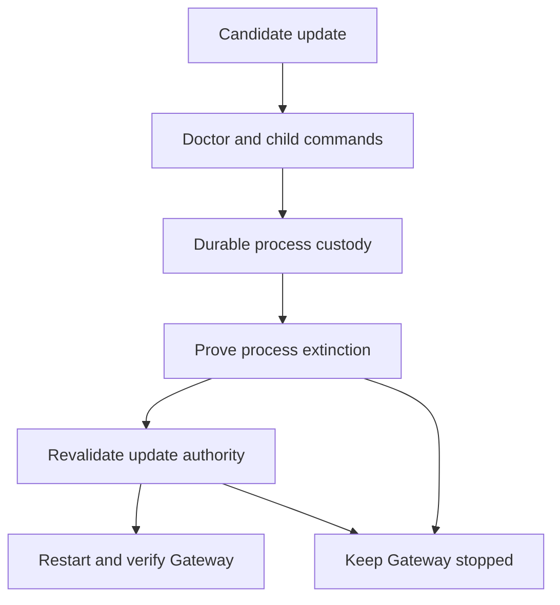

Codex review: needs real behavior proof before merge. _Reviewed October 2, 2026, 3:31 AM ET / 07:31 UTC (Revision 21)._

# ClawSweeper review

## What this changes

The updater retains Doctor child-process custody, retires settled writer claims before recovering migrated Gateways, and drains local database writers before taking recovery snapshots.

## Merge readiness

⛔ **Blocked before merge - 4 items remain**

This PR remains necessary: current main covers the snapshot correction but not the central Doctor settlement recovery path. No concrete blocking patch defect was found; the prior final-effect authority proof gap remains unresolved.

**Priority:** P0
**Reviewed head:** `2b7e5700f6adada2a0fe8a7a10a6b2092a9fde05`

## Review scores

| Measure | Result | What it means |
|---|---|---|
| **Overall readiness** | 🦐 gold shrimp **(3/6)** | The patch has substantial useful coverage and retained real recovery evidence, but the current authority boundary is not yet proven through native activation. |
| **Proof confidence** | 🦐 gold shrimp **(3/6)** | Needs stronger real behavior proof before merge: Authority-chain proof required: the retained packaged trace proves settlement and healthy recovery at faaabc09b9338ef3e2c985fa696d0bb5ac0d8bba before async-progress integration; current recovery coverage mocks restart and health. Show allowed recovery and rejection before native activation for a revoked requester and replaced parent generation. Existing stored-payload compatibility is supported independently by optional decoding, reclamation coverage, and the published-driver cell. After adding proof, update the PR body; ClawSweeper should re-review automatically. If it does not, the PR author or someone with repository write access can comment `@clawsweeper re-review`. |
| **Patch quality** | 🦐 gold shrimp **(3/6)** | Security review found an item that needs attention. |

## Verification

| Check | Result | Evidence |
|---|---|---|
| **Real behavior** | Needs proof | Needs stronger real behavior proof before merge: Authority-chain proof required: the retained packaged trace proves settlement and healthy recovery at faaabc09b9338ef3e2c985fa696d0bb5ac0d8bba before async-progress integration; current recovery coverage mocks restart and health. Show allowed recovery and rejection before native activation for a revoked requester and replaced parent generation. Existing stored-payload compatibility is supported independently by optional decoding, reclamation coverage, and the published-driver cell. After adding proof, update the PR body; ClawSweeper should re-review automatically. If it does not, the PR author or someone with repository write access can comment `@clawsweeper re-review`. |
| **Evidence reviewed** | 10 items | Pinned introduction and clean checkout: Reviewed the introduced merge-base-to-head delta. The checkout remains clean; the supplied stale test merge was not used to infer removal of current-main behavior. Central work remains absent from main: Current main still requires a failed database rollback receipt for migrated recovery and lacks the new Doctor process-custody owner. That owner is also absent from the supplied latest-release commit. Settlement precedes retirement: The parent captures exact native claims, awaits tracked-group settlement, and retires claims only when settlement succeeds and no unidentified reservation remains. |
| **Findings** | None | None. |
| **Security** | Needs attention | Verify stale authority cannot activate the Gateway: The changed custody and recovery path crosses process lifetimes and asynchronous publication. Available current coverage does not show requester revocation or parent-generation replacement being rejected before native activation. |

## How this fits together

OpenClaw's updater runs Doctor against the candidate installation before completing Gateway activation. Process settlement and current update authority determine whether recovery may restart the Gateway on preserved migrated state.

## Before merge

- [ ] **Add real behavior proof** - Needs stronger real behavior proof before merge: Authority-chain proof required: the retained packaged trace proves settlement and healthy recovery at faaabc09b9338ef3e2c985fa696d0bb5ac0d8bba before async-progress integration; current recovery coverage mocks restart and health. Show allowed recovery and rejection before native activation for a revoked requester and replaced parent generation. Existing stored-payload compatibility is supported independently by optional decoding, reclamation coverage, and the published-driver cell. After adding proof, update the PR body; ClawSweeper should re-review automatically. If it does not, the PR author or someone with repository write access can comment `@clawsweeper re-review`.
- [ ] **Resolve security concern: Verify stale authority cannot activate the Gateway** - The changed custody and recovery path crosses process lifetimes and asynchronous publication. Available current coverage does not show requester revocation or parent-generation replacement being rejected before native activation.
- [ ] **Resolve merge risk (P1)** - The current settlement-publication-to-native-activation path lacks final-effect evidence that requester revocation or parent-generation replacement prevents restart, while an authorized recovery still succeeds.
- [ ] **Complete next step (P2)** - Provide current production-path authority proof showing permitted recovery and rejection before native activation after requester revocation or parent-generation replacement; redact credentials, private paths, IP addresses, and non-public endpoints.

## Findings

- [medium] Verify stale authority cannot activate the Gateway — `src/cli/update-cli/update-command-package.ts:386`

<strong>Agent review details</strong>

### Security

Needs attention: No concrete bypass or supply-chain regression was found, but current final-effect authority coverage remains incomplete.

### PR surface

Source +1365, Tests +2104, Docs +18, Other +1. Total +3488 across 70 files.

View PR surface stats

| Area | Files | Added | Removed | Net |
|---|---:|---:|---:|---:|
| Source | 36 | 1804 | 439 | +1365 |
| Tests | 32 | 2335 | 231 | +2104 |
| Docs | 1 | 18 | 0 | +18 |
| Config | 0 | 0 | 0 | 0 |
| Generated | 0 | 0 | 0 | 0 |
| Other | 1 | 1 | 0 | +1 |
| **Total** | **70** | **4158** | **670** | **+3488** |

### Review metrics

| Metric | Value | Why it matters |
|---|---|---|
| **Production versus regression growth** | production net +1,365 lines; tests/support net +2,104 lines | The PR explains the production growth as custody across process, IPC, and durable-claim lifetimes; final-effect evidence must connect those owners. |

### Stored data model

Persistent data-model change detected: `migration/backfill/repair: src/cli/update-cli/update-command-fresh-doctor.ts`, `migration/backfill/repair: src/cli/update-cli/update-recovery-guidance.ts`, `migration/backfill/repair: src/flows/doctor-health.ts`, `migration/backfill/repair: src/infra/update-doctor-process-custody.ts`, `serialized state: src/infra/update-doctor-process-custody.ts`, `unknown-data-model-change: src/cli/update-cli/update-command-fresh-doctor.ts`, and 2 more. Migration or upgrade compatibility proof is recorded; maintainers should verify it before merge.

### Root-cause cluster

Relationship: `fixed_by_candidate`
Canonical: https://github.com/openclaw/openclaw/issues/162055
Summary: This PR is the candidate recovery fix for the linked issue; merged neighboring repairs address only parts of the reported failure.

Members:
- `canonical`: https://github.com/openclaw/openclaw/issues/162055 - The report describes Doctor stalling after migration with the Gateway stopped, and this PR explicitly targets its recovery.
- `partial_overlap`: https://github.com/openclaw/openclaw/pull/162254 - Merged native-validation caching addresses the Doctor CPU cost, rather than retained writer settlement.
- `partial_overlap`: https://github.com/openclaw/openclaw/pull/163008 - Merged snapshot drainage prevents false rollback refusals and is incorporated into this branch.

Proposal only: this assessment does not dispatch repair, suppress jobs, mutate sibling items, close, or merge anything.

### Merge-risk options

**Maintainer options:**
1. **Complete scoped authority proof (recommended)**  
   Show authorized recovery and rejection before native activation after requester revocation or parent-generation replacement through the current production path.

### Technical review

Best possible solution:

Keep recovery within the existing custody and service owners, preserving migrated state and requiring current authority immediately before native activation.

Do we have a high-confidence way to reproduce the issue?

Yes, source inspection establishes the missing parent-held descendant settlement path, supported by the retained packaged timeout trace. No current-main runtime reproduction was executed in this read-only review.

Is this the best way to solve the issue?

Yes, extending the existing command-custody, handoff, and recovery owners is a coherent repair; current final-effect authority proof is still needed to establish merge readiness.

AGENTS.md: found and applied where relevant.

Codex review notes: model internal, reasoning medium; reviewed against [3224ed9341cf](https://github.com/openclaw/openclaw/commit/3224ed9341cfe206e303ebf5fb948347de8e2d99).

### Labels

Label changes:

No label changes.

Label justifications:

- `P0`: The linked current-release update failure leaves a migrated Gateway down, and writer uncertainty prevents safe recovery.
- `merge-risk: 🚨 security-boundary`: The patch persists command custody and expands recovery admission across process lifetimes; final native rejection after authority changes remains unproven.
- `rating: 🦐 gold shrimp`: Overall readiness is 🦐 gold shrimp; proof is 🦐 gold shrimp and patch quality is 🦐 gold shrimp.
- `status: 📣 needs proof`: The PR needs real behavior proof before ClawSweeper can clear the contributor ask. Needs stronger real behavior proof before merge: Authority-chain proof required: the retained packaged trace proves settlement and healthy recovery at faaabc09b9338ef3e2c985fa696d0bb5ac0d8bba before async-progress integration; current recovery coverage mocks restart and health. Show allowed recovery and rejection before native activation for a revoked requester and replaced parent generation. Existing stored-payload compatibility is supported independently by optional decoding, reclamation coverage, and the published-driver cell. After adding proof, update the PR body; ClawSweeper should re-review automatically. If it does not, the PR author or someone with repository write access can comment `@clawsweeper re-review`.

### Evidence

Security concerns:

- [medium] Verify stale authority cannot activate the Gateway — `src/cli/update-cli/update-command-package.ts:386`
  The changed custody and recovery path crosses process lifetimes and asynchronous publication. Available current coverage does not show requester revocation or parent-generation replacement being rejected before native activation.
  Confidence: 0.93

What I checked:

- **Pinned introduction and clean checkout:** Reviewed the introduced merge-base-to-head delta. The checkout remains clean; the supplied stale test merge was not used to infer removal of current-main behavior. ([2b7e5700f6ad](https://github.com/openclaw/openclaw/commit/2b7e5700f6adada2a0fe8a7a10a6b2092a9fde05))
- **Central work remains absent from main:** Current main still requires a failed database rollback receipt for migrated recovery and lacks the new Doctor process-custody owner. That owner is also absent from the supplied latest-release commit. ([`src/cli/update-cli/update-command-service-recovery.ts:183`](https://github.com/openclaw/openclaw/blob/3224ed9341cfe206e303ebf5fb948347de8e2d99/src/cli/update-cli/update-command-service-recovery.ts#L183), [3224ed9341cf](https://github.com/openclaw/openclaw/commit/3224ed9341cfe206e303ebf5fb948347de8e2d99))
- **Settlement precedes retirement:** The parent captures exact native claims, awaits tracked-group settlement, and retires claims only when settlement succeeds and no unidentified reservation remains. ([`src/infra/update-doctor-process-custody.ts:292`](https://github.com/openclaw/openclaw/blob/2b7e5700f6adada2a0fe8a7a10a6b2092a9fde05/src/infra/update-doctor-process-custody.ts#L292), [2b7e5700f6ad](https://github.com/openclaw/openclaw/commit/2b7e5700f6adada2a0fe8a7a10a6b2092a9fde05))
- **Current asynchronous authority boundary:** Package Doctor now awaits settlement publication and then rechecks requester/executor context. Recovery subsequently consumes the settlement receipt through the existing service owner; this is the current path requiring final-effect coverage. ([`src/cli/update-cli/update-command-package.ts:386`](https://github.com/openclaw/openclaw/blob/2b7e5700f6adada2a0fe8a7a10a6b2092a9fde05/src/cli/update-cli/update-command-package.ts#L386), [2b7e5700f6ad](https://github.com/openclaw/openclaw/commit/2b7e5700f6adada2a0fe8a7a10a6b2092a9fde05))
- **Retained proof and source identity:** Read the complete PR body through GitHub and verified its SHA-256 matches the captured snapshot: 17b4ca1387a1589bffc38ebd19365fa5014223856563e9786088bd40303ebe48. Its packaged trace at faaabc09b9338ef3e2c985fa696d0bb5ac0d8bba records Doctor timeout, writer extinction, claim retirement before restart, healthy readiness, and preserved later config/database bytes. The body explicitly identifies this as preceding async-progress integration. The published 2026.9.5 driver cell preserves the stopped outcome rather than claiming retrofitted recovery. ([faaabc09b933](https://github.com/openclaw/openclaw/commit/faaabc09b9338ef3e2c985fa696d0bb5ac0d8bba))
- **Recovery fixture coverage boundary:** The new recovery matrix covers settled, unsettled, missing, foreign, restored-database, and failed-source-rollback cases, but substitutes restart and health implementations. It does not demonstrate current native activation or rejection of revoked requester/replaced parent authority at the final effect. ([`src/cli/update-cli/update-command-post-update-repair.test.ts:741`](https://github.com/openclaw/openclaw/blob/2b7e5700f6adada2a0fe8a7a10a6b2092a9fde05/src/cli/update-cli/update-command-post-update-repair.test.ts#L741), [2b7e5700f6ad](https://github.com/openclaw/openclaw/commit/2b7e5700f6adada2a0fe8a7a10a6b2092a9fde05))

Likely related people:

- **steipete:** Suggested for follow-up; no historical authorship or introduction is verified. (role: unverified routing candidate; confidence: low)
- **fuller-stack-dev:** Suggested for follow-up; no historical authorship or introduction is verified. (role: unverified routing candidate; confidence: low)

### Rank-up moves

Optional improvements that raise the rating; they are not merge blockers.

- Show current authorized native recovery after awaited settlement publication, with durable claims retired before activation and later operator writes preserved.
- Prove requester revocation and parent-generation replacement prevent native activation; post redacted terminal output or logs, then update the PR body for automatic re-review or ask a maintainer to comment @clawsweeper re-review.

### Rating scale

| Score | Internal tier | Crab rank | Meaning |
|---:|:---:|---|---|
| **6/6** | S | 🦀 challenger crab | Exceptional readiness |
| **5/6** | A | 🦞 diamond lobster | Very strong readiness |
| **4/6** | B | 🐚 platinum hermit | Good normal PR; ordinary maintainer review |
| **3/6** | C | 🦐 gold shrimp | Useful, but confidence is limited |
| **2/6** | D | 🦪 silver shellfish | Proof or implementation needs work |
| **1/6** | F | 🧂 unranked krab | Not merge-ready |
| N/A | NA | 🌊 off-meta tidepool | Rating does not apply |

Overall follows the weaker of proof and patch quality.
Shiny media proof means a screenshot, video, or linked artifact directly shows the changed behavior. Runtime, network, CSP, and security claims still need visible diagnostics.

### Workflow

- ClawSweeper keeps one durable marker-backed review comment per issue or PR.
- Re-runs edit this comment so the latest verdict, findings, and automation markers stay together instead of adding duplicate bot comments.
- A fresh review can be triggered by eligible `@clawsweeper re-review` comments, exact-item GitHub events, scheduled/background review runs, or manual workflow dispatch.
- PR/issue authors and users with repository write access can comment `@clawsweeper re-review` or `@clawsweeper re-run` on an open PR or issue to request a fresh review only.
- Maintainers can also comment `@clawsweeper review` to request a fresh review only.
- Fresh-review commands do not start repair, autofix, rebase, CI repair, or automerge.
- Maintainer-only repair and merge flows require explicit commands such as `@clawsweeper autofix`, `@clawsweeper automerge`, `@clawsweeper fix ci`, or `@clawsweeper address review`.
- Maintainers can comment `@clawsweeper explain` to ask for more context, or `@clawsweeper stop` to stop active automation.

### History

Review history (20 earlier review cycles; latest 8 shown)

<!-- clawsweeper-review-history v=1 total=20 -->
- reviewed 2026-10-01T21:41:42.450Z sha 69c1fd892af7081ecdfd6207bb63341e7ec1959a :: needs real behavior proof before merge. :: none
- reviewed 2026-10-01T22:51:09.077Z sha 69c1fd892af7081ecdfd6207bb63341e7ec1959a :: needs real behavior proof before merge. :: none
- reviewed 2026-10-01T22:57:56.416Z sha 69c1fd892af7081ecdfd6207bb63341e7ec1959a :: needs real behavior proof before merge. :: none
- reviewed 2026-10-01T23:17:17.478Z sha 69c1fd892af7081ecdfd6207bb63341e7ec1959a :: needs real behavior proof before merge. :: none
- reviewed 2026-10-02T00:23:10.317Z sha 69c1fd892af7081ecdfd6207bb63341e7ec1959a :: needs real behavior proof before merge. :: none
- reviewed 2026-10-02T04:54:32.452Z sha 325880742bdca8a74b42ab8cce79880a22a66f83 :: needs real behavior proof before merge. :: none
- reviewed 2026-10-02T05:08:41.350Z sha 325880742bdca8a74b42ab8cce79880a22a66f83 :: needs real behavior proof before merge. :: none
- reviewed 2026-10-02T07:23:21.810Z sha 2b7e5700f6adada2a0fe8a7a10a6b2092a9fde05 :: needs real behavior proof before merge. :: none

<!-- clawsweeper-security:security-sensitive item=162614 sha=2b7e5700f6adada2a0fe8a7a10a6b2092a9fde05 confidence=high updated_at=2026-10-02T07:27:11Z reviewed_at=2026-10-02T07:31:27.699Z lease_owner=github-run-36978518559-1 lease_comment_id=5947363759 source_revision=397b4f4f10675c12bbc7ef9dce0a3d416d8b7b856dd64d49285fb97f35df19f7 live_verification=absent -->
<!-- clawsweeper-verdict:needs-human item=162614 sha=2b7e5700f6adada2a0fe8a7a10a6b2092a9fde05 confidence=high updated_at=2026-10-02T07:27:11Z reviewed_at=2026-10-02T07:31:27.699Z lease_owner=github-run-36978518559-1 lease_comment_id=5947363759 source_revision=397b4f4f10675c12bbc7ef9dce0a3d416d8b7b856dd64d49285fb97f35df19f7 live_verification=absent -->
<!-- clawsweeper-review-state:blocked item=162614 sha=2b7e5700f6adada2a0fe8a7a10a6b2092a9fde05 v=1 -->

<!-- clawsweeper-review-version item=162614 reviewed_at=2026-10-02T07:31:27.699Z sha=2b7e5700f6adada2a0fe8a7a10a6b2092a9fde05 source_revision=397b4f4f10675c12bbc7ef9dce0a3d416d8b7b856dd64d49285fb97f35df19f7 lease_owner=github-run-36978518559-1 lease_comment_id=5947363759 v=1 -->

<!-- clawsweeper-review item=162614 -->