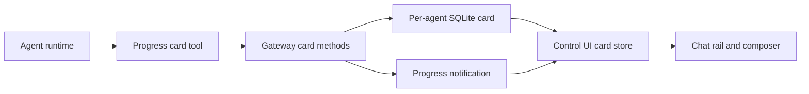

Codex review: needs real behavior proof before merge. _Reviewed August 17, 2026, 12:10 PM ET / 16:10 UTC._

# ClawSweeper review

## What this changes

This PR replaces transient agent plans with a durable per-session progress card, persists it in the per-agent database, bridges Codex plan updates, and renders it across the Control UI.

## Merge readiness

⛔ **Blocked until real behavior proof from a real setup is added - 7 items remain**

Keep open: the new progress notification bypasses the existing subscriber gate for session-scoped clients, and the PR still lacks real Gateway behavior proof and direct Codex contract verification.

**Priority:** P2
**Reviewed head:** `55f648b9f28b89a079f3c198327f1bb29abe0dfb`
**Owner decision:** Required. See [Decision needed](#decision-needed).

## Review scores

| Measure | Result | What it means |
|---|---|---|
| **Overall readiness** | 🦪 silver shellfish **(2/6)** | The patch has focused coverage but contains a session-delivery defect and only mock-based behavior proof. |
| **Proof confidence** | 🦪 silver shellfish **(2/6)** | Needs real behavior proof before merge: The supplied browser screenshots and E2E coverage exercise a mocked Gateway, not an after-fix real Gateway or operator flow. After adding proof, update the PR body; ClawSweeper should re-review automatically. If it does not, the PR author or someone with repository write access can comment `@clawsweeper re-review`. |
| **Patch quality** | 🦐 gold shrimp **(3/6)** | Security review found an item that needs attention. |

## Verification

| Check | Result | Evidence |
|---|---|---|
| **Real behavior** | Needs proof | Needs real behavior proof before merge: The supplied browser screenshots and E2E coverage exercise a mocked Gateway, not an after-fix real Gateway or operator flow. After adding proof, update the PR body; ClawSweeper should re-review automatically. If it does not, the PR author or someone with repository write access can comment `@clawsweeper re-review`. |
| **Evidence reviewed** | 7 items | Cross-session notification path: The new write handler broadcasts a payload containing the canonical session key and revision, while the broadcaster does not classify this event as subscription-gated. Existing subscription invariant: Session-scoped clients are filtered only for events in SESSION_SUBSCRIPTION_EVENTS; progressCard.changed is absent, whereas the nearby comment states scoped clients must not receive session-bearing broadcasts without the registry gate. Visibility is not a subscription substitute: The visibility predicate permits events for visible sessions and, for clients without a session creator identity, permits all events except suggestion and typing; it does not enforce the subscription registry. |
| **Findings** | 1 actionable finding | [P1] Scope progress-card notifications to subscribed sessions |
| **Security** | Needs attention | Session notification bypasses subscriber isolation: Read-capable scoped clients can receive another session's key and revision because the new event is globally broadcast but omitted from the subscription-gated event set. |

## How this fits together

Agent tools submit a session progress card through Gateway methods that persist a canonical card and notify connected clients. The Control UI loads that card to show progress in the active chat, session rail, and hovercard.

## Decision needed

| Question | Recommendation |
|---|---|
| Should OpenClaw replace the established transient plan surface with a durable per-session progress card across agent runtimes? | **Adopt the durable card:** Keep the new canonical session artifact after resolving notification isolation and proof gaps. |

Why: This is a new persistence, protocol, tool, and UI contract rather than a bounded repair, so maintainer intent must establish the canonical product model.

## Before merge

- [ ] **Add real behavior proof** - Needs real behavior proof before merge: The supplied browser screenshots and E2E coverage exercise a mocked Gateway, not an after-fix real Gateway or operator flow. After adding proof, update the PR body; ClawSweeper should re-review automatically. If it does not, the PR author or someone with repository write access can comment `@clawsweeper re-review`.
- [ ] **Scope progress-card notifications to subscribed sessions (P1)** - `progressCard.changed` carries a session key but is not in `SESSION_SUBSCRIPTION_EVENTS`. A client advertising `session-scoped-events` therefore receives notifications for visible sessions it did not subscribe to; visibility filtering does not enforce the subscriber registry. Add this event to the set and cover a client subscribed to another session.
- [ ] **Resolve security concern: Session notification bypasses subscriber isolation** - Read-capable scoped clients can receive another session's key and revision because the new event is globally broadcast but omitted from the subscription-gated event set.
- [ ] **Resolve merge risk (P1)** - Until progressCard.changed joins the session subscription gate, scoped clients can receive foreign-session key and revision notifications.
- [ ] **Resolve merge risk (P1)** - The upstream Codex configuration contract and a real after-fix Gateway flow remain unverified; provided UI evidence uses a mocked Gateway.
- [ ] **Complete next step (P2)** - A maintainer must confirm the product migration, while the contributor must fix scoped notification delivery and add real behavior proof.

## Findings

- [P1] Scope progress-card notifications to subscribed sessions — `src/gateway/server-broadcast.ts:43`
- [medium] Session notification bypasses subscriber isolation — `src/gateway/server-broadcast.ts:43`

<strong>Agent review details</strong>

### Security

Needs attention: The UI sanitizer is appropriately constrained, but the new session-bearing broadcast misses the scoped-session delivery boundary.

### Review metrics

| Metric | Value | Why it matters |
|---|---|---|
| **Diff footprint** | 162 files, +3,704 / -1,642 | The change spans agent tools, Gateway, persistence, protocol, Codex, native clients, and Control UI, so it needs whole-surface review. |
| **Production vs test LOC** | PR-reported production/tooling -277 net; tests -480 net; generated +149; docs +3 | The reported accounting indicates replacement and deletion of prior plan paths rather than net production growth. |
| **Durable session state** | 1 additive per-agent SQLite table | Progress now survives stream and UI lifecycles, making session ownership and upgrade behavior merge-relevant. |

### Stored data model

Persistent data-model change detected: `migration/backfill/repair: ui/src/pages/chat/chat-state.test.ts`, `unknown-data-model-change: packages/gateway-protocol/src/schema/progress-card.ts`, `unknown-truncated-pull-files`. Confirm migration or upgrade compatibility proof before merge.

### Merge-risk options

**Maintainer options:**
1. **Restore subscription isolation (recommended)**  
   Classify progressCard.changed as a session-subscription event and prove a scoped client subscribed elsewhere receives no notification.
2. **Pause the state-model replacement**  
   Defer the migration if maintainers do not want durable progress to become a cross-runtime session contract.

### Technical review

Best possible solution:

Add progressCard.changed to the subscription-gated event set with a cross-session regression test, then provide redacted real-Gateway proof and direct Codex contract verification before adopting the durable-card model.

Do we have a high-confidence way to reproduce the issue?

Yes, from source: a session-scoped read client subscribed to a different key passes visibility filtering and receives progressCard.changed because the event is absent from the subscription-gated set.

Is this the best way to solve the issue?

No: the broadcast registration omits the existing scoped-session mechanism; adding that classification and a two-session receiver test is the narrower canonical repair.

Full review comments:

- [P1] Scope progress-card notifications to subscribed sessions — `src/gateway/server-broadcast.ts:43`
  `progressCard.changed` carries a session key but is not in `SESSION_SUBSCRIPTION_EVENTS`. A client advertising `session-scoped-events` therefore receives notifications for visible sessions it did not subscribe to; visibility filtering does not enforce the subscriber registry. Add this event to the set and cover a client subscribed to another session.
  Confidence: 0.93

Overall correctness: patch is incorrect
Overall confidence: 0.89

AGENTS.md: found and applied where relevant.

Codex review notes: model internal, reasoning high; reviewed against [793669c8f6dd](https://github.com/openclaw/openclaw/commit/793669c8f6ddfad07b40009068f532832685b7d6).

### Labels

Label changes:

- add `merge-risk: 🚨 security-boundary`: The new session-bearing event bypasses the existing subscription filter for clients that opt into scoped delivery.
- add `rating: 🦪 silver shellfish`: Overall readiness is 🦪 silver shellfish; proof is 🦪 silver shellfish and patch quality is 🦐 gold shrimp.
- remove `rating: 🦐 gold shrimp`: Current PR rating is `rating: 🦪 silver shellfish`, so this older rating label is no longer current.

Label justifications:

- `P2`: This is a broad but non-emergency agent-status feature with a concrete correctness blocker.
- `merge-risk: 🚨 compatibility`: The PR replaces the native update_plan path with a new durable cross-runtime tool and protocol surface.
- `merge-risk: 🚨 session-state`: Progress is persisted and broadcast by session, so incorrect delivery or lifecycle handling affects session state.
- `merge-risk: 🚨 security-boundary`: The new session-bearing event bypasses the existing subscription filter for clients that opt into scoped delivery.
- `rating: 🦪 silver shellfish`: Overall readiness is 🦪 silver shellfish; proof is 🦪 silver shellfish and patch quality is 🦐 gold shrimp.
- `status: 📣 needs proof`: The PR needs real behavior proof before ClawSweeper can clear the contributor ask. Needs real behavior proof before merge: The supplied browser screenshots and E2E coverage exercise a mocked Gateway, not an after-fix real Gateway or operator flow. After adding proof, update the PR body; ClawSweeper should re-review automatically. If it does not, the PR author or someone with repository write access can comment `@clawsweeper re-review`.
- `proof: 📸 screenshot`: Contributor real behavior proof includes screenshot evidence. The supplied browser screenshots and E2E coverage exercise a mocked Gateway, not an after-fix real Gateway or operator flow.

### Evidence

Security concerns:

- [medium] Session notification bypasses subscriber isolation — `src/gateway/server-broadcast.ts:43`
  Read-capable scoped clients can receive another session's key and revision because the new event is globally broadcast but omitted from the subscription-gated event set.
  Confidence: 0.93

Acceptance criteria:

- [P1] Add a Gateway broadcaster test with two session-scoped clients subscribed to different keys.
- [P1] Run the focused Gateway broadcaster and progress-card suites.
- [P1] Capture a redacted real-Gateway write, reload, clear, and Control UI placement flow.

What I checked:

- **Cross-session notification path:** The new write handler broadcasts a payload containing the canonical session key and revision, while the broadcaster does not classify this event as subscription-gated. ([`src/gateway/server-methods/progress-card.ts:80`](https://github.com/openclaw/openclaw/blob/55f648b9f28b/src/gateway/server-methods/progress-card.ts#L80), [55f648b9f28b](https://github.com/openclaw/openclaw/commit/55f648b9f28b))
- **Existing subscription invariant:** Session-scoped clients are filtered only for events in SESSION_SUBSCRIPTION_EVENTS; progressCard.changed is absent, whereas the nearby comment states scoped clients must not receive session-bearing broadcasts without the registry gate. ([`src/gateway/server-broadcast.ts:102`](https://github.com/openclaw/openclaw/blob/55f648b9f28b/src/gateway/server-broadcast.ts#L102), [55f648b9f28b](https://github.com/openclaw/openclaw/commit/55f648b9f28b))
- **Visibility is not a subscription substitute:** The visibility predicate permits events for visible sessions and, for clients without a session creator identity, permits all events except suggestion and typing; it does not enforce the subscription registry. ([`src/gateway/session-sharing.ts:663`](https://github.com/openclaw/openclaw/blob/55f648b9f28b/src/gateway/session-sharing.ts#L663), [55f648b9f28b](https://github.com/openclaw/openclaw/commit/55f648b9f28b))
- **Durable-state compatibility design:** The feature uses one lazy additive per-agent table; a focused test confirms an older schema without the table reads as no card without creating it, and compatibility explicitly permits that table to be absent. ([`src/session-cards/progress-card-store.test.ts:71`](https://github.com/openclaw/openclaw/blob/55f648b9f28b/src/session-cards/progress-card-store.test.ts#L71), [55f648b9f28b](https://github.com/openclaw/openclaw/commit/55f648b9f28b))
- **UI sanitization coverage:** Progress-card markdown is rendered through the existing sanitizer, and the browser test asserts script and inline-event removal before rendering. ([`ui/src/components/session-progress-card.ts:34`](https://github.com/openclaw/openclaw/blob/55f648b9f28b/ui/src/components/session-progress-card.ts#L34), [55f648b9f28b](https://github.com/openclaw/openclaw/commit/55f648b9f28b))
- **Codex dependency gate:** The PR changes the Codex app-server configuration for the upstream native update_plan tool, which is an affirmative Codex-contract dependency; the required sibling ../codex checkout is unavailable, so that protocol claim could not be directly verified. ([`extensions/codex/src/app-server/thread-requests.ts:47`](https://github.com/openclaw/openclaw/blob/55f648b9f28b/extensions/codex/src/app-server/thread-requests.ts#L47), [55f648b9f28b](https://github.com/openclaw/openclaw/commit/55f648b9f28b))

Likely related people:

- **steipete:** Peter Steinberger introduced the live plan client, replay behavior, and scoped-session delivery repair, and authored the related merged UI cleanup. (role: original feature contributor and recent area owner; confidence: high; commits: [b3301e32127d](https://github.com/openclaw/openclaw/commit/b3301e32127de6b5ca9ca6b7c0defe0f9c80434a), [4bfaccafd62a](https://github.com/openclaw/openclaw/commit/4bfaccafd62ac2ff2e70ca1decc40fb1297ab438), [2f97e8c9ebdc](https://github.com/openclaw/openclaw/commit/2f97e8c9ebdcfceb5d7cdee7c39c78dd9ba31f5b); files: `src/gateway/server-broadcast.ts`, `ui/src/pages/chat/tool-stream.ts`)

### Rank-up moves

Optional improvements that raise the rating; they are not merge blockers.

- Add subscriber-isolation coverage for progressCard.changed.
- Provide redacted real-Gateway proof of write, reload, clear, and live placement.
- Verify the Codex configuration behavior against the required sibling source contract.

### Rating scale

| Score | Internal tier | Crab rank | Meaning |
|---:|:---:|---|---|
| **6/6** | S | 🦀 challenger crab | Exceptional readiness |
| **5/6** | A | 🦞 diamond lobster | Very strong readiness |
| **4/6** | B | 🐚 platinum hermit | Good normal PR; ordinary maintainer review |
| **3/6** | C | 🦐 gold shrimp | Useful, but confidence is limited |
| **2/6** | D | 🦪 silver shellfish | Proof or implementation needs work |
| **1/6** | F | 🧂 unranked krab | Not merge-ready |
| N/A | NA | 🌊 off-meta tidepool | Rating does not apply |

Overall follows the weaker of proof and patch quality.
Shiny media proof means a screenshot, video, or linked artifact directly shows the changed behavior. Runtime, network, CSP, and security claims still need visible diagnostics.

### Workflow

- ClawSweeper keeps one durable marker-backed review comment per issue or PR.
- Re-runs edit this comment so the latest verdict, findings, and automation markers stay together instead of adding duplicate bot comments.
- A fresh review can be triggered by eligible `@clawsweeper re-review` comments, exact-item GitHub events, scheduled/background review runs, or manual workflow dispatch.
- PR/issue authors and users with repository write access can comment `@clawsweeper re-review` or `@clawsweeper re-run` on an open PR or issue to request a fresh review only.
- Maintainers can also comment `@clawsweeper review` to request a fresh review only.
- Fresh-review commands do not start repair, autofix, rebase, CI repair, or automerge.
- Maintainer-only repair and merge flows require explicit commands such as `@clawsweeper autofix`, `@clawsweeper automerge`, `@clawsweeper fix ci`, or `@clawsweeper address review`.
- Maintainers can comment `@clawsweeper explain` to ask for more context, or `@clawsweeper stop` to stop active automation.

### History

Review history (6 earlier review cycles)

<!-- clawsweeper-review-history v=1 total=6 -->
- reviewed 2026-08-17T06:50:49.700Z sha 252e2224a126fe38c53c8134253400de6e35ab73 :: needs maintainer review before merge. :: none
- reviewed 2026-08-17T07:08:59.158Z sha a0e6bff317d70173408036b51466a59102d4e1a0 :: found issues before merge. :: [P2] Normalize native plans before persisting them
- reviewed 2026-08-17T08:05:53.014Z sha 7f8850a8996ea843096446c17f6f1b90d53e878e :: needs changes before merge. :: [P2] Normalize native plans before persisting them
- reviewed 2026-08-17T08:21:36.854Z sha 13dd482fb34dd3e1ee6e839aa0374d26a49a8fc8 :: found issues before merge. :: [P1] Emit a legacy clear event when the checklist is removed | [P2] Normalize native plans before persisting them
- reviewed 2026-08-17T14:23:27.063Z sha 13dd482fb34dd3e1ee6e839aa0374d26a49a8fc8 :: needs real behavior proof before merge. :: [P2] Normalize native plans before projecting them
- reviewed 2026-08-17T14:48:04.469Z sha 8d5ff4a48f880646fabf79f84d1169c67bc56af3 :: needs real behavior proof before merge. :: none

<!-- clawsweeper-security:security-sensitive item=125125 sha=55f648b9f28b89a079f3c198327f1bb29abe0dfb confidence=high updated_at=2026-08-17T15:58:03Z reviewed_at=2026-08-17T16:10:54.427Z lease_owner=github-run-32043828535-1 lease_comment_id=5317460548 source_revision=5421a46ea752d76668021735e466235f7c660456db8c6effd694738e6f7aba5a -->
<!-- clawsweeper-verdict:needs-human item=125125 sha=55f648b9f28b89a079f3c198327f1bb29abe0dfb confidence=high updated_at=2026-08-17T15:58:03Z reviewed_at=2026-08-17T16:10:54.427Z lease_owner=github-run-32043828535-1 lease_comment_id=5317460548 source_revision=5421a46ea752d76668021735e466235f7c660456db8c6effd694738e6f7aba5a -->

<!-- clawsweeper-review-version item=125125 reviewed_at=2026-08-17T16:10:54.427Z sha=55f648b9f28b89a079f3c198327f1bb29abe0dfb source_revision=5421a46ea752d76668021735e466235f7c660456db8c6effd694738e6f7aba5a lease_owner=github-run-32043828535-1 lease_comment_id=5317460548 v=1 -->

<!-- clawsweeper-review item=125125 -->