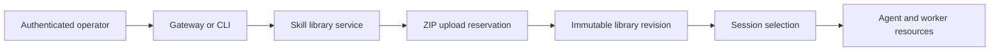

Codex review: needs real behavior proof before merge. _Reviewed September 1, 2026, 4:06 PM ET / 20:06 UTC._

# ClawSweeper review

## What this changes

The PR adds authenticated, profile-owned skill libraries with immutable revisions, session selection, ZIP and ClawHub imports, and delivery to agents and workers.

## Merge readiness

⛔ **Blocked until stronger real behavior proof is added - 6 items remain**

Keep open: the ZIP-import admission path lets one authorized profile exhaust all pending upload slots and deny imports to other authorized profiles.

**Priority:** P2
**Reviewed head:** `93fbd9f4488f9c332b2d54f07580841a1b468da8`

## Review scores

| Measure | Result | What it means |
|---|---|---|
| **Overall readiness** | 🦐 gold shrimp **(3/6)** | The PR has substantial feature-flow evidence, but the introduced resource-isolation defect prevents a higher rating. |
| **Proof confidence** | 🐚 platinum hermit **(4/6)** | Needs stronger real behavior proof before merge: Authority-chain proof required: the supplied Gateway and worker evidence supports the primary feature flow, but it does not prove that the nearest competing authorized profile can still reach upload admission after another profile exhausts pending slots. After adding proof, update the PR body; ClawSweeper should re-review automatically. If it does not, the PR author or someone with repository write access can comment `@clawsweeper re-review`. |
| **Patch quality** | 🦐 gold shrimp **(3/6)** | Security review found an item that needs attention. |

## Verification

| Check | Result | Evidence |
|---|---|---|
| **Real behavior** | Needs proof | Needs stronger real behavior proof before merge: Authority-chain proof required: the supplied Gateway and worker evidence supports the primary feature flow, but it does not prove that the nearest competing authorized profile can still reach upload admission after another profile exhausts pending slots. After adding proof, update the PR body; ClawSweeper should re-review automatically. If it does not, the PR author or someone with repository write access can comment `@clawsweeper re-review`. |
| **Evidence reviewed** | 7 items | Introduced global import quota: The ZIP begin path counts every unfinished upload without filtering by the authenticated profile, then creates an upload owned by that profile; 32 pending begins by one writer therefore reject another writer before it can start. Cross-profile callers are authorized separately: All new upload operations are Gateway methods requiring operator.write, so multiple independently authenticated profiles can reach the unscoped quota. Request reserves capacity before archive transfer: The begin schema accepts only a slug, byte count, and hash; the implementation reserves the row for one hour before any archive bytes are required. |
| **Findings** | 1 actionable finding | [P1] Reserve ZIP upload capacity per profile |
| **Security** | Needs attention | Cross-profile ZIP upload starvation: The global pending-upload query has no owner profile condition, allowing one operator.write principal to exhaust all reservations before any archive data is uploaded. |

## How this fits together

Skill libraries are created or imported through authenticated Gateway and CLI entry points, stored as immutable revisions, then selected into sessions and materialized for agents or workers. ZIP imports first reserve a temporary upload row before publishing a library revision.

## Before merge

- [ ] **Add real behavior proof** - Needs stronger real behavior proof before merge: Authority-chain proof required: the supplied Gateway and worker evidence supports the primary feature flow, but it does not prove that the nearest competing authorized profile can still reach upload admission after another profile exhausts pending slots. After adding proof, update the PR body; ClawSweeper should re-review automatically. If it does not, the PR author or someone with repository write access can comment `@clawsweeper re-review`.
- [ ] **Reserve ZIP upload capacity per profile (P1)** - `begin` counts all unfinished rows before inserting `owner_profile_id`, so one `operator.write` profile can leave 32 uploads pending and make every other profile’s ZIP import fail for an hour. Scope admission to the authenticated profile or reserve capacity for other profiles, and add a two-profile regression.
- [ ] **Resolve security concern: Cross-profile ZIP upload starvation** - The global pending-upload query has no owner profile condition, allowing one operator.write principal to exhaust all reservations before any archive data is uploaded.
- [ ] **Resolve merge risk (P1)** - A single operator.write profile can reserve every one-hour ZIP-import slot, denying imports to other authorized profiles.
- [ ] **Resolve merge risk (P1)** - The PR has 281 changed files; this review found one concrete defect but does not establish whole-branch correctness, and exact-head hosted CI remains incomplete.
- [ ] **Resolve merge risk (P1)** - The declared @openclaw/fs-safe 0.7.0 package source was absent locally and network resolution failed, so its archive-extraction contract was not independently verified.

## Findings

- [P1] Reserve ZIP upload capacity per profile — `src/skills/library/import.ts:111-120`
- [medium] Cross-profile ZIP upload starvation — `src/skills/library/import.ts:111`

<strong>Agent review details</strong>

### Security

Needs attention: The introduced shared upload quota allows a permitted profile to deny another permitted profile’s import capacity.

### PR surface

PR surface statistics unavailable: the file list is incomplete.

### Review metrics

| Metric | Value | Why it matters |
|---|---|---|
| **Production versus test delta** | production/tooling +7,962/-516; test/support +8,395/-756; docs +302/-34; generated +418/-1; lockfile +81/-7 | The supplied 281-file accounting reflects substantial feature growth, so the shared auth, persistence, and resource-limit boundaries need focused maintainer scrutiny. |

### Stored data model

Persistent data-model change detected: `durable storage schema: packages/gateway-protocol/src/schema/worker-skill-workshop.ts`, `serialized state: ui/src/pages/chat/chat-commands.ts`, `unknown-data-model-change: packages/gateway-protocol/src/schema/skill-library.ts`, `unknown-data-model-change: packages/gateway-protocol/src/schema/worker-skill-workshop.ts`, `unknown-data-model-change: ui/src/pages/chat/chat-commands.ts`, `unknown-truncated-pull-files`, and 1 more. Confirm migration or upgrade compatibility proof before merge.

### Merge-risk options

**Maintainer options:**
1. **Reserve active import capacity per profile (recommended)**  
   Keep the global resource bound but cap or reserve pending ZIP uploads per authenticated profile, then prove another profile can begin an import after one profile reaches its quota.
2. **Accept the shared-capacity tradeoff**  
   Land the global quota only if maintainers intentionally treat every operator.write profile as entitled to deny import capacity to the others for up to one hour.
3. **Pause the ZIP-import surface**  
   Defer the upload feature if a fair capacity policy cannot be agreed without broadening the product’s tenant or resource model.

### Technical review

Best possible solution:

Keep a bounded global import limit only with per-profile admission or reserved capacity, and add a two-profile regression proving one profile cannot deny another a begin request.

Do we have a high-confidence way to reproduce the issue?

Yes: use two operator.write profiles, leave 32 valid begin requests pending from the first, then issue begin from the second; the unscoped query deterministically rejects it for up to one hour.

Is this the best way to solve the issue?

No: the feature’s per-profile authorization model is undermined by a shared unpartitioned reservation quota; per-profile capacity protection at upload admission is the owner-level repair.

Full review comments:

- [P1] Reserve ZIP upload capacity per profile — `src/skills/library/import.ts:111-120`
  `begin` counts all unfinished rows before inserting `owner_profile_id`, so one `operator.write` profile can leave 32 uploads pending and make every other profile’s ZIP import fail for an hour. Scope admission to the authenticated profile or reserve capacity for other profiles, and add a two-profile regression.
  Confidence: 0.96

Overall correctness: patch is incorrect
Overall confidence: 0.93

AGENTS.md: found and applied where relevant.

Codex review notes: model internal, reasoning high; reviewed against [b49119b44f41](https://github.com/openclaw/openclaw/commit/b49119b44f41b16a4bde85acc5ace2d4969023e6).

### Labels

Label changes:

- add `merge-risk: 🚨 availability`: Exhausting the global pending-upload quota rejects every other ZIP import until an entry expires or completes.
- add `status: 📣 needs proof`: The PR needs real behavior proof before ClawSweeper can clear the contributor ask. Needs stronger real behavior proof before merge: Authority-chain proof required: the supplied Gateway and worker evidence supports the primary feature flow, but it does not prove that the nearest competing authorized profile can still reach upload admission after another profile exhausts pending slots. After adding proof, update the PR body; ClawSweeper should re-review automatically. If it does not, the PR author or someone with repository write access can comment `@clawsweeper re-review`.
- remove `merge-risk: 🚨 compatibility`: Current PR review merge-risk labels are `merge-risk: 🚨 security-boundary`, `merge-risk: 🚨 availability`.
- remove `status: ⏳ waiting on author`: Current PR status label is `status: 📣 needs proof`.

Label justifications:

- `P2`: This is a substantial unshipped feature with a bounded but real multi-profile import failure.
- `merge-risk: 🚨 security-boundary`: An authorized profile can consume a shared admission quota and interfere with other authorized profiles despite per-profile ownership checks.
- `merge-risk: 🚨 availability`: Exhausting the global pending-upload quota rejects every other ZIP import until an entry expires or completes.
- `rating: 🦐 gold shrimp`: Overall readiness is 🦐 gold shrimp; proof is 🐚 platinum hermit and patch quality is 🦐 gold shrimp.
- `status: 📣 needs proof`: The PR needs real behavior proof before ClawSweeper can clear the contributor ask. Needs stronger real behavior proof before merge: Authority-chain proof required: the supplied Gateway and worker evidence supports the primary feature flow, but it does not prove that the nearest competing authorized profile can still reach upload admission after another profile exhausts pending slots. After adding proof, update the PR body; ClawSweeper should re-review automatically. If it does not, the PR author or someone with repository write access can comment `@clawsweeper re-review`.

### Evidence

Security concerns:

- [medium] Cross-profile ZIP upload starvation — `src/skills/library/import.ts:111`
  The global pending-upload query has no owner profile condition, allowing one operator.write principal to exhaust all reservations before any archive data is uploaded.
  Confidence: 0.96

Acceptance criteria:

- [P1] Run the focused skill-library service/import suite containing the new two-profile quota regression.
- [P1] Run the repository changed-file checks for the touched library and Gateway paths.
- [P1] Demonstrate an authenticated profile A exhausting its allowed pending imports while profile B can still begin one.

What I checked:

- **Introduced global import quota:** The ZIP begin path counts every unfinished upload without filtering by the authenticated profile, then creates an upload owned by that profile; 32 pending begins by one writer therefore reject another writer before it can start. ([`src/skills/library/import.ts:111`](https://github.com/openclaw/openclaw/blob/93fbd9f4488f/src/skills/library/import.ts#L111), [93fbd9f4488f](https://github.com/openclaw/openclaw/commit/93fbd9f4488f))
- **Cross-profile callers are authorized separately:** All new upload operations are Gateway methods requiring operator.write, so multiple independently authenticated profiles can reach the unscoped quota. ([`src/gateway/methods/core-descriptors.ts:200`](https://github.com/openclaw/openclaw/blob/93fbd9f4488f/src/gateway/methods/core-descriptors.ts#L200), [93fbd9f4488f](https://github.com/openclaw/openclaw/commit/93fbd9f4488f))
- **Request reserves capacity before archive transfer:** The begin schema accepts only a slug, byte count, and hash; the implementation reserves the row for one hour before any archive bytes are required. ([`packages/gateway-protocol/src/schema/skill-library.ts:82`](https://github.com/openclaw/openclaw/blob/93fbd9f4488f/packages/gateway-protocol/src/schema/skill-library.ts#L82), [93fbd9f4488f](https://github.com/openclaw/openclaw/commit/93fbd9f4488f))
- **Existing test misses inter-profile capacity:** The active-upload test fills all 32 slots as Alice and asserts Alice is rejected; it does not prove Bob can still begin an import. ([`src/skills/library/service.test.ts:511`](https://github.com/openclaw/openclaw/blob/93fbd9f4488f/src/skills/library/service.test.ts#L511), [93fbd9f4488f](https://github.com/openclaw/openclaw/commit/93fbd9f4488f))
- **Introduction provenance:** The implicated file was added in this commit; comparison with its recorded parent shows the quota hunk was introduced there, and it remains unchanged at the review head. ([`src/skills/library/import.ts:111`](https://github.com/openclaw/openclaw/blob/343b128e19a8/src/skills/library/import.ts#L111), [343b128e19a8](https://github.com/openclaw/openclaw/commit/343b128e19a8))
- **Current-main check:** Current main has neither the skill-library implementation directory nor its Gateway methods, so the feature is neither implemented nor released from this branch. ([`src/skills/library/import.ts:92`](https://github.com/openclaw/openclaw/blob/b49119b44f41/src/skills/library/import.ts#L92), [b49119b44f41](https://github.com/openclaw/openclaw/commit/b49119b44f41))

Likely related people:

- **steipete:** Suggested for follow-up; no historical authorship or introduction is verified. (role: unverified routing candidate; confidence: low)

### Rank-up moves

Optional improvements that raise the rating; they are not merge blockers.

- Add a two-profile Gateway or service regression showing quota exhaustion by one profile does not reject another profile before I/O.

### Rating scale

| Score | Internal tier | Crab rank | Meaning |
|---:|:---:|---|---|
| **6/6** | S | 🦀 challenger crab | Exceptional readiness |
| **5/6** | A | 🦞 diamond lobster | Very strong readiness |
| **4/6** | B | 🐚 platinum hermit | Good normal PR; ordinary maintainer review |
| **3/6** | C | 🦐 gold shrimp | Useful, but confidence is limited |
| **2/6** | D | 🦪 silver shellfish | Proof or implementation needs work |
| **1/6** | F | 🧂 unranked krab | Not merge-ready |
| N/A | NA | 🌊 off-meta tidepool | Rating does not apply |

Overall follows the weaker of proof and patch quality.
Shiny media proof means a screenshot, video, or linked artifact directly shows the changed behavior. Runtime, network, CSP, and security claims still need visible diagnostics.

### Workflow

- ClawSweeper keeps one durable marker-backed review comment per issue or PR.
- Re-runs edit this comment so the latest verdict, findings, and automation markers stay together instead of adding duplicate bot comments.
- A fresh review can be triggered by eligible `@clawsweeper re-review` comments, exact-item GitHub events, scheduled/background review runs, or manual workflow dispatch.
- PR/issue authors and users with repository write access can comment `@clawsweeper re-review` or `@clawsweeper re-run` on an open PR or issue to request a fresh review only.
- Maintainers can also comment `@clawsweeper review` to request a fresh review only.
- Fresh-review commands do not start repair, autofix, rebase, CI repair, or automerge.
- Maintainer-only repair and merge flows require explicit commands such as `@clawsweeper autofix`, `@clawsweeper automerge`, `@clawsweeper fix ci`, or `@clawsweeper address review`.
- Maintainers can comment `@clawsweeper explain` to ask for more context, or `@clawsweeper stop` to stop active automation.

### History

Review history (9 earlier review cycles; latest 8 shown)

<!-- clawsweeper-review-history v=1 total=9 -->
- reviewed 2026-09-01T10:39:42.611Z sha 21e77e0d199dc4e72e86c365b2db173a753673b1 :: needs maintainer review before merge. :: none
- reviewed 2026-09-01T11:22:06.173Z sha ceb94a14baa21e3dfa6d2138459faaa8410fd166 :: found issues before merge. :: [P3] Clarify Claude CLI delivery for library selections
- reviewed 2026-09-01T12:51:45.392Z sha 2cdcf1b879d61ffe85637739a3dcd98ef43a0ce6 :: found issues before merge. :: [P1] Preserve generic approval source in Swift generation
- reviewed 2026-09-01T13:16:23.734Z sha 2cdcf1b879d61ffe85637739a3dcd98ef43a0ce6 :: needs real behavior proof before merge. :: [P1] Keep approval source generic in generated Swift
- reviewed 2026-09-01T15:15:46.863Z sha 7aba28a22dacdeaf073452761b03fcd9c6cad8a8 :: needs real behavior proof before merge. :: none
- reviewed 2026-09-01T15:41:26.035Z sha 7aba28a22dacdeaf073452761b03fcd9c6cad8a8 :: needs maintainer review before merge. :: none
- reviewed 2026-09-01T16:05:40.113Z sha ad0aba2446a3b9808b51be074e5b7f27f4e44529 :: needs maintainer review before merge. :: none
- reviewed 2026-09-01T17:47:32.697Z sha c98e0a6d72c1b36f5b574d891251c88eb5ac7367 :: needs maintainer review before merge. :: none

<!-- clawsweeper-security:security-sensitive item=134068 sha=93fbd9f4488f9c332b2d54f07580841a1b468da8 confidence=high updated_at=2026-09-01T20:01:40Z reviewed_at=2026-09-01T20:06:02.177Z lease_owner=github-run-33552710054-1 lease_comment_id=5499673412 source_revision=313bf1e897ff1dd0b1cfdfc8dc5d5db483e2f46b28a1f2f893b91e7505d5c8c8 live_verification=absent -->
<!-- clawsweeper-verdict:needs-human item=134068 sha=93fbd9f4488f9c332b2d54f07580841a1b468da8 confidence=high updated_at=2026-09-01T20:01:40Z reviewed_at=2026-09-01T20:06:02.177Z lease_owner=github-run-33552710054-1 lease_comment_id=5499673412 source_revision=313bf1e897ff1dd0b1cfdfc8dc5d5db483e2f46b28a1f2f893b91e7505d5c8c8 live_verification=absent -->

<!-- clawsweeper-review-version item=134068 reviewed_at=2026-09-01T20:06:02.177Z sha=93fbd9f4488f9c332b2d54f07580841a1b468da8 source_revision=313bf1e897ff1dd0b1cfdfc8dc5d5db483e2f46b28a1f2f893b91e7505d5c8c8 lease_owner=github-run-33552710054-1 lease_comment_id=5499673412 v=1 -->

<!-- clawsweeper-review item=134068 -->