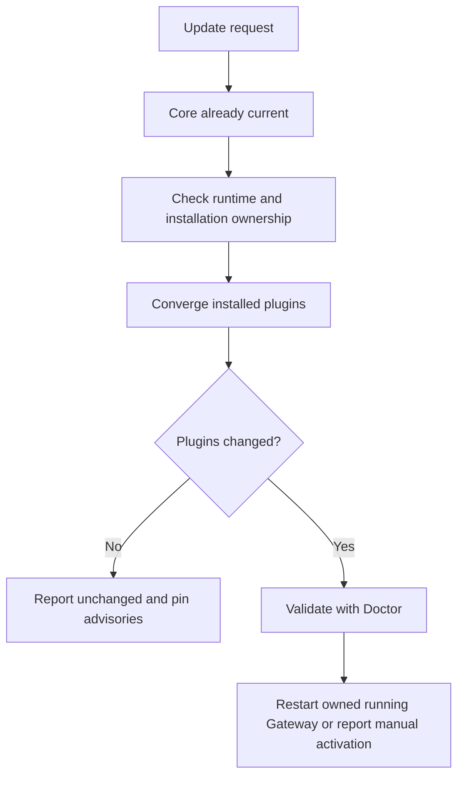

Codex review: needs maintainer review before merge. _Reviewed September 9, 2026, 12:50 PM ET / 16:50 UTC (Revision 5)._

# ClawSweeper review

## What this changes

Runs existing plugin maintenance when core is already current, preserves exact pins and their advisories, and activates changed plugins through the managed Gateway restart flow.

## Merge readiness

✅ **Ready for maintainer review**

Keep open: current main still skips plugin maintenance when core is already current. The prior runtime-admission blocker is resolved, and this review found no remaining blocking defect.

**Priority:** P2
**Reviewed head:** `4cbabb9e04e88b66261781c54eb0bf3c39e82697`

## Review scores

| Measure | Result | What it means |
|---|---|---|
| **Overall readiness** | 🐚 platinum hermit **(4/6)** | A focused repair with meaningful regression coverage and the prior blocker resolved; supplied validation is accurately scoped to the isolated harness. |
| **Proof confidence** | 🌊 off-meta tidepool | Not applicable: The ordinary external-contributor proof gate does not apply to this maintainer PR. The captured evidence exercises update orchestration with mocked package/service boundaries, including runtime refusal and refresh failure; it does not demonstrate a live registry upgrade or native Gateway restart. |
| **Patch quality** | 🐚 platinum hermit **(4/6)** | No actionable review findings were identified. |

## Verification

| Check | Result | Evidence |
|---|---|---|
| **Real behavior** | Not applicable | Not applicable: The ordinary external-contributor proof gate does not apply to this maintainer PR. The captured evidence exercises update orchestration with mocked package/service boundaries, including runtime refusal and refresh failure; it does not demonstrate a live registry upgrade or native Gateway restart. |
| **Evidence reviewed** | 9 items | Current main still needs this change: The current-main implementation reads installed records, checks missing payloads, and reports already-current without invoking plugin updates. Latest release comparison: The supplied latest release, v2026.9.3, contains the same read-only already-current path; the requested maintenance behavior is not present there. Prior finding resolved: Runtime admission now precedes plugin preflight and mutation. A fallback requires a running, owned service with a writable definition, and the selected runner and required-refresh flag reach finalization. The previous reviewed commit was unavailable locally, so continuity was checked against the supplied finding and current source rather than an invented historical comparison. |
| **Findings** | None | None. |
| **Security** | None | None. |

## How this fits together

The update CLI coordinates installed core versions, plugin packages, and the managed Gateway service. Plugin convergence applies existing selection policies, validates the resulting installation, and determines whether the running Gateway needs activation.

## Before merge

None.

<strong>Agent review details</strong>

### Security

None.

### PR surface

Source +243, Tests +419, Docs -3. Total +659 across 16 files.

View PR surface stats

| Area | Files | Added | Removed | Net |
|---|---:|---:|---:|---:|
| Source | 11 | 393 | 150 | +243 |
| Tests | 3 | 445 | 26 | +419 |
| Docs | 2 | 5 | 8 | -3 |
| Config | 0 | 0 | 0 | 0 |
| Generated | 0 | 0 | 0 | 0 |
| Other | 0 | 0 | 0 | 0 |
| **Total** | **16** | **843** | **184** | **+659** |

### Review metrics

| Metric | Value | Why it matters |
|---|---|---|
| **Production versus regression coverage** | Net production +243 lines; tests +419 lines | Production growth adds admission and finalization orchestration around existing maintenance owners; regression coverage addresses activation and failure boundaries. |

### Technical review

Best possible solution:

Keep one plugin maintenance flow for core-changing and already-current updates, preserving selected pins, runtime admission, owned-service activation, and explicit no-restart guidance.

Do we have a high-confidence way to reproduce the issue?

Yes, from source: install current core separately while leaving an eligible plugin outdated, then run openclaw update; current main returns through the read-only already-current path. No runtime reproduction was executed during this review.

Is this the best way to solve the issue?

Yes. Reusing convergence and finalization avoids a competing updater, and the revised runtime admission closes the previously identified shutdown failure.

AGENTS.md: found and applied where relevant.

Codex review notes: model internal, reasoning medium; reviewed against [627b1e84acaa](https://github.com/openclaw/openclaw/commit/627b1e84acaac3943e7cdc6c53372edb986f1962).

### Labels

Label changes:

- add `rating: 🐚 platinum hermit`: Overall readiness is 🐚 platinum hermit; proof is 🌊 off-meta tidepool and patch quality is 🐚 platinum hermit.
- add `status: 👀 ready for maintainer look`: ClawSweeper has no concrete contributor-facing blocker left for this PR. Not applicable: The ordinary external-contributor proof gate does not apply to this maintainer PR. The captured evidence exercises update orchestration with mocked package/service boundaries, including runtime refusal and refresh failure; it does not demonstrate a live registry upgrade or native Gateway restart.
- remove `rating: 🦐 gold shrimp`: Current PR rating is `rating: 🐚 platinum hermit`, so this older rating label is no longer current.
- remove `merge-risk: 🚨 availability`: Current PR review selected no merge-risk labels.
- remove `status: ⏳ waiting on author`: Current PR status label is `status: 👀 ready for maintainer look`.

Label justifications:

- `P2`: Repairs a bounded update workflow that otherwise leaves plugin maintenance undone after a separate core upgrade.
- `rating: 🐚 platinum hermit`: Overall readiness is 🐚 platinum hermit; proof is 🌊 off-meta tidepool and patch quality is 🐚 platinum hermit.
- `status: 👀 ready for maintainer look`: ClawSweeper has no concrete contributor-facing blocker left for this PR. Not applicable: The ordinary external-contributor proof gate does not apply to this maintainer PR. The captured evidence exercises update orchestration with mocked package/service boundaries, including runtime refusal and refresh failure; it does not demonstrate a live registry upgrade or native Gateway restart.

### Evidence

What I checked:

- **Current main still needs this change:** The current-main implementation reads installed records, checks missing payloads, and reports already-current without invoking plugin updates. ([`src/cli/update-cli/update-command-noop.ts:15`](https://github.com/openclaw/openclaw/blob/627b1e84acaac3943e7cdc6c53372edb986f1962/src/cli/update-cli/update-command-noop.ts#L15), [627b1e84acaa](https://github.com/openclaw/openclaw/commit/627b1e84acaac3943e7cdc6c53372edb986f1962))
- **Latest release comparison:** The supplied latest release, v2026.9.3, contains the same read-only already-current path; the requested maintenance behavior is not present there. ([`src/cli/update-cli/update-command-noop.ts:15`](https://github.com/openclaw/openclaw/blob/1391f7cd2d40ab5bbcf2f5f831d3a64f520e72d7/src/cli/update-cli/update-command-noop.ts#L15), [1391f7cd2d40](https://github.com/openclaw/openclaw/commit/1391f7cd2d40ab5bbcf2f5f831d3a64f520e72d7))
- **Prior finding resolved:** Runtime admission now precedes plugin preflight and mutation. A fallback requires a running, owned service with a writable definition, and the selected runner and required-refresh flag reach finalization. The previous reviewed commit was unavailable locally, so continuity was checked against the supplied finding and current source rather than an invented historical comparison. ([`src/cli/update-cli/update-command-noop.ts:74`](https://github.com/openclaw/openclaw/blob/4cbabb9e04e88b66261781c54eb0bf3c39e82697/src/cli/update-cli/update-command-noop.ts#L74), [4cbabb9e04e8](https://github.com/openclaw/openclaw/commit/4cbabb9e04e88b66261781c54eb0bf3c39e82697))
- **Required runtime replacement cannot use unsafe recovery:** A required service-runtime refresh failure records service-runtime-refresh-failed and exits the activation attempt; finalization excludes generic service repair for that failure. Unchanged plugin results do not restart the Gateway. ([`src/cli/update-cli/update-command-service.ts:371`](https://github.com/openclaw/openclaw/blob/4cbabb9e04e88b66261781c54eb0bf3c39e82697/src/cli/update-cli/update-command-service.ts#L371), [4cbabb9e04e8](https://github.com/openclaw/openclaw/commit/4cbabb9e04e88b66261781c54eb0bf3c39e82697))
- **Existing ownership checks retained:** The new path repeats service and configuration admission after plugin target lookup. The existing native stop owner rechecks the exact service definition and manager after awaited preparation and before stopping it. ([`src/cli/update-cli/update-command-service-maintenance.ts:487`](https://github.com/openclaw/openclaw/blob/4cbabb9e04e88b66261781c54eb0bf3c39e82697/src/cli/update-cli/update-command-service-maintenance.ts#L487), [4cbabb9e04e8](https://github.com/openclaw/openclaw/commit/4cbabb9e04e88b66261781c54eb0bf3c39e82697))
- **Regression and proof assessment:** Inspected added cases cover running and absent services, no-restart, retained pins, changed ownership, incompatible Node, permitted fallback, failed refresh, and Doctor/partial-stop failures. The captured PR body reports before/after failures and passes, 581 owner tests, and 28 post-rebase focused tests, explicitly using mocked package/service boundaries. These are contributor-reported results; this read-only review executed no tests. ([`src/cli/update-cli.test.ts:10764`](https://github.com/openclaw/openclaw/blob/4cbabb9e04e88b66261781c54eb0bf3c39e82697/src/cli/update-cli.test.ts#L10764), [4cbabb9e04e8](https://github.com/openclaw/openclaw/commit/4cbabb9e04e88b66261781c54eb0bf3c39e82697))

Likely related people:

- **steipete:** Suggested for follow-up; no historical authorship or introduction is verified. (role: unverified routing candidate; confidence: low)
- **unknown:** The claimed source-line change could not be verified from bounded local history. (role: source history unknown; confidence: low)

### Rating scale

| Score | Internal tier | Crab rank | Meaning |
|---:|:---:|---|---|
| **6/6** | S | 🦀 challenger crab | Exceptional readiness |
| **5/6** | A | 🦞 diamond lobster | Very strong readiness |
| **4/6** | B | 🐚 platinum hermit | Good normal PR; ordinary maintainer review |
| **3/6** | C | 🦐 gold shrimp | Useful, but confidence is limited |
| **2/6** | D | 🦪 silver shellfish | Proof or implementation needs work |
| **1/6** | F | 🧂 unranked krab | Not merge-ready |
| N/A | NA | 🌊 off-meta tidepool | Rating does not apply |

Overall follows the weaker of proof and patch quality.
Shiny media proof means a screenshot, video, or linked artifact directly shows the changed behavior. Runtime, network, CSP, and security claims still need visible diagnostics.

### Workflow

- ClawSweeper keeps one durable marker-backed review comment per issue or PR.
- Re-runs edit this comment so the latest verdict, findings, and automation markers stay together instead of adding duplicate bot comments.
- A fresh review can be triggered by eligible `@clawsweeper re-review` comments, exact-item GitHub events, scheduled/background review runs, or manual workflow dispatch.
- PR/issue authors and users with repository write access can comment `@clawsweeper re-review` or `@clawsweeper re-run` on an open PR or issue to request a fresh review only.
- Maintainers can also comment `@clawsweeper review` to request a fresh review only.
- Fresh-review commands do not start repair, autofix, rebase, CI repair, or automerge.
- Maintainer-only repair and merge flows require explicit commands such as `@clawsweeper autofix`, `@clawsweeper automerge`, `@clawsweeper fix ci`, or `@clawsweeper address review`.
- Maintainers can comment `@clawsweeper explain` to ask for more context, or `@clawsweeper stop` to stop active automation.

### History

Review history (4 earlier review cycles)

<!-- clawsweeper-review-history v=1 total=4 -->
- reviewed 2026-09-09T14:36:40.120Z sha 59c55021b70bc3bbbf08fd850f9320b4e2f151a2 :: needs maintainer review before merge. :: none
- reviewed 2026-09-09T14:50:15.935Z sha 38fce4305c7edbdf230352c48d7c6b47aad5301c :: blocked before merge. :: [P1] Validate the managed Node before same-version plugin maintenance
- reviewed 2026-09-09T15:02:07.471Z sha 38fce4305c7edbdf230352c48d7c6b47aad5301c :: blocked before merge. :: [P1] Validate the managed Node before same-version plugin maintenance
- reviewed 2026-09-09T15:13:02.633Z sha 38fce4305c7edbdf230352c48d7c6b47aad5301c :: blocked before merge. :: [P1] Validate the managed Node before same-version plugin maintenance

<!-- clawsweeper-verdict:needs-human item=143174 sha=4cbabb9e04e88b66261781c54eb0bf3c39e82697 confidence=high updated_at=2026-09-09T16:47:15Z reviewed_at=2026-09-09T16:50:20.714Z lease_owner=github-run-34378716059-1 lease_comment_id=5605483182 source_revision=8ebb4310c3da7b1125cd2597b2cd6f2323da6bb84fadb7f4c4861f3927cb2809 live_verification=absent -->
<!-- clawsweeper-review-state:ready item=143174 sha=4cbabb9e04e88b66261781c54eb0bf3c39e82697 v=1 -->

<!-- clawsweeper-review-version item=143174 reviewed_at=2026-09-09T16:50:20.714Z sha=4cbabb9e04e88b66261781c54eb0bf3c39e82697 source_revision=8ebb4310c3da7b1125cd2597b2cd6f2323da6bb84fadb7f4c4861f3927cb2809 lease_owner=github-run-34378716059-1 lease_comment_id=5605483182 v=1 -->

<!-- clawsweeper-review item=143174 -->