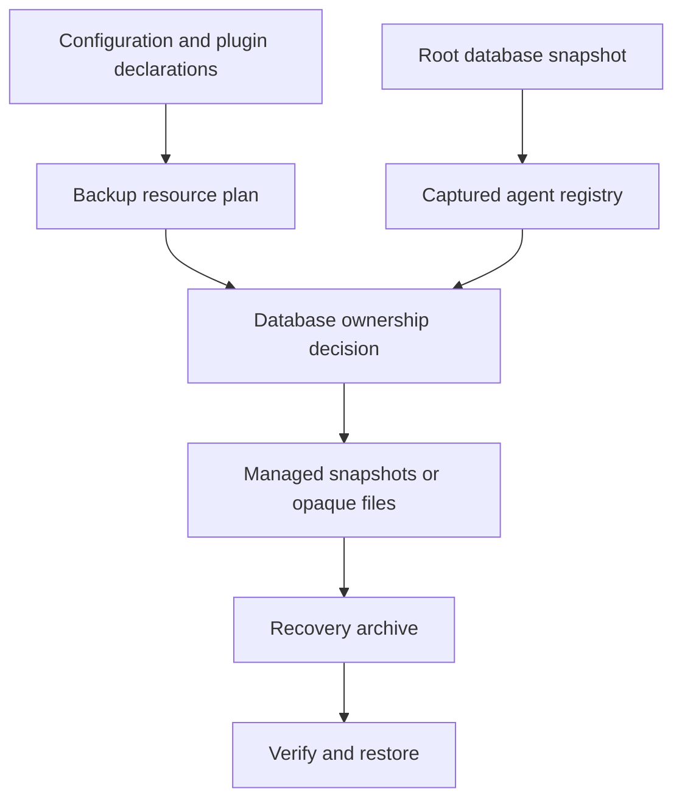

Codex review: blocked before merge. _Reviewed September 13, 2026, 1:35 AM ET / 05:35 UTC (Revision 3)._

# ClawSweeper review

## What this changes

The PR snapshots registered OpenClaw and declared plugin databases while copying other SQLite files and sidecars unchanged, reporting warnings, and skipping unresolvable foreign SQLite links.

## Merge readiness

⛔ **Blocked before merge - 4 items remain**

This remains a useful fix for a current backup failure. No blocking code defect was found, but the previously identified archive-reader compatibility decision remains unresolved.

**Priority:** P2
**Reviewed head:** `bf81b138f9482db6b7c76c08bbcd93581ac2daa7`
**Owner decision:** Required. See [Decision needed](#decision-needed).

## Review scores

| Measure | Result | What it means |
|---|---|---|
| **Overall readiness** | 🐚 platinum hermit **(4/6)** | A coherent fix with relevant real CLI evidence and meaningful regression coverage; compatibility acceptance remains a separate merge gate. |
| **Proof confidence** | 🐚 platinum hermit **(4/6)** | Sufficient (live_output): Retained PR-body observations cover real CLI create, verify, and restore, byte preservation, managed refusal, WAL hardlinks, and concurrent writes through the changed backup owner; the latest formatter relocation does not invalidate that evidence. |
| **Patch quality** | 🐚 platinum hermit **(4/6)** | No actionable review findings were identified. |

## Verification

| Check | Result | Evidence |
|---|---|---|
| **Real behavior** | Verified | Sufficient (live_output): Retained PR-body observations cover real CLI create, verify, and restore, byte preservation, managed refusal, WAL hardlinks, and concurrent writes through the changed backup owner; the latest formatter relocation does not invalidate that evidence. |
| **Evidence reviewed** | 9 items | Current main still has the reported failure mechanism: Fetched main classifies included SQLite files under state and configured agent roots as snapshot candidates without requiring declared ownership. They still reach verified snapshot creation, so the central change remains necessary. Ownership and archive handling: Creation reads agent registrations from the online root snapshot, seals the ownership inventory, retains managed database validation, and records opaque-file warnings. Verification derives agent ownership from the archived registry. Shipped reader incompatibility: The v2026.9.4 verifier rejects SQLite sidecars under state and agent roots. Consequently, archives containing the newly permitted opaque sidecars cannot be verified or restored by that release. |
| **Findings** | None | None. |
| **Security** | None | None. |

## How this fits together

OpenClaw’s archive backup combines configuration, state, credentials, and workspaces into a recovery archive. Database ownership determines which files receive consistent SQLite snapshots and which checks verification performs before restore.

## Decision needed

| Question | Recommendation |
|---|---|
| Should this change require a newer archive reader and make plugin snapshot guarantees depend on explicit backupResources declarations? | **Accept and document the new recovery contract:** Retain the ownership-based behavior, document the required reader, and record old-reader rejection alongside successful candidate restoration. |

Why: The implementation changes shipped recovery and plugin backup guarantees even though the numeric archive schema and manifest fields remain unchanged.

## Before merge

- [ ] **Resolve merge risk (P1)** - Archives containing opaque SQLite sidecars will fail verification and restore on v2026.9.4; the supported reader requirement remains undocumented and unaccepted.
- [ ] **Resolve merge risk (P1)** - Undeclared plugin databases lose automatic consistent snapshots and deleted-page removal. Existing installations need an explicit compatibility policy for this changed meaning of backupResources.
- [ ] **Complete next step (P2)** - Record maintainer acceptance of the changed backup guarantees, document the supported reader requirement, and retain old/new reader compatibility evidence.
- [ ] **Resolve maintainer decision** - Resolve the maintainer decision shown above before merge.

<strong>Agent review details</strong>

### Security

None.

### PR surface

Source +31, Tests +458, Docs +29. Total +518 across 21 files.

View PR surface stats

| Area | Files | Added | Removed | Net |
|---|---:|---:|---:|---:|
| Source | 10 | 558 | 527 | +31 |
| Tests | 8 | 762 | 304 | +458 |
| Docs | 3 | 51 | 22 | +29 |
| Config | 0 | 0 | 0 | 0 |
| Generated | 0 | 0 | 0 | 0 |
| Other | 0 | 0 | 0 | 0 |
| **Total** | **21** | **1371** | **853** | **+518** |

### Review metrics

| Metric | Value | Why it matters |
|---|---|---|
| **Production and test growth** | Production +31 net lines; tests +458 net lines | The stated production-growth justification is separating resource planning from captured ownership, with most net growth in regression coverage. |

### Root-cause cluster

Relationship: `fixed_by_candidate`
Canonical: https://github.com/openclaw/openclaw/issues/144552
Summary: This PR is the explicit candidate fix for the reported foreign SQLite backup failure.

Members:
- `canonical`: https://github.com/openclaw/openclaw/issues/144552 - The open report supplies the concrete reproduction and is explicitly linked by this PR.

Proposal only: this assessment does not dispatch repair, suppress jobs, mutate sibling items, close, or merge anything.

### Merge-risk options

**Maintainer options:**
1. **Accept a documented reader requirement (recommended)**  
   Approve the changed guarantees with explicit recovery documentation and an old/new reader compatibility record.
2. **Preserve the existing recovery contract**  
   Revise the exception before merge if older readers or implicit plugin snapshot guarantees must remain supported.

### Technical review

Best possible solution:

Keep a single captured ownership inventory and make the accepted reader requirements and plugin snapshot guarantees explicit in recovery guidance.

Do we have a high-confidence way to reproduce the issue?

Yes. The foreign-key fixture reaches unconditional snapshot validation on fetched main, and the PR records a real CLI failure; this review did not execute it.

Is this the best way to solve the issue?

Yes, the shared ownership decision addresses the reported failure without globally weakening managed database checks; acceptance still depends on the changed recovery contract.

AGENTS.md: found and applied where relevant.

Codex review notes: model internal, reasoning medium; reviewed against [b86bcb7dd218](https://github.com/openclaw/openclaw/commit/b86bcb7dd2185dd3af553e3ba7fce5bacc84b53c).

### Labels

Label justifications:

- `P2`: The fix restores archive creation for installations containing unrelated SQLite files with referential-integrity failures.
- `merge-risk: 🚨 compatibility`: New opaque-sidecar archives are rejected by v2026.9.4, and undeclared plugin databases receive different backup guarantees.
- `rating: 🐚 platinum hermit`: Overall readiness is 🐚 platinum hermit; proof is 🐚 platinum hermit and patch quality is 🐚 platinum hermit.
- `status: 👀 ready for maintainer look`: ClawSweeper has no concrete contributor-facing blocker left for this PR. Sufficient (live_output): Retained PR-body observations cover real CLI create, verify, and restore, byte preservation, managed refusal, WAL hardlinks, and concurrent writes through the changed backup owner; the latest formatter relocation does not invalidate that evidence.
- `proof: sufficient`: Contributor real behavior proof is sufficient. Retained PR-body observations cover real CLI create, verify, and restore, byte preservation, managed refusal, WAL hardlinks, and concurrent writes through the changed backup owner; the latest formatter relocation does not invalidate that evidence.

### Evidence

What I checked:

- **Current main still has the reported failure mechanism:** Fetched main classifies included SQLite files under state and configured agent roots as snapshot candidates without requiring declared ownership. They still reach verified snapshot creation, so the central change remains necessary. ([`src/infra/backup-sqlite-snapshot.ts:116`](https://github.com/openclaw/openclaw/blob/b86bcb7dd2185dd3af553e3ba7fce5bacc84b53c/src/infra/backup-sqlite-snapshot.ts#L116), [b86bcb7dd218](https://github.com/openclaw/openclaw/commit/b86bcb7dd2185dd3af553e3ba7fce5bacc84b53c))
- **Ownership and archive handling:** Creation reads agent registrations from the online root snapshot, seals the ownership inventory, retains managed database validation, and records opaque-file warnings. Verification derives agent ownership from the archived registry. ([`src/infra/backup-sqlite-snapshot.ts:235`](https://github.com/openclaw/openclaw/blob/bf81b138f9482db6b7c76c08bbcd93581ac2daa7/src/infra/backup-sqlite-snapshot.ts#L235), [bf81b138f948](https://github.com/openclaw/openclaw/commit/bf81b138f9482db6b7c76c08bbcd93581ac2daa7))
- **Shipped reader incompatibility:** The v2026.9.4 verifier rejects SQLite sidecars under state and agent roots. Consequently, archives containing the newly permitted opaque sidecars cannot be verified or restored by that release. ([`src/commands/backup-verify.ts:302`](https://github.com/openclaw/openclaw/blob/3a9d69db306cd7f081e06254cb89c4bcc14a7107/src/commands/backup-verify.ts#L302), [3a9d69db306c](https://github.com/openclaw/openclaw/commit/3a9d69db306cd7f081e06254cb89c4bcc14a7107))
- **Documented guarantee change:** The updated documentation explicitly removes live consistency and deleted-data-removal guarantees for undeclared SQLite files. Existing plugin include declarations now select managed snapshots; the documentation does not identify the incompatible older archive reader. Public docs: [`docs/cli/backup.md`](https://docs.openclaw.ai/cli/backup). ([`docs/cli/backup.md:350`](https://docs.openclaw.ai/cli/backup), [bf81b138f948](https://github.com/openclaw/openclaw/commit/bf81b138f9482db6b7c76c08bbcd93581ac2daa7))
- **Re-review continuity:** Comparison with the previous reviewed head shows no changes to capture, verification, or compatibility documentation. GitHub’s exact-head commit patch confirms that the latest commit only relocates summary formatting and updates its imports. The earlier cyclic-link concern is addressed by explicit skip-and-warning handling. ([`src/commands/backup-summary.ts:3`](https://github.com/openclaw/openclaw/blob/bf81b138f9482db6b7c76c08bbcd93581ac2daa7/src/commands/backup-summary.ts#L3), [bf81b138f948](https://github.com/openclaw/openclaw/commit/bf81b138f9482db6b7c76c08bbcd93581ac2daa7))
- **Retained real CLI evidence:** The supplied complete PR body, captured under sourceRevision 49f5242d3afc6740c57f88059f4ffd3e7a1fac338fc96341ac068cfdfa8ff3bd, reports baseline failure, candidate create/verify/restore preserving seven foreign files and sidecars, managed refusal controls, WAL-aware hardlinks, and successful capture during 10 ms commits with 309 rows during a 3.6-second run. These observations cover the changed production path; they were not independently rerun during this read-only review. ([37f9d97a9d65](https://github.com/openclaw/openclaw/commit/37f9d97a9d65a3c47b8d0a147233365cfc82fcaa))

Likely related people:

- **obviyus:** Suggested for follow-up; no historical authorship or introduction is verified. (role: unverified routing candidate; confidence: low)
- **steipete:** Suggested for follow-up; no historical authorship or introduction is verified. (role: unverified routing candidate; confidence: low)

### Rank-up moves

Optional improvements that raise the rating; they are not merge blockers.

- Document and record old/new reader compatibility, including v2026.9.4 rejection of opaque sidecars and successful candidate restoration.

### Rating scale

| Score | Internal tier | Crab rank | Meaning |
|---:|:---:|---|---|
| **6/6** | S | 🦀 challenger crab | Exceptional readiness |
| **5/6** | A | 🦞 diamond lobster | Very strong readiness |
| **4/6** | B | 🐚 platinum hermit | Good normal PR; ordinary maintainer review |
| **3/6** | C | 🦐 gold shrimp | Useful, but confidence is limited |
| **2/6** | D | 🦪 silver shellfish | Proof or implementation needs work |
| **1/6** | F | 🧂 unranked krab | Not merge-ready |
| N/A | NA | 🌊 off-meta tidepool | Rating does not apply |

Overall follows the weaker of proof and patch quality.
Shiny media proof means a screenshot, video, or linked artifact directly shows the changed behavior. Runtime, network, CSP, and security claims still need visible diagnostics.

### Workflow

- ClawSweeper keeps one durable marker-backed review comment per issue or PR.
- Re-runs edit this comment so the latest verdict, findings, and automation markers stay together instead of adding duplicate bot comments.
- A fresh review can be triggered by eligible `@clawsweeper re-review` comments, exact-item GitHub events, scheduled/background review runs, or manual workflow dispatch.
- PR/issue authors and users with repository write access can comment `@clawsweeper re-review` or `@clawsweeper re-run` on an open PR or issue to request a fresh review only.
- Maintainers can also comment `@clawsweeper review` to request a fresh review only.
- Fresh-review commands do not start repair, autofix, rebase, CI repair, or automerge.
- Maintainer-only repair and merge flows require explicit commands such as `@clawsweeper autofix`, `@clawsweeper automerge`, `@clawsweeper fix ci`, or `@clawsweeper address review`.
- Maintainers can comment `@clawsweeper explain` to ask for more context, or `@clawsweeper stop` to stop active automation.

### History

Review history (2 earlier review cycles)

<!-- clawsweeper-review-history v=1 total=2 -->
- reviewed 2026-09-13T03:31:46.306Z sha ce85d13530c4f793fa7f2075f641da90d488a767 :: blocked before merge. :: [P2] [P2] Preserve undeclared cyclic SQLite symlinks
- reviewed 2026-09-13T04:56:40.735Z sha ec4989c3346b17d5ae8d42719c058a6c16cd20b4 :: blocked before merge. :: none

<!-- clawsweeper-verdict:needs-human item=146700 sha=bf81b138f9482db6b7c76c08bbcd93581ac2daa7 confidence=high updated_at=2026-09-13T05:31:43Z reviewed_at=2026-09-13T05:35:08.569Z lease_owner=github-run-34740449717-1 lease_comment_id=5651404497 source_revision=49f5242d3afc6740c57f88059f4ffd3e7a1fac338fc96341ac068cfdfa8ff3bd live_verification=absent -->
<!-- clawsweeper-review-state:blocked item=146700 sha=bf81b138f9482db6b7c76c08bbcd93581ac2daa7 v=1 -->

<!-- clawsweeper-review-version item=146700 reviewed_at=2026-09-13T05:35:08.569Z sha=bf81b138f9482db6b7c76c08bbcd93581ac2daa7 source_revision=49f5242d3afc6740c57f88059f4ffd3e7a1fac338fc96341ac068cfdfa8ff3bd lease_owner=github-run-34740449717-1 lease_comment_id=5651404497 v=1 -->

<!-- clawsweeper-review item=146700 -->