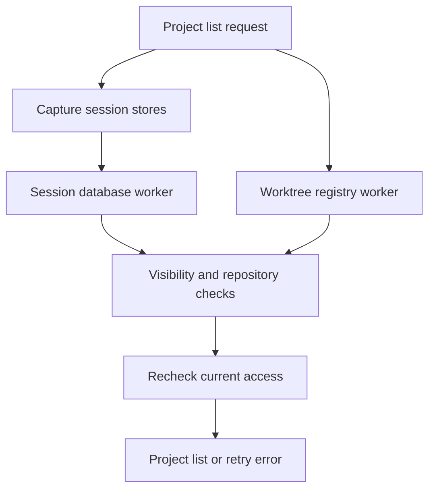

Codex review: blocked before merge. _Reviewed September 19, 2026, 2:56 PM ET / 18:56 UTC (Revision 7)._

# ClawSweeper review

## What this changes

Moves project session and worktree listings into existing database workers, preserves disclosure checks, and updates the worktree cleanup CLI to await registry results.

## Merge readiness

⛔ **Blocked before merge - 2 items remain**

This remains useful: current main and the latest release still perform the affected listings synchronously. No concrete introduced correctness defect was found; the scoped performance-validation follow-up remains unresolved.

**Priority:** P2
**Reviewed head:** `786e23f6010ec7bf6b27a2d91a54053fb3fd2477`

## Review scores

| Measure | Result | What it means |
|---|---|---|
| **Overall readiness** | 🐚 platinum hermit **(4/6)** | The implementation is coherent and has meaningful boundary coverage, with performance quantification still outstanding. |
| **Proof confidence** | 🌊 off-meta tidepool | Not applicable: The supplied context identifies maintainer-authored work, so the external-contributor proof gate does not apply. Registered-handler and real-worker controls support the changed path; scoped performance measurements remain a separate validation requirement. |
| **Patch quality** | 🐚 platinum hermit **(4/6)** | No actionable review findings were identified. |

## Verification

| Check | Result | Evidence |
|---|---|---|
| **Real behavior** | Not applicable | Not applicable: The supplied context identifies maintainer-authored work, so the external-contributor proof gate does not apply. Registered-handler and real-worker controls support the changed path; scoped performance measurements remain a separate validation requirement. |
| **Evidence reviewed** | 8 items | Pinned implementation and publication boundary: The introduced diff prepares session rows once, awaits observational worktree reads, and checks requester identity, configuration, and access revision before publishing. Current write scope determines whether paths and observed checkouts are returned. Current main still needs the change: Fetched main still calls the synchronous combined-session reader for recents and observed projects, and synchronously consumes worktree registry records. The landed prerequisites do not implement this remaining worker cutover. Latest release comparison: The v2026.9.5 source also uses synchronous combined-session and worktree registry reads. Local retrieval of the release blob failed, so the same tagged file was inspected through GitHub's contents API. |
| **Findings** | None | None. |
| **Security** | None | None. |

## How this fits together

The Gateway builds project recents and discovered checkouts from session databases and the managed-worktree registry. Worker results feed the existing visibility filters and repository checks before the Gateway returns the project list.

## Before merge

- [ ] **Resolve merge risk (P1)** - The elapsed-time and RSS cost of transferring complete listings and retaining their database owners remains unquantified.
- [ ] **Complete next step (P2)** - Add the scoped before/after elapsed-time and RSS measurements to the PR evidence, naming the workload and compared revisions.

<strong>Agent review details</strong>

### Security

None.

### PR surface

Source +254, Tests +615, Docs +20. Total +889 across 29 files.

View PR surface stats

| Area | Files | Added | Removed | Net |
|---|---:|---:|---:|---:|
| Source | 11 | 525 | 271 | +254 |
| Tests | 17 | 716 | 101 | +615 |
| Docs | 1 | 20 | 0 | +20 |
| Config | 0 | 0 | 0 | 0 |
| Generated | 0 | 0 | 0 | 0 |
| Other | 0 | 0 | 0 | 0 |
| **Total** | **29** | **1261** | **372** | **+889** |

### Review metrics

| Metric | Value | Why it matters |
|---|---|---|
| **Net growth by responsibility** | Production +254 lines; tests +604; test routing +11 | Production growth supports retained batch reads and worker dispatch; much of the new resource module relocates existing lifecycle code. |

### Merge-risk options

**Maintainer options:**
1. **Decide the mitigation before merge**  
   Keep descriptive database reads in the existing workers, preserve synchronous deletion authority, and establish the latency and memory tradeoff with comparable measurements.
2. **Pause or close**  
   Do not merge this PR until maintainers decide whether the risk is worth taking.

### Technical review

Best possible solution:

Keep descriptive database reads in the existing workers, preserve synchronous deletion authority, and establish the latency and memory tradeoff with comparable measurements.

Do we have a high-confidence way to reproduce the issue?

Yes for the blocking mechanism: current main directly executes synchronous session and registry reads from the project-list request. Actual latency under load was not reproduced in this read-only review.

Is this the best way to solve the issue?

Yes: reusing the existing workers and query owners is a focused solution that preserves storage and disclosure contracts; the performance benefit and memory cost still need measurement.

AGENTS.md: found and applied where relevant.

Codex review notes: model internal, reasoning medium; reviewed against [5ef36706caa7](https://github.com/openclaw/openclaw/commit/5ef36706caa77944bf2ffe54a2bb971c210d100c).

### Labels

Label justifications:

- `P2`: This is a bounded responsiveness improvement to project listings without evidence of an urgent runtime outage.
- `rating: 🐚 platinum hermit`: Overall readiness is 🐚 platinum hermit; proof is 🌊 off-meta tidepool and patch quality is 🐚 platinum hermit.
- `status: 👀 ready for maintainer look`: ClawSweeper has no concrete contributor-facing blocker left for this PR. Not applicable: The supplied context identifies maintainer-authored work, so the external-contributor proof gate does not apply. Registered-handler and real-worker controls support the changed path; scoped performance measurements remain a separate validation requirement.

### Evidence

What I checked:

- **Pinned implementation and publication boundary:** The introduced diff prepares session rows once, awaits observational worktree reads, and checks requester identity, configuration, and access revision before publishing. Current write scope determines whether paths and observed checkouts are returned. ([`src/gateway/server-methods/projects.ts:461`](https://github.com/openclaw/openclaw/blob/786e23f6010ec7bf6b27a2d91a54053fb3fd2477/src/gateway/server-methods/projects.ts#L461), [786e23f6010e](https://github.com/openclaw/openclaw/commit/786e23f6010ec7bf6b27a2d91a54053fb3fd2477))
- **Current main still needs the change:** Fetched main still calls the synchronous combined-session reader for recents and observed projects, and synchronously consumes worktree registry records. The landed prerequisites do not implement this remaining worker cutover. ([`src/gateway/server-methods/projects.ts:183`](https://github.com/openclaw/openclaw/blob/5ef36706caa77944bf2ffe54a2bb971c210d100c/src/gateway/server-methods/projects.ts#L183), [5ef36706caa7](https://github.com/openclaw/openclaw/commit/5ef36706caa77944bf2ffe54a2bb971c210d100c))
- **Latest release comparison:** The v2026.9.5 source also uses synchronous combined-session and worktree registry reads. Local retrieval of the release blob failed, so the same tagged file was inspected through GitHub's contents API. ([`src/gateway/server-methods/projects.ts:183`](https://github.com/openclaw/openclaw/blob/ec9c1a13db8938e5a3eaa51fca2e981cde2395a9/src/gateway/server-methods/projects.ts#L183), [ec9c1a13db89](https://github.com/openclaw/openclaw/commit/ec9c1a13db8938e5a3eaa51fca2e981cde2395a9))
- **Retained database lifetime and error coverage:** The batch retains all selected databases before yielding and checks revocation before returning. Added tests exercise canonical close/reopen, replacement of a later batch target, captured environment and options, physical-store ownership, incognito handling, and unavailable-store errors through real workers. These tests were inspected, not executed during this review. ([`src/config/sessions/combined-store-gateway.worker.test.ts:47`](https://github.com/openclaw/openclaw/blob/786e23f6010ec7bf6b27a2d91a54053fb3fd2477/src/config/sessions/combined-store-gateway.worker.test.ts#L47), [786e23f6010e](https://github.com/openclaw/openclaw/commit/786e23f6010ec7bf6b27a2d91a54053fb3fd2477))
- **Registered entrypoint and access controls:** The added registered-handler test checks both recents and observed checkouts while observing zero caller-thread session-row queries after calibration. Additional cases verify scope downgrade redaction and rejection after access changes during session reads, registry reads, and repository probes. ([`src/gateway/server-methods/projects.test.ts:234`](https://github.com/openclaw/openclaw/blob/786e23f6010ec7bf6b27a2d91a54053fb3fd2477/src/gateway/server-methods/projects.test.ts#L234), [786e23f6010e](https://github.com/openclaw/openclaw/commit/786e23f6010ec7bf6b27a2d91a54053fb3fd2477))
- **Performance follow-up remains applicable:** The applicable agent policy requires before/after seconds and RSS for performance changes. The complete captured PR body and matching live body describe focused controls and source-qualified earlier validation, but provide no such measurements. This is the same concrete follow-up retained from the previous completed review, not a new code finding. ([`src/agents/AGENTS.md:61`](https://github.com/openclaw/openclaw/blob/786e23f6010ec7bf6b27a2d91a54053fb3fd2477/src/agents/AGENTS.md#L61), [786e23f6010e](https://github.com/openclaw/openclaw/commit/786e23f6010ec7bf6b27a2d91a54053fb3fd2477))

Likely related people:

- **unknown:** The claimed source-line change could not be verified from bounded local history. (role: source history unknown; confidence: low)

### Rank-up moves

Optional improvements that raise the rating; they are not merge blockers.

- Record before/after elapsed time and RSS for the affected listing path, identifying the workload and compared revisions.

### Rating scale

| Score | Internal tier | Crab rank | Meaning |
|---:|:---:|---|---|
| **6/6** | S | 🦀 challenger crab | Exceptional readiness |
| **5/6** | A | 🦞 diamond lobster | Very strong readiness |
| **4/6** | B | 🐚 platinum hermit | Good normal PR; ordinary maintainer review |
| **3/6** | C | 🦐 gold shrimp | Useful, but confidence is limited |
| **2/6** | D | 🦪 silver shellfish | Proof or implementation needs work |
| **1/6** | F | 🧂 unranked krab | Not merge-ready |
| N/A | NA | 🌊 off-meta tidepool | Rating does not apply |

Overall follows the weaker of proof and patch quality.
Shiny media proof means a screenshot, video, or linked artifact directly shows the changed behavior. Runtime, network, CSP, and security claims still need visible diagnostics.

### Workflow

- ClawSweeper keeps one durable marker-backed review comment per issue or PR.
- Re-runs edit this comment so the latest verdict, findings, and automation markers stay together instead of adding duplicate bot comments.
- A fresh review can be triggered by eligible `@clawsweeper re-review` comments, exact-item GitHub events, scheduled/background review runs, or manual workflow dispatch.
- PR/issue authors and users with repository write access can comment `@clawsweeper re-review` or `@clawsweeper re-run` on an open PR or issue to request a fresh review only.
- Maintainers can also comment `@clawsweeper review` to request a fresh review only.
- Fresh-review commands do not start repair, autofix, rebase, CI repair, or automerge.
- Maintainer-only repair and merge flows require explicit commands such as `@clawsweeper autofix`, `@clawsweeper automerge`, `@clawsweeper fix ci`, or `@clawsweeper address review`.
- Maintainers can comment `@clawsweeper explain` to ask for more context, or `@clawsweeper stop` to stop active automation.

### History

Review history (6 earlier review cycles)

<!-- clawsweeper-review-history v=1 total=6 -->
- reviewed 2026-09-19T07:52:52.495Z sha 1edb1aaec8ecf51e7da106d9a2d6be5f7e7898d1 :: blocked before merge. :: none
- reviewed 2026-09-19T08:12:26.177Z sha 09d65a71b5c9055ce1adca4733e79000dc65b1a9 :: blocked before merge. :: none
- reviewed 2026-09-19T08:32:47.384Z sha 09d65a71b5c9055ce1adca4733e79000dc65b1a9 :: blocked before merge. :: none
- reviewed 2026-09-19T13:39:52.174Z sha 92680e80414a5e2475fdf3bfc99c6314921230c3 :: blocked before merge. :: none
- reviewed 2026-09-19T14:25:34.316Z sha 92680e80414a5e2475fdf3bfc99c6314921230c3 :: blocked before merge. :: none
- reviewed 2026-09-19T16:59:31.262Z sha 9a4e7823e561c3934bf141e0bc49ac3859168255 :: blocked before merge. :: none

<!-- clawsweeper-verdict:needs-human item=152691 sha=786e23f6010ec7bf6b27a2d91a54053fb3fd2477 confidence=high updated_at=2026-09-19T18:53:05Z reviewed_at=2026-09-19T18:56:15.400Z lease_owner=github-run-35462517177-1 lease_comment_id=5744499074 source_revision=79c343325a96b1c8c849129c91f7abd2273b3adbd8d6c84e68009a0122f50c5c live_verification=absent -->
<!-- clawsweeper-review-state:blocked item=152691 sha=786e23f6010ec7bf6b27a2d91a54053fb3fd2477 v=1 -->

<!-- clawsweeper-review-version item=152691 reviewed_at=2026-09-19T18:56:15.400Z sha=786e23f6010ec7bf6b27a2d91a54053fb3fd2477 source_revision=79c343325a96b1c8c849129c91f7abd2273b3adbd8d6c84e68009a0122f50c5c lease_owner=github-run-35462517177-1 lease_comment_id=5744499074 v=1 -->

<!-- clawsweeper-review item=152691 -->