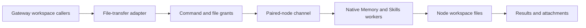

Codex review: needs real behavior proof before merge. _Reviewed September 20, 2026, 7:32 PM ET / 23:32 UTC (Revision 5)._

# ClawSweeper review

## What this changes

Extends paired-node workspaces to transfer attachments and access Memory files and Skills through existing native workers.

## Merge readiness

⛔ **Blocked before merge - 5 items remain**

The feature remains useful and absent from current main. Earlier findings are addressed, but a newly identified path-replacement race can bypass the node’s file grants and blocks merge.

**Priority:** P2
**Reviewed head:** `ab0de506fd706320229d0e7e42300815b697c908`

## Review scores

| Measure | Result | What it means |
|---|---|---|
| **Overall readiness** | 🦐 gold shrimp **(3/6)** | Substantial implementation and useful boundary evidence are present, but the newly identified authorization race remains unresolved. |
| **Proof confidence** | 🦐 gold shrimp **(3/6)** | Needs stronger real behavior proof before merge: Authority-chain proof required: existing Gateway/node attachment and native-worker denial evidence remains valid, but it does not cover an admitted file replaced before the worker reads it. After repair, show allowed reads and rejection of that replacement before any denied bytes cross the node channel. After adding proof, update the PR body; ClawSweeper should re-review automatically. If it does not, the PR author or someone with repository write access can comment `@clawsweeper re-review`. |
| **Patch quality** | 🦐 gold shrimp **(3/6)** | Security review found an item that needs attention. |

## Verification

| Check | Result | Evidence |
|---|---|---|
| **Real behavior** | Needs proof | Needs stronger real behavior proof before merge: Authority-chain proof required: existing Gateway/node attachment and native-worker denial evidence remains valid, but it does not cover an admitted file replaced before the worker reads it. After repair, show allowed reads and rejection of that replacement before any denied bytes cross the node channel. After adding proof, update the PR body; ClawSweeper should re-review automatically. If it does not, the PR author or someone with repository write access can comment `@clawsweeper re-review`. |
| **Evidence reviewed** | 8 items | Introduced scope and merge ownership: Reviewed the pinned merge-base-to-head delta. The test merge records the supplied base followed by the exact PR head, and its result retains the new node worker handler. Unbound path check: The handler checks canonical path strings, then awaits a start frame and launches a subprocess using the original pathname. It retains neither an opened file nor a filesystem identity binding across that wait. Final read follows the replacement: The Skills readInstructions operation calls fs.readFile on the supplied pathname. Memory maintenance readFile likewise uses fs.readFile. Neither operation receives the admission-time identity or per-file authorization callback; their output is forwarded by the new handler. |
| **Findings** | 1 actionable finding | [P1] [P1] Bind worker reads to the file identity admitted by policy |
| **Security** | Needs attention | Authorized pathname can resolve to denied contents at read time: A workspace writer can replace an admitted file after the canonical check and before worker startup; raw Skills and Memory maintenance reads follow the replacement and return its bytes. |

## How this fits together

The file-transfer plugin connects Gateway workspace operations to a paired node. Gateway checks command and file grants, then node-side handlers perform filesystem operations and return results.

## Before merge

- [ ] **Add real behavior proof** - Needs stronger real behavior proof before merge: Authority-chain proof required: existing Gateway/node attachment and native-worker denial evidence remains valid, but it does not cover an admitted file replaced before the worker reads it. After repair, show allowed reads and rejection of that replacement before any denied bytes cross the node channel. After adding proof, update the PR body; ClawSweeper should re-review automatically. If it does not, the PR author or someone with repository write access can comment `@clawsweeper re-review`.
- [ ] **\[P1\] Bind worker reads to the file identity admitted by policy (P1)** - The canonical-path check happens before `await started`, but `readInstructions` later calls `fs.readFile(filePath)` in the subprocess; Memory maintenance `readFile` does the same. If an allowed regular file is replaced with a symlink to a denied file during that wait, the worker follows it and this handler forwards the contents without checking the opened identity. Carry an identity-bound safe read through the final operation; another pathname check alone leaves the race. This is a late discovery: the handler’s blob is identical at the previous reviewed head.
- [ ] **Resolve security concern: Authorized pathname can resolve to denied contents at read time** - A workspace writer can replace an admitted file after the canonical check and before worker startup; raw Skills and Memory maintenance reads follow the replacement and return its bytes.
- [ ] **Resolve merge risk (P1)** - A writable workspace path can be replaced after admission, allowing the new worker route to return bytes from a file excluded by the node’s grants.
- [ ] **Complete next step (P2)** - Repair the file-identity race and attach redacted after-fix boundary output showing allowed reads and zero denied bytes after path replacement. Remove private paths, endpoints, and credentials from evidence; updating the PR body should trigger review, or a maintainer can request @clawsweeper re-review.

## Findings

- [P1] [P1] Bind worker reads to the file identity admitted by policy — `extensions/file-transfer/src/node-host/workspace-memory.ts:64-69`
- [high] Authorized pathname can resolve to denied contents at read time — `extensions/file-transfer/src/node-host/workspace-memory.ts:65`

<strong>Agent review details</strong>

### Security

Needs attention: The new worker route separates file authorization from the actual open, permitting a path-replacement bypass.

### PR surface

Source +1070, Tests +1177, Docs +11, Other +3. Total +2261 across 26 files.

View PR surface stats

| Area | Files | Added | Removed | Net |
|---|---:|---:|---:|---:|
| Source | 15 | 1090 | 20 | +1070 |
| Tests | 8 | 1191 | 14 | +1177 |
| Docs | 1 | 12 | 1 | +11 |
| Config | 0 | 0 | 0 | 0 |
| Generated | 0 | 0 | 0 | 0 |
| Other | 2 | 5 | 2 | +3 |
| **Total** | **26** | **2298** | **37** | **+2261** |

### Review metrics

| Metric | Value | Why it matters |
|---|---|---|
| **Authority surface** | 2 new node commands; 1 new SDK callable | The new commands expose native Memory and Skills operations through existing command and file grants. |

### Merge-risk options

**Maintainer options:**
1. **Preserve authorization through the actual read (recommended)**  
   Use identity-bound reads and demonstrate that replacing an admitted path cannot return denied bytes.

### Technical review

Best possible solution:

Bind worker filesystem operations to the authorized file identity through the existing safe-file owner, preserving native Memory and Skills semantics.

Do we have a high-confidence way to reproduce the issue?

Yes, from source: replace an allowed file with a symlink to a denied file after canonical admission but before the start frame; readInstructions then reads the replacement. This PR-head path was inspected, not executed.

Is this the best way to solve the issue?

The adapter approach reuses the appropriate owners, but its pathname precheck is insufficient; authorization must remain attached to the file actually opened.

Full review comments:

- [P1] [P1] Bind worker reads to the file identity admitted by policy — `extensions/file-transfer/src/node-host/workspace-memory.ts:64-69`
  The canonical-path check happens before `await started`, but `readInstructions` later calls `fs.readFile(filePath)` in the subprocess; Memory maintenance `readFile` does the same. If an allowed regular file is replaced with a symlink to a denied file during that wait, the worker follows it and this handler forwards the contents without checking the opened identity. Carry an identity-bound safe read through the final operation; another pathname check alone leaves the race. This is a late discovery: the handler’s blob is identical at the previous reviewed head.
  Confidence: 0.97
  Late finding: first raised on code an earlier review cycle already covered.

Overall correctness: patch is incorrect
Overall confidence: 0.96

AGENTS.md: found and applied where relevant.

Codex review notes: model internal, reasoning medium; reviewed against [21f3d71a09d4](https://github.com/openclaw/openclaw/commit/21f3d71a09d4356e2f9af53532ac5877136d0a0c).

### Labels

Label justifications:

- `P2`: This is a bounded paired-node capability expansion with a pre-merge defect, rather than evidence of a shipped urgent regression.
- `merge-risk: 🚨 security-boundary`: The new worker path can follow a replacement symlink after authorization and return otherwise denied file contents.
- `rating: 🦐 gold shrimp`: Overall readiness is 🦐 gold shrimp; proof is 🦐 gold shrimp and patch quality is 🦐 gold shrimp.
- `status: 📣 needs proof`: The PR needs real behavior proof before ClawSweeper can clear the contributor ask. Needs stronger real behavior proof before merge: Authority-chain proof required: existing Gateway/node attachment and native-worker denial evidence remains valid, but it does not cover an admitted file replaced before the worker reads it. After repair, show allowed reads and rejection of that replacement before any denied bytes cross the node channel. After adding proof, update the PR body; ClawSweeper should re-review automatically. If it does not, the PR author or someone with repository write access can comment `@clawsweeper re-review`.

### Evidence

Security concerns:

- [high] Authorized pathname can resolve to denied contents at read time — `extensions/file-transfer/src/node-host/workspace-memory.ts:65`
  A workspace writer can replace an admitted file after the canonical check and before worker startup; raw Skills and Memory maintenance reads follow the replacement and return its bytes.
  Confidence: 0.97

What I checked:

- **Introduced scope and merge ownership:** Reviewed the pinned merge-base-to-head delta. The test merge records the supplied base followed by the exact PR head, and its result retains the new node worker handler. ([`extensions/file-transfer/src/node-host/workspace-memory.ts:64`](https://github.com/openclaw/openclaw/blob/ab0de506fd706320229d0e7e42300815b697c908/extensions/file-transfer/src/node-host/workspace-memory.ts#L64), [ab0de506fd70](https://github.com/openclaw/openclaw/commit/ab0de506fd706320229d0e7e42300815b697c908))
- **Unbound path check:** The handler checks canonical path strings, then awaits a start frame and launches a subprocess using the original pathname. It retains neither an opened file nor a filesystem identity binding across that wait. ([`extensions/file-transfer/src/node-host/workspace-memory.ts:65`](https://github.com/openclaw/openclaw/blob/ab0de506fd706320229d0e7e42300815b697c908/extensions/file-transfer/src/node-host/workspace-memory.ts#L65), [ab0de506fd70](https://github.com/openclaw/openclaw/commit/ab0de506fd706320229d0e7e42300815b697c908))
- **Final read follows the replacement:** The Skills readInstructions operation calls fs.readFile on the supplied pathname. Memory maintenance readFile likewise uses fs.readFile. Neither operation receives the admission-time identity or per-file authorization callback; their output is forwarded by the new handler. ([`src/skills/runtime/workspace-worker.ts:295`](https://github.com/openclaw/openclaw/blob/ab0de506fd706320229d0e7e42300815b697c908/src/skills/runtime/workspace-worker.ts#L295), [ab0de506fd70](https://github.com/openclaw/openclaw/commit/ab0de506fd706320229d0e7e42300815b697c908))
- **Late-finding continuity:** GitHub returned blob 1844aebb32281542ebb974d797f8d3faa5e3b170 for this handler at the previous reviewed revision; git ls-tree returned the identical blob at the current head. The race was equally visible in that earlier review. ([`extensions/file-transfer/src/node-host/workspace-memory.ts:65`](https://github.com/openclaw/openclaw/blob/4160e136c2bb54f09a9651d09e31266b041e8600/extensions/file-transfer/src/node-host/workspace-memory.ts#L65), [4160e136c2bb](https://github.com/openclaw/openclaw/commit/4160e136c2bb54f09a9651d09e31266b041e8600))
- **Existing permission contract:** Node workspace placement does not grant file access; commands and paths require separate authorization. The documented file-transfer boundary preserves canonical source identity checks. Public docs: [`docs/nodes/file-transfers.md`](https://docs.openclaw.ai/nodes/file-transfers). ([`docs/nodes/file-transfers.md:47`](https://docs.openclaw.ai/nodes/file-transfers), [ab0de506fd70](https://github.com/openclaw/openclaw/commit/ab0de506fd706320229d0e7e42300815b697c908))
- **Still necessary on main:** Fetched main registers only the workspace bridge, without this branch’s Memory, Skills, attachment-preparation, or outbound-media capabilities. The workspace-service path is absent from the supplied latest-release commit. The related merged https://github.com/openclaw/openclaw/pull/154120 supplies the CI fixture repair, not this feature. ([`extensions/file-transfer/src/workspace-service.ts:84`](https://github.com/openclaw/openclaw/blob/21f3d71a09d4356e2f9af53532ac5877136d0a0c/extensions/file-transfer/src/workspace-service.ts#L84), [21f3d71a09d4](https://github.com/openclaw/openclaw/commit/21f3d71a09d4356e2f9af53532ac5877136d0a0c))

Likely related people:

- **Kimi Yu:** Raw commit 90ab8619b3ec616db61c916dd850d5876d9f42c9 adds extensions/file-transfer/src/workspace-service.ts:36 relative to its recorded parents. This identifies author metadata, not feature responsibility or a PR merger. (role: source-line author; confidence: high; commits: [90ab8619b3ec](https://github.com/openclaw/openclaw/commit/90ab8619b3ec616db61c916dd850d5876d9f42c9); files: `extensions/file-transfer/src/workspace-service.ts`)
- **joshavant:** Suggested for follow-up; no historical authorship or introduction is verified. (role: unverified routing candidate; confidence: low)

### Rank-up moves

Optional improvements that raise the rating; they are not merge blockers.

- Preserve the admitted filesystem identity through worker reads.
- Add final-effect proof for an allowed read and a post-admission symlink replacement, asserting zero denied output bytes.

### Rating scale

| Score | Internal tier | Crab rank | Meaning |
|---:|:---:|---|---|
| **6/6** | S | 🦀 challenger crab | Exceptional readiness |
| **5/6** | A | 🦞 diamond lobster | Very strong readiness |
| **4/6** | B | 🐚 platinum hermit | Good normal PR; ordinary maintainer review |
| **3/6** | C | 🦐 gold shrimp | Useful, but confidence is limited |
| **2/6** | D | 🦪 silver shellfish | Proof or implementation needs work |
| **1/6** | F | 🧂 unranked krab | Not merge-ready |
| N/A | NA | 🌊 off-meta tidepool | Rating does not apply |

Overall follows the weaker of proof and patch quality.
Shiny media proof means a screenshot, video, or linked artifact directly shows the changed behavior. Runtime, network, CSP, and security claims still need visible diagnostics.

### Workflow

- ClawSweeper keeps one durable marker-backed review comment per issue or PR.
- Re-runs edit this comment so the latest verdict, findings, and automation markers stay together instead of adding duplicate bot comments.
- A fresh review can be triggered by eligible `@clawsweeper re-review` comments, exact-item GitHub events, scheduled/background review runs, or manual workflow dispatch.
- PR/issue authors and users with repository write access can comment `@clawsweeper re-review` or `@clawsweeper re-run` on an open PR or issue to request a fresh review only.
- Maintainers can also comment `@clawsweeper review` to request a fresh review only.
- Fresh-review commands do not start repair, autofix, rebase, CI repair, or automerge.
- Maintainer-only repair and merge flows require explicit commands such as `@clawsweeper autofix`, `@clawsweeper automerge`, `@clawsweeper fix ci`, or `@clawsweeper address review`.
- Maintainers can comment `@clawsweeper explain` to ask for more context, or `@clawsweeper stop` to stop active automation.

### History

Review history (4 earlier review cycles)

<!-- clawsweeper-review-history v=1 total=4 -->
- reviewed 2026-09-20T21:27:27.031Z sha c60922c3c2498b4315611d8a6b298a7593d1fd96 :: needs real behavior proof before merge. :: [P1] Authorize the trimmed target used by the Memory reader | [P1] Authorize SKILL.md when resolving an explicit Skill | [P2] Avoid translating node-owned Skill paths a second time
- reviewed 2026-09-20T21:49:03.019Z sha 8661cf6d16aeb185860b41a0d0d81032f3b595a5 :: needs real behavior proof before merge. :: [P1] Reject raw traversal before normalizing worker admission paths | [P2] Normalize configured roots before matching worker requests
- reviewed 2026-09-20T22:16:42.633Z sha adab62894b136fd14c9077b1b3335692bf71524b :: blocked before merge. :: [P2] Convert native separators before joining remote Skill paths
- reviewed 2026-09-20T22:31:48.887Z sha 4160e136c2bb54f09a9651d09e31266b041e8600 :: needs maintainer review before merge. :: none

<!-- clawsweeper-security:security-sensitive item=154087 sha=ab0de506fd706320229d0e7e42300815b697c908 confidence=high updated_at=2026-09-20T23:28:02Z reviewed_at=2026-09-20T23:32:00.669Z lease_owner=github-run-35544627477-1 lease_comment_id=5753511772 source_revision=9503971783d8b63a22027b44545519cd2c5450dc814c3606de67e96106dfb53e live_verification=absent -->
<!-- clawsweeper-verdict:needs-human item=154087 sha=ab0de506fd706320229d0e7e42300815b697c908 confidence=high updated_at=2026-09-20T23:28:02Z reviewed_at=2026-09-20T23:32:00.669Z lease_owner=github-run-35544627477-1 lease_comment_id=5753511772 source_revision=9503971783d8b63a22027b44545519cd2c5450dc814c3606de67e96106dfb53e live_verification=absent -->
<!-- clawsweeper-review-state:blocked item=154087 sha=ab0de506fd706320229d0e7e42300815b697c908 v=1 -->

<!-- clawsweeper-review-version item=154087 reviewed_at=2026-09-20T23:32:00.669Z sha=ab0de506fd706320229d0e7e42300815b697c908 source_revision=9503971783d8b63a22027b44545519cd2c5450dc814c3606de67e96106dfb53e lease_owner=github-run-35544627477-1 lease_comment_id=5753511772 v=1 -->

<!-- clawsweeper-review item=154087 -->