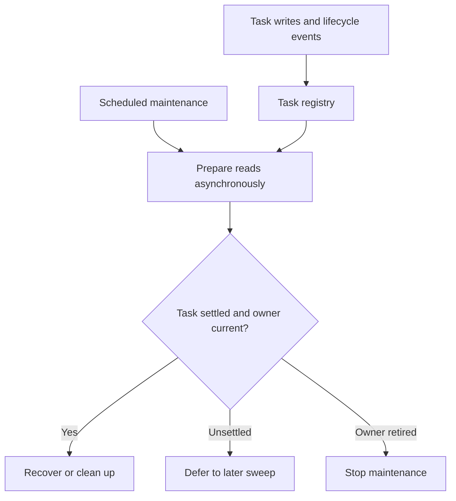

Codex review: blocked before merge. _Reviewed September 20, 2026, 7:56 AM ET / 11:56 UTC (Revision 5)._

# ClawSweeper review

## What this changes

Task maintenance prepares reads asynchronously, yields between batches, defers unsettled tasks, and stops recovery or cleanup when its original store owner retires.

## Merge readiness

⛔ **Blocked before merge - 1 item remains**

This remains a useful, bounded fix; current main still performs synchronous maintenance reads. No actionable introduced defect was found, and the updated description records acceptance of the measured CPU tradeoff.

**Priority:** P2
**Reviewed head:** `a575cd823ba094d947a4e0d7ff657c763a632450`

## Review scores

| Measure | Result | What it means |
|---|---|---|
| **Overall readiness** | 🐚 platinum hermit **(4/6)** | A focused owner-preserving repair with meaningful regression coverage, successful exact-head CI, and an explicitly accepted performance tradeoff. |
| **Proof confidence** | 🌊 off-meta tidepool | Not applicable: The ordinary external-contributor proof gate does not apply to this maintainer PR. Its captured macOS/Node 26.8.2 comparison targets maintenance plus accepted-event settlement and reports parity and reduced blocking reads; production-wide performance remains outside that evidence. |
| **Patch quality** | 🐚 platinum hermit **(4/6)** | No actionable review findings were identified. |

## Verification

| Check | Result | Evidence |
|---|---|---|
| **Real behavior** | Not applicable | Not applicable: The ordinary external-contributor proof gate does not apply to this maintainer PR. Its captured macOS/Node 26.8.2 comparison targets maintenance plus accepted-event settlement and reports parity and reduced blocking reads; production-wide performance remains outside that evidence. |
| **Evidence reviewed** | 9 items | Current main still needs the change: Both maintenance snapshot creation and candidate selection call ensureTaskRegistryReady synchronously on fetched main. Latest release retains synchronous preparation: The v2026.9.5 snapshot implementation also calls ensureTaskRegistryReady synchronously; the requested asynchronous maintenance path is not present there. Prepared reads and bounded traversal: The visitor reuses the existing prepared-read owner, yields every 25 candidates, refreshes after awaited visits, and retries preparation before deferring an unsettled task. Exact task IDs are preserved by the settlement check. |
| **Findings** | None | None. |
| **Security** | None | None. |

## How this fits together

The task registry tracks work from agents, cron, and CLI runs. Scheduled maintenance reads that state to recover results, identify abandoned work, and clean up expired records and ACP sessions.

## Before merge

- [ ] **Resolve merge risk (P1)** - Production-wide performance remains unmeasured; the reported 1,000-task comparison was inconclusive.

<strong>Agent review details</strong>

### Security

None.

### PR surface

Source +156, Tests +693. Total +849 across 17 files.

View PR surface stats

| Area | Files | Added | Removed | Net |
|---|---:|---:|---:|---:|
| Source | 7 | 502 | 346 | +156 |
| Tests | 10 | 886 | 193 | +693 |
| Docs | 0 | 0 | 0 | 0 |
| Config | 0 | 0 | 0 | 0 |
| Generated | 0 | 0 | 0 | 0 |
| Other | 0 | 0 | 0 | 0 |
| **Total** | **17** | **1388** | **539** | **+849** |

### Review metrics

| Metric | Value | Why it matters |
|---|---|---|
| **Production versus regression coverage** | Net production +156 lines; tests and test support +690; test routing +3 | Production growth implements shared traversal and lifecycle checks; most added code exercises contention, settlement, and recovery invariants. |
| **Reported contention improvement** | 4,000-task case: main-thread CPU −58.7%; synchronous snapshots 54 → 0 | The synthetic comparison directly targets the blocking-read mechanism while retaining task and delivery parity. |

### Merge-risk options

**Maintainer options:**
1. **Decide the mitigation before merge**  
   Keep asynchronous maintenance preparation with the existing read owner while preserving authoritative mutation, cleanup eligibility, and retention contracts.
2. **Pause or close**  
   Do not merge this PR until maintainers decide whether the risk is worth taking.

### Technical review

Best possible solution:

Keep asynchronous maintenance preparation with the existing read owner while preserving authoritative mutation, cleanup eligibility, and retention contracts.

Do we have a high-confidence way to reproduce the issue?

Yes, source establishes a concrete path: maintenance invokes synchronous projection refresh while task writes or accepted events remain unsettled. The contention tests target that path; this review did not execute them.

Is this the best way to solve the issue?

Yes. Reusing the existing worker-backed prepared-read owner avoids a competing consistency mechanism, and authoritative rereads protect recovery and retention after awaited work.

AGENTS.md: found and applied where relevant.

Codex review notes: model internal, reasoning medium; reviewed against [d98c42737902](https://github.com/openclaw/openclaw/commit/d98c42737902bef513b951726cbae2f1e4bb9fd5).

### Labels

Label justifications:

- `P2`: This is a bounded responsiveness repair for scheduled task maintenance under concurrent writes.
- `rating: 🐚 platinum hermit`: Overall readiness is 🐚 platinum hermit; proof is 🌊 off-meta tidepool and patch quality is 🐚 platinum hermit.
- `status: 👀 ready for maintainer look`: ClawSweeper has no concrete contributor-facing blocker left for this PR. Not applicable: The ordinary external-contributor proof gate does not apply to this maintainer PR. Its captured macOS/Node 26.8.2 comparison targets maintenance plus accepted-event settlement and reports parity and reduced blocking reads; production-wide performance remains outside that evidence.

### Evidence

What I checked:

- **Current main still needs the change:** Both maintenance snapshot creation and candidate selection call ensureTaskRegistryReady synchronously on fetched main. ([`src/tasks/task-registry-maintenance-snapshot.ts:14`](https://github.com/openclaw/openclaw/blob/d98c42737902bef513b951726cbae2f1e4bb9fd5/src/tasks/task-registry-maintenance-snapshot.ts#L14), [d98c42737902](https://github.com/openclaw/openclaw/commit/d98c42737902bef513b951726cbae2f1e4bb9fd5))
- **Latest release retains synchronous preparation:** The v2026.9.5 snapshot implementation also calls ensureTaskRegistryReady synchronously; the requested asynchronous maintenance path is not present there. ([`src/tasks/task-registry-maintenance-snapshot.ts:11`](https://github.com/openclaw/openclaw/blob/ec9c1a13db8938e5a3eaa51fca2e981cde2395a9/src/tasks/task-registry-maintenance-snapshot.ts#L11), [ec9c1a13db89](https://github.com/openclaw/openclaw/commit/ec9c1a13db8938e5a3eaa51fca2e981cde2395a9))
- **Prepared reads and bounded traversal:** The visitor reuses the existing prepared-read owner, yields every 25 candidates, refreshes after awaited visits, and retries preparation before deferring an unsettled task. Exact task IDs are preserved by the settlement check. ([`src/tasks/task-registry-maintenance-snapshot.ts:63`](https://github.com/openclaw/openclaw/blob/a575cd823ba094d947a4e0d7ff657c763a632450/src/tasks/task-registry-maintenance-snapshot.ts#L63), [a575cd823ba0](https://github.com/openclaw/openclaw/commit/a575cd823ba094d947a4e0d7ff657c763a632450))
- **Recovery and retention preserve their mutation owner:** Recovery rereads authoritative task and cron state under withTaskRegistryMutation, including after the recovery hook yields. Retention continues through the existing guarded retention implementation; no schema, persisted format, or retention-policy change is introduced. ([`src/tasks/task-registry.maintenance.ts:965`](https://github.com/openclaw/openclaw/blob/a575cd823ba094d947a4e0d7ff657c763a632450/src/tasks/task-registry.maintenance.ts#L965), [a575cd823ba0](https://github.com/openclaw/openclaw/commit/a575cd823ba094d947a4e0d7ff657c763a632450))
- **Cleanup lifecycle safeguards:** The extracted ACP cleanup preserves existing eligibility rules and adds original-owner checks before effects and after awaits. Reviewed tests cover retirement during listing, closing, and unbinding, including rejection before subsequent effects. ([`src/tasks/task-registry.maintenance-acp-authority.test.ts:69`](https://github.com/openclaw/openclaw/blob/a575cd823ba094d947a4e0d7ff657c763a632450/src/tasks/task-registry.maintenance-acp-authority.test.ts#L69), [a575cd823ba0](https://github.com/openclaw/openclaw/commit/a575cd823ba094d947a4e0d7ff657c763a632450))
- **Behavioral regression coverage:** Production-owner tests exercise SQLite coordinator contention, delayed publication, cleanup of an expired sibling during task creation, late accepted events, exact padded IDs, and durable-state parity. These tests were inspected, not executed during this read-only review. ([`src/tasks/task-registry.maintenance-projection.test.ts:68`](https://github.com/openclaw/openclaw/blob/a575cd823ba094d947a4e0d7ff657c763a632450/src/tasks/task-registry.maintenance-projection.test.ts#L68), [a575cd823ba0](https://github.com/openclaw/openclaw/commit/a575cd823ba094d947a4e0d7ff657c763a632450))

Likely related people:

- **steipete:** Suggested for follow-up; no historical authorship or introduction is verified. (role: unverified routing candidate; confidence: low)

### Rating scale

| Score | Internal tier | Crab rank | Meaning |
|---:|:---:|---|---|
| **6/6** | S | 🦀 challenger crab | Exceptional readiness |
| **5/6** | A | 🦞 diamond lobster | Very strong readiness |
| **4/6** | B | 🐚 platinum hermit | Good normal PR; ordinary maintainer review |
| **3/6** | C | 🦐 gold shrimp | Useful, but confidence is limited |
| **2/6** | D | 🦪 silver shellfish | Proof or implementation needs work |
| **1/6** | F | 🧂 unranked krab | Not merge-ready |
| N/A | NA | 🌊 off-meta tidepool | Rating does not apply |

Overall follows the weaker of proof and patch quality.
Shiny media proof means a screenshot, video, or linked artifact directly shows the changed behavior. Runtime, network, CSP, and security claims still need visible diagnostics.

### Workflow

- ClawSweeper keeps one durable marker-backed review comment per issue or PR.
- Re-runs edit this comment so the latest verdict, findings, and automation markers stay together instead of adding duplicate bot comments.
- A fresh review can be triggered by eligible `@clawsweeper re-review` comments, exact-item GitHub events, scheduled/background review runs, or manual workflow dispatch.
- PR/issue authors and users with repository write access can comment `@clawsweeper re-review` or `@clawsweeper re-run` on an open PR or issue to request a fresh review only.
- Maintainers can also comment `@clawsweeper review` to request a fresh review only.
- Fresh-review commands do not start repair, autofix, rebase, CI repair, or automerge.
- Maintainer-only repair and merge flows require explicit commands such as `@clawsweeper autofix`, `@clawsweeper automerge`, `@clawsweeper fix ci`, or `@clawsweeper address review`.
- Maintainers can comment `@clawsweeper explain` to ask for more context, or `@clawsweeper stop` to stop active automation.

### History

Review history (4 earlier review cycles)

<!-- clawsweeper-review-history v=1 total=4 -->
- reviewed 2026-09-20T10:40:30.325Z sha 8552bf03eb675f3538be319f82870ec05f4e855b :: needs maintainer review before merge. :: none
- reviewed 2026-09-20T10:49:59.980Z sha 5b3b7417c6529537ca4196e1fc2f6de91f7a30f6 :: needs maintainer review before merge. :: none
- reviewed 2026-09-20T10:59:59.805Z sha 84671159025df2ca30ec946e1befe2b62ad936e5 :: blocked before merge. :: none
- reviewed 2026-09-20T11:14:56.520Z sha a575cd823ba094d947a4e0d7ff657c763a632450 :: needs maintainer review before merge. :: none

<!-- clawsweeper-verdict:needs-human item=153634 sha=a575cd823ba094d947a4e0d7ff657c763a632450 confidence=high updated_at=2026-09-20T11:53:35Z reviewed_at=2026-09-20T11:56:39.443Z lease_owner=github-run-35509008900-1 lease_comment_id=5749627420 source_revision=38ae195f34ff1444272ca9723a6067419d4fcf31efe563db8bfdbf7fc44df3f5 live_verification=absent -->
<!-- clawsweeper-review-state:blocked item=153634 sha=a575cd823ba094d947a4e0d7ff657c763a632450 v=1 -->

<!-- clawsweeper-review-version item=153634 reviewed_at=2026-09-20T11:56:39.443Z sha=a575cd823ba094d947a4e0d7ff657c763a632450 source_revision=38ae195f34ff1444272ca9723a6067419d4fcf31efe563db8bfdbf7fc44df3f5 lease_owner=github-run-35509008900-1 lease_comment_id=5749627420 v=1 -->

<!-- clawsweeper-review item=153634 -->