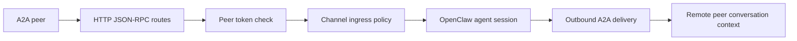

Codex review: found issues before merge. _Reviewed August 26, 2026, 10:47 AM ET / 14:47 UTC._

# ClawSweeper review

## What this changes

Adds a default-off bundled A2A v1.0 channel plugin for authenticated inbound agent tasks and configured outbound A2A peer messages.

## Merge readiness

⚠️ **Ready for maintainer review - 5 items remain**

Keep open: the active A2A feature branch still lets an authenticated peer bypass OpenClaw’s text-command authorization and makes every local agent share one remote conversation context per peer.

**Priority:** P1
**Reviewed head:** `0554ff7788e935abf169e1173a125cfc423174cb`
**Owner decision:** Required. See [Decision needed](#decision-needed).

## Review scores

| Measure | Result | What it means |
|---|---|---|
| **Overall readiness** | 🦐 gold shrimp **(3/6)** | The feature has substantial coverage and addressed prior findings, but two remaining P1 boundary defects prevent a correctness-ready rating. |
| **Proof confidence** | 🌊 off-meta tidepool | Not applicable: Maintainer-authored PR; the external-contributor real-behavior proof gate does not apply. |
| **Patch quality** | 🦐 gold shrimp **(3/6)** | Security review found an item that needs attention. |

## Verification

| Check | Result | Evidence |
|---|---|---|
| **Real behavior** | Not applicable | Not applicable: Maintainer-authored PR; the external-contributor real-behavior proof gate does not apply. |
| **Evidence reviewed** | 8 items | A2A ingress marks every admitted peer command-authorized: The new adapter passes no command policy to the ingress resolver, then explicitly sets command authorization to true for every dispatched task. Core command policy is bypassed: When command policy is omitted, the resolver creates an allow gate; later command detection treats control text as explicit when CommandAuthorized is true. Sibling channels preserve resolver-derived command authority: Buzz and Nextcloud Talk compute command policy and pass access.commandAccess.authorized into the inbound context instead of forcing authorization. |
| **Findings** | 2 actionable findings | [P1] Preserve command authorization for A2A text turns [P1] Scope outbound A2A context to the local conversation |
| **Security** | Needs attention | Authenticated peer bypasses command authorization: The adapter marks every admitted A2A peer command-authorized without using the core command-policy decision, allowing a peer token to reach textual control commands that the normal command allowlists would deny. |

## How this fits together

The A2A plugin converts authenticated HTTP/JSON-RPC peer traffic into OpenClaw channel ingress, then returns agent output as A2A task artifacts. Outbound channel messages become A2A requests to configured peers, so ingress authorization and remote conversation context affect agent safety and state isolation.

## Decision needed

| Question | Recommendation |
|---|---|
| Should A2A ship as a bundled official plugin, or should this optional interoperability capability be published as an external official plugin? | **Publish externally:** Move the A2A package to an external official plugin while retaining only generic plugin seams in core. |

Why: The implementation uses existing plugin seams and adds a new default-off bundled capability, so distribution scope requires maintainer intent beyond the two concrete repair findings.

## Before merge

- [ ] **Preserve command authorization for A2A text turns (P1)** - This sets `CommandAuthorized` for every authenticated peer after resolving ingress without a command policy. Consequently, a configured peer can send a slash/control command and bypass command-owner and access-group authorization. Compute command applicability through the channel runtime, pass it to the resolver, reject `shouldBlockControlCommand`, and carry `ingress.commandAccess.authorized` into the context.
- [ ] **Scope outbound A2A context to the local conversation (P1)** - All sends to a peer use the same `ctx-oc-&lt;peer>` context ID. The local outbound route is agent-specific, so messages from distinct local agents to one remote peer are merged into one remote A2A conversation and can expose or contaminate state. Carry an originating conversation identity to delivery and derive a stable context from it; update the peer-context test accordingly.
- [ ] **Resolve security concern: Authenticated peer bypasses command authorization** - The adapter marks every admitted A2A peer command-authorized without using the core command-policy decision, allowing a peer token to reach textual control commands that the normal command allowlists would deny.
- [ ] **Resolve merge risk (P1)** - Bundling this optional interoperability channel rather than distributing it as an external official plugin remains a maintainer product decision under the repository’s lean-core direction.

## Findings

- [P1] Preserve command authorization for A2A text turns — `extensions/a2a/src/inbound.ts:93`
- [P1] Scope outbound A2A context to the local conversation — `extensions/a2a/src/outbound.ts:67`
- [high] Authenticated peer bypasses command authorization — `extensions/a2a/src/inbound.ts:93`

<strong>Agent review details</strong>

### Security

Needs attention: The patch introduces a concrete command-authorization bypass for authenticated remote peers.

### PR surface

Source +1505, Tests +1446, Docs +212, Config +82, Generated 0, Other +13. Total +3258 across 45 files.

View PR surface stats

| Area | Files | Added | Removed | Net |
|---|---:|---:|---:|---:|
| Source | 22 | 1505 | 0 | +1505 |
| Tests | 10 | 1448 | 2 | +1446 |
| Docs | 6 | 214 | 2 | +212 |
| Config | 3 | 82 | 0 | +82 |
| Generated | 3 | 25 | 25 | 0 |
| Other | 1 | 13 | 0 | +13 |
| **Total** | **45** | **3287** | **29** | **+3258** |

### Review metrics

| Metric | Value | Why it matters |
|---|---|---|
| **Production versus test delta** | production +1,587; tests +1,446; docs +212; generated/lock +13 | The new channel is a substantial feature addition; the production growth is justified only if its authorization and state boundaries are repaired. |
| **Configuration surface** | 6 top-level channel keys and 3 per-peer keys added | Operators must configure peer credentials, outbound destinations, routing exposure, and rate behavior before the feature becomes active. |

### Stored data model

Persistent data-model change detected: `persistent cache schema: extensions/a2a/src/channel.test.ts`, `persistent cache schema: extensions/a2a/src/http.ts`, `serialized state: extensions/a2a/src/channel.test.ts`, `serialized state: extensions/a2a/src/http.ts`, `serialized state: extensions/a2a/src/outbound.test.ts`, `unknown-data-model-change: src/config/bundled-channel-config-metadata.generated.ts`, and 1 more. Confirm migration or upgrade compatibility proof before merge.

### Root-cause cluster

Relationship: `canonical`
Canonical: https://github.com/openclaw/openclaw/pull/130008
Summary: This is the active canonical A2A implementation; earlier A2A proposals are superseded by this maintained branch.

Members:
- `superseded`: https://github.com/openclaw/openclaw/pull/99612 - Earlier A2A implementation was closed without merge.
- `fixed_by_candidate`: https://github.com/openclaw/openclaw/issues/99599 - The active PR implements the requested A2A plugin capability.
- `fixed_by_candidate`: https://github.com/openclaw/openclaw/issues/119724 - The active PR implements the requested A2A interoperability capability.

Proposal only: this assessment does not dispatch repair, suppress jobs, mutate sibling items, close, or merge anything.

### Merge-risk options

**Maintainer options:**
1. **Repair authorization and context isolation (recommended)**  
   Route A2A text commands through the normal command-policy resolver and make outbound remote context unique to the originating local conversation before merge.
2. **Pause for external distribution**  
   Pause this bundled implementation if maintainers prefer A2A as an external official plugin under the lean-core policy.

### Technical review

Best possible solution:

Preserve resolver-derived command authorization for A2A turns and bind outbound A2A context to the originating local agent/session before merging.

Do we have a high-confidence way to reproduce the issue?

Yes, from source: an authenticated configured peer can submit a control-command text turn, which the adapter labels command-authorized without command-policy evaluation; two local agents targeting one peer also generate the same outbound context ID.

Is this the best way to solve the issue?

No: the proposed plugin correctly uses many existing channel seams, but its command authority and outbound conversation identity must follow the existing owner boundaries first.

Full review comments:

- [P1] Preserve command authorization for A2A text turns — `extensions/a2a/src/inbound.ts:93`
  This sets `CommandAuthorized` for every authenticated peer after resolving ingress without a command policy. Consequently, a configured peer can send a slash/control command and bypass command-owner and access-group authorization. Compute command applicability through the channel runtime, pass it to the resolver, reject `shouldBlockControlCommand`, and carry `ingress.commandAccess.authorized` into the context.
  Confidence: 0.98
- [P1] Scope outbound A2A context to the local conversation — `extensions/a2a/src/outbound.ts:67`
  All sends to a peer use the same `ctx-oc-&lt;peer>` context ID. The local outbound route is agent-specific, so messages from distinct local agents to one remote peer are merged into one remote A2A conversation and can expose or contaminate state. Carry an originating conversation identity to delivery and derive a stable context from it; update the peer-context test accordingly.
  Confidence: 0.95

Overall correctness: patch is incorrect
Overall confidence: 0.96

AGENTS.md: found and applied where relevant.

Codex review notes: model internal, reasoning high; reviewed against [376510eb7128](https://github.com/openclaw/openclaw/commit/376510eb712818ba987781fb7326dd318c2030bc).

### Labels

Label changes:

- add `P1`: Authenticated A2A peers can reach control-command handling outside the normal command authorization policy, and local-agent state can merge at a remote peer.
- remove `P2`: Current review triage priority is P1, so this older priority label is no longer current.
- remove `merge-risk: 🚨 compatibility`: Current PR review merge-risk labels are `merge-risk: 🚨 security-boundary`, `merge-risk: 🚨 session-state`.

Label justifications:

- `P1`: Authenticated A2A peers can reach control-command handling outside the normal command authorization policy, and local-agent state can merge at a remote peer.
- `merge-risk: 🚨 security-boundary`: The patch grants command authorization to authenticated peers without evaluating the standard command-owner or access-group policy.
- `merge-risk: 🚨 session-state`: The peer-only outbound context identifier can merge separate local agent conversations at the same remote A2A peer.
- `rating: 🦐 gold shrimp`: Overall readiness is 🦐 gold shrimp; proof is 🌊 off-meta tidepool and patch quality is 🦐 gold shrimp.
- `status: ⏳ waiting on author`: ClawSweeper has contributor-facing work open and is waiting for author action. Not applicable: Maintainer-authored PR; the external-contributor real-behavior proof gate does not apply.

### Evidence

Security concerns:

- [high] Authenticated peer bypasses command authorization — `extensions/a2a/src/inbound.ts:93`
  The adapter marks every admitted A2A peer command-authorized without using the core command-policy decision, allowing a peer token to reach textual control commands that the normal command allowlists would deny.
  Confidence: 0.98

Acceptance criteria:

- [P1] Add a regression where an authenticated non-command-authorized A2A peer sends a control command and is blocked before dispatch.
- [P1] Add an outbound test showing two originating local agent/conversation identities produce distinct, stable A2A context IDs.
- [P1] Run the relevant A2A plugin and shared channel-ingress test suites after repair.

What I checked:

- **A2A ingress marks every admitted peer command-authorized:** The new adapter passes no command policy to the ingress resolver, then explicitly sets command authorization to true for every dispatched task. ([`extensions/a2a/src/inbound.ts:93`](https://github.com/openclaw/openclaw/blob/0554ff7788e9/extensions/a2a/src/inbound.ts#L93), [0554ff7788e9](https://github.com/openclaw/openclaw/commit/0554ff7788e9))
- **Core command policy is bypassed:** When command policy is omitted, the resolver creates an allow gate; later command detection treats control text as explicit when CommandAuthorized is true. ([`src/channels/message-access/decision.ts:86`](https://github.com/openclaw/openclaw/blob/0554ff7788e9/src/channels/message-access/decision.ts#L86), [0554ff7788e9](https://github.com/openclaw/openclaw/commit/0554ff7788e9))
- **Sibling channels preserve resolver-derived command authority:** Buzz and Nextcloud Talk compute command policy and pass access.commandAccess.authorized into the inbound context instead of forcing authorization. ([`extensions/buzz/src/inbound.ts:78`](https://github.com/openclaw/openclaw/blob/0554ff7788e9/extensions/buzz/src/inbound.ts#L78), [0554ff7788e9](https://github.com/openclaw/openclaw/commit/0554ff7788e9))
- **Outbound context is peer-only:** Every outbound send uses ctx-oc-&lt;peer>, while the local outbound route receives agentId but the message adapter does not carry it into A2A delivery. ([`extensions/a2a/src/outbound.ts:67`](https://github.com/openclaw/openclaw/blob/0554ff7788e9/extensions/a2a/src/outbound.ts#L67), [0554ff7788e9](https://github.com/openclaw/openclaw/commit/0554ff7788e9))
- **Documentation and test lock in shared peer context:** The docs promise a stable conversation context per peer and the outbound test asserts ctx-oc-hermes, so independent local agents targeting one peer intentionally collide remotely. Public docs: [`docs/channels/a2a.md`](https://docs.openclaw.ai/channels/a2a). ([`docs/channels/a2a.md:140`](https://docs.openclaw.ai/channels/a2a), [0554ff7788e9](https://github.com/openclaw/openclaw/commit/0554ff7788e9))
- **Current main does not yet contain this plugin:** The current-main tree has no extensions/a2a entries, and the PR head is not contained by a release tag. ([`extensions/a2a`](https://github.com/openclaw/openclaw/blob/376510eb7128/extensions/a2a), [376510eb7128](https://github.com/openclaw/openclaw/commit/376510eb7128))

Likely related people:

- **Peter Steinberger:** Authored the A2A implementation and the recent shared ingress/outbound work implicated by both findings. (role: feature author and recent shared-channel contributor; confidence: high; commits: [0554ff7788e9](https://github.com/openclaw/openclaw/commit/0554ff7788e935abf169e1173a125cfc423174cb), [f9b1ccc4fa2e](https://github.com/openclaw/openclaw/commit/f9b1ccc4fa2eea2b8083fe29ce5092b15db268a4), [a2ec3f69046d](https://github.com/openclaw/openclaw/commit/a2ec3f69046d0a47ed61688a369c070ccdb1307f); files: `extensions/a2a/src/inbound.ts`, `extensions/a2a/src/outbound.ts`, `src/channels/message-access/decision.ts`)
- **Shakker:** Recent merged Buzz channel work demonstrates the resolver-derived command-authorization pattern relevant to the A2A adapter. (role: adjacent channel-inbound contributor; confidence: medium; commits: [08ac5b987fb0](https://github.com/openclaw/openclaw/commit/08ac5b987fb02e65882fb767ed8a8dbae7bd12c2), [2746e35f696c](https://github.com/openclaw/openclaw/commit/2746e35f696c47dc24b098dd68c3a26052535328); files: `extensions/buzz/src/inbound.ts`)

### Rank-up moves

Optional improvements that raise the rating; they are not merge blockers.

- Route A2A command text through resolver-derived authorization and add an unauthorized-peer control-command regression.
- Carry local conversation identity into outbound delivery and prove two local agents cannot share a remote A2A context.

### Rating scale

| Score | Internal tier | Crab rank | Meaning |
|---:|:---:|---|---|
| **6/6** | S | 🦀 challenger crab | Exceptional readiness |
| **5/6** | A | 🦞 diamond lobster | Very strong readiness |
| **4/6** | B | 🐚 platinum hermit | Good normal PR; ordinary maintainer review |
| **3/6** | C | 🦐 gold shrimp | Useful, but confidence is limited |
| **2/6** | D | 🦪 silver shellfish | Proof or implementation needs work |
| **1/6** | F | 🧂 unranked krab | Not merge-ready |
| N/A | NA | 🌊 off-meta tidepool | Rating does not apply |

Overall follows the weaker of proof and patch quality.
Shiny media proof means a screenshot, video, or linked artifact directly shows the changed behavior. Runtime, network, CSP, and security claims still need visible diagnostics.

### Workflow

- ClawSweeper keeps one durable marker-backed review comment per issue or PR.
- Re-runs edit this comment so the latest verdict, findings, and automation markers stay together instead of adding duplicate bot comments.
- A fresh review can be triggered by eligible `@clawsweeper re-review` comments, exact-item GitHub events, scheduled/background review runs, or manual workflow dispatch.
- PR/issue authors and users with repository write access can comment `@clawsweeper re-review` or `@clawsweeper re-run` on an open PR or issue to request a fresh review only.
- Maintainers can also comment `@clawsweeper review` to request a fresh review only.
- Fresh-review commands do not start repair, autofix, rebase, CI repair, or automerge.
- Maintainer-only repair and merge flows require explicit commands such as `@clawsweeper autofix`, `@clawsweeper automerge`, `@clawsweeper fix ci`, or `@clawsweeper address review`.
- Maintainers can comment `@clawsweeper explain` to ask for more context, or `@clawsweeper stop` to stop active automation.

### History

Review history (5 earlier review cycles)

<!-- clawsweeper-review-history v=1 total=5 -->
- reviewed 2026-08-26T08:38:09.360Z sha d085299ee65fa6fe99eee3a038ff05f5ee3db6ad :: found issues before merge. :: [P1] Scope sessions to the authenticated peer and A2A context | [P1] Do not report cancellation while the agent run continues
- reviewed 2026-08-26T09:20:16.070Z sha d085299ee65fa6fe99eee3a038ff05f5ee3db6ad :: found issues before merge. :: [P1] Isolate authenticated peer contexts by default | [P1] Propagate cancellation to the authoritative agent run
- reviewed 2026-08-26T13:37:58.276Z sha eaf5cd4e80fcb76bf490bd021e26bd0b0c62f3dd :: found issues before merge. :: [P1] Isolate A2A peer contexts by default | [P1] Cancel the agent run before reporting the task canceled
- reviewed 2026-08-26T14:01:57.228Z sha 24a58d283efc6aa02c95af97cccaac028ee09bbd :: found issues before merge. :: [P1] Isolate A2A contexts without an opt-in session setting | [P1] Abort the agent run before reporting task cancellation
- reviewed 2026-08-26T14:12:45.556Z sha bc7872e36699e7c36e4af1f7e0103e91b858aed1 :: found issues before merge. :: [P1] Isolate A2A contexts without an opt-in session setting | [P1] Abort the agent run before reporting task cancellation

<!-- clawsweeper-security:security-sensitive item=130008 sha=0554ff7788e935abf169e1173a125cfc423174cb confidence=high updated_at=2026-08-26T14:43:46Z reviewed_at=2026-08-26T14:47:55.299Z lease_owner=github-run-32981872223-1 lease_comment_id=5427013887 source_revision=ba4c058354eb146da0d8954e6ca4c969bc3f1266493cf979f612ec6102136c16 -->
<!-- clawsweeper-verdict:needs-human item=130008 sha=0554ff7788e935abf169e1173a125cfc423174cb confidence=high updated_at=2026-08-26T14:43:46Z reviewed_at=2026-08-26T14:47:55.299Z lease_owner=github-run-32981872223-1 lease_comment_id=5427013887 source_revision=ba4c058354eb146da0d8954e6ca4c969bc3f1266493cf979f612ec6102136c16 -->

<!-- clawsweeper-review-version item=130008 reviewed_at=2026-08-26T14:47:55.299Z sha=0554ff7788e935abf169e1173a125cfc423174cb source_revision=ba4c058354eb146da0d8954e6ca4c969bc3f1266493cf979f612ec6102136c16 lease_owner=github-run-32981872223-1 lease_comment_id=5427013887 v=1 -->

<!-- clawsweeper-review item=130008 -->