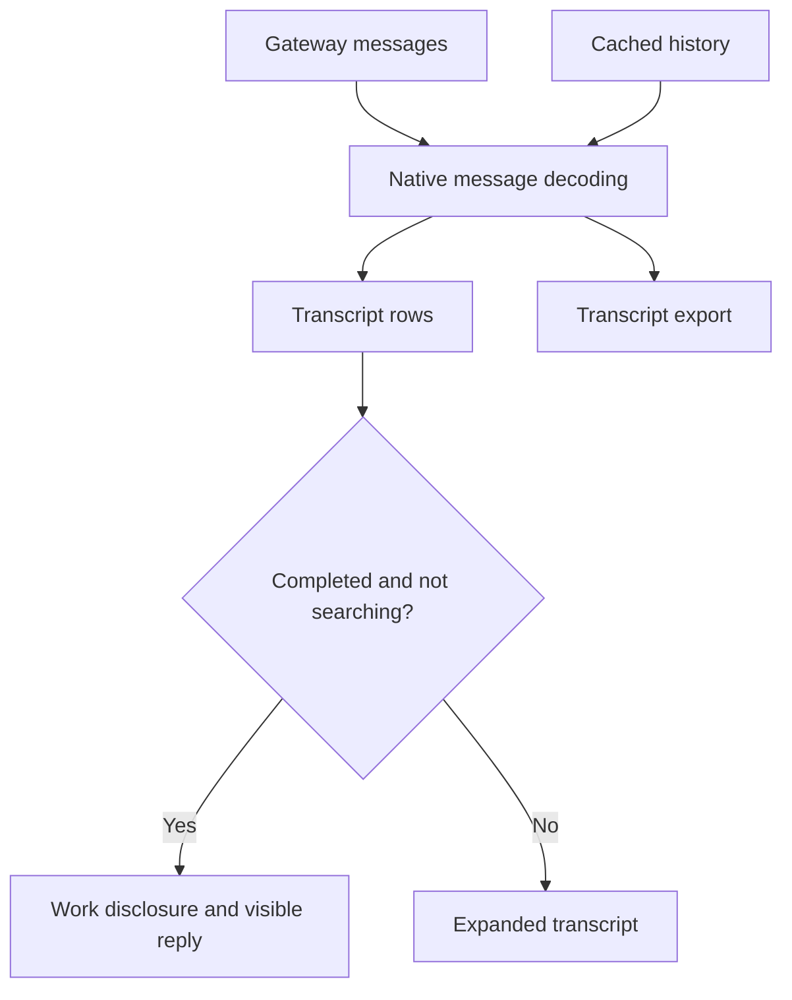

Codex review: needs maintainer review before merge. _Reviewed September 13, 2026, 8:20 PM ET / September 14, 2026, 00:20 UTC (Revision 2)._

# ClawSweeper review

## What this changes

The full macOS chat window folds completed commentary and tool activity above replies while preserving commentary identity through history, caching, and replay.

## Merge readiness

✅ **Ready for maintainer review**

The prior commentary-identity blocker is resolved, and no remaining actionable correctness defect was found. The contribution remains useful: current main still lacks native completed-work grouping.

**Priority:** P2
**Reviewed head:** `63ae4d4fb36dc446f0d1695fcab0c85cade96cbb`

## Review scores

| Measure | Result | What it means |
|---|---|---|
| **Overall readiness** | 🐚 platinum hermit **(4/6)** | A useful, focused implementation with convincing visual proof and the previous blocker resolved. |
| **Proof confidence** | 🦞 diamond lobster **(5/6)** ✨ media proof bonus | Sufficient (screenshot): The inspected native before/after screenshots directly demonstrate production ChatView grouping for the same real-provider conversation, with the final answer preserved. Reported native replay and cache tests supplement that visual proof; they were not rerun here. |
| **Patch quality** | 🐚 platinum hermit **(4/6)** | No actionable review findings were identified. |

## Verification

| Check | Result | Evidence |
|---|---|---|
| **Real behavior** | Verified | Sufficient (screenshot): The inspected native before/after screenshots directly demonstrate production ChatView grouping for the same real-provider conversation, with the final answer preserved. Reported native replay and cache tests supplement that visual proof; they were not rerun here. |
| **Evidence reviewed** | 9 items | Previous finding resolved: The decoder retains openclawStreamFallback; segment identity takes precedence during reconciliation, and commentary segments are excluded from final-message matching and completion detection. The earlier reviewed source used content-shape projection identity instead. Gateway contract verified: The Gateway projects commentary as plain text with openclawStreamFallback.source and itemId. This OpenClaw-owned projection establishes the native decoder contract; no dependency-specific Codex contract is needed for this change. Focused regression coverage: Reviewed tests cover keyed commentary without a final, metadata round trips, active turns, structural boundaries, search, and both commentary/final event orders. The retained cached-final test reopens SQLite and checks convergence despite changed reasoning framing. The contributor reports 35 passing native tests; this read-only review did not execute them. |
| **Findings** | None | None. |
| **Security** | None | None. |

## How this fits together

The shared Apple chat renderer receives Gateway messages and cached history, then builds the native transcript. This change groups completed work for the full macOS window while leaving final replies accessible.

## Before merge

None.

<strong>Agent review details</strong>

### Security

None.

### PR surface

Docs +9, Other +727. Total +736 across 15 files.

View PR surface stats

| Area | Files | Added | Removed | Net |
|---|---:|---:|---:|---:|
| Source | 0 | 0 | 0 | 0 |
| Tests | 0 | 0 | 0 | 0 |
| Docs | 1 | 9 | 0 | +9 |
| Config | 0 | 0 | 0 | 0 |
| Generated | 0 | 0 | 0 | 0 |
| Other | 14 | 785 | 58 | +727 |
| **Total** | **15** | **794** | **58** | **+736** |

### Review metrics

| Metric | Value | Why it matters |
|---|---|---|
| **Production versus regression coverage** | Production net +384 lines; tests net +341 lines | Production growth supports the new presentation and metadata preservation; regression coverage targets completion boundaries and replay identity. |

### Technical review

Best possible solution:

Keep completed-work grouping in the native presentation layer, with reversible detail, stable message identity, preserved preferences, and unchanged canonical transcript storage.

Do we have a high-confidence way to reproduce the issue?

Not applicable as a bug report: this adds presentation behavior. Current-main source and the inspected before/after screenshots establish the existing clutter and intended improvement.

Is this the best way to solve the issue?

Yes. The existing native transcript renderer is the appropriate owner, and the revised segment-aware reconciliation addresses the prior blocker without changing ordinary canonical message identity.

AGENTS.md: found and applied where relevant.

Codex review notes: model internal, reasoning medium; reviewed against [078ca0bc2ff6](https://github.com/openclaw/openclaw/commit/078ca0bc2ff6ca83748450a895e78684a1de6894).

### Labels

Label changes:

- add `rating: 🐚 platinum hermit`: Overall readiness is 🐚 platinum hermit; proof is 🦞 diamond lobster and patch quality is 🐚 platinum hermit. Replaced prior `rating: 🦐 gold shrimp`.
- remove `rating: 🦐 gold shrimp`: Current PR rating is `rating: 🐚 platinum hermit`, so this older rating label is no longer current.

Label justifications:

- `P2`: This is a bounded native-chat readability improvement without evidence of an urgent user-blocking regression.
- `rating: 🐚 platinum hermit`: Overall readiness is 🐚 platinum hermit; proof is 🦞 diamond lobster and patch quality is 🐚 platinum hermit. Replaced prior `rating: 🦐 gold shrimp`.
- `status: ⏳ waiting on author`: ClawSweeper has contributor-facing work open and is waiting for author action. Sufficient (screenshot): The inspected native before/after screenshots directly demonstrate production ChatView grouping for the same real-provider conversation, with the final answer preserved. Reported native replay and cache tests supplement that visual proof; they were not rerun here.
- `proof: sufficient`: Contributor real behavior proof is sufficient. The inspected native before/after screenshots directly demonstrate production ChatView grouping for the same real-provider conversation, with the final answer preserved. Reported native replay and cache tests supplement that visual proof; they were not rerun here.
- `proof: 📸 screenshot`: Contributor real behavior proof includes screenshot evidence. The inspected native before/after screenshots directly demonstrate production ChatView grouping for the same real-provider conversation, with the final answer preserved. Reported native replay and cache tests supplement that visual proof; they were not rerun here.

### Evidence

What I checked:

- **Previous finding resolved:** The decoder retains openclawStreamFallback; segment identity takes precedence during reconciliation, and commentary segments are excluded from final-message matching and completion detection. The earlier reviewed source used content-shape projection identity instead. ([`apps/shared/OpenClawKit/Sources/OpenClawChatUI/ChatViewModel+HistoryReconciliation.swift:181`](https://github.com/openclaw/openclaw/blob/63ae4d4fb36dc446f0d1695fcab0c85cade96cbb/apps/shared/OpenClawKit/Sources/OpenClawChatUI/ChatViewModel%2BHistoryReconciliation.swift#L181), [63ae4d4fb36d](https://github.com/openclaw/openclaw/commit/63ae4d4fb36dc446f0d1695fcab0c85cade96cbb))
- **Gateway contract verified:** The Gateway projects commentary as plain text with openclawStreamFallback.source and itemId. This OpenClaw-owned projection establishes the native decoder contract; no dependency-specific Codex contract is needed for this change. ([`src/gateway/chat-display-projection.sanitize.ts:313`](https://github.com/openclaw/openclaw/blob/63ae4d4fb36dc446f0d1695fcab0c85cade96cbb/src/gateway/chat-display-projection.sanitize.ts#L313), [63ae4d4fb36d](https://github.com/openclaw/openclaw/commit/63ae4d4fb36dc446f0d1695fcab0c85cade96cbb))
- **Focused regression coverage:** Reviewed tests cover keyed commentary without a final, metadata round trips, active turns, structural boundaries, search, and both commentary/final event orders. The retained cached-final test reopens SQLite and checks convergence despite changed reasoning framing. The contributor reports 35 passing native tests; this read-only review did not execute them. ([`apps/shared/OpenClawKit/Tests/OpenClawKitTests/ChatStreamReplayTests.swift:571`](https://github.com/openclaw/openclaw/blob/63ae4d4fb36dc446f0d1695fcab0c85cade96cbb/apps/shared/OpenClawKit/Tests/OpenClawKitTests/ChatStreamReplayTests.swift#L571), [63ae4d4fb36d](https://github.com/openclaw/openclaw/commit/63ae4d4fb36dc446f0d1695fcab0c85cade96cbb))
- **Inspected native visual proof:** Inspected both downloaded images linked in the captured PR body: https://github.com/user-attachments/assets/d39012f9-a204-4a21-8da8-e70be6ed8bd4 and https://github.com/user-attachments/assets/2c41c054-0081-4152-afd3-c2fd3742a9aa. The same synthetic conversation changes from inline commentary and a Read row to a collapsed Worked for 4 sec disclosure, with the final answer preserved. The body identifies a signed native app using production chat UI and a real isolated Gateway/provider.
- **Still necessary on current main:** Current main builds and filters individual transcript rows without a completed-work grouping stage. ([`apps/shared/OpenClawKit/Sources/OpenClawChatUI/ChatView.swift:799`](https://github.com/openclaw/openclaw/blob/078ca0bc2ff6ca83748450a895e78684a1de6894/apps/shared/OpenClawKit/Sources/OpenClawChatUI/ChatView.swift#L799), [078ca0bc2ff6](https://github.com/openclaw/openclaw/commit/078ca0bc2ff6ca83748450a895e78684a1de6894))
- **Latest release comparison:** The v2026.9.4 source likewise renders individual transcript rows without this grouping. The release source was inspected through the contents API after its local blob was unavailable. ([`apps/shared/OpenClawKit/Sources/OpenClawChatUI/ChatView.swift:791`](https://github.com/openclaw/openclaw/blob/3a9d69db306cd7f081e06254cb89c4bcc14a7107/apps/shared/OpenClawKit/Sources/OpenClawChatUI/ChatView.swift#L791), [3a9d69db306c](https://github.com/openclaw/openclaw/commit/3a9d69db306cd7f081e06254cb89c4bcc14a7107))

Likely related people:

- **Peter Steinberger:** Raw commit cb51cf7d3ee3410df7fa24d1bf355ac6bb19e035 adds apps/shared/OpenClawKit/Sources/OpenClawChatUI/ChatTranscriptRows.swift:151 relative to its recorded parents. This identifies author metadata, not feature responsibility or a PR merger. (role: source-line author; confidence: high; commits: [cb51cf7d3ee3](https://github.com/openclaw/openclaw/commit/cb51cf7d3ee3410df7fa24d1bf355ac6bb19e035); files: `apps/shared/OpenClawKit/Sources/OpenClawChatUI/ChatTranscriptRows.swift`)
- **clawSean:** Suggested for follow-up; no historical authorship or introduction is verified. (role: unverified routing candidate; confidence: low)

### Rating scale

| Score | Internal tier | Crab rank | Meaning |
|---:|:---:|---|---|
| **6/6** | S | 🦀 challenger crab | Exceptional readiness |
| **5/6** | A | 🦞 diamond lobster | Very strong readiness |
| **4/6** | B | 🐚 platinum hermit | Good normal PR; ordinary maintainer review |
| **3/6** | C | 🦐 gold shrimp | Useful, but confidence is limited |
| **2/6** | D | 🦪 silver shellfish | Proof or implementation needs work |
| **1/6** | F | 🧂 unranked krab | Not merge-ready |
| N/A | NA | 🌊 off-meta tidepool | Rating does not apply |

Overall follows the weaker of proof and patch quality.
Shiny media proof means a screenshot, video, or linked artifact directly shows the changed behavior. Runtime, network, CSP, and security claims still need visible diagnostics.

### Workflow

- ClawSweeper keeps one durable marker-backed review comment per issue or PR.
- Re-runs edit this comment so the latest verdict, findings, and automation markers stay together instead of adding duplicate bot comments.
- A fresh review can be triggered by eligible `@clawsweeper re-review` comments, exact-item GitHub events, scheduled/background review runs, or manual workflow dispatch.
- PR/issue authors and users with repository write access can comment `@clawsweeper re-review` or `@clawsweeper re-run` on an open PR or issue to request a fresh review only.
- Maintainers can also comment `@clawsweeper review` to request a fresh review only.
- Fresh-review commands do not start repair, autofix, rebase, CI repair, or automerge.
- Maintainer-only repair and merge flows require explicit commands such as `@clawsweeper autofix`, `@clawsweeper automerge`, `@clawsweeper fix ci`, or `@clawsweeper address review`.
- Maintainers can comment `@clawsweeper explain` to ask for more context, or `@clawsweeper stop` to stop active automation.

### History

Review history (1 earlier review cycle)

<!-- clawsweeper-review-history v=1 total=1 -->
- reviewed 2026-09-13T23:30:00.379Z sha 349106b53ec817aad65968cd839769107e5fbd7f :: needs changes before merge. :: [P2] Preserve commentary fallback identity before detecting completed replies

<!-- clawsweeper-verdict:needs-human item=147540 sha=63ae4d4fb36dc446f0d1695fcab0c85cade96cbb confidence=high updated_at=2026-09-14T00:17:20Z reviewed_at=2026-09-14T00:20:45.567Z lease_owner=github-run-34792075319-1 lease_comment_id=5657317248 source_revision=e7625b4f85b3ca9dfbf144c7d14a317d54d5ce5d62234b7151c5b50da6cc2954 live_verification=absent -->
<!-- clawsweeper-review-state:ready item=147540 sha=63ae4d4fb36dc446f0d1695fcab0c85cade96cbb v=1 -->

<!-- clawsweeper-review-version item=147540 reviewed_at=2026-09-14T00:20:45.567Z sha=63ae4d4fb36dc446f0d1695fcab0c85cade96cbb source_revision=e7625b4f85b3ca9dfbf144c7d14a317d54d5ce5d62234b7151c5b50da6cc2954 lease_owner=github-run-34792075319-1 lease_comment_id=5657317248 v=1 -->

<!-- clawsweeper-review item=147540 -->