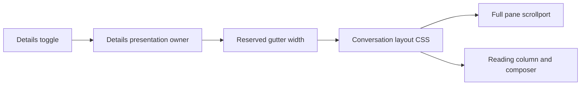

Codex review: needs maintainer review before merge.

## What this changes

Extends the desktop transcript scrollport to the pane edge while preserving the reading column and composer clearance from Details.

**Example:** Open Details in a 1900 × 1000 desktop chat.
- **Before:** The conversation scrollbar sits 308 px inside the pane.
- **After:** The scrollbar reaches the pane edge while messages and the composer retain their alignment.

## Review scores

| Measure | Result | What it means |
|---|---|---|
| **Overall readiness** | 🦞 diamond lobster **(5/6)** | A focused repair with directly relevant visual proof, meaningful browser coverage, green exact-head CI, and no actionable findings. |
| **Proof confidence** | 🦞 diamond lobster **(5/6)** ✨ media proof bonus | Sufficient (screenshot): Inspected before/after screenshots exercise the production Control UI layout in Chromium with synthetic Gateway fixtures and visibly demonstrate the scrollbar reaching the pane edge without moving the reading column or composer. |
| **Patch quality** | 🦞 diamond lobster **(5/6)** | No actionable review findings were identified. |

## Product

**Kind:** Bug fix · **Worth it:** Yes · **Fix scope:** Complete
**User problem:** Opening Details leaves the conversation scrollbar visibly inset from the pane edge.
**Reason:** The maintainer-authored repair restores the existing edge-aligned scrollbar contract while preserving Details clearance and the reading layout.

## Merge readiness

✅ **Ready for maintainer review**

This PR fixes a visible layout defect with a focused CSS change and convincing visual evidence; no actionable findings remain.

**Priority:** P3
**Reviewed head:** `3f38c53ce8a0aef23eb75e9f08fcf943209c57c5`

## Before merge

None.

## Findings

None.

<strong>Agent review details</strong>

### How this fits together

The Control UI's conversation frame contains the transcript scrollport, composer, and floating Details card; shared CSS converts the Details owner's reserved width into their layout.

### Technical review

Best possible solution:

Merge the focused CSS repair with its browser regression while retaining the existing Details and transcript geometry owners.

Do we have a high-confidence way to reproduce the issue?

Current-main CSS narrows the scrollport with the Details reservation, matching the inspected before screenshot and the author's reported failing browser regression; no target code was executed during this review.

Is this the best way to solve the issue?

The patch repairs the layout at its existing CSS owner without adding state, changing virtualization, or moving the composer, and every introduced hunk supports that invariant.

AGENTS.md: found and applied where relevant.

Codex review notes: model internal, reasoning medium; reviewed against [855b0aa7242e](https://github.com/openclaw/openclaw/commit/855b0aa7242e31c85051d20db54a853025cd4094).

### Provenance checked

- `Desktop conversation reservation and panel layout` keeps the original intent (fb0ad93d0143db3d09d3887b83c2dbbcc4583ab4: The shared panel frame preserves navigation, resizing, active resources, and coordinated conversation motion; the patch retains these owners and reservation semantics.)
- `Details clearance from transcript content` keeps the original intent (https://github.com/openclaw/openclaw/pull/168494: Keep Details and its controls clear of conversation content across narrow and split layouts; the new reading-column grid preserves that clearance.)

### Testing

Proof path: shipped entry point.

### Security

None.

### Evidence

What I checked:

- **Focused introduced change:** The pinned introduction diff changes only desktop layout CSS and adds a browser regression using existing fixtures and helpers. ([`ui/src/styles/chat/startup-layout.css:1252`](https://github.com/openclaw/openclaw/blob/3f38c53ce8a0aef23eb75e9f08fcf943209c57c5/ui/src/styles/chat/startup-layout.css#L1252), [3f38c53ce8a0](https://github.com/openclaw/openclaw/commit/3f38c53ce8a0aef23eb75e9f08fcf943209c57c5))
- **Visual result inspected:** Both downloaded screenshots were inspected directly: the scrollbar moves to the far-right pane edge while the synthetic conversation, composer, and Details card retain their positions. ([3f38c53ce8a0](https://github.com/openclaw/openclaw/commit/3f38c53ce8a0aef23eb75e9f08fcf943209c57c5))
- **Behavioral regression coverage:** The new browser test checks edge geometry, scrollbar hit testing, reading-column alignment, Details clearance, keyboard scrolling, draft retention, responsive thresholds, and a Files side panel; the body records failure on original CSS and success after the fix. ([`ui/src/e2e/chat-details-scrollbar.e2e.test.ts:130`](https://github.com/openclaw/openclaw/blob/3f38c53ce8a0aef23eb75e9f08fcf943209c57c5/ui/src/e2e/chat-details-scrollbar.e2e.test.ts#L130), [3f38c53ce8a0](https://github.com/openclaw/openclaw/commit/3f38c53ce8a0aef23eb75e9f08fcf943209c57c5))
- **Existing owner and design preserved:** The Details owner still supplies the gutter reservation, and transcript geometry still measures the actual reading column; the shared panel layout introduced by https://github.com/openclaw/openclaw/pull/176356 remains authoritative. ([`ui/src/pages/chat/components/chat-details.tsx:446`](https://github.com/openclaw/openclaw/blob/fb0ad93d0143db3d09d3887b83c2dbbcc4583ab4/ui/src/pages/chat/components/chat-details.tsx#L446), [fb0ad93d0143](https://github.com/openclaw/openclaw/commit/fb0ad93d0143db3d09d3887b83c2dbbcc4583ab4))
- **Current main still needs the fix:** Current main retains the conversation inset and lacks the new scrollport extension; its intervening stylesheet changes concern header surfaces and controls. ([`ui/src/styles/chat/startup-layout.css:1257`](https://github.com/openclaw/openclaw/blob/855b0aa7242e31c85051d20db54a853025cd4094/ui/src/styles/chat/startup-layout.css#L1257), [855b0aa7242e](https://github.com/openclaw/openclaw/commit/855b0aa7242e31c85051d20db54a853025cd4094))
- **Reviewed head passes CI:** REST reads confirm the reviewed head remains open, ready, and mergeable, with a successful CI gate and no failing or pending checks across both check-run pages. ([3f38c53ce8a0](https://github.com/openclaw/openclaw/commit/3f38c53ce8a0aef23eb75e9f08fcf943209c57c5))

Likely related people:

- **Peter Steinberger:** Raw commit 23e8398b35b012f33aace2df376e8dc88aabb62c adds ui/src/styles/chat/startup-layout.css:90 relative to its recorded parents. This identifies author metadata, not feature responsibility or a PR merger. (role: source-line author; confidence: high; commits: [23e8398b35b0](https://github.com/openclaw/openclaw/commit/23e8398b35b012f33aace2df376e8dc88aabb62c); files: `ui/src/styles/chat/startup-layout.css`)

### PR surface

Source +18, Tests +185. Total +203 across 2 files. Added test files: 1.

View PR surface stats

| Area | Files | Added | Removed | Net |
|---|---:|---:|---:|---:|
| Source | 1 | 18 | 0 | +18 |
| Tests | 1 | 185 | 0 | +185 |
| Docs | 0 | 0 | 0 | 0 |
| Config | 0 | 0 | 0 | 0 |
| Generated | 0 | 0 | 0 | 0 |
| Other | 0 | 0 | 0 | 0 |
| **Total** | **2** | **203** | **0** | **+203** |

### Labels

Label changes:

- add `P3`: This is a desktop scrollbar placement defect with working conversation and composer interactions.
- add `proof: sufficient`: Contributor real behavior proof is sufficient.
- add `proof: 📸 screenshot`: Contributor real behavior proof includes screenshot evidence.
- add `rating: 🦞 diamond lobster`: Overall readiness is 🦞 diamond lobster; proof is 🦞 diamond lobster and patch quality is 🦞 diamond lobster.
- add `status: 👀 ready for maintainer look`: ClawSweeper has no concrete contributor-facing blocker left for this PR.

Label justifications:

- `P3`: This is a desktop scrollbar placement defect with working conversation and composer interactions.
- `rating: 🦞 diamond lobster`: Overall readiness is 🦞 diamond lobster; proof is 🦞 diamond lobster and patch quality is 🦞 diamond lobster.
- `status: 👀 ready for maintainer look`: ClawSweeper has no concrete contributor-facing blocker left for this PR.
- `proof: sufficient`: Contributor real behavior proof is sufficient.
- `proof: 📸 screenshot`: Contributor real behavior proof includes screenshot evidence.

### Rating scale

6/6 🦀 challenger crab · 5/6 🦞 diamond lobster · 4/6 🐚 platinum hermit · 3/6 🦐 gold shrimp · 2/6 🦪 silver shellfish · 1/6 🧂 unranked krab. Overall follows the weaker of proof and patch quality; ✨ marks media proof (a screenshot, video, or linked artifact) that directly shows the changed behavior.

### Workflow

ClawSweeper edits this one comment on every review. Comment `@clawsweeper re-review` for a fresh review only. Repair and merge execution lanes are retired.

_Reviewed October 21, 2026, 1:42 AM ET / 05:42 UTC._

<!-- clawsweeper-verdict:needs-human item=179059 sha=3f38c53ce8a0aef23eb75e9f08fcf943209c57c5 confidence=high updated_at=2026-10-21T05:39:24Z reviewed_at=2026-10-21T05:42:22.038Z lease_owner=github-run-39550662875-1 lease_comment_id=6308933056 source_revision=f885b289365238a00a67c60cd0df40e9a1d2881d247be628288e45a7a09e2034 hold=not_opted_in findings=0 -->
<!-- clawsweeper-review-state:ready item=179059 sha=3f38c53ce8a0aef23eb75e9f08fcf943209c57c5 v=1 -->

<!-- clawsweeper-review-version item=179059 reviewed_at=2026-10-21T05:42:22.038Z sha=3f38c53ce8a0aef23eb75e9f08fcf943209c57c5 source_revision=f885b289365238a00a67c60cd0df40e9a1d2881d247be628288e45a7a09e2034 lease_owner=github-run-39550662875-1 lease_comment_id=6308933056 v=1 -->

<!-- clawsweeper-review item=179059 -->