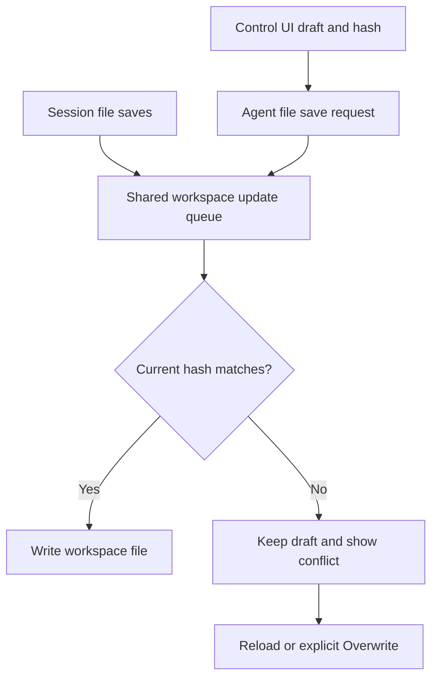

Codex review: needs maintainer review before merge. _Reviewed September 9, 2026, 1:42 AM ET / 05:42 UTC (Revision 5)._

# ClawSweeper review

## What this changes

Adds conditional agent workspace-file saves and explicit Reload/Overwrite recovery, preserving draft ancestry through Refresh and Reset.

## Merge readiness

✅ **Ready for maintainer review**

This repair remains necessary: current main still permits stale agent-file saves. The earlier findings are resolved, the supplied real-Gateway evidence covers the repaired behavior, and no blocking defect was found.

**Priority:** P1
**Reviewed head:** `c62a11624ab85b67954902edeeb831a7f660e6f7`

## Review scores

| Measure | Result | What it means |
|---|---|---|
| **Overall readiness** | 🐚 platinum hermit **(4/6)** | A focused, well-supported repair with the earlier findings resolved and no remaining blocking correctness concern. |
| **Proof confidence** | 🦞 diamond lobster **(5/6)** | Sufficient (live_output): The captured real-Gateway RPC and Chromium observations exercise the changed agent-file handler and editor recovery flow, showing stale writes refused, newer disk bytes preserved, and Reload/Overwrite/Reset recovery working. |
| **Patch quality** | 🐚 platinum hermit **(4/6)** | No actionable review findings were identified. |

## Verification

| Check | Result | Evidence |
|---|---|---|
| **Real behavior** | Verified | Sufficient (live_output): The captured real-Gateway RPC and Chromium observations exercise the changed agent-file handler and editor recovery flow, showing stale writes refused, newer disk bytes preserved, and Reload/Overwrite/Reset recovery working. |
| **Evidence reviewed** | 8 items | Current main still needs the repair: The fetched main revision sends agent-file saves without a precondition and writes directly through workspaceRoot.write. Its existing refresh lifecycle protection does not reject external changes made after opening the editor. Latest release retains unconditional saves: The v2026.9.3 source also writes agent files unconditionally at line 1523; this release does not contain the proposed conditional-save behavior. Shared compare-and-write boundary: Agent-file hash comparison and publication now use the queue already used by session-file updates. Missing or mismatched files produce a conflict; uppercase hashes normalize before comparison, while omitted preconditions preserve the existing API. |
| **Findings** | None | None. |
| **Security** | None | None. |

## How this fits together

The Control UI edits agent instructions and memory files through Gateway file RPCs. The Gateway compares the editor’s content hash with disk contents before publishing a save through the shared workspace update queue.

## Before merge

None.

<strong>Agent review details</strong>

### Security

None.

### PR surface

Source +257, Tests +494, Docs 0, Other +8. Total +759 across 18 files.

View PR surface stats

| Area | Files | Added | Removed | Net |
|---|---:|---:|---:|---:|
| Source | 10 | 297 | 40 | +257 |
| Tests | 6 | 526 | 32 | +494 |
| Docs | 1 | 1 | 1 | 0 |
| Config | 0 | 0 | 0 | 0 |
| Generated | 0 | 0 | 0 | 0 |
| Other | 1 | 9 | 1 | +8 |
| **Total** | **18** | **833** | **74** | **+759** |

### Review metrics

| Metric | Value | Why it matters |
|---|---|---|
| **Protocol compatibility** | 1 optional request precondition; 1 optional response hash; no version bump | Existing RPC clients retain unconditional writes while the bundled editor gains conflict protection. |
| **Implementation and regression coverage** | Net production +265 lines; tests and test support +494 lines | Production growth implements conditional saves and explicit recovery, with coverage for the previously identified lifecycle failures. |

### Technical review

Best possible solution:

Keep conditional saves at the shared write boundary and pair each editor draft with its matching hash, with explicit conflict recovery and unchanged legacy RPC behavior.

Do we have a high-confidence way to reproduce the issue?

Yes: open a file, change it through another writer, then save the original draft. Current-main source still permits the overwrite, and the supplied earlier-main runtime trace demonstrates it; this review did not execute current main.

Is this the best way to solve the issue?

Yes: reusing the existing write queue and carrying draft hashes fixes the reported stale-save path without changing file formats or legacy client semantics.

AGENTS.md: found and applied where relevant.

Codex review notes: model internal, reasoning medium; reviewed against [b04a3f83adad](https://github.com/openclaw/openclaw/commit/b04a3f83adad8bd6a2ca8408e7940fc6bcbde212).

### Labels

Label justifications:

- `P1`: Saving a stale agent instruction or memory draft can silently erase newer workspace edits on current main.
- `rating: 🐚 platinum hermit`: Overall readiness is 🐚 platinum hermit; proof is 🦞 diamond lobster and patch quality is 🐚 platinum hermit.
- `status: 👀 ready for maintainer look`: ClawSweeper has no concrete contributor-facing blocker left for this PR. Sufficient (live_output): The captured real-Gateway RPC and Chromium observations exercise the changed agent-file handler and editor recovery flow, showing stale writes refused, newer disk bytes preserved, and Reload/Overwrite/Reset recovery working.
- `proof: sufficient`: Contributor real behavior proof is sufficient. The captured real-Gateway RPC and Chromium observations exercise the changed agent-file handler and editor recovery flow, showing stale writes refused, newer disk bytes preserved, and Reload/Overwrite/Reset recovery working.

### Evidence

What I checked:

- **Current main still needs the repair:** The fetched main revision sends agent-file saves without a precondition and writes directly through workspaceRoot.write. Its existing refresh lifecycle protection does not reject external changes made after opening the editor. ([`src/gateway/server-methods/agents.ts`](https://github.com/openclaw/openclaw/blob/b04a3f83adad8bd6a2ca8408e7940fc6bcbde212/src/gateway/server-methods/agents.ts), [b04a3f83adad](https://github.com/openclaw/openclaw/commit/b04a3f83adad8bd6a2ca8408e7940fc6bcbde212))
- **Latest release retains unconditional saves:** The v2026.9.3 source also writes agent files unconditionally at line 1523; this release does not contain the proposed conditional-save behavior. ([`src/gateway/server-methods/agents.ts:1523`](https://github.com/openclaw/openclaw/blob/1391f7cd2d40ab5bbcf2f5f831d3a64f520e72d7/src/gateway/server-methods/agents.ts#L1523), [1391f7cd2d40](https://github.com/openclaw/openclaw/commit/1391f7cd2d40ab5bbcf2f5f831d3a64f520e72d7))
- **Shared compare-and-write boundary:** Agent-file hash comparison and publication now use the queue already used by session-file updates. Missing or mismatched files produce a conflict; uppercase hashes normalize before comparison, while omitted preconditions preserve the existing API. ([`src/gateway/server-methods/agents.ts:1613`](https://github.com/openclaw/openclaw/blob/c62a11624ab85b67954902edeeb831a7f660e6f7/src/gateway/server-methods/agents.ts#L1613), [c62a11624ab8](https://github.com/openclaw/openclaw/commit/c62a11624ab85b67954902edeeb831a7f660e6f7))
- **Previous findings resolved:** The controller retains a dirty draft’s hash on Refresh and refused Save, pairs Reset with the refreshed base hash, and rechecks client, capability object, connection, and request generation after Overwrite’s read. Since the immediately preceding review, only the browser preview fixture gained its three required properties. ([`ui/src/pages/agents/files.ts:161`](https://github.com/openclaw/openclaw/blob/c62a11624ab85b67954902edeeb831a7f660e6f7/ui/src/pages/agents/files.ts#L161), [c62a11624ab8](https://github.com/openclaw/openclaw/commit/c62a11624ab85b67954902edeeb831a7f660e6f7))
- **Real behavior evidence:** The captured PR body reports real Gateway, served Control UI, Chromium, and separate disk-writer runs. Its redacted RPC excerpt shows the stale 46-byte draft rejected with agent_file_conflict while the later 62-byte disk contents survive. Recorded observations also cover repeated Save, dirty Refresh, Reload, Overwrite, Reset, uppercase hashes, and concurrent agent/session saves. The final commit changes only a test fixture, preserving the production behavior exercised by that evidence. No target code was executed during this review. ([c62a11624ab8](https://github.com/openclaw/openclaw/commit/c62a11624ab85b67954902edeeb831a7f660e6f7))
- **Regression coverage and bounded guarantees:** The real-Gateway browser test checks disk contents after conflict, Overwrite, Reload, dirty Refresh, and Reset. The body explicitly excludes missing-file creation races, external writes between comparison and publication, and other Gateway processes; these are not newly introduced regressions. ([`ui/src/e2e/agent-file-lifecycle.real-gateway.e2e.test.ts:461`](https://github.com/openclaw/openclaw/blob/c62a11624ab85b67954902edeeb831a7f660e6f7/ui/src/e2e/agent-file-lifecycle.real-gateway.e2e.test.ts#L461), [c62a11624ab8](https://github.com/openclaw/openclaw/commit/c62a11624ab85b67954902edeeb831a7f660e6f7))

Likely related people:

- **Peter Steinberger:** Suggested for follow-up; no historical authorship or introduction is verified. (role: unverified routing candidate; confidence: low)
- **obviyus:** Suggested for follow-up; no historical authorship or introduction is verified. (role: unverified routing candidate; confidence: low)

### Rating scale

| Score | Internal tier | Crab rank | Meaning |
|---:|:---:|---|---|
| **6/6** | S | 🦀 challenger crab | Exceptional readiness |
| **5/6** | A | 🦞 diamond lobster | Very strong readiness |
| **4/6** | B | 🐚 platinum hermit | Good normal PR; ordinary maintainer review |
| **3/6** | C | 🦐 gold shrimp | Useful, but confidence is limited |
| **2/6** | D | 🦪 silver shellfish | Proof or implementation needs work |
| **1/6** | F | 🧂 unranked krab | Not merge-ready |
| N/A | NA | 🌊 off-meta tidepool | Rating does not apply |

Overall follows the weaker of proof and patch quality.
Shiny media proof means a screenshot, video, or linked artifact directly shows the changed behavior. Runtime, network, CSP, and security claims still need visible diagnostics.

### Workflow

- ClawSweeper keeps one durable marker-backed review comment per issue or PR.
- Re-runs edit this comment so the latest verdict, findings, and automation markers stay together instead of adding duplicate bot comments.
- A fresh review can be triggered by eligible `@clawsweeper re-review` comments, exact-item GitHub events, scheduled/background review runs, or manual workflow dispatch.
- PR/issue authors and users with repository write access can comment `@clawsweeper re-review` or `@clawsweeper re-run` on an open PR or issue to request a fresh review only.
- Maintainers can also comment `@clawsweeper review` to request a fresh review only.
- Fresh-review commands do not start repair, autofix, rebase, CI repair, or automerge.
- Maintainer-only repair and merge flows require explicit commands such as `@clawsweeper autofix`, `@clawsweeper automerge`, `@clawsweeper fix ci`, or `@clawsweeper address review`.
- Maintainers can comment `@clawsweeper explain` to ask for more context, or `@clawsweeper stop` to stop active automation.

### History

Review history (4 earlier review cycles)

<!-- clawsweeper-review-history v=1 total=4 -->
- reviewed 2026-09-02T03:45:18.233Z sha 75e7b59f1b8032a9512837b8d9e41379d0e6d8b8 :: needs real behavior proof before merge. :: [P1] Prevent conflict reload from authorizing the stale draft | [P1] Serialize the hash check with the agent-file write
- reviewed 2026-09-06T02:55:37.678Z sha 82fdee3d9d857ef7b7ca38d7de633a3c4646b0bc :: blocked before merge. :: [P1] Preserve the dirty draft's base hash across Refresh
- reviewed 2026-09-06T04:04:30.528Z sha 3c4f9367b2fc4be81e15c26668940451dad4e7bb :: needs changes before merge. :: [P2] Update the draft hash when Reset adopts refreshed content
- reviewed 2026-09-09T05:29:07.304Z sha 4303c93845b47373ab43106be58367c8fe758be3 :: needs maintainer review before merge. :: none

<!-- clawsweeper-verdict:needs-human item=135865 sha=c62a11624ab85b67954902edeeb831a7f660e6f7 confidence=high updated_at=2026-09-09T05:39:25Z reviewed_at=2026-09-09T05:42:01.285Z lease_owner=github-run-34315668233-1 lease_comment_id=5596400835 source_revision=2072aa71e61bebca61bf88c4c94928ca6644afcfea35143940f22ff175b61a32 live_verification=absent -->
<!-- clawsweeper-review-state:ready item=135865 sha=c62a11624ab85b67954902edeeb831a7f660e6f7 v=1 -->

<!-- clawsweeper-review-version item=135865 reviewed_at=2026-09-09T05:42:01.285Z sha=c62a11624ab85b67954902edeeb831a7f660e6f7 source_revision=2072aa71e61bebca61bf88c4c94928ca6644afcfea35143940f22ff175b61a32 lease_owner=github-run-34315668233-1 lease_comment_id=5596400835 v=1 -->

<!-- clawsweeper-review item=135865 -->