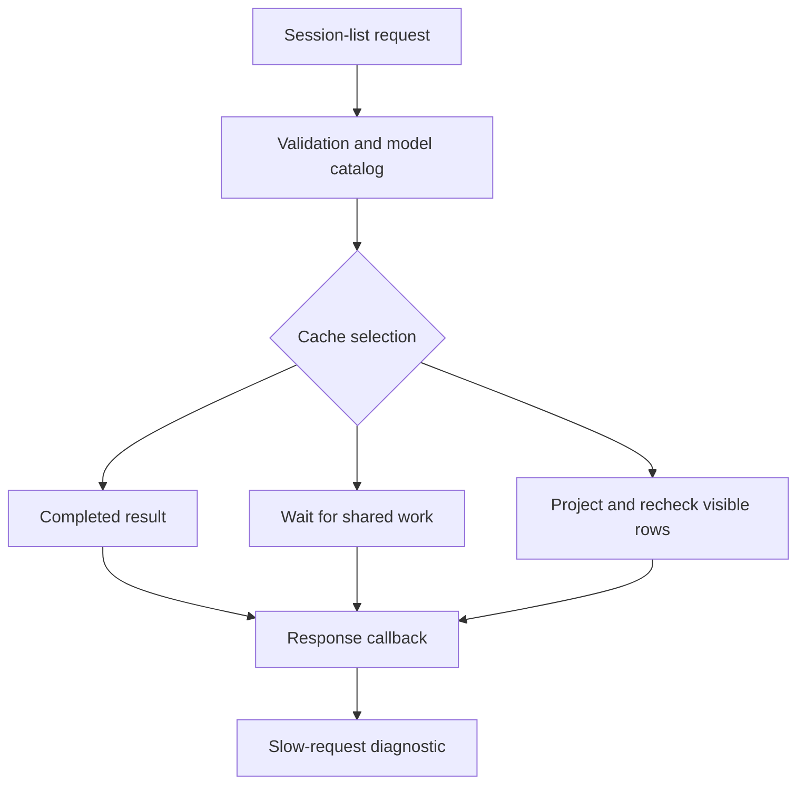

Codex review: needs maintainer review before merge. _Reviewed September 10, 2026, 9:37 PM ET / September 11, 2026, 01:37 UTC (Revision 2)._

# ClawSweeper review

## What this changes

Adds slow session-list warnings that distinguish cached results, waiting for shared work, and projection work, with timing tests and operator documentation.

## Merge readiness

✅ **Ready for maintainer review**

The attribution remains useful and is absent from current main. No introduced correctness or security defect was found, and the protected maintainer PR should remain open.

**Priority:** P2
**Reviewed head:** `948808b8ebaab12383fc9bc56c26ac660f02e22e`

## Review scores

| Measure | Result | What it means |
|---|---|---|
| **Overall readiness** | 🐚 platinum hermit **(4/6)** | A focused, maintainable diagnostic addition with meaningful boundary coverage and no identified blocking defect. |
| **Proof confidence** | 🌊 off-meta tidepool | Not applicable: The supplied Repository State identifies a member-authored PR, so the external-contributor proof gate does not apply. Handler tests exercise attribution and sink failures; the reported Linux Gateway run covers ordinary list behavior but explicitly does not demonstrate a slow warning. |
| **Patch quality** | 🐚 platinum hermit **(4/6)** | No actionable review findings were identified. |

## Verification

| Check | Result | Evidence |
|---|---|---|
| **Real behavior** | Not applicable | Not applicable: The supplied Repository State identifies a member-authored PR, so the external-contributor proof gate does not apply. Handler tests exercise attribution and sink failures; the reported Linux Gateway run covers ordinary list behavior but explicitly does not demonstrate a slow warning. |
| **Evidence reviewed** | 8 items | Introduced production changes: The pinned base-to-head diff instruments existing phase boundaries and yield sites while preserving row construction, visibility repair, cache fences, and response payloads. Request-owned diagnostics: The wrapper captures the request trace, gates collection on diagnostics and warning enablement, records response outcomes, and catches warning-sink failures. Projection counters belong only to the producing request. Current-main necessity: Current main retains the cache implementation without role reporting, selected-row diagnostics, or producer-trace binding. The new diagnostics module is absent from both fetched main and the supplied latest release tag v2026.9.3; no implementation-based closure is established. |
| **Findings** | None | None. |
| **Security** | None | None. |

## How this fits together

The Gateway turns session-list requests into filtered pages, reusing completed results or sharing in-flight work when possible. The new diagnostics explain where slow requests spent time without recording session contents.

## Before merge

None.

<strong>Agent review details</strong>

### Security

None.

### PR surface

Source +226, Tests +272, Docs +17. Total +515 across 6 files.

View PR surface stats

| Area | Files | Added | Removed | Net |
|---|---:|---:|---:|---:|
| Source | 4 | 306 | 80 | +226 |
| Tests | 1 | 272 | 0 | +272 |
| Docs | 1 | 17 | 0 | +17 |
| Config | 0 | 0 | 0 | 0 |
| Generated | 0 | 0 | 0 | 0 |
| Other | 0 | 0 | 0 | 0 |
| **Total** | **6** | **595** | **80** | **+515** |

### Review metrics

| Metric | Value | Why it matters |
|---|---|---|
| **Production versus test growth** | Production net +226 lines; tests net +272 lines | Production growth supplies request attribution and aggregate timing, while tests cover shared-work attribution and failure isolation. |

### Technical review

Best possible solution:

Keep attribution with the existing cache and projection owners, using bounded diagnostics that preserve list results and distinguish elapsed waiting from synchronous work.

Do we have a high-confidence way to reproduce the issue?

Not applicable as a broken-behavior reproduction: this adds diagnostic detail. Source confirms the current cache does not provide this attribution; the new warning condition was not reproduced live during review.

Is this the best way to solve the issue?

Yes. The patch obtains cache roles from the cache owner, measures existing yield boundaries, and follows the repository's established slow-request timing pattern without adding competing state or configuration.

AGENTS.md: found and applied where relevant.

Codex review notes: model internal, reasoning medium; reviewed against [6674550af937](https://github.com/openclaw/openclaw/commit/6674550af937738f62d68828e33719b5d7f3d71d).

### Labels

Label justifications:

- `P2`: This is a bounded operational improvement for diagnosing slow session lists without evidence of an urgent runtime regression.
- `rating: 🐚 platinum hermit`: Overall readiness is 🐚 platinum hermit; proof is 🌊 off-meta tidepool and patch quality is 🐚 platinum hermit.
- `status: 👀 ready for maintainer look`: ClawSweeper has no concrete contributor-facing blocker left for this PR. Not applicable: The supplied Repository State identifies a member-authored PR, so the external-contributor proof gate does not apply. Handler tests exercise attribution and sink failures; the reported Linux Gateway run covers ordinary list behavior but explicitly does not demonstrate a slow warning.

### Evidence

What I checked:

- **Introduced production changes:** The pinned base-to-head diff instruments existing phase boundaries and yield sites while preserving row construction, visibility repair, cache fences, and response payloads. ([`src/gateway/session-utils-list.ts:559`](https://github.com/openclaw/openclaw/blob/948808b8ebaab12383fc9bc56c26ac660f02e22e/src/gateway/session-utils-list.ts#L559), [948808b8ebaa](https://github.com/openclaw/openclaw/commit/948808b8ebaab12383fc9bc56c26ac660f02e22e))
- **Request-owned diagnostics:** The wrapper captures the request trace, gates collection on diagnostics and warning enablement, records response outcomes, and catches warning-sink failures. Projection counters belong only to the producing request. ([`src/gateway/server-methods/sessions-list-diagnostics.ts:30`](https://github.com/openclaw/openclaw/blob/948808b8ebaab12383fc9bc56c26ac660f02e22e/src/gateway/server-methods/sessions-list-diagnostics.ts#L30), [948808b8ebaa](https://github.com/openclaw/openclaw/commit/948808b8ebaab12383fc9bc56c26ac660f02e22e))
- **Current-main necessity:** Current main retains the cache implementation without role reporting, selected-row diagnostics, or producer-trace binding. The new diagnostics module is absent from both fetched main and the supplied latest release tag v2026.9.3; no implementation-based closure is established. ([`src/gateway/server-methods/sessions-list-cache.ts:203`](https://github.com/openclaw/openclaw/blob/6674550af937738f62d68828e33719b5d7f3d71d/src/gateway/server-methods/sessions-list-cache.ts#L203), [6674550af937](https://github.com/openclaw/openclaw/commit/6674550af937738f62d68828e33719b5d7f3d71d))
- **Focused behavioral coverage:** The complete new test file exercises the registered session-list handler, overlapping producer/follower traces, completed hits, visibility changes during yields, disabled diagnostics, and throwing sinks. These are controlled-clock boundary tests; they were inspected but not executed during this read-only review. ([`src/gateway/server-methods/sessions-read-diagnostics.test.ts:70`](https://github.com/openclaw/openclaw/blob/948808b8ebaab12383fc9bc56c26ac660f02e22e/src/gateway/server-methods/sessions-read-diagnostics.test.ts#L70), [948808b8ebaa](https://github.com/openclaw/openclaw/commit/948808b8ebaab12383fc9bc56c26ac660f02e22e))
- **Review continuity:** All six reviewed files are unchanged from the previous reviewed head. The supplied completed-review projection contains no findings and no published rank-up moves. ([948808b8ebaa](https://github.com/openclaw/openclaw/commit/948808b8ebaab12383fc9bc56c26ac660f02e22e))
- **Reported runtime evidence and its limits:** The supplied body reports successful isolated Linux Gateway list, update, persistence, and restart checks through https://github.com/openclaw/openclaw/actions/runs/34546163934, explicitly without forcing a slow warning. The allocation workflow and its Run Testbox step are cancelled; that metadata alone neither verifies nor disproves the reported manual session. The warning condition is supported by controlled tests rather than a captured live warning.

Likely related people:

- **steipete:** Suggested for follow-up; no historical authorship or introduction is verified. (role: unverified routing candidate; confidence: low)
- **masatohoshino:** Suggested for follow-up; no historical authorship or introduction is verified. (role: unverified routing candidate; confidence: low)

### Rating scale

| Score | Internal tier | Crab rank | Meaning |
|---:|:---:|---|---|
| **6/6** | S | 🦀 challenger crab | Exceptional readiness |
| **5/6** | A | 🦞 diamond lobster | Very strong readiness |
| **4/6** | B | 🐚 platinum hermit | Good normal PR; ordinary maintainer review |
| **3/6** | C | 🦐 gold shrimp | Useful, but confidence is limited |
| **2/6** | D | 🦪 silver shellfish | Proof or implementation needs work |
| **1/6** | F | 🧂 unranked krab | Not merge-ready |
| N/A | NA | 🌊 off-meta tidepool | Rating does not apply |

Overall follows the weaker of proof and patch quality.
Shiny media proof means a screenshot, video, or linked artifact directly shows the changed behavior. Runtime, network, CSP, and security claims still need visible diagnostics.

### Workflow

- ClawSweeper keeps one durable marker-backed review comment per issue or PR.
- Re-runs edit this comment so the latest verdict, findings, and automation markers stay together instead of adding duplicate bot comments.
- A fresh review can be triggered by eligible `@clawsweeper re-review` comments, exact-item GitHub events, scheduled/background review runs, or manual workflow dispatch.
- PR/issue authors and users with repository write access can comment `@clawsweeper re-review` or `@clawsweeper re-run` on an open PR or issue to request a fresh review only.
- Maintainers can also comment `@clawsweeper review` to request a fresh review only.
- Fresh-review commands do not start repair, autofix, rebase, CI repair, or automerge.
- Maintainer-only repair and merge flows require explicit commands such as `@clawsweeper autofix`, `@clawsweeper automerge`, `@clawsweeper fix ci`, or `@clawsweeper address review`.
- Maintainers can comment `@clawsweeper explain` to ask for more context, or `@clawsweeper stop` to stop active automation.

### History

Review history (1 earlier review cycle)

<!-- clawsweeper-review-history v=1 total=1 -->
- reviewed 2026-09-11T00:54:56.778Z sha cfcef99dc084dee385840d3cbdc8eda3ef84cf44 :: needs maintainer review before merge. :: none

<!-- clawsweeper-verdict:needs-human item=144531 sha=948808b8ebaab12383fc9bc56c26ac660f02e22e confidence=high updated_at=2026-09-11T01:34:28Z reviewed_at=2026-09-11T01:37:15.712Z lease_owner=github-run-34551065828-1 lease_comment_id=5628072357 source_revision=16eeef904cc9a2b0e1dd9c3bee3aa1292ff9c7bb927640c55b00339ec234a1c1 live_verification=absent -->
<!-- clawsweeper-review-state:ready item=144531 sha=948808b8ebaab12383fc9bc56c26ac660f02e22e v=1 -->

<!-- clawsweeper-review-version item=144531 reviewed_at=2026-09-11T01:37:15.712Z sha=948808b8ebaab12383fc9bc56c26ac660f02e22e source_revision=16eeef904cc9a2b0e1dd9c3bee3aa1292ff9c7bb927640c55b00339ec234a1c1 lease_owner=github-run-34551065828-1 lease_comment_id=5628072357 v=1 -->

<!-- clawsweeper-review item=144531 -->