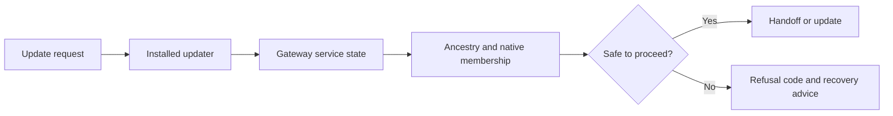

Codex review: needs real behavior proof before merge. _Reviewed September 26, 2026, 5:24 AM ET / 09:24 UTC (Revision 7)._

# ClawSweeper review

## What this changes

The branch distinguishes inherited service markers from native Gateway membership, preserves specific update refusal codes, and moves three Codex plugin filesystem checks to an existing SDK helper.

## Merge readiness

⛔ **Blocked before merge - 8 items remain**

Keep open: the update repair remains absent from current main. The prior recovery-guidance finding persists, and the changed service authority lacks final-effect proof.

**Priority:** P0
**Reviewed head:** `83b66cfbc0a7d180c5f7667d81488a5a5e88b207`

## Review scores

| Measure | Result | What it means |
|---|---|---|
| **Overall readiness** | 🦪 silver shellfish **(2/6)** | The repair has substantial source and fixture coverage, while one actionable guidance defect and missing native final-effect proof limit merge confidence. |
| **Proof confidence** | 🦪 silver shellfish **(2/6)** | Needs real behavior proof before merge: Authority-chain proof required: the changed updater membership owner and LaunchAgent stop path are exercised by fixture tests with simulated service I/O, but no after-fix terminal or native-service trace shows an external inherited-marker caller completing an update and a reparented member or revoked helper being rejected before final I/O. The PR body also records the published 2026.9.5-driver-to-candidate cell as unrun. New refusal codes reuse existing stored failure-fact fields, so no stored-data migration is implicated. Add redacted terminal output or logs without private paths, IP addresses, keys, phone numbers, or endpoints; updating the PR body should trigger review, or a maintainer can request `@clawsweeper re-review`. After adding proof, update the PR body; ClawSweeper should re-review automatically. If it does not, the PR author or someone with repository write access can comment `@clawsweeper re-review`. |
| **Patch quality** | 🦐 gold shrimp **(3/6)** | Security review found an item that needs attention. |

## Verification

| Check | Result | Evidence |
|---|---|---|
| **Real behavior** | Needs proof | Needs real behavior proof before merge: Authority-chain proof required: the changed updater membership owner and LaunchAgent stop path are exercised by fixture tests with simulated service I/O, but no after-fix terminal or native-service trace shows an external inherited-marker caller completing an update and a reparented member or revoked helper being rejected before final I/O. The PR body also records the published 2026.9.5-driver-to-candidate cell as unrun. New refusal codes reuse existing stored failure-fact fields, so no stored-data migration is implicated. Add redacted terminal output or logs without private paths, IP addresses, keys, phone numbers, or endpoints; updating the PR body should trigger review, or a maintainer can request `@clawsweeper re-review`. After adding proof, update the PR body; ClawSweeper should re-review automatically. If it does not, the PR author or someone with repository write access can comment `@clawsweeper re-review`. |
| **Evidence reviewed** | 10 items | Current-main behavior: The current-main guard treats a matching inherited Gateway PID as a reason to block an update even when that PID is not in the caller's ancestry. Introduced admission change: The introduced patch replaces the inherited-marker decision with ancestry and native membership checks while retaining refusal on unknown membership. Native containment owner: The new owner inspects macOS process-group and coalition facts or Linux systemd cgroups; unreadable observations return unknown. |
| **Findings** | 1 actionable finding | [P2] Give incomplete-ancestry callers a workable recovery path |
| **Security** | Needs attention | Verify rejection before native service stop: Membership classification now feeds LaunchAgent stop and updater service actions. The available cases simulate membership and service calls, so they do not establish that a reparented member or revoked transferred helper is rejected before native teardown. |

## How this fits together

The installed updater checks the running Gateway and its service before replacing packages or stopping that service. Its decision controls managed handoff, service actions, and the refusal shown in update reports.

## Before merge

- [ ] **Add real behavior proof** - Needs real behavior proof before merge: Authority-chain proof required: the changed updater membership owner and LaunchAgent stop path are exercised by fixture tests with simulated service I/O, but no after-fix terminal or native-service trace shows an external inherited-marker caller completing an update and a reparented member or revoked helper being rejected before final I/O. The PR body also records the published 2026.9.5-driver-to-candidate cell as unrun. New refusal codes reuse existing stored failure-fact fields, so no stored-data migration is implicated. Add redacted terminal output or logs without private paths, IP addresses, keys, phone numbers, or endpoints; updating the PR body should trigger review, or a maintainer can request `@clawsweeper re-review`. After adding proof, update the PR body; ClawSweeper should re-review automatically. If it does not, the PR author or someone with repository write access can comment `@clawsweeper re-review`.
- [ ] **Give incomplete-ancestry callers a workable recovery path (P2)** - When native membership is outside but the parent walk is incomplete, the new guard refuses regardless of inherited service markers. Retrying without those markers cannot repair the failed inspection. Replace that advice with a recovery step that restores inspection or routes the user through an effective in-product path; this finding remains from the prior review.
- [ ] **Resolve security concern: Verify rejection before native service stop** - Membership classification now feeds LaunchAgent stop and updater service actions. The available cases simulate membership and service calls, so they do not establish that a reparented member or revoked transferred helper is rejected before native teardown.
- [ ] **Resolve merge risk (P1)** - The tests do not yet show that a reparented Gateway member or a revoked transferred helper is rejected before native service I/O.
- [ ] **Resolve merge risk (P1)** - The published 2026.9.5 updater-to-candidate path is unrun; an installed driver can refuse before candidate code takes control.
- [ ] **Resolve merge risk (P1)** - macOS and Windows service behavior has fixture-only coverage, leaving update and service availability on those native paths uncertain.
- [ ] **Complete next step (P2)** - Correct the incomplete-ancestry advice and add redacted final-effect and published-driver upgrade evidence to the PR body before re-review.
- [ ] **Add data-model compatibility proof** - Confirm migration or upgrade compatibility proof before merge.

## Findings

- [P2] Give incomplete-ancestry callers a workable recovery path — `src/infra/update-preflight-details.ts:23-24`
- [medium] Verify rejection before native service stop — `src/daemon/launchd-stop.ts:174`

<strong>Agent review details</strong>

### Security

Needs attention: The patch adds no evident supply-chain change, but its native service authority needs forbidden-caller and revoked-helper proof at final I/O.

### PR surface

Source +353, Tests +813, Docs +16, Other +15. Total +1197 across 66 files.

View PR surface stats

| Area | Files | Added | Removed | Net |
|---|---:|---:|---:|---:|
| Source | 24 | 521 | 168 | +353 |
| Tests | 38 | 1599 | 786 | +813 |
| Docs | 1 | 16 | 0 | +16 |
| Config | 0 | 0 | 0 | 0 |
| Generated | 0 | 0 | 0 | 0 |
| Other | 3 | 40 | 25 | +15 |
| **Total** | **66** | **2176** | **979** | **+1197** |

### Review metrics

| Metric | Value | Why it matters |
|---|---|---|
| **Source growth** | production +351 net; tests and support +813 net | The new native-membership owner accounts for meaningful production growth that warrants boundary proof. |

### Stored data model

Persistent data-model change detected: `migration/backfill/repair: scripts/e2e/lib/doctor-install-switch/shims/busctl`, `migration/backfill/repair: src/infra/update-preflight-details.ts`. Confirm migration or upgrade compatibility proof before merge.

### Merge-risk options

**Maintainer options:**
1. **Prove the native and first-hop boundaries (recommended)**  
   Capture redacted after-fix terminal or service logs for the published-driver upgrade, an allowed external caller, and forbidden or revoked callers rejected before native stop.

### Technical review

Best possible solution:

Ship an installed updater that admits verified external callers, refuses Gateway-owned callers before service teardown, retains precise refusal codes, and offers a visible Doctor or Fix recovery when inspection fails.

Do we have a high-confidence way to reproduce the issue?

Yes, with source-backed confidence: current main blocks a caller with a matching inherited Gateway PID even when ancestry is external, and the PR records failing pre-fix controls. This review did not execute the update.

Is this the best way to solve the issue?

No, not yet: the branch changes the appropriate updater and service owners, but the ancestry-failure advice is ineffective and the native final-effect and upgrade paths still need proof.

Full review comments:

- [P2] Give incomplete-ancestry callers a workable recovery path — `src/infra/update-preflight-details.ts:23-24`
  When native membership is outside but the parent walk is incomplete, the new guard refuses regardless of inherited service markers. Retrying without those markers cannot repair the failed inspection. Replace that advice with a recovery step that restores inspection or routes the user through an effective in-product path; this finding remains from the prior review.
  Confidence: 0.94

Overall correctness: patch is incorrect
Overall confidence: 0.86

AGENTS.md: found and applied where relevant.

Codex review notes: model internal, reasoning high; reviewed against [5f3781df412c](https://github.com/openclaw/openclaw/commit/5f3781df412caf60e3258428cf0bb7e406f19a76).

### Labels

Label changes:

No label changes.

Label justifications:

- `P0`: The PR addresses update refusals that block affected users in an essential recovery path.
- `merge-risk: 🚨 compatibility`: The installed updater acts before candidate replacement, and the published-driver upgrade path has not been exercised.
- `merge-risk: 🚨 security-boundary`: New membership decisions affect which caller can reach native Gateway service teardown.
- `merge-risk: 🚨 availability`: Incorrect native membership or inspection handling could refuse an update or stop a caller-owned service.
- `rating: 🦪 silver shellfish`: Overall readiness is 🦪 silver shellfish; proof is 🦪 silver shellfish and patch quality is 🦐 gold shrimp.
- `status: 📣 needs proof`: The PR needs real behavior proof before ClawSweeper can clear the contributor ask. Needs real behavior proof before merge: Authority-chain proof required: the changed updater membership owner and LaunchAgent stop path are exercised by fixture tests with simulated service I/O, but no after-fix terminal or native-service trace shows an external inherited-marker caller completing an update and a reparented member or revoked helper being rejected before final I/O. The PR body also records the published 2026.9.5-driver-to-candidate cell as unrun. New refusal codes reuse existing stored failure-fact fields, so no stored-data migration is implicated. Add redacted terminal output or logs without private paths, IP addresses, keys, phone numbers, or endpoints; updating the PR body should trigger review, or a maintainer can request `@clawsweeper re-review`. After adding proof, update the PR body; ClawSweeper should re-review automatically. If it does not, the PR author or someone with repository write access can comment `@clawsweeper re-review`.

### Evidence

Security concerns:

- [medium] Verify rejection before native service stop — `src/daemon/launchd-stop.ts:174`
  Membership classification now feeds LaunchAgent stop and updater service actions. The available cases simulate membership and service calls, so they do not establish that a reparented member or revoked transferred helper is rejected before native teardown.
  Confidence: 0.86

What I checked:

- **Current-main behavior:** The current-main guard treats a matching inherited Gateway PID as a reason to block an update even when that PID is not in the caller's ancestry. ([`src/cli/update-cli/update-command-handoff.ts:56`](https://github.com/openclaw/openclaw/blob/5f3781df412caf60e3258428cf0bb7e406f19a76/src/cli/update-cli/update-command-handoff.ts#L56), [5f3781df412c](https://github.com/openclaw/openclaw/commit/5f3781df412caf60e3258428cf0bb7e406f19a76))
- **Introduced admission change:** The introduced patch replaces the inherited-marker decision with ancestry and native membership checks while retaining refusal on unknown membership. ([`src/cli/update-cli/update-command-handoff.ts:56`](https://github.com/openclaw/openclaw/blob/83b66cfbc0a7d180c5f7667d81488a5a5e88b207/src/cli/update-cli/update-command-handoff.ts#L56), [83b66cfbc0a7](https://github.com/openclaw/openclaw/commit/83b66cfbc0a7d180c5f7667d81488a5a5e88b207))
- **Native containment owner:** The new owner inspects macOS process-group and coalition facts or Linux systemd cgroups; unreadable observations return unknown. ([`src/daemon/service-process-membership.ts:32`](https://github.com/openclaw/openclaw/blob/83b66cfbc0a7d180c5f7667d81488a5a5e88b207/src/daemon/service-process-membership.ts#L32), [83b66cfbc0a7](https://github.com/openclaw/openclaw/commit/83b66cfbc0a7d180c5f7667d81488a5a5e88b207))
- **Unfixed prior finding:** The new ancestry-failure advice recommends removing inherited markers, but the decision still refuses when the parent walk is incomplete; the prior review raised this same concern. ([`src/infra/update-preflight-details.ts:24`](https://github.com/openclaw/openclaw/blob/83b66cfbc0a7d180c5f7667d81488a5a5e88b207/src/infra/update-preflight-details.ts#L24), [83b66cfbc0a7](https://github.com/openclaw/openclaw/commit/83b66cfbc0a7d180c5f7667d81488a5a5e88b207))
- **Service stop boundary:** LaunchAgent stop consumes the membership decision and rechecks handoff authority before its native disable and bootout calls. ([`src/daemon/launchd-stop.ts:174`](https://github.com/openclaw/openclaw/blob/83b66cfbc0a7d180c5f7667d81488a5a5e88b207/src/daemon/launchd-stop.ts#L174), [83b66cfbc0a7](https://github.com/openclaw/openclaw/commit/83b66cfbc0a7d180c5f7667d81488a5a5e88b207))
- **Boundary-test scope:** The reparented-caller tests mock native membership and service actions; the Linux case exercises the real parser against substituted procfs content. ([`src/cli/update-cli/update-command-service-maintenance-handoff.test.ts:163`](https://github.com/openclaw/openclaw/blob/83b66cfbc0a7d180c5f7667d81488a5a5e88b207/src/cli/update-cli/update-command-service-maintenance-handoff.test.ts#L163), [83b66cfbc0a7](https://github.com/openclaw/openclaw/commit/83b66cfbc0a7d180c5f7667d81488a5a5e88b207))

Likely related people:

- **Peter Steinberger:** Suggested for follow-up; no historical authorship or introduction is verified. (role: unverified routing candidate; confidence: low)
- **Dallin Romney:** Suggested for follow-up; no historical authorship or introduction is verified. (role: unverified routing candidate; confidence: low)
- **Jason (Json):** Suggested for follow-up; no historical authorship or introduction is verified. (role: unverified routing candidate; confidence: low)

### Rank-up moves

Optional improvements that raise the rating; they are not merge blockers.

- Correct the incomplete-ancestry recovery instruction.
- Add final-effect evidence for an allowed external caller and forbidden or revoked callers before service I/O.
- Exercise the published 2026.9.5 updater-to-candidate path and record the result.

### Rating scale

| Score | Internal tier | Crab rank | Meaning |
|---:|:---:|---|---|
| **6/6** | S | 🦀 challenger crab | Exceptional readiness |
| **5/6** | A | 🦞 diamond lobster | Very strong readiness |
| **4/6** | B | 🐚 platinum hermit | Good normal PR; ordinary maintainer review |
| **3/6** | C | 🦐 gold shrimp | Useful, but confidence is limited |
| **2/6** | D | 🦪 silver shellfish | Proof or implementation needs work |
| **1/6** | F | 🧂 unranked krab | Not merge-ready |
| N/A | NA | 🌊 off-meta tidepool | Rating does not apply |

Overall follows the weaker of proof and patch quality.
Shiny media proof means a screenshot, video, or linked artifact directly shows the changed behavior. Runtime, network, CSP, and security claims still need visible diagnostics.

### Workflow

- ClawSweeper keeps one durable marker-backed review comment per issue or PR.
- Re-runs edit this comment so the latest verdict, findings, and automation markers stay together instead of adding duplicate bot comments.
- A fresh review can be triggered by eligible `@clawsweeper re-review` comments, exact-item GitHub events, scheduled/background review runs, or manual workflow dispatch.
- PR/issue authors and users with repository write access can comment `@clawsweeper re-review` or `@clawsweeper re-run` on an open PR or issue to request a fresh review only.
- Maintainers can also comment `@clawsweeper review` to request a fresh review only.
- Fresh-review commands do not start repair, autofix, rebase, CI repair, or automerge.
- Maintainer-only repair and merge flows require explicit commands such as `@clawsweeper autofix`, `@clawsweeper automerge`, `@clawsweeper fix ci`, or `@clawsweeper address review`.
- Maintainers can comment `@clawsweeper explain` to ask for more context, or `@clawsweeper stop` to stop active automation.

### History

Review history (6 earlier review cycles)

<!-- clawsweeper-review-history v=1 total=6 -->
- reviewed September 25, 2026, 4:52 PM ET / 20:52 UTC sha unknown :: blocked before merge. :: none
- reviewed 2026-09-26T02:26:22.360Z sha b086373ec96078a3ef59983b4d87c86dc0f1d1f0 :: needs real behavior proof before merge. :: none
- reviewed 2026-09-26T03:32:37.062Z sha 189130e1a484a90bb3b41940d89f6ea291f359fd :: needs real behavior proof before merge. :: none
- reviewed 2026-09-26T04:53:14.660Z sha 400524b9dbe33185366042127e8b651a0652df55 :: needs real behavior proof before merge. :: [P2] Make incomplete-ancestry recovery actionable
- reviewed 2026-09-26T05:46:53.054Z sha 38d01fd9b4f7425ab4fdd4292ecbdfdc199d1fdd :: needs real behavior proof before merge. :: [P2] Give incomplete-ancestry users an effective recovery path
- reviewed 2026-09-26T08:23:12.379Z sha c1bb069976b8d213e6e3e4ea699b4486be1e47be :: needs real behavior proof before merge. :: [P2] Give incomplete-ancestry callers an effective retry

<!-- clawsweeper-security:security-sensitive item=158314 sha=83b66cfbc0a7d180c5f7667d81488a5a5e88b207 confidence=high updated_at=2026-09-26T09:21:00Z reviewed_at=2026-09-26T09:24:55.261Z lease_owner=github-run-36232393855-1 lease_comment_id=5844965184 source_revision=d4a5200a85914951261bfcd8409c97de662e4eeedaa0940d6cb3639ebd7d6bcc live_verification=absent -->
<!-- clawsweeper-verdict:needs-human item=158314 sha=83b66cfbc0a7d180c5f7667d81488a5a5e88b207 confidence=high updated_at=2026-09-26T09:21:00Z reviewed_at=2026-09-26T09:24:55.261Z lease_owner=github-run-36232393855-1 lease_comment_id=5844965184 source_revision=d4a5200a85914951261bfcd8409c97de662e4eeedaa0940d6cb3639ebd7d6bcc live_verification=absent -->
<!-- clawsweeper-review-state:blocked item=158314 sha=83b66cfbc0a7d180c5f7667d81488a5a5e88b207 v=1 -->

<!-- clawsweeper-review-version item=158314 reviewed_at=2026-09-26T09:24:55.261Z sha=83b66cfbc0a7d180c5f7667d81488a5a5e88b207 source_revision=d4a5200a85914951261bfcd8409c97de662e4eeedaa0940d6cb3639ebd7d6bcc lease_owner=github-run-36232393855-1 lease_comment_id=5844965184 v=1 -->

<!-- clawsweeper-review item=158314 -->