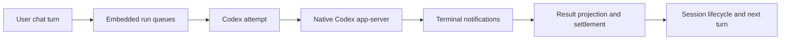

Codex review: needs maintainer review before merge. _Reviewed September 1, 2026, 11:02 PM ET / September 2, 2026, 03:02 UTC._

# ClawSweeper review

## What this changes

The PR replaces inferred Codex app-server idle watches with attempt-owned execution and settlement deadlines, retires three Codex timeout settings through Doctor, and updates shared run-lane recovery and timeout propagation.

## Regression provenance

Possible regression — probable (reviewed change; known regression link). No predecessor PR is attributed.

## Merge readiness

⚠️ **Ready for maintainer review - 2 items remain**

Keep this maintainer-owned PR open for normal landing review. The deadline ownership change matches the Codex event contract, preserves explicit cancellation and bounded settlement, and the prior compatibility decision is now recorded; no discrete patch defect was found.

**Priority:** P1
**Reviewed head:** `7bd12290e95eae418607649d190f1d70c1aba357`

## Review scores

| Measure | Result | What it means |
|---|---|---|
| **Overall readiness** | 🦞 diamond lobster **(5/6)** | Strong real-flow evidence and focused owner-boundary tests support a coherent net-negative repair with no blocking defect found. |
| **Proof confidence** | 🦞 diamond lobster **(5/6)** ✨ media proof bonus | Sufficient (recording): The changed owners are the Codex attempt deadline controller, queue deadline handoff, and terminal settlement path; supplied isolated Gateway/Control UI evidence shows a long-running unlimited turn, real Stop, fast provider disconnect, persisted terminal state, partial-text retention, and a successful next turn. The final head’s recorded refresh is test-only, so the runtime proof remains applicable. |
| **Patch quality** | 🦞 diamond lobster **(5/6)** | No actionable review findings were identified. |

## Verification

| Check | Result | Evidence |
|---|---|---|
| **Real behavior** | Verified | Sufficient (recording): The changed owners are the Codex attempt deadline controller, queue deadline handoff, and terminal settlement path; supplied isolated Gateway/Control UI evidence shows a long-running unlimited turn, real Stop, fast provider disconnect, persisted terminal state, partial-text retention, and a successful next turn. The final head’s recorded refresh is test-only, so the runtime proof remains applicable. |
| **Evidence reviewed** | 8 items | Attempt deadline owner: The new controller publishes an absolute execution deadline, switches once to an absolute terminal-settlement deadline, and does not use progress to reset either deadline. Queue and authority boundary: Queue deadline updates are accepted only from the current attempt owner with current lifecycle generation and delegated authority; stale controls cannot alter successor deadlines or cancellation. Queue deadline behavior: When an owner deadline is present, the queue calculates remaining time from its absolute deadline rather than from progress; it rejects late deadline updates after cancellation begins. |
| **Findings** | None | None. |
| **Security** | None | None. |

## How this fits together

Codex-backed agent turns pass from OpenClaw’s embedded run queues to the Codex app-server, then back through notification projection and session lifecycle handling. This change assigns native liveness to Codex while OpenClaw retains elapsed-budget, cancellation, settlement, and delivery ownership.

## Before merge

- [ ] **Resolve merge risk (P2)** - Existing Codex configurations using the three retired idle-timeout keys will have those independent controls removed by Doctor; the PR records this as an intentional migration, but it remains an upgrade-visible compatibility change.
- [ ] **Complete next step (P2)** - This protected maintainer PR has no discrete repair to queue; remaining work is normal final maintainer landing review.

<strong>Agent review details</strong>

### Security

None.

### PR surface

PR surface statistics unavailable: the file list is incomplete.

### Review metrics

| Metric | Value | Why it matters |
|---|---|---|
| **Production versus test delta** | production −1,157; tests/support −644 | The PR’s stated classification is net-negative in both production and test support while replacing the retired watch system with focused owner-boundary coverage. |
| **Retired settings** | 3 removed, 0 replacement settings | Existing Codex installations using these three keys will be migrated by Doctor, so the intentional upgrade effect deserves visible review. |

### Stored data model

Persistent data-model change detected: `migration/backfill/repair: extensions/codex/doctor-contract-api.ts`, `unknown-data-model-change: extensions/codex/doctor-contract-api.ts`, `unknown-truncated-pull-files`. Confirm migration or upgrade compatibility proof before merge.

### Merge-risk options

**Maintainer options:**
1. **Land with the recorded timeout retirement (recommended)**  
   Accept the documented Doctor migration that removes the three idle-timeout settings and retain agents.defaults.timeoutSeconds as the elapsed execution budget.
2. **Pause for a different upgrade contract**  
   Keep the PR unmerged if maintainers want to preserve independent idle controls rather than adopt native Codex liveness ownership.

### Technical review

Best possible solution:

Land the single elapsed execution-budget and native-liveness model with the documented Doctor migration, keeping the retired timeout keys absent from steady-state runtime configuration.

Do we have a high-confidence way to reproduce the issue?

Yes—source-reproducible with high confidence: the replaced watch controller used inferred idle activity, while the new deadline and queue tests exercise the quiet-turn and elapsed-budget boundaries. The supplied isolated Gateway/UI recording also demonstrates the repaired Stop and follow-up-turn path.

Is this the best way to solve the issue?

Yes. Moving liveness and terminal completion to native Codex while retaining OpenClaw-owned elapsed budgets, cancellation, and settlement removes the competing-watch ownership conflict instead of lengthening timers.

AGENTS.md: found and applied where relevant.

Codex review notes: model internal, reasoning high; reviewed against [b31586f730ef](https://github.com/openclaw/openclaw/commit/b31586f730efcca8cc8be412400408ebc82fb0d8).

### Labels

Label changes:

- add `rating: 🦞 diamond lobster`: Overall readiness is 🦞 diamond lobster; proof is 🦞 diamond lobster and patch quality is 🦞 diamond lobster.
- remove `rating: 🐚 platinum hermit`: Current PR rating is `rating: 🦞 diamond lobster`, so this older rating label is no longer current.

Label justifications:

- `P1`: This repairs interrupted active Codex-backed turns and execution budgets in ordinary agent chat flows.
- `merge-risk: 🚨 compatibility`: Doctor removes three previously shipped Codex app-server timeout settings without translating their values to a replacement knob.
- `rating: 🦞 diamond lobster`: Overall readiness is 🦞 diamond lobster; proof is 🦞 diamond lobster and patch quality is 🦞 diamond lobster.
- `status: 👀 ready for maintainer look`: ClawSweeper has no concrete contributor-facing blocker left for this PR. Sufficient (recording): The changed owners are the Codex attempt deadline controller, queue deadline handoff, and terminal settlement path; supplied isolated Gateway/Control UI evidence shows a long-running unlimited turn, real Stop, fast provider disconnect, persisted terminal state, partial-text retention, and a successful next turn. The final head’s recorded refresh is test-only, so the runtime proof remains applicable.
- `proof: sufficient`: Contributor real behavior proof is sufficient. The changed owners are the Codex attempt deadline controller, queue deadline handoff, and terminal settlement path; supplied isolated Gateway/Control UI evidence shows a long-running unlimited turn, real Stop, fast provider disconnect, persisted terminal state, partial-text retention, and a successful next turn. The final head’s recorded refresh is test-only, so the runtime proof remains applicable.
- `proof: 🎥 video`: Contributor real behavior proof includes video or recording evidence. The changed owners are the Codex attempt deadline controller, queue deadline handoff, and terminal settlement path; supplied isolated Gateway/Control UI evidence shows a long-running unlimited turn, real Stop, fast provider disconnect, persisted terminal state, partial-text retention, and a successful next turn. The final head’s recorded refresh is test-only, so the runtime proof remains applicable.

### Evidence

What I checked:

- **Attempt deadline owner:** The new controller publishes an absolute execution deadline, switches once to an absolute terminal-settlement deadline, and does not use progress to reset either deadline. ([`extensions/codex/src/app-server/attempt-deadlines.ts:28`](https://github.com/openclaw/openclaw/blob/7bd12290e95eae418607649d190f1d70c1aba357/extensions/codex/src/app-server/attempt-deadlines.ts#L28), [7bd12290e95e](https://github.com/openclaw/openclaw/commit/7bd12290e95eae418607649d190f1d70c1aba357))
- **Queue and authority boundary:** Queue deadline updates are accepted only from the current attempt owner with current lifecycle generation and delegated authority; stale controls cannot alter successor deadlines or cancellation. ([`src/agents/embedded-agent-runner/run/lane-controller.ts:127`](https://github.com/openclaw/openclaw/blob/7bd12290e95eae418607649d190f1d70c1aba357/src/agents/embedded-agent-runner/run/lane-controller.ts#L127), [7bd12290e95e](https://github.com/openclaw/openclaw/commit/7bd12290e95eae418607649d190f1d70c1aba357))
- **Queue deadline behavior:** When an owner deadline is present, the queue calculates remaining time from its absolute deadline rather than from progress; it rejects late deadline updates after cancellation begins. ([`src/process/command-queue.ts:257`](https://github.com/openclaw/openclaw/blob/7bd12290e95eae418607649d190f1d70c1aba357/src/process/command-queue.ts#L257), [7bd12290e95e](https://github.com/openclaw/openclaw/commit/7bd12290e95eae418607649d190f1d70c1aba357))
- **Configuration migration:** Doctor detects all three retired app-server idle-timeout keys and removes them while the strict runtime schema and manifest no longer expose them. ([`extensions/codex/doctor-contract-api.ts:39`](https://github.com/openclaw/openclaw/blob/7bd12290e95eae418607649d190f1d70c1aba357/extensions/codex/doctor-contract-api.ts#L39), [7bd12290e95e](https://github.com/openclaw/openclaw/commit/7bd12290e95eae418607649d190f1d70c1aba357))
- **Regression coverage:** Focused tests cover elapsed admission-based expiry, terminal settlement after unlimited execution, closed-controller non-revival, queue owner deadlines, and stale attempt controls. ([`extensions/codex/src/app-server/attempt-deadlines.test.ts:31`](https://github.com/openclaw/openclaw/blob/7bd12290e95eae418607649d190f1d70c1aba357/extensions/codex/src/app-server/attempt-deadlines.test.ts#L31), [7bd12290e95e](https://github.com/openclaw/openclaw/commit/7bd12290e95eae418607649d190f1d70c1aba357))
- **Direct Codex runtime inspection:** The inspected sibling Codex source waits for each WebSocket frame before parsing it, and app-server completion aborts pending per-thread requests before publishing completion; these support native ownership of transport liveness and terminal completion. The local sibling uses an internal cache remote, so repository ownership is not independently verified here. (`codex-rs/codex-api/src/endpoint/responses_websocket.rs:705`, `78c290807ce710180111df227df3b7a4fe845452`)

Likely related people:

- **steipete:** Suggested for follow-up; no historical authorship or introduction is verified. (role: unverified routing candidate; confidence: low)
- **Josh Avant:** Suggested for follow-up; no historical authorship or introduction is verified. (role: unverified routing candidate; confidence: low)

### Rating scale

| Score | Internal tier | Crab rank | Meaning |
|---:|:---:|---|---|
| **6/6** | S | 🦀 challenger crab | Exceptional readiness |
| **5/6** | A | 🦞 diamond lobster | Very strong readiness |
| **4/6** | B | 🐚 platinum hermit | Good normal PR; ordinary maintainer review |
| **3/6** | C | 🦐 gold shrimp | Useful, but confidence is limited |
| **2/6** | D | 🦪 silver shellfish | Proof or implementation needs work |
| **1/6** | F | 🧂 unranked krab | Not merge-ready |
| N/A | NA | 🌊 off-meta tidepool | Rating does not apply |

Overall follows the weaker of proof and patch quality.
Shiny media proof means a screenshot, video, or linked artifact directly shows the changed behavior. Runtime, network, CSP, and security claims still need visible diagnostics.

### Workflow

- ClawSweeper keeps one durable marker-backed review comment per issue or PR.
- Re-runs edit this comment so the latest verdict, findings, and automation markers stay together instead of adding duplicate bot comments.
- A fresh review can be triggered by eligible `@clawsweeper re-review` comments, exact-item GitHub events, scheduled/background review runs, or manual workflow dispatch.
- PR/issue authors and users with repository write access can comment `@clawsweeper re-review` or `@clawsweeper re-run` on an open PR or issue to request a fresh review only.
- Maintainers can also comment `@clawsweeper review` to request a fresh review only.
- Fresh-review commands do not start repair, autofix, rebase, CI repair, or automerge.
- Maintainer-only repair and merge flows require explicit commands such as `@clawsweeper autofix`, `@clawsweeper automerge`, `@clawsweeper fix ci`, or `@clawsweeper address review`.
- Maintainers can comment `@clawsweeper explain` to ask for more context, or `@clawsweeper stop` to stop active automation.

### History

Review history (5 earlier review cycles)

<!-- clawsweeper-review-history v=1 total=5 -->
- reviewed 2026-09-01T09:12:26.112Z sha be6bf339f4f2f5e4186a45dad947f5aef5c8c965 :: found issues before merge. :: [P1] Reject retired timeout settings before strict parsing
- reviewed 2026-09-01T19:28:43.098Z sha 48b900df86a4e8f43521591bffb2bde1969ea5d9 :: needs maintainer review before merge. :: none
- reviewed 2026-09-02T01:32:14.539Z sha 096587001a02c13b77d55e02dac0ee80d9b1f340 :: needs maintainer review before merge. :: none
- reviewed 2026-09-02T02:12:03.675Z sha 5d0c14fe93670f7bac8608ab42353e82266ad398 :: needs maintainer review before merge. :: none
- reviewed 2026-09-02T02:24:43.803Z sha 19679f052e7131f061c8136c1221bbd565f3a13b :: needs maintainer review before merge. :: none

<!-- clawsweeper-verdict:needs-human item=134755 sha=7bd12290e95eae418607649d190f1d70c1aba357 confidence=high updated_at=2026-09-02T02:58:59Z reviewed_at=2026-09-02T03:02:27.651Z lease_owner=github-run-33585159020-1 lease_comment_id=5503656483 source_revision=3a27c58ed385b16bf7fdc42f3e76fea8dfe62e9521c24435ae5b2cf2eb2ef9eb live_verification=absent -->

<!-- clawsweeper-review-version item=134755 reviewed_at=2026-09-02T03:02:27.651Z sha=7bd12290e95eae418607649d190f1d70c1aba357 source_revision=3a27c58ed385b16bf7fdc42f3e76fea8dfe62e9521c24435ae5b2cf2eb2ef9eb lease_owner=github-run-33585159020-1 lease_comment_id=5503656483 v=1 -->

<!-- clawsweeper-review item=134755 -->