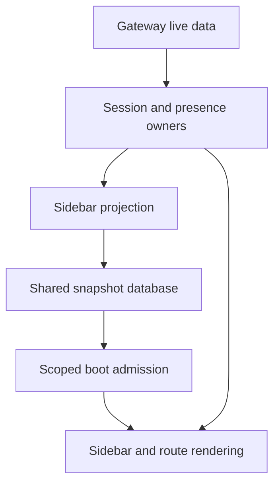

Codex review: blocked before merge.

## What this changes

This PR restores sidebar presentation and initial session-routing facts from one scoped browser snapshot before live data arrives.

**Example:** Reload Project dashboard 6 while Gateway hello is delayed.
- **Before:** The sidebar initially shows an empty roster and placeholder identity.
- **After:** Saved dashboard rows, Harbor, Forge, Scout, rail pins, and Riley’s identity appear before hello.

## Review scores

| Measure | Result | What it means |
|---|---|---|
| **Overall readiness** | 🦐 gold shrimp **(3/6)** | Strong visual evidence supports a useful cutover, but the unresolved P2 finding and compatibility gate prevent merge readiness. |
| **Proof confidence** | 🦞 diamond lobster **(5/6)** ✨ media proof bonus | Sufficient (screenshot): Inspected before/after screenshots show the running Control UI restoring saved sidebar rows and identity before hello in an isolated synthetic browser setup; the database-version change still needs a v2026.10.1-to-candidate existing-state upgrade run with sanitized output. |
| **Patch quality** | 🦐 gold shrimp **(3/6)** | 1 actionable review finding remain. |

## Product

**Kind:** Bug fix · **Worth it:** Yes · **Fix scope:** Complete
**User problem:** A signed-in deep-link reload shows an empty sidebar before rebuilding saved navigation and identity.
**Reason:** The maintainer-authored direction extends established warm rendering and demonstrates a remaining improvement after the rail migration.

## Merge readiness

⛔ **Blocked before merge - 2 items remain**

Keep this useful PR open; its unified snapshot remains distinct from main, but the previously reported live-handoff defect still blocks merge.

**Priority:** P2
**Reviewed head:** `c1ee746907d7dd6a1afed6efb7b06d55ddb138d2`

## Before merge

- [ ] **Determine count readiness from live presence (P2)** - In a profileless scope with profileId null, save a sidebar snapshot containing profile user Ada, then reload after Ada leaves and live presence contains no profile identities. The scope still matches, but this predicate reads saved Ada from sidebarOnlineOrder and waits for counts. SessionDataController.synchronizeOwnerSessionCounts uses live presence and supplies no session source, leaving counts and error null indefinitely. The snapshot therefore never releases, retaining stale navigation and disabling sidebar creation and mutation controls after live loading finishes. Derive readiness from the live presence/count owner and cover this transition through the actual sidebar lifecycle. This is the previously reported unresolved finding, verified again on the unchanged reviewed head.
- [ ] **Add data-model compatibility proof** - The review found that existing stored data may not work after upgrade. Show that existing data still loads and works with this change.

## Findings

- [P2] Determine count readiness from live presence — `ui/src/components/app-sidebar.ts:133-138`

### Tests

- Missing end-to-end proof: Show a v2026.10.1-to-candidate browser upgrade with existing settings and session data preserved; candidate-created reload fixtures do not establish that transition.

<strong>Agent review details</strong>

### How this fits together

The Control UI projects Gateway sessions, agents, presence, and plugin navigation into the sidebar and stores scoped display and routing facts in its browser snapshot database.

### Technical review

Best possible solution:

Keep one scoped browser snapshot whose live handoff follows the current presence/count owner and preserves existing browser state through upgrade.

Do we have a high-confidence way to reproduce the issue?

The supplied browser comparison demonstrates the reload problem, and the inspected production owners establish the cached-presence/live-count mismatch; no target code was executed.

Is this the best way to solve the issue?

Sharing the existing snapshot database removes competing cache lifecycles, but readiness must follow authoritative live presence rather than retained display membership.

Full review comments:

- [P2] Determine count readiness from live presence — `ui/src/components/app-sidebar.ts:133-138`
  In a profileless scope with profileId null, save a sidebar snapshot containing profile user Ada, then reload after Ada leaves and live presence contains no profile identities. The scope still matches, but this predicate reads saved Ada from sidebarOnlineOrder and waits for counts. SessionDataController.synchronizeOwnerSessionCounts uses live presence and supplies no session source, leaving counts and error null indefinitely. The snapshot therefore never releases, retaining stale navigation and disabling sidebar creation and mutation controls after live loading finishes. Derive readiness from the live presence/count owner and cover this transition through the actual sidebar lifecycle. This is the previously reported unresolved finding, verified again on the unchanged reviewed head.
  Confidence: 0.99

Overall correctness: patch is incorrect
Overall confidence: 0.98

AGENTS.md: found and applied where relevant.

Codex review notes: model internal, reasoning medium; reviewed against [5b5a476b836e](https://github.com/openclaw/openclaw/commit/5b5a476b836ed254cb3f8c7f1ced9b655e7d886a).

### Provenance checked

- `Warm roster persistence and routing` changes intended behavior with a stated reason (24ae0fc1984c9563ebd7b4417489ddf6abd88d78: Restore bounded, scoped cached rows before hello while preserving live reconciliation and releasing stalled routing waits.)
- `Account-scoped offline cache admission` keeps the original intent (9764de1747490dd2595305ab2376427e1a39d742: Allow previously signed-in users to read retained conversations offline without assigning unscoped history to another account.)
- `Online people ordering and counts` keeps the original intent (https://github.com/openclaw/openclaw/pull/163664: Keep running activity visible and allow presence, workload, and name sorting through existing sidebar controls.)
- `Personal navigation rail` keeps the original intent (fd018170c94387e843076b259ee54d8998ba935f: Separate destinations, conversations, and people while preserving personal preferences and live access boundaries.)
- `Incognito browser persistence` keeps the original intent (7f50ce061649e4e638e8d4282d637037ebde52a4: Keep Incognito history out of browser storage.)

### Testing

Proof path: shipped entry point.

### Security

None.

### Evidence

Acceptance criteria:

- pnpm test ui/src/components/app-sidebar-session-row-render.test.ts --maxWorkers=1
- pnpm test ui/src/components/sidebar-snapshot-controller.test.ts --maxWorkers=1
- node scripts/run-vitest.mjs run --config test/vitest/vitest.ui-e2e.config.ts --configLoader runner ui/src/e2e/sidebar-cold-load.e2e.test.ts
- git diff --check

What I checked:

- **Unresolved readiness defect:** The settlement predicate reads retained sidebar people, including saved profile identities, rather than the live presence used by the count owner. ([`ui/src/components/app-sidebar.ts:133`](https://github.com/openclaw/openclaw/blob/c1ee746907d7dd6a1afed6efb7b06d55ddb138d2/ui/src/components/app-sidebar.ts#L133), [c1ee746907d7](https://github.com/openclaw/openclaw/commit/c1ee746907d7dd6a1afed6efb7b06d55ddb138d2))
- **Authoritative count lifecycle:** SessionDataController supplies no count source when live presence has no profile identities; SidebarOwnerSessionCounts then retains null counts and null error. ([`ui/src/components/session-data-controller.ts:236`](https://github.com/openclaw/openclaw/blob/c1ee746907d7dd6a1afed6efb7b06d55ddb138d2/ui/src/components/session-data-controller.ts#L236), [c1ee746907d7](https://github.com/openclaw/openclaw/commit/c1ee746907d7dd6a1afed6efb7b06d55ddb138d2))
- **Visible consequence:** While sidebarSnapshot remains installed, session creation and mutation access are disabled. ([`ui/src/components/app-sidebar-base.ts:153`](https://github.com/openclaw/openclaw/blob/c1ee746907d7dd6a1afed6efb7b06d55ddb138d2/ui/src/components/app-sidebar-base.ts#L153), [c1ee746907d7](https://github.com/openclaw/openclaw/commit/c1ee746907d7dd6a1afed6efb7b06d55ddb138d2))
- **Inspected visual proof:** The downloaded before/after screenshots show the running synthetic Control UI changing from an empty sidebar to saved dashboard rows and agent identities before hello: https://github.com/user-attachments/assets/524e4378-db2d-4e29-b359-6fe8cb0a8813 and https://github.com/user-attachments/assets/2ba2963e-72ad-4291-a4a7-865fa8b838ed. ([c1ee746907d7](https://github.com/openclaw/openclaw/commit/c1ee746907d7dd6a1afed6efb7b06d55ddb138d2))
- **Stored-format transition:** The candidate advances the chat snapshot database from version 4 to 6, adds sidebarSnapshots, and retires the legacy roster database; v2026.10.1 uses version 4. ([`ui/src/pages/chat/session-snapshot-database.ts:13`](https://github.com/openclaw/openclaw/blob/e178c39e9aae3fa440735217f9aef9574f286677/ui/src/pages/chat/session-snapshot-database.ts#L13), [e178c39e9aae](https://github.com/openclaw/openclaw/commit/e178c39e9aae3fa440735217f9aef9574f286677))
- **Current-main ownership:** Current main still uses the separate roster cache; feature history identifies the original warm rendering work and subsequent cache repairs. ([`ui/src/lib/sessions/session-roster-cache.ts:54`](https://github.com/openclaw/openclaw/blob/5b5a476b836ed254cb3f8c7f1ced9b655e7d886a/ui/src/lib/sessions/session-roster-cache.ts#L54), [5b5a476b836e](https://github.com/openclaw/openclaw/commit/5b5a476b836ed254cb3f8c7f1ced9b655e7d886a))

Likely related people:

- **Peter Steinberger:** Raw commit 0e7f8c9ce963ed4ffd7a0b154503e2e09dd90802 adds ui/src/pages/chat/session-snapshot-database.ts:18 relative to its recorded parents. This identifies author metadata, not feature responsibility or a PR merger. (role: source-line author; confidence: high; commits: [0e7f8c9ce963](https://github.com/openclaw/openclaw/commit/0e7f8c9ce963ed4ffd7a0b154503e2e09dd90802); files: `ui/src/pages/chat/session-snapshot-database.ts`)
- **RoboClaw:** Raw commit 8e57f5447edd469333772292f2fafb2f913f99a9 adds ui/src/components/session-data-controller.ts:233 relative to its recorded parents. This identifies author metadata, not feature responsibility or a PR merger. (role: source-line author; confidence: high; commits: [8e57f5447edd](https://github.com/openclaw/openclaw/commit/8e57f5447edd469333772292f2fafb2f913f99a9); files: `ui/src/components/session-data-controller.ts`)

### PR surface

Source +889, Tests +1476, Docs +2. Total +2367 across 72 files. Added test files: 6.

View PR surface stats

| Area | Files | Added | Removed | Net |
|---|---:|---:|---:|---:|
| Source | 42 | 1850 | 961 | +889 |
| Tests | 29 | 2076 | 600 | +1476 |
| Docs | 1 | 2 | 0 | +2 |
| Config | 0 | 0 | 0 | 0 |
| Generated | 0 | 0 | 0 | 0 |
| Other | 0 | 0 | 0 | 0 |
| **Total** | **72** | **3928** | **1561** | **+2367** |

### Labels

Label changes:

No label changes.

Label justifications:

- `P2`: The reload improvement has limited scope, and the introduced handoff defect affects profileless reloads after the last profile user leaves.
- `rating: 🦐 gold shrimp`: Overall readiness is 🦐 gold shrimp; proof is 🦞 diamond lobster and patch quality is 🦐 gold shrimp.
- `status: ⏳ waiting on author`: ClawSweeper has contributor-facing work open and is waiting for author action.
- `proof: sufficient`: Contributor real behavior proof is sufficient.
- `proof: 📸 screenshot`: Contributor real behavior proof includes screenshot evidence.

### Rating scale

6/6 🦀 challenger crab · 5/6 🦞 diamond lobster · 4/6 🐚 platinum hermit · 3/6 🦐 gold shrimp · 2/6 🦪 silver shellfish · 1/6 🧂 unranked krab. Overall follows the weaker of proof and patch quality; ✨ marks media proof (a screenshot, video, or linked artifact) that directly shows the changed behavior.

### Workflow

ClawSweeper edits this one comment on every review. Comment `@clawsweeper re-review` for a fresh review only; repair and merge need explicit maintainer commands such as `@clawsweeper autofix` or `@clawsweeper automerge`.

### History

Review history (23 earlier review cycles; latest 8 shown)

<!-- clawsweeper-review-history v=1 total=23 -->
- reviewed 2026-10-10T18:55:42.223Z sha c269cfc7cd976764cc620bb188d5e18db53b7fdc :: blocked before merge. :: [P2] Determine count readiness from live presence
- reviewed 2026-10-10T19:27:13.609Z sha 7040f0d82d719c231c01a0b36a996ca5f6df156a :: blocked before merge. :: [P2] Determine count readiness from live presence | [P2] Align chunking assertions with the regenerated lazy debug modules
- reviewed 2026-10-10T19:55:58.494Z sha fdaff6370a9b0536fb4ebd7c5ac5989acc437e36 :: blocked before merge. :: [P2] Determine count readiness from live presence
- reviewed 2026-10-10T23:42:13.571Z sha 580333826d7798a2f785ab0c1ced5df1e5cde2db :: blocked before merge. :: [P2] Determine count readiness from live presence
- reviewed 2026-10-11T00:00:32.748Z sha 580333826d7798a2f785ab0c1ced5df1e5cde2db :: blocked before merge. :: [P2] Determine count readiness from live presence
- reviewed 2026-10-11T00:56:39.551Z sha bb6691ccdf18abd577ed81595b860fc01783ab2a :: blocked before merge. :: [P2] Determine count readiness from live presence
- reviewed 2026-10-11T01:31:14.074Z sha c1ee746907d7dd6a1afed6efb7b06d55ddb138d2 :: blocked before merge. :: [P2] Determine count readiness from live presence
- reviewed 2026-10-11T02:06:32.874Z sha c1ee746907d7dd6a1afed6efb7b06d55ddb138d2 :: blocked before merge. :: [P2] Determine count readiness from live presence

_Reviewed October 10, 2026, 11:14 PM ET / October 11, 2026, 03:14 UTC (Revision 24)._

<!-- clawsweeper-verdict:needs-human item=168206 sha=c1ee746907d7dd6a1afed6efb7b06d55ddb138d2 confidence=high updated_at=2026-10-11T03:10:14Z reviewed_at=2026-10-11T03:14:23.077Z lease_owner=github-run-38107468981-1 lease_comment_id=6104899947 source_revision=1e06db6b29257f8678bad79fa753fed0425795b92539f0bc4f0e0592eeedc65a live_verification=absent hold=blocked findings=1 -->
<!-- clawsweeper-review-state:blocked item=168206 sha=c1ee746907d7dd6a1afed6efb7b06d55ddb138d2 v=1 -->

<!-- clawsweeper-review-version item=168206 reviewed_at=2026-10-11T03:14:23.077Z sha=c1ee746907d7dd6a1afed6efb7b06d55ddb138d2 source_revision=1e06db6b29257f8678bad79fa753fed0425795b92539f0bc4f0e0592eeedc65a lease_owner=github-run-38107468981-1 lease_comment_id=6104899947 v=1 -->

<!-- clawsweeper-review item=168206 -->