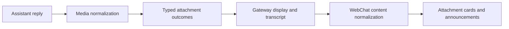

Codex review: needs maintainer review before merge. _Reviewed August 28, 2026, 3:15 PM ET / 19:15 UTC._

# ClawSweeper review

## What this changes

The PR preserves each failed attachment’s name and reason from media normalization through Gateway transcript content into named WebChat status cards.

## Merge readiness

⚠️ **Ready for maintainer review - 2 items remain**

Keep this active member-authored, maintainer-labeled PR open. The prior SDK compatibility concern is addressed on the current head, and source review found no new blocking defect; exact-head checks remain in progress.

**Priority:** P2
**Reviewed head:** `5221fd9537b4d6eb10ac6b593913cef378936414`

## Review scores

| Measure | Result | What it means |
|---|---|---|
| **Overall readiness** | 🐚 platinum hermit **(4/6)** | The owner-boundary repair and the prior compatibility correction read cleanly, with exact-head CI still pending. |
| **Proof confidence** | 🌊 off-meta tidepool | Not applicable: Not applicable to the contributor-proof gate because this is a MEMBER-authored PR; the supplied screenshots and Gateway scenario are supplemental evidence. |
| **Patch quality** | 🐚 platinum hermit **(4/6)** | No actionable review findings were identified. |

## Verification

| Check | Result | Evidence |
|---|---|---|
| **Real behavior** | Not applicable | Not applicable: Not applicable to the contributor-proof gate because this is a MEMBER-authored PR; the supplied screenshots and Gateway scenario are supplemental evidence. |
| **Evidence reviewed** | 8 items | Producer-owned failure outcome: The reply-media normalizer records one bounded typed failure for each rejected media source, retains it as payload metadata, and appends a channel fallback receipt only at that producer boundary. Gateway projection and fallback removal: The shared Gateway display builder turns retained failures into attachment-error blocks and removes the text receipt where the structured card supersedes it, including failure-only replies. Sibling finalization paths use the same owner: Both normal and source-reply finalizers invoke the shared display builder, and the shared non-text-content predicate retains attachment-error blocks for persistence and broadcast. |
| **Findings** | None | None. |
| **Security** | None | None. |

## How this fits together

Assistant replies enter media normalization before the Gateway creates display and transcript content. The Control UI then normalizes that content and renders successful attachments or failed-attachment cards.

## Before merge

- [ ] **Resolve merge risk (P1)** - Exact-head CI is still incomplete, and this partial clone could not hydrate current-main source blobs for a full semantic endpoint comparison; that is a reviewer limitation, not a contributor-proof failure.
- [ ] **Complete next step (P2)** - No narrow repair remains; allow exact-head checks and ordinary maintainer review to complete.

<strong>Agent review details</strong>

### Security

None.

### PR surface

Source +323, Tests +637. Total +960 across 32 files.

View PR surface stats

| Area | Files | Added | Removed | Net |
|---|---:|---:|---:|---:|
| Source | 20 | 464 | 141 | +323 |
| Tests | 12 | 766 | 129 | +637 |
| Docs | 0 | 0 | 0 | 0 |
| Config | 0 | 0 | 0 | 0 |
| Generated | 0 | 0 | 0 | 0 |
| Other | 0 | 0 | 0 | 0 |
| **Total** | **32** | **1230** | **270** | **+960** |

### Review metrics

| Metric | Value | Why it matters |
|---|---|---|
| **Production versus test delta** | production +464/-141 (net +323); tests +766/-129 (net +637) | The positive production growth is concentrated in the required cross-boundary outcome path and was reviewed across producer, Gateway, transcript, and UI consumers. |

### Root-cause cluster

Relationship: `fixed_by_candidate`
Canonical: https://github.com/openclaw/openclaw/issues/131820
Summary: This PR is the explicitly linked candidate fix for the canonical report about anonymous per-file attachment failures.

Members:
- `canonical`: https://github.com/openclaw/openclaw/issues/131820 - The PR body formally links this issue, whose reported missing and mixed attachment outcomes match the implemented typed failure flow.
- `adjacent_distinct`: https://github.com/openclaw/openclaw/pull/130402 - The merged predecessor established generated attachment rendering, while this PR adds distinct per-failure outcome preservation.

Proposal only: this assessment does not dispatch repair, suppress jobs, mutate sibling items, close, or merge anything.

### Merge-risk options

**Maintainer options:**
1. **Decide the mitigation before merge**  
   After exact-head CI completes successfully, retain the single typed internal outcome across normalization, Gateway projection, and WebChat rendering rather than restoring anonymous warning text.
2. **Pause or close**  
   Do not merge this PR until maintainers decide whether the risk is worth taking.

### Technical review

Best possible solution:

After exact-head CI completes successfully, retain the single typed internal outcome across normalization, Gateway projection, and WebChat rendering rather than restoring anonymous warning text.

Do we have a high-confidence way to reproduce the issue?

Yes—source provides a focused Gateway-client scenario for missing and mixed attachments, though this read-only review did not execute it.

Is this the best way to solve the issue?

Yes—the typed failure is recorded where the media attempt fails and projected centrally, avoiding error reconstruction or a WebChat-only workaround while preserving the public media error code.

AGENTS.md: found and applied where relevant.

Codex review notes: model internal, reasoning high; reviewed against [0ee6c35299aa](https://github.com/openclaw/openclaw/commit/0ee6c35299aa972c828edcc0cffb694e170617d6).

### Labels

Label changes:

- add `rating: 🐚 platinum hermit`: Overall readiness is 🐚 platinum hermit; proof is 🌊 off-meta tidepool and patch quality is 🐚 platinum hermit.
- add `status: 👀 ready for maintainer look`: ClawSweeper has no concrete contributor-facing blocker left for this PR. Not applicable: Not applicable to the contributor-proof gate because this is a MEMBER-authored PR; the supplied screenshots and Gateway scenario are supplemental evidence.
- remove `rating: 🦐 gold shrimp`: Current PR rating is `rating: 🐚 platinum hermit`, so this older rating label is no longer current.
- remove `merge-risk: 🚨 compatibility`: Current PR review selected no merge-risk labels.
- remove `status: ⏳ waiting on author`: Current PR status label is `status: 👀 ready for maintainer look`.

Label justifications:

- `P2`: This is a bounded repair to misleading WebChat attachment outcomes without an availability, security, or release-blocking failure.
- `rating: 🐚 platinum hermit`: Overall readiness is 🐚 platinum hermit; proof is 🌊 off-meta tidepool and patch quality is 🐚 platinum hermit.
- `status: 👀 ready for maintainer look`: ClawSweeper has no concrete contributor-facing blocker left for this PR. Not applicable: Not applicable to the contributor-proof gate because this is a MEMBER-authored PR; the supplied screenshots and Gateway scenario are supplemental evidence.

### Evidence

What I checked:

- **Producer-owned failure outcome:** The reply-media normalizer records one bounded typed failure for each rejected media source, retains it as payload metadata, and appends a channel fallback receipt only at that producer boundary. ([`src/auto-reply/reply/reply-media-paths.ts:342`](https://github.com/openclaw/openclaw/blob/5221fd9537b4/src/auto-reply/reply/reply-media-paths.ts#L342), [5221fd9537b4](https://github.com/openclaw/openclaw/commit/5221fd9537b4))
- **Gateway projection and fallback removal:** The shared Gateway display builder turns retained failures into attachment-error blocks and removes the text receipt where the structured card supersedes it, including failure-only replies. ([`src/gateway/server-methods/chat-assistant-content.ts:141`](https://github.com/openclaw/openclaw/blob/5221fd9537b4/src/gateway/server-methods/chat-assistant-content.ts#L141), [5221fd9537b4](https://github.com/openclaw/openclaw/commit/5221fd9537b4))
- **Sibling finalization paths use the same owner:** Both normal and source-reply finalizers invoke the shared display builder, and the shared non-text-content predicate retains attachment-error blocks for persistence and broadcast. ([`src/gateway/server-methods/chat-send-nonagent-finalization.ts:246`](https://github.com/openclaw/openclaw/blob/5221fd9537b4/src/gateway/server-methods/chat-send-nonagent-finalization.ts#L246), [5221fd9537b4](https://github.com/openclaw/openclaw/commit/5221fd9537b4))
- **Control UI consumer:** The UI validates the closed attachment-error shape and renders it through the existing assistant attachment-card component with localized reason text. ([`ui/src/lib/chat/message-normalizer-attachments.ts:8`](https://github.com/openclaw/openclaw/blob/5221fd9537b4/ui/src/lib/chat/message-normalizer-attachments.ts#L8), [5221fd9537b4](https://github.com/openclaw/openclaw/commit/5221fd9537b4))
- **Prior compatibility finding addressed:** The new internal host-read subtype still exposes the established path-not-allowed code through LocalMediaAccessError, while the normalizer can classify the subtype as unsupported-format internally; the public SDK continues to export the base error type. ([`src/media/local-media-access.ts:39`](https://github.com/openclaw/openclaw/blob/5221fd9537b4/src/media/local-media-access.ts#L39), [5221fd9537b4](https://github.com/openclaw/openclaw/commit/5221fd9537b4))
- **Source-reproducible coverage:** The QA-lab scenario sends missing and mixed media through an ephemeral Gateway and real Gateway client, then asserts one structured success or failure outcome per requested file. ([`test/e2e/qa-lab/runtime/webchat-media-artifacts.e2e.test.ts:219`](https://github.com/openclaw/openclaw/blob/5221fd9537b4/test/e2e/qa-lab/runtime/webchat-media-artifacts.e2e.test.ts#L219), [5221fd9537b4](https://github.com/openclaw/openclaw/commit/5221fd9537b4))

Likely related people:

- **vyctorbrzezowski:** Authored the current PR and the merged WebChat attachment-rendering foundation used by this follow-up. (role: recent attachment-flow owner; confidence: high; commits: [a1782855a25a](https://github.com/openclaw/openclaw/commit/a1782855a25a919f5f68129a4a87b127da0d9898), [c9e22e6c5035](https://github.com/openclaw/openclaw/commit/c9e22e6c503521f8b8bb8bc099ce64535533a398); files: `src/gateway/server-methods/chat-assistant-content.ts`, `ui/src/pages/chat/components/chat-message-attachments.ts`)
- **steipete:** History shows repeated ownership of managed-media and Gateway display lifecycle work adjacent to this change. (role: foundational Gateway and media contributor; confidence: high; commits: [4c4aa2ed126a](https://github.com/openclaw/openclaw/commit/4c4aa2ed126a162a54284fe9591570719c4fa0d1), [2adbdd75c6f8](https://github.com/openclaw/openclaw/commit/2adbdd75c6f85c2d96df34d8f8289e639e636af9); files: `src/gateway/managed-image-attachments.ts`, `src/gateway/server-methods/chat-send-reply-dispatch.ts`)

### Rank-up moves

Optional improvements that raise the rating; they are not merge blockers.

- Let exact-head CI finish before the normal maintainer merge decision.

### Rating scale

| Score | Internal tier | Crab rank | Meaning |
|---:|:---:|---|---|
| **6/6** | S | 🦀 challenger crab | Exceptional readiness |
| **5/6** | A | 🦞 diamond lobster | Very strong readiness |
| **4/6** | B | 🐚 platinum hermit | Good normal PR; ordinary maintainer review |
| **3/6** | C | 🦐 gold shrimp | Useful, but confidence is limited |
| **2/6** | D | 🦪 silver shellfish | Proof or implementation needs work |
| **1/6** | F | 🧂 unranked krab | Not merge-ready |
| N/A | NA | 🌊 off-meta tidepool | Rating does not apply |

Overall follows the weaker of proof and patch quality.
Shiny media proof means a screenshot, video, or linked artifact directly shows the changed behavior. Runtime, network, CSP, and security claims still need visible diagnostics.

### Workflow

- ClawSweeper keeps one durable marker-backed review comment per issue or PR.
- Re-runs edit this comment so the latest verdict, findings, and automation markers stay together instead of adding duplicate bot comments.
- A fresh review can be triggered by eligible `@clawsweeper re-review` comments, exact-item GitHub events, scheduled/background review runs, or manual workflow dispatch.
- PR/issue authors and users with repository write access can comment `@clawsweeper re-review` or `@clawsweeper re-run` on an open PR or issue to request a fresh review only.
- Maintainers can also comment `@clawsweeper review` to request a fresh review only.
- Fresh-review commands do not start repair, autofix, rebase, CI repair, or automerge.
- Maintainer-only repair and merge flows require explicit commands such as `@clawsweeper autofix`, `@clawsweeper automerge`, `@clawsweeper fix ci`, or `@clawsweeper address review`.
- Maintainers can comment `@clawsweeper explain` to ask for more context, or `@clawsweeper stop` to stop active automation.

### History

Review history (3 earlier review cycles)

<!-- clawsweeper-review-history v=1 total=3 -->
- reviewed 2026-08-28T15:40:47.695Z sha aae8a3a27ccab2c078ebaa33b928319925ea4ced :: needs changes before merge. :: [P2] Announce attachment-only completed agent runs
- reviewed 2026-08-28T15:56:04.495Z sha 7dcaaf2ac57e501c0136948fecc80f92cbb1f79d :: needs changes before merge. :: [P2] Announce attachment-only completed runs
- reviewed 2026-08-28T18:41:55.251Z sha cfd32164d74137aefe7d895221a5daa3999e82c4 :: found issues before merge. :: [P1] Preserve the public media error-code contract

<!-- clawsweeper-verdict:needs-human item=131826 sha=5221fd9537b4d6eb10ac6b593913cef378936414 confidence=high updated_at=2026-08-28T19:11:30Z reviewed_at=2026-08-28T19:15:57.602Z lease_owner=github-run-33202569133-1 lease_comment_id=5456706295 source_revision=cc0ee226a0a8a83e5c8c22ba3e1dea5d968edd63c43bce6ded4d2cfc1f342a14 live_verification=absent -->

<!-- clawsweeper-review-version item=131826 reviewed_at=2026-08-28T19:15:57.602Z sha=5221fd9537b4d6eb10ac6b593913cef378936414 source_revision=cc0ee226a0a8a83e5c8c22ba3e1dea5d968edd63c43bce6ded4d2cfc1f342a14 lease_owner=github-run-33202569133-1 lease_comment_id=5456706295 v=1 -->

<!-- clawsweeper-review item=131826 -->