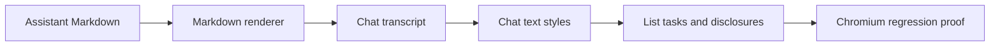

Codex review: needs maintainer review before merge. _Reviewed August 11, 2026, 10:28 PM ET / August 12, 2026, 02:28 UTC._

# ClawSweeper review

## What this changes

Aligns Control UI chat Markdown lists, task controls, and authored disclosures in one logical gutter, with a browser regression test.

## Merge readiness

⚠️ **Ready for maintainer review - 3 items remain**

Keep this PR open for normal maintainer merge handling. The supplied exact-head browser proof and follow-up resolve the prior RTL and JSON-disclosure concerns; a local partial-clone transport failure prevented re-reading every PR blob.

**Priority:** P2
**Reviewed head:** `4c150f88d159ac3a9247e2b14432db6a6bd6b88b`

## Review scores

| Measure | Result | What it means |
|---|---|---|
| **Overall readiness** | 🐚 platinum hermit **(4/6)** | The PR has strong visible proof and focused browser coverage for a bounded stylesheet repair. |
| **Proof confidence** | 🦞 diamond lobster **(5/6)** ✨ media proof bonus | Sufficient (screenshot): The PR supplies before/after light and dark transcript captures, exact-head Chromium measurements, and a focused successful Chromium run. |
| **Patch quality** | 🐚 platinum hermit **(4/6)** | No actionable review findings were identified. |

## Verification

| Check | Result | Evidence |
|---|---|---|
| **Real behavior** | Verified | Sufficient (screenshot): The PR supplies before/after light and dark transcript captures, exact-head Chromium measurements, and a focused successful Chromium run. |
| **Evidence reviewed** | 6 items | Style owner and current defect: Current main gives lists a physical left indent and task checkboxes an independent inline margin; it has no general authored disclosure gutter rule. Rendering boundary: Both streamed and completed Markdown are wrapped in `.chat-text`, so the chat stylesheet is the appropriate owner for this visual repair. Sibling disclosure separation: Long JSON code blocks use `details.json-collapse`, distinct from authored Markdown disclosures; the PR follow-up says this class remains excluded. |
| **Findings** | None | None. |
| **Security** | None | None. |

## How this fits together

Assistant Markdown is sanitized and rendered inside the Control UI chat transcript. The chat stylesheet positions lists, task checkboxes, and native disclosure elements before Chromium renders the visible conversation.

## Before merge

- [ ] **Resolve merge risk (P1)** - The PR is marked behind; use the normal merge preview or review refresh against current main before landing, rather than assuming stale-base drift removes current behavior.
- [ ] **Resolve merge risk (P1)** - Production CSS is net +74 lines for a bug fix; this is justified only if maintainers accept that existing list and native-disclosure markup has no smaller shared presentation owner.
- [ ] **Complete next step (P2)** - No repair-lane action is indicated: the prior actionable findings were addressed, while protected maintainer handling and normal exact-head merge checks remain.

<strong>Agent review details</strong>

### Security

None.

### PR surface

Source +74, Tests +284. Total +358 across 2 files.

View PR surface stats

| Area | Files | Added | Removed | Net |
|---|---:|---:|---:|---:|
| Source | 1 | 88 | 14 | +74 |
| Tests | 1 | 284 | 0 | +284 |
| Docs | 0 | 0 | 0 | 0 |
| Config | 0 | 0 | 0 | 0 |
| Generated | 0 | 0 | 0 | 0 |
| Other | 0 | 0 | 0 | 0 |
| **Total** | **2** | **372** | **14** | **+358** |

### Review metrics

| Metric | Value | Why it matters |
|---|---|---|
| **Production versus test LOC** | production +88/-14 (net +74); tests +284/-0 | The browser regression is substantial and the stylesheet growth should remain scoped to the shared gutter invariant. |

### Stored data model

Persistent data-model change detected: `serialized state: ui/src/e2e/chat-markdown-alignment.e2e.test.ts`. Confirm migration or upgrade compatibility proof before merge.

### Root-cause cluster

Relationship: `fixed_by_candidate`
Canonical: https://github.com/openclaw/openclaw/issues/122277
Summary: This PR is the linked candidate repair for the documented chat Markdown gutter defect.

Members:
- `canonical`: https://github.com/openclaw/openclaw/issues/122277 - The PR explicitly links this issue, and its stated fixture covers the issue’s list, task, and disclosure cases.
- `adjacent_distinct`: https://github.com/openclaw/openclaw/pull/122289 - The merged PR repairs vertical spacing between blocks, whereas this PR addresses horizontal marker and disclosure alignment.

Proposal only: this assessment does not dispatch repair, suppress jobs, mutate sibling items, close, or merge anything.

### Merge-risk options

**Maintainer options:**
1. **Decide the mitigation before merge**  
   Land after current-head checks and merge-preview validation complete; retain the scoped CSS because the existing renderer already provides the semantic markup but no shared visual owner.
2. **Pause or close**  
   Do not merge this PR until maintainers decide whether the risk is worth taking.

### Technical review

Best possible solution:

Land after current-head checks and merge-preview validation complete; retain the scoped CSS because the existing renderer already provides the semantic markup but no shared visual owner.

Do we have a high-confidence way to reproduce the issue?

Yes, source-reproducible: current main retains separate list and task geometry and lacks general authored disclosure containment; the linked issue provides a deterministic mocked-Gateway browser fixture.

Is this the best way to solve the issue?

Yes: the stylesheet is the narrow owner because the renderer already emits semantic list, task, details, and summary markup, while compact JSON disclosures remain separately classed.

AGENTS.md: found and applied where relevant.

Codex review notes: model internal, reasoning high; reviewed against [7630d060f850](https://github.com/openclaw/openclaw/commit/7630d060f850087d28cc9d24322508defb73836b).

### Labels

Label changes:

- add `rating: 🐚 platinum hermit`: Overall readiness is 🐚 platinum hermit; proof is 🦞 diamond lobster and patch quality is 🐚 platinum hermit.
- add `status: 👀 ready for maintainer look`: ClawSweeper has no concrete contributor-facing blocker left for this PR. Sufficient (screenshot): The PR supplies before/after light and dark transcript captures, exact-head Chromium measurements, and a focused successful Chromium run.
- remove `rating: 🦐 gold shrimp`: Current PR rating is `rating: 🐚 platinum hermit`, so this older rating label is no longer current.
- remove `status: ⏳ waiting on author`: Current PR status label is `status: 👀 ready for maintainer look`.
- remove `merge-risk: 🚨 other`: Current PR review selected no merge-risk labels.

Label justifications:

- `P2`: This repairs a contained Control UI readability and hierarchy problem without affecting message delivery or configuration.
- `rating: 🐚 platinum hermit`: Overall readiness is 🐚 platinum hermit; proof is 🦞 diamond lobster and patch quality is 🐚 platinum hermit.
- `status: 👀 ready for maintainer look`: ClawSweeper has no concrete contributor-facing blocker left for this PR. Sufficient (screenshot): The PR supplies before/after light and dark transcript captures, exact-head Chromium measurements, and a focused successful Chromium run.
- `proof: sufficient`: Contributor real behavior proof is sufficient. The PR supplies before/after light and dark transcript captures, exact-head Chromium measurements, and a focused successful Chromium run.
- `proof: 📸 screenshot`: Contributor real behavior proof includes screenshot evidence. The PR supplies before/after light and dark transcript captures, exact-head Chromium measurements, and a focused successful Chromium run.

### Evidence

What I checked:

- **Style owner and current defect:** Current main gives lists a physical left indent and task checkboxes an independent inline margin; it has no general authored disclosure gutter rule. ([`ui/src/styles/chat/text.css:140`](https://github.com/openclaw/openclaw/blob/7630d060f850/ui/src/styles/chat/text.css#L140), [7630d060f850](https://github.com/openclaw/openclaw/commit/7630d060f850))
- **Rendering boundary:** Both streamed and completed Markdown are wrapped in `.chat-text`, so the chat stylesheet is the appropriate owner for this visual repair. ([`ui/src/pages/chat/components/chat-message-markdown.ts:271`](https://github.com/openclaw/openclaw/blob/7630d060f850/ui/src/pages/chat/components/chat-message-markdown.ts#L271), [7630d060f850](https://github.com/openclaw/openclaw/commit/7630d060f850))
- **Sibling disclosure separation:** Long JSON code blocks use `details.json-collapse`, distinct from authored Markdown disclosures; the PR follow-up says this class remains excluded. ([`ui/src/components/markdown-code-blocks.ts:179`](https://github.com/openclaw/openclaw/blob/7630d060f850/ui/src/components/markdown-code-blocks.ts#L179), [7630d060f850](https://github.com/openclaw/openclaw/commit/7630d060f850))
- **Exact-head behavior proof:** The PR body reports a 2/2 focused Chromium run on the PR head covering LTR/RTL alignment, checkbox geometry, authored disclosure styling, and compact JSON preservation. ([`ui/src/e2e/chat-markdown-alignment.e2e.test.ts:1`](https://github.com/openclaw/openclaw/blob/4c150f88d159/ui/src/e2e/chat-markdown-alignment.e2e.test.ts#L1), [4c150f88d159](https://github.com/openclaw/openclaw/commit/4c150f88d159))
- **Area history:** Recent merged work on the stylesheet includes Markdown image and table presentation, establishing current area ownership. ([`ui/src/styles/chat/text.css:140`](https://github.com/openclaw/openclaw/blob/7c83fc17290b/ui/src/styles/chat/text.css#L140), [7c83fc17290b](https://github.com/openclaw/openclaw/commit/7c83fc17290b))
- **Review infrastructure gap:** The PR commit object is present locally, but its promised blobs could not be materialized because the checkout attempted a network fetch while GitHub DNS was unavailable; this review used the supplied diff and evidence plus current-main source. ([4c150f88d159](https://github.com/openclaw/openclaw/commit/4c150f88d159))

Likely related people:

- **vyctorbrzezowski:** Recent merged Control UI Markdown changes touch the stylesheet owner independently of this PR. (role: recent area contributor; confidence: high; commits: [7c83fc17290b](https://github.com/openclaw/openclaw/commit/7c83fc17290b958aeed03de290344457899fd9a9), [9dfc26ba63eb](https://github.com/openclaw/openclaw/commit/9dfc26ba63eb2d7e78bbd9d676a358f70751f95b), [bb02fc53ea8f](https://github.com/openclaw/openclaw/commit/bb02fc53ea8fc5b402f4e5bb010856ccd88316f5); files: `ui/src/styles/chat/text.css`)
- **Shakker:** Recent main history owns the native details and summary rendering used by authored Markdown disclosures. (role: recent renderer contributor; confidence: medium; commits: [281fe1e5029e](https://github.com/openclaw/openclaw/commit/281fe1e5029ed90d1a15fbf2bfc27e4bf1bb264f); files: `ui/src/components/markdown-details.ts`)
- **Peter Steinberger:** History includes the main-branch list presentation change and adjacent chat Markdown work. (role: earlier Markdown presentation contributor; confidence: medium; commits: [3e14caa2bdf8](https://github.com/openclaw/openclaw/commit/3e14caa2bdf81d41b01b02ecf18e1b57869337c2), [22e6f5b5e0dc](https://github.com/openclaw/openclaw/commit/22e6f5b5e0dc64e51e40c3def11b770716742345); files: `ui/src/styles/chat/text.css`)

### Rating scale

| Score | Internal tier | Crab rank | Meaning |
|---:|:---:|---|---|
| **6/6** | S | 🦀 challenger crab | Exceptional readiness |
| **5/6** | A | 🦞 diamond lobster | Very strong readiness |
| **4/6** | B | 🐚 platinum hermit | Good normal PR; ordinary maintainer review |
| **3/6** | C | 🦐 gold shrimp | Useful, but confidence is limited |
| **2/6** | D | 🦪 silver shellfish | Proof or implementation needs work |
| **1/6** | F | 🧂 unranked krab | Not merge-ready |
| N/A | NA | 🌊 off-meta tidepool | Rating does not apply |

Overall follows the weaker of proof and patch quality.
Shiny media proof means a screenshot, video, or linked artifact directly shows the changed behavior. Runtime, network, CSP, and security claims still need visible diagnostics.

### Workflow

- ClawSweeper keeps one durable marker-backed review comment per issue or PR.
- Re-runs edit this comment so the latest verdict, findings, and automation markers stay together instead of adding duplicate bot comments.
- A fresh review can be triggered by eligible `@clawsweeper re-review` comments, exact-item GitHub events, scheduled/background review runs, or manual workflow dispatch.
- PR/issue authors and users with repository write access can comment `@clawsweeper re-review` or `@clawsweeper re-run` on an open PR or issue to request a fresh review only.
- Maintainers can also comment `@clawsweeper review` to request a fresh review only.
- Fresh-review commands do not start repair, autofix, rebase, CI repair, or automerge.
- Maintainer-only repair and merge flows require explicit commands such as `@clawsweeper autofix`, `@clawsweeper automerge`, `@clawsweeper fix ci`, or `@clawsweeper address review`.
- Maintainers can comment `@clawsweeper explain` to ask for more context, or `@clawsweeper stop` to stop active automation.

### History

Review history (5 earlier review cycles)

<!-- clawsweeper-review-history v=1 total=5 -->
- reviewed 2026-08-11T21:53:29.028Z sha 7525a6920c6327d552e63beac8e4aa9560a3847b :: needs changes before merge. :: [P2] Scope disclosure styles away from JSON code blocks
- reviewed 2026-08-11T22:59:20.090Z sha 8562d9715fa09254fda864f0567573e27bde4f32 :: needs changes before merge. :: [P2] Exclude JSON code-block disclosures from gutter rules
- reviewed 2026-08-12T00:54:17.888Z sha 5138fc1dc90af57052b30012e332335eaca16119 :: found issues before merge. :: [P2] Exclude JSON code-block disclosures from gutter rules
- reviewed 2026-08-12T01:22:42.210Z sha 5138fc1dc90af57052b30012e332335eaca16119 :: found issues before merge. :: [P2] Exclude JSON code-block disclosures from gutter rules
- reviewed 2026-08-12T02:18:01.325Z sha 4b37835538278fcb002695f78e11734d4d5a700d :: found issues before merge. :: [P2] Preserve the shared indent in RTL chat

<!-- clawsweeper-verdict:needs-human item=122286 sha=4c150f88d159ac3a9247e2b14432db6a6bd6b88b confidence=medium updated_at=2026-08-12T02:25:20Z reviewed_at=2026-08-12T02:28:25.483Z lease_owner=github-run-31556725785-1 lease_comment_id=5261372563 source_revision=f81133529c692cc8660cf45adc8fe496663267843816b01d3e85a73125c72998 -->

<!-- clawsweeper-review-version item=122286 reviewed_at=2026-08-12T02:28:25.483Z sha=4c150f88d159ac3a9247e2b14432db6a6bd6b88b source_revision=f81133529c692cc8660cf45adc8fe496663267843816b01d3e85a73125c72998 lease_owner=github-run-31556725785-1 lease_comment_id=5261372563 v=1 -->

<!-- clawsweeper-review item=122286 -->