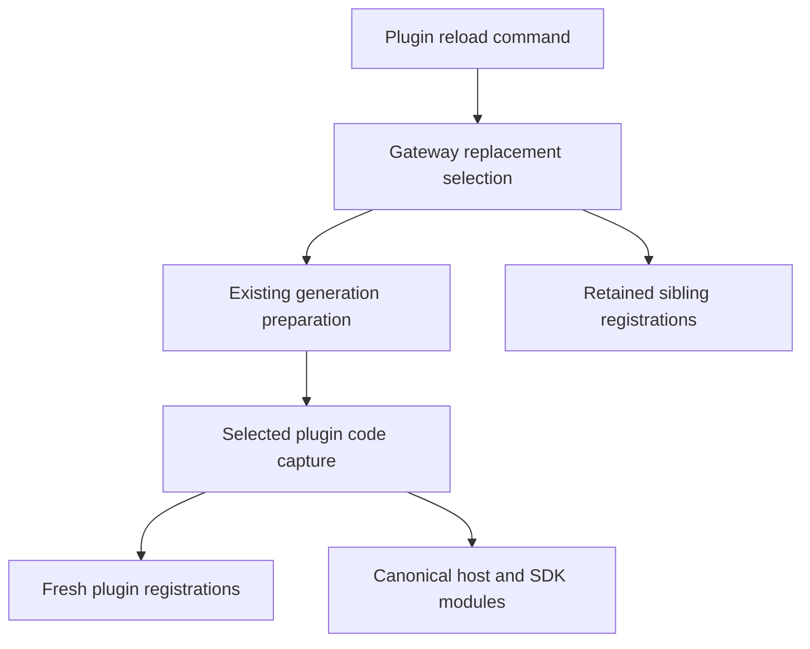

Codex review: needs maintainer review before merge.

## What this changes

This PR reloads selected bundled plugins from fresh captured code while preserving shared host modules and unaffected plugins.

**Example:** Edit reload-probe’s helper from A to B and run openclaw plugins reload reload-probe --json.
- **Before:** The running Gateway keeps executing A and requires a restart.
- **After:** The supplied runtime trace executes B with restartRequired=false under Gateway PID 2987480, while the sibling instance remains unchanged.

## Review scores

| Measure | Result | What it means |
|---|---|---|
| **Overall readiness** | 🦐 gold shrimp **(3/6)** | The focused implementation and shipped reload trace support the change, but required upgrade validation remains incomplete. |
| **Proof confidence** | 🦐 gold shrimp **(3/6)** | Real behavior proof is not required for maintainer- or bot-authored pull requests. |
| **Patch quality** | 🐚 platinum hermit **(4/6)** | No actionable review findings were identified. |

## Product

**Kind:** Feature · **Worth it:** Yes · **Fix scope:** Complete
**User problem:** Operators editing bundled plugin code must restart the Gateway because reload currently retains the loaded implementation.
**Reason:** The maintainer-directed capability removes disruptive restarts from explicit replacement without imposing capture cost on ordinary startup or inventory refresh.

## Merge readiness

✅ **Ready for maintainer review**

Keep this maintainer-directed PR open: it adds useful bundled-code reload capability, resolves the prior wrapper finding, and introduces no definite code defect found in this review.

**Priority:** P2
**Reviewed head:** `aa4b22416d9abb9acf09f19dd209056cff8a6a34`

## Before merge

None.

## Findings

None.

### Tests

- Missing end-to-end proof: Provide the required latest-stable-to-candidate update run, then demonstrate compiled bundled reload with existing plugin settings and data intact.

<strong>Agent review details</strong>

### How this fits together

The plugin loader receives replacement IDs from Gateway reload orchestration, captures selected plugin code through existing preparation and recovery owners, and publishes fresh registrations while retaining canonical host and SDK modules.

### Technical review

Best possible solution:

Keep ordinary shared loading and use the existing captured-generation owners for explicit bundled replacements.

Do we have a high-confidence way to reproduce the issue?

Current-main source and the earlier merged reload documentation establish that bundled edits retain loaded code until restart; this review did not execute target code.

Is this the best way to solve the issue?

The change appropriately extends a previously documented limitation through existing capture, preparation, and recovery owners while preserving the startup optimization.

AGENTS.md: found and applied where relevant.

Codex review notes: model internal, reasoning medium; reviewed against [52dbc2fab96c](https://github.com/openclaw/openclaw/commit/52dbc2fab96c2842e15a7e6c1c672b2574e9c062).

### Provenance checked

- `Bundled shared loading` changes intended behavior with a stated reason (b5a41c2001634c5fff793fa6dec0f8bad215f7e5: Avoid repeated bundled source capture that stalled source-checkout agent turns; explicit replacement now opts into capture while ordinary loading remains shared.)
- `Restart-required reporting` changes intended behavior with a stated reason (525970204ad85c51a338a3a4d3cd6b85d1ba7326: Accurately warn when successful registration replacement retained stale bundled code; fresh captured replacement removes that condition for selected plugins.)
- `Preparation and recovery ownership` keeps the original intent (720f8423c8cd24dc3cf080b5d05a8945f29b5359: Keep preparation workers on a smaller private graph and retain publication in the host; this PR transports bundled ownership facts through those existing owners.)
- `Native ESM retention` keeps the original intent (a81bb54f094f0bb5df760b4fe7e100c791c757d1: Avoid retaining duplicate native graphs during ordinary refreshes while preserving generation ownership and lazy imports; explicit replacement’s additional graph retention is disclosed.)

### Testing

Proof path: shipped entry point.

### Security

None.

### Evidence

What I checked:

- **Pinned introduction and clean checkout:** Reviewed the introduced merge-base-to-head hunks at aa4b22416d9abb9acf09f19dd209056cff8a6a34; the checkout remained clean. ([aa4b22416d9a](https://github.com/openclaw/openclaw/commit/aa4b22416d9abb9acf09f19dd209056cff8a6a34))
- **Prior finding resolved:** Both plugin-bundled-reload.ts and runtime-dependency-ownership.ts are now included in the existing wrapper inventory, addressing the previous review’s missing runtime closure entries. ([`scripts/pr-lib/wrapper-components.txt:1102`](https://github.com/openclaw/openclaw/blob/aa4b22416d9abb9acf09f19dd209056cff8a6a34/scripts/pr-lib/wrapper-components.txt#L1102), [aa4b22416d9a](https://github.com/openclaw/openclaw/commit/aa4b22416d9abb9acf09f19dd209056cff8a6a34))
- **Shipped entry-point evidence:** The author’s isolated installed-layout CLI-to-Gateway trace shows A becoming B under the same PID, a fresh selected instance, an unchanged sibling, and preserved settings: https://github.com/openclaw/openclaw/pull/180466#issuecomment-6345468029. ([aa4b22416d9a](https://github.com/openclaw/openclaw/commit/aa4b22416d9abb9acf09f19dd209056cff8a6a34))
- **Current main retains the old boundary:** Current main still sends bundled modules through the shared loader; https://github.com/openclaw/openclaw/pull/163639 explains that this deliberately reduced source-checkout startup cost at the expense of requiring restart after edits. ([`src/plugins/plugin-instance-module-loader.ts:255`](https://github.com/openclaw/openclaw/blob/52dbc2fab96c2842e15a7e6c1c672b2574e9c062/src/plugins/plugin-instance-module-loader.ts#L255), [52dbc2fab96c](https://github.com/openclaw/openclaw/commit/52dbc2fab96c2842e15a7e6c1c672b2574e9c062))
- **Targeted capture and recovery:** Replacement IDs control bundled capture; ownership facts travel through preparation and recovery, and the layout matrix exercises fresh helpers, plugin-only chunks, shared host identity, deferred imports, and recovery after source removal. ([`src/plugins/plugin-bundled-reload.test.ts:24`](https://github.com/openclaw/openclaw/blob/aa4b22416d9abb9acf09f19dd209056cff8a6a34/src/plugins/plugin-bundled-reload.test.ts#L24), [aa4b22416d9a](https://github.com/openclaw/openclaw/commit/aa4b22416d9abb9acf09f19dd209056cff8a6a34))
- **Upgrade-sensitive metadata requirement:** Compiled reload now refuses missing ownership metadata with rebuild guidance; the repository’s update contract requires published-driver-to-candidate proof for plugin-loading changes: https://docs.openclaw.ai/install/updating#update-implementation-contract. ([`src/plugins/plugin-bundled-reload.ts:28`](https://github.com/openclaw/openclaw/blob/aa4b22416d9abb9acf09f19dd209056cff8a6a34/src/plugins/plugin-bundled-reload.ts#L28), [aa4b22416d9a](https://github.com/openclaw/openclaw/commit/aa4b22416d9abb9acf09f19dd209056cff8a6a34))

Likely related people:

- **Peter Steinberger:** Raw commit b5a41c2001634c5fff793fa6dec0f8bad215f7e5 adds src/plugins/plugin-instance-module-loader.ts:41 relative to its recorded parents. This identifies author metadata, not feature responsibility or a PR merger. (role: source-line author; confidence: high; commits: [b5a41c200163](https://github.com/openclaw/openclaw/commit/b5a41c2001634c5fff793fa6dec0f8bad215f7e5); files: `src/plugins/plugin-instance-module-loader.ts`)
- **Patrick Erichsen:** Raw commit 687865486444b4654be34066ea42a4fbee661cee adds src/plugins/plugin-instance-module-loader.ts:48 relative to its recorded parents. This identifies author metadata, not feature responsibility or a PR merger. (role: source-line author; confidence: medium; commits: [687865486444](https://github.com/openclaw/openclaw/commit/687865486444b4654be34066ea42a4fbee661cee); files: `src/plugins/plugin-instance-module-loader.ts`)
- **Vincent Koc:** Raw commit 720f8423c8cd24dc3cf080b5d05a8945f29b5359 adds src/plugins/plugin-generation-capture.ts:6 relative to its recorded parents. This identifies author metadata, not feature responsibility or a PR merger. (role: source-line author; confidence: medium; commits: [720f8423c8cd](https://github.com/openclaw/openclaw/commit/720f8423c8cd24dc3cf080b5d05a8945f29b5359); files: `src/plugins/plugin-generation-capture.ts`)

### PR surface

Source +193, Tests +137, Docs 0, Other +2. Total +332 across 19 files. Added test files: 1.

View PR surface stats

| Area | Files | Added | Removed | Net |
|---|---:|---:|---:|---:|
| Source | 13 | 264 | 71 | +193 |
| Tests | 3 | 163 | 26 | +137 |
| Docs | 2 | 13 | 13 | 0 |
| Config | 0 | 0 | 0 | 0 |
| Generated | 0 | 0 | 0 | 0 |
| Other | 1 | 2 | 0 | +2 |
| **Total** | **19** | **442** | **110** | **+332** |

### Labels

Label changes:

No label changes.

Label justifications:

- `P2`: This improves an explicit operator reload workflow with limited scope; normal startup retains its existing loading behavior.
- `rating: 🦐 gold shrimp`: Overall readiness is 🦐 gold shrimp; proof is 🦐 gold shrimp and patch quality is 🐚 platinum hermit.
- `status: 👀 ready for maintainer look`: ClawSweeper has no concrete contributor-facing blocker left for this PR.

### Rank-up moves

Optional improvements that raise the rating; they are not merge blockers.

- Add latest-stable-to-candidate update evidence showing compiled bundled reload preserves existing settings and data.

### Rating scale

6/6 🦀 challenger crab · 5/6 🦞 diamond lobster · 4/6 🐚 platinum hermit · 3/6 🦐 gold shrimp · 2/6 🦪 silver shellfish · 1/6 🧂 unranked krab. Overall follows the weaker of proof and patch quality; ✨ marks media proof (a screenshot, video, or linked artifact) that directly shows the changed behavior.

### Workflow

ClawSweeper edits this one comment on every review. Comment `@clawsweeper re-review` for a fresh review only. Repair and merge execution lanes are retired.

### History

Review history (1 earlier review cycle)

<!-- clawsweeper-review-history v=1 total=1 -->
- reviewed 2026-10-22T09:13:21.951Z sha 367c562b7684877c0e7d9f4a7703e28fb1aa1b8e :: needs changes before merge. :: [P2] Include the new runtime imports in the PR wrapper inventory

_Reviewed October 22, 2026, 12:18 PM ET / 16:18 UTC (Revision 2)._

<!-- clawsweeper-verdict:needs-human item=180466 sha=aa4b22416d9abb9acf09f19dd209056cff8a6a34 confidence=high updated_at=2026-10-22T16:14:02Z reviewed_at=2026-10-22T16:18:39.155Z lease_owner=github-run-39812081096-1 lease_comment_id=6345507185 source_revision=73d9b93448eeae35a16431c6a386fd3327df2993dd2495e112734b38e83f9127 hold=not_opted_in findings=0 -->
<!-- clawsweeper-review-state:ready item=180466 sha=aa4b22416d9abb9acf09f19dd209056cff8a6a34 v=1 -->

<!-- clawsweeper-review-version item=180466 reviewed_at=2026-10-22T16:18:39.155Z sha=aa4b22416d9abb9acf09f19dd209056cff8a6a34 source_revision=73d9b93448eeae35a16431c6a386fd3327df2993dd2495e112734b38e83f9127 lease_owner=github-run-39812081096-1 lease_comment_id=6345507185 v=1 -->

<!-- clawsweeper-review item=180466 -->