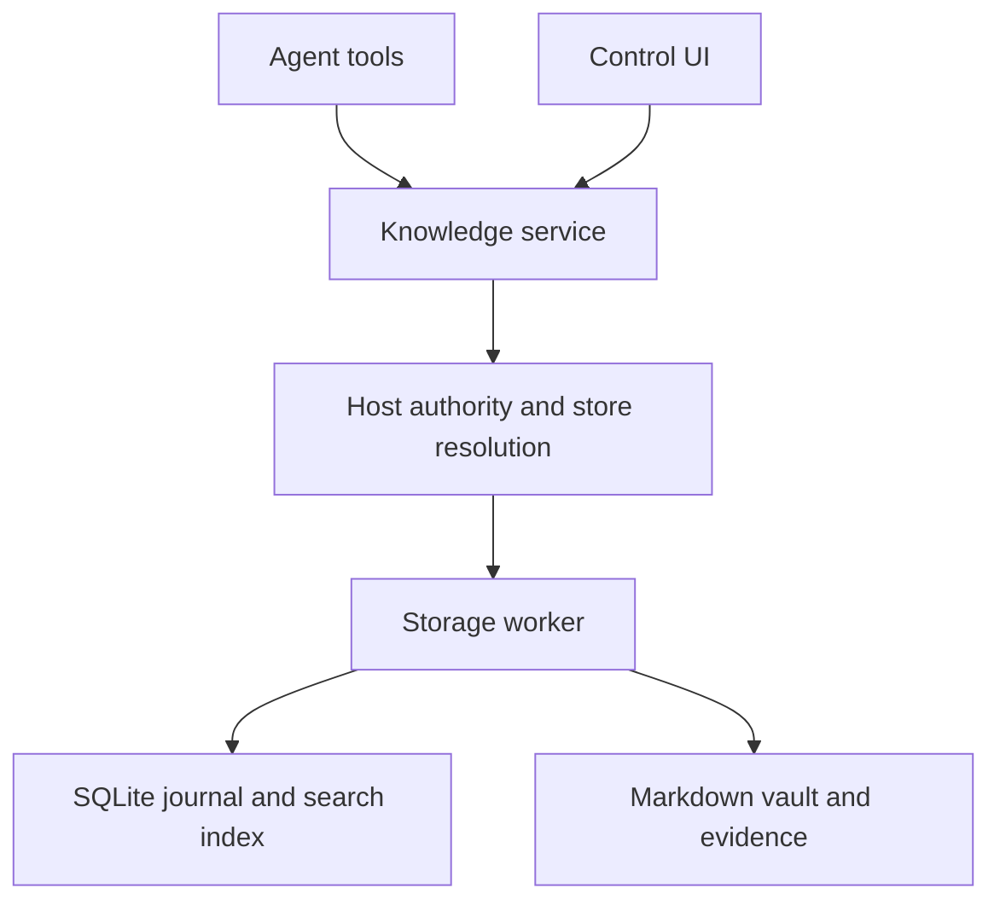

Codex review: needs maintainer review before merge.

## What this changes

This PR bundles Knowledge as an optional memory plugin with evidence-backed records, retrieval, shared stores, and a Control UI explorer.

**Example:** An operator selects plugins.slots.memory: "knowledge".
- **Before:** Knowledge requires a separately installed plugin.
- **After:** The bundled plugin provides Knowledge tools and its explorer without a separate installation.

## Review scores

| Measure | Result | What it means |
|---|---|---|
| **Overall readiness** | 🐚 platinum hermit **(4/6)** | Useful and supported by shipped-entry-point evidence, with no introduced blocking defect identified; exact-head core CI attribution remains unresolved. |
| **Proof confidence** | 🦞 diamond lobster **(5/6)** | Sufficient (live_output): Bundled-Gateway output exercises real-model memory writes, private-versus-conversation isolation, operator denials, and workspace attachment success and escape rejection; the later production-owner harness records reset, reassignment, and operator-revocation rejection before final effects, with the relevant Knowledge paths unchanged. |
| **Patch quality** | 🐚 platinum hermit **(4/6)** | No actionable review findings were identified. |

## Product

**Kind:** Feature · **Worth it:** Yes · **Fix scope:** Complete
**User problem:** Users must separately install Knowledge, and its independent distribution can drift from OpenClaw.
**Reason:** Maintainer-authored direction makes this an approved optional integration, with existing memory selection and other providers preserved.

## Merge readiness

✅ **Ready for maintainer review**

Keep this maintainer-authored PR open: optional Knowledge bundling has clear value, and the previously reported physical-store pinning defect is fixed.

**Priority:** P2
**Reviewed head:** `9f4f07a64002fbe871b95a52d975ad022d666295`

## Before merge

None.

## Findings

None.

<strong>Agent review details</strong>

### How this fits together

Knowledge consumes host-issued agent and operator authority, resolves the authorized store and partition, and serves memory operations through plugin-owned workers and vault files.

### Technical review

Best possible solution:

Bundle Knowledge through the existing plugin owners while preserving live authority checks, existing stores, and the documented standalone transition.

Do we have a high-confidence way to reproduce the issue?

This is a feature import; source inspection confirms that Knowledge is absent from fetched main and registered by this PR.

Is this the best way to solve the issue?

The implementation fits the existing feature-plugin, memory-provider, worker, and config-writer owners without introducing a competing core memory system.

AGENTS.md: found and applied where relevant.

Codex review notes: model internal, reasoning medium; reviewed against [ec3cfa5f72da](https://github.com/openclaw/openclaw/commit/ec3cfa5f72daba38d22a7b0a257e092112ae014c).

### Provenance checked

- `Generic plugin session actions` keeps the original intent (1adaa28dc86b4eb5805733f558962481159678f3: https://github.com/openclaw/openclaw/pull/72287 established generic host hooks so workflow plugins could integrate without product-specific core patches.)
- `Session-action reload and live policy` keeps the original intent (4bbb8154288d9ebeb2d84faa946948820914dcf5: The existing handler retries actions across plugin reload; this PR retains that dispatch and adds the request-authority callback needed at configuration publication.)
- `Learning command descriptions` keeps the original intent (f8d9d253e1c4bf4433d32f9827d5f078fa377112: https://github.com/openclaw/openclaw/pull/181879 already added memory-backed learning; this PR aligns command descriptions and supplies the participating plugin.)
- `SQLite dialect inventory` changes intended behavior with a stated reason (a1c1610b1907a3750f623297af19dedd425f7399: The shrink-only inventory exposes SQLite-specific debt; the maintainer explains the narrow exception for Knowledge's rebuildable plugin-private FTS index and adds scope controls.)

### Testing

Proof path: shipped entry point.

### Security

None.

### Evidence

What I checked:

- **Optional plugin integration:** The entry composes existing feature-plugin and plugin-entry contracts; the manifest declares the memory kind, tools, skills, and packaged UI. The fetched main tree has no extensions/knowledge entry. ([`extensions/knowledge/src/index.ts:8`](https://github.com/openclaw/openclaw/blob/9f4f07a64002fbe871b95a52d975ad022d666295/extensions/knowledge/src/index.ts#L8), [9f4f07a64002](https://github.com/openclaw/openclaw/commit/9f4f07a64002fbe871b95a52d975ad022d666295))
- **Previous index finding resolved:** The pinned-index identity includes runtime.vaultId alongside agent, session incarnation, binding, and cutoff; the regression test exercises a binding moving between physical stores. ([`extensions/knowledge/src/memory-index-hook.ts:98`](https://github.com/openclaw/openclaw/blob/9f4f07a64002fbe871b95a52d975ad022d666295/extensions/knowledge/src/memory-index-hook.ts#L98), [9f4f07a64002](https://github.com/openclaw/openclaw/commit/9f4f07a64002fbe871b95a52d975ad022d666295))
- **Final-effect authority evidence:** The author supplies allowed and forbidden bundled-Gateway traces plus five production-owner revocation scenarios at https://github.com/openclaw/openclaw/pull/180139#issuecomment-6393175087. The inspected Knowledge authority, publication, attachment, and assignment files are unchanged from that evidence revision; the Gateway merge retains its reload retry and adds the live request assertion. ([`extensions/knowledge/src/store-assignments.ts:419`](https://github.com/openclaw/openclaw/blob/9f4f07a64002fbe871b95a52d975ad022d666295/extensions/knowledge/src/store-assignments.ts#L419), [9f4f07a64002](https://github.com/openclaw/openclaw/commit/9f4f07a64002fbe871b95a52d975ad022d666295))
- **Existing-store compatibility:** The full PR body records a bundled Gateway opening a consistent copy of a real standalone store and successfully reading and searching it. Schema admission uses additive steps and recognizes unstamped stores; the migration guide preserves configuration before uninstalling the standalone copy. ([`extensions/knowledge/src/storage-schema.ts:45`](https://github.com/openclaw/openclaw/blob/9f4f07a64002fbe871b95a52d975ad022d666295/extensions/knowledge/src/storage-schema.ts#L45), [9f4f07a64002](https://github.com/openclaw/openclaw/commit/9f4f07a64002fbe871b95a52d975ad022d666295))
- **Recorded implementation tradeoffs:** The maintainer-authored body explicitly records the plugin-private FTS5 exception, bounded test-ceiling increase, and standalone transition. Inspection confirms the dialect exception is limited to three constructs in retrieval.ts and the lockfile adds an importer using existing pinned package resolutions. ([`scripts/database-dialect-inventory.mts:132`](https://github.com/openclaw/openclaw/blob/9f4f07a64002fbe871b95a52d975ad022d666295/scripts/database-dialect-inventory.mts#L132), [9f4f07a64002](https://github.com/openclaw/openclaw/commit/9f4f07a64002fbe871b95a52d975ad022d666295))
- **Mergeability and unresolved CI:** GitHub reports mergeable=true, clearing the previous conflict request. Core lint and core test-types failed on this head: https://github.com/openclaw/openclaw/actions/runs/40213684582/job/121230906850 and https://github.com/openclaw/openclaw/actions/runs/40213684582/job/121230906910. Lint annotations name untouched files; available test-types annotations do not identify its underlying error, so diff attribution remains unresolved. ([9f4f07a64002](https://github.com/openclaw/openclaw/commit/9f4f07a64002fbe871b95a52d975ad022d666295))

### PR surface

PR surface statistics unavailable: the file list is incomplete.

### Review metrics

| Metric | Value | Why it matters |
|---|---|---|
| **Plugin configuration inventory** | +29 baseline entries | The generated plugin baseline increases from 4,828 to 4,857 as Knowledge's optional configuration joins the bundled inventory. |

### Labels

Label changes:

- add `status: 👀 ready for maintainer look`: ClawSweeper has no concrete contributor-facing blocker left for this PR.
- remove `status: ⏳ waiting on author`: Current PR status label is `status: 👀 ready for maintainer look`.

Label justifications:

- `P2`: This is a useful optional memory capability with no demonstrated urgent regression.
- `merge-risk: 🚨 compatibility`: The PR adds a public session-action authority callback and bundles a previously standalone plugin; its maintainer records the transition, and existing-store compatibility evidence is supplied.
- `rating: 🐚 platinum hermit`: Overall readiness is 🐚 platinum hermit; proof is 🦞 diamond lobster and patch quality is 🐚 platinum hermit.
- `status: 👀 ready for maintainer look`: ClawSweeper has no concrete contributor-facing blocker left for this PR.
- `proof: sufficient`: Contributor real behavior proof is sufficient.

### Rating scale

6/6 🦀 challenger crab · 5/6 🦞 diamond lobster · 4/6 🐚 platinum hermit · 3/6 🦐 gold shrimp · 2/6 🦪 silver shellfish · 1/6 🧂 unranked krab. Overall follows the weaker of proof and patch quality; ✨ marks media proof (a screenshot, video, or linked artifact) that directly shows the changed behavior.

### Workflow

ClawSweeper edits this one comment on every review. Comment `@clawsweeper re-review` for a fresh review only. Repair and merge execution lanes are retired.

### History

Review history (10 earlier review cycles; latest 8 shown)

<!-- clawsweeper-review-history v=1 total=10 -->
- reviewed 2026-10-23T13:19:56.099Z sha 726c134f04bde84263a31aae287db5f6b00c318d :: needs real behavior proof before merge. :: [P1] Carry live operator policy into session-action storage checks | [P2] Pin the rendered index across turns in the same session context | [P2] Update the missing-audience assertions for the new diagnostic
- reviewed 2026-10-23T14:12:40.639Z sha 05285ef80e61313c1c8bc042e97a0dc462a7eb74 :: needs real behavior proof before merge. :: [P1] Revalidate operator authority when committing store assignments | [P2] Replace the assertion chains rejected by the boundary gate | [P2] Let the source-ingest scripts exit naturally after help output
- reviewed 2026-10-23T17:21:22.513Z sha 17356211536b3ba98a26e6457e04e95df6bb289c :: needs real behavior proof before merge. :: none
- reviewed 2026-10-23T20:50:22.065Z sha 46415c3e63c569fe6b253f5e3fe20f65e7479f72 :: needs real behavior proof before merge. :: [P2] [P2] Apply private-read policy to store inventory counts | [P2] [P2] Preserve schema types without a chained assertion | [P2] [P2] Replace unchecked casts in the imported test fixtures
- reviewed 2026-10-23T23:25:43.408Z sha 4d6e53ef18319d58f3ed97abab0c104297959e18 :: needs real behavior proof before merge. :: none
- reviewed 2026-10-25T13:57:10.022Z sha 246d776bb8e5d0c9817dca230d1f99e132c915d7 :: needs changes before merge. :: [P2] [P2] Include physical vault identity in the pinned-index key
- reviewed 2026-10-25T14:03:48.811Z sha 246d776bb8e5d0c9817dca230d1f99e132c915d7 :: needs changes before merge. :: [P2] Include physical vault identity in the pinned-index key
- reviewed 2026-10-25T15:08:37.087Z sha d574ff866f278a8c13a00438f17d0dde4d38d2fc :: needs changes before merge. :: none

_Reviewed October 25, 2026, 1:06 PM ET / 17:06 UTC (Revision 11)._

<!-- clawsweeper-verdict:needs-human item=180139 sha=9f4f07a64002fbe871b95a52d975ad022d666295 confidence=high updated_at=2026-10-25T17:00:25Z reviewed_at=2026-10-25T17:06:30.082Z lease_owner=github-run-40214307699-1 lease_comment_id=6400503740 source_revision=bb63e862e080e788c6073b65a801ebb9197e4cd8b605767f1a505572933a02ed hold=not_opted_in findings=0 -->
<!-- clawsweeper-review-state:ready item=180139 sha=9f4f07a64002fbe871b95a52d975ad022d666295 v=1 -->

<!-- clawsweeper-review-version item=180139 reviewed_at=2026-10-25T17:06:30.082Z sha=9f4f07a64002fbe871b95a52d975ad022d666295 source_revision=bb63e862e080e788c6073b65a801ebb9197e4cd8b605767f1a505572933a02ed lease_owner=github-run-40214307699-1 lease_comment_id=6400503740 v=1 -->

<!-- clawsweeper-review item=180139 -->