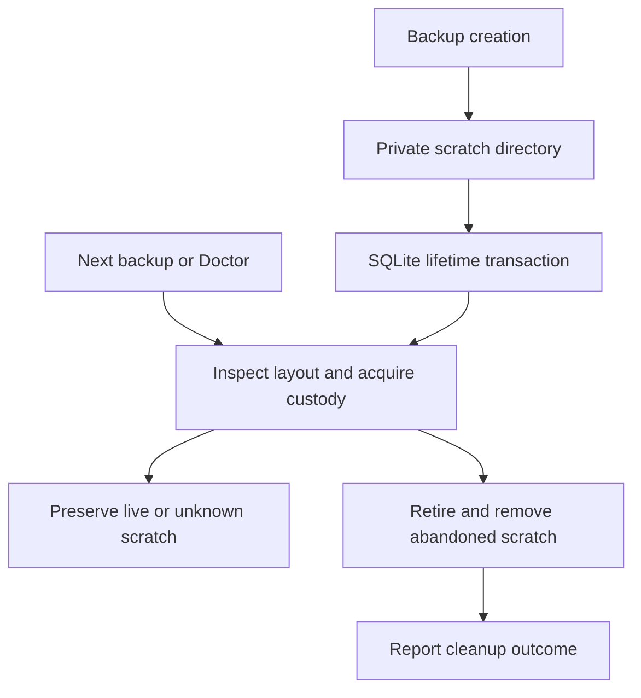

Codex review: blocked before merge. _Reviewed September 21, 2026, 7:09 AM ET / 11:09 UTC (Revision 5)._

# ClawSweeper review

## What this changes

Archive backups gain transaction-protected scratch cleanup, abandoned-directory recovery through subsequent backups and Doctor, and explicit cleanup outcomes.

## Regression provenance

Possible regression — suspected (reviewed change). No predecessor PR is attributed.

## Merge readiness

⛔ **Blocked before merge - 5 items remain**

The cleanup work remains useful and is absent from current main. The already-reclaimed correction is sound, but the previously reported Windows retirement defect remains unresolved.

**Priority:** P2
**Reviewed head:** `8c7f9c93a0df985a55af9d8e660efd75152bbb40`

## Review scores

| Measure | Result | What it means |
|---|---|---|
| **Overall readiness** | 🦐 gold shrimp **(3/6)** | Useful lifecycle design and real macOS observations are limited by the unresolved Windows defect and update compatibility gap. |
| **Proof confidence** | 🐚 platinum hermit **(4/6)** | Sufficient (live_output): The captured macOS production-Doctor observations demonstrate dead-owner reclamation while preserving a live owner and rollback sentinel. This remains valid bounded lifecycle proof; Windows retirement and the published-updater compatibility check remain separate unresolved merge requirements. |
| **Patch quality** | 🦐 gold shrimp **(3/6)** | 1 actionable review finding remain. |

## Verification

| Check | Result | Evidence |
|---|---|---|
| **Real behavior** | Verified | Sufficient (live_output): The captured macOS production-Doctor observations demonstrate dead-owner reclamation while preserving a live owner and rollback sentinel. This remains valid bounded lifecycle proof; Windows retirement and the published-updater compatibility check remain separate unresolved merge requirements. |
| **Evidence reviewed** | 11 items | Introduced cleanup operation: The pinned merge-base-to-head diff introduces a pre-created retirement directory followed by an overwrite move. Normal completion and abandoned-directory reclamation both use this operation before deleting payloads.<br>Verified filesystem dependency contract: The target pins @openclaw/fs-safe 0.17.0 and its filesystem facade delegates Root.move to this dependency. Inspection of the verified dependency repository and release tag shows overwrite moves reach fs.rename without removing the existing destination directory.<br>Windows rename implementation: Node 24.16.0's bundled libuv implements rename using MoveFileExW with MOVEFILE_REPLACE_EXISTING. |
| **Findings** | 1 actionable finding | [P2] Avoid renaming onto an existing directory on Windows |
| **Security** | None | None. |

## How this fits together

Archive creation stages configuration and database copies before publishing a backup. The scratch lifecycle owner coordinates writers and cleanup, while Doctor discovers abandoned directories and reports or repairs them.



## Before merge

- [ ] **Avoid renaming onto an existing directory on Windows (P2)** - The retirement destination is created immediately before this overwrite move. Pinned fs-safe 0.17.0 delegates it to `fs.rename`, whose Windows implementation rejects an existing directory destination. Consequently normal backup completion and abandoned-scratch reclamation stop before payload deletion, leaving captures behind; Doctor retries hit the same failure. This previously reported blocker remains present. Use a portable retirement operation while retaining identity and collision safeguards.
- [ ] **Resolve merge risk (P1)** - Windows backup completion and reclamation cannot retire scratch through the existing-directory overwrite move, so payloads accumulate despite repeated Doctor repair.
- [ ] **Resolve merge risk (P1)** - The published-updater × candidate Doctor compatibility check requested in the prior review remains unrecorded; standalone macOS handler proof does not establish preservation of existing scratch and rollback material through that update entrypoint.
- [ ] **Complete next step (P2)** - Repair portable scratch retirement, demonstrate Windows cleanup and retry, and record the published-updater × candidate Doctor compatibility result.
- [ ] **Add data-model compatibility proof** - Confirm migration or upgrade compatibility proof before merge.

## Findings

- [P2] Avoid renaming onto an existing directory on Windows — `src/infra/backup-scratch.ts:153-159`


<details>
<summary><strong>Agent review details</strong></summary>

### Security

None.

### PR surface

Source +492, Tests +356, Docs +18, Other +2. Total +868 across 13 files.

<details>
<summary>View PR surface stats</summary>

| Area | Files | Added | Removed | Net |
|---|---:|---:|---:|---:|
| Source | 8 | 566 | 74 | +492 |
| Tests | 3 | 356 | 0 | +356 |
| Docs | 1 | 18 | 0 | +18 |
| Config | 0 | 0 | 0 | 0 |
| Generated | 0 | 0 | 0 | 0 |
| Other | 1 | 2 | 0 | +2 |
| **Total** | **13** | **942** | **74** | **+868** |

</details>

### Review metrics

| Metric | Value | Why it matters |
|---|---|---|
| **Lifecycle implementation growth** | Production +566/-74 (net +492); tests +356/-0 | The stated growth implements transaction custody, guarded reclamation, recovery outcomes, and Doctor integration while sharing the existing staging primitive. |

### Stored data model

Persistent data-model change detected: `migration/backfill/repair: src/commands/doctor-backup-scratch.ts`, `migration/backfill/repair: src/flows/doctor-health-contribution-runners.state.ts`, `migration/backfill/repair: src/infra/backup-create.ts`. Confirm migration or upgrade compatibility proof before merge.

### Merge-risk options

**Maintainer options:**
1. **Make retirement portable (recommended)**  
   Repair the Windows retirement operation without weakening identity or collision checks, then verify normal cleanup, abandoned cleanup, retry, and the published-updater boundary.

<details>
<summary>Copy recommended automerge instruction</summary>

```text
@clawsweeper automerge

Special instructions:
Replace the existing-directory overwrite retirement with a portable operation that preserves source identity, destination collision protection, committed retirement, and partial-cleanup recovery; validate Windows cleanup and the published-updater-to-candidate Doctor path with existing scratch and rollback material.
```

</details>

### Technical review

Best possible solution:

Use portable, identity-checked retirement within the shared scratch owner, with Windows recovery and published-updater compatibility demonstrated before landing.

Do we have a high-confidence way to reproduce the issue?

Yes, from source: a Windows backup reaches a rename onto an existing directory, which the pinned dependency and Windows API reject. This review did not execute a Windows reproduction.

Is this the best way to solve the issue?

The shared lifetime owner is appropriate, but the retirement operation must be portable; the already-reclaimed correction does not address that failure.

Full review comments:

- [P2] Avoid renaming onto an existing directory on Windows — `src/infra/backup-scratch.ts:153-159`
  The retirement destination is created immediately before this overwrite move. Pinned fs-safe 0.17.0 delegates it to `fs.rename`, whose Windows implementation rejects an existing directory destination. Consequently normal backup completion and abandoned-scratch reclamation stop before payload deletion, leaving captures behind; Doctor retries hit the same failure. This previously reported blocker remains present. Use a portable retirement operation while retaining identity and collision safeguards.
  Confidence: 0.99

Overall correctness: patch is incorrect
Overall confidence: 0.98

AGENTS.md: found and applied where relevant.

Codex review notes: model internal, reasoning medium; reviewed against [6e70aff09276](https://github.com/openclaw/openclaw/commit/6e70aff092768801e539fb8f5af34055ec51e6ba).

### Labels

Label justifications:

- `P2`: This is a bounded backup-maintenance repair for abandoned disk usage, with a concrete Windows cleanup defect remaining.
- `merge-risk: 🚨 compatibility`: Merging replaces working normal scratch deletion with a retirement operation Windows rejects, and update-entrypoint compatibility proof remains outstanding.
- `rating: 🦐 gold shrimp`: Overall readiness is 🦐 gold shrimp; proof is 🐚 platinum hermit and patch quality is 🦐 gold shrimp.
- `status: ⏳ waiting on author`: ClawSweeper has contributor-facing work open and is waiting for author action. Sufficient (live_output): The captured macOS production-Doctor observations demonstrate dead-owner reclamation while preserving a live owner and rollback sentinel. This remains valid bounded lifecycle proof; Windows retirement and the published-updater compatibility check remain separate unresolved merge requirements.
- `proof: sufficient`: Contributor real behavior proof is sufficient. The captured macOS production-Doctor observations demonstrate dead-owner reclamation while preserving a live owner and rollback sentinel. This remains valid bounded lifecycle proof; Windows retirement and the published-updater compatibility check remain separate unresolved merge requirements.

### Evidence

Acceptance criteria:

- [P1] node scripts/run-vitest.mjs src/infra/backup-scratch.test.ts src/infra/backup-create.publication.test.ts src/commands/doctor-backup-scratch.test.ts --maxWorkers=1.
- [P1] node scripts/check-changed.mjs --dry-run -- src/infra/backup-scratch.ts src/infra/backup-scratch.test.ts src/infra/backup-create.publication.test.ts src/commands/doctor-backup-scratch.test.ts.
- [P1] git diff --check.
- [P1] On Windows, exercise normal backup cleanup, dead-owner reclamation, live-owner preservation, and retry after partial deletion through the production owners.
- [P1] Exercise a published updater against the candidate Doctor with existing legacy/new scratch and package rollback material; record the observed preservation and cleanup outcomes.

What I checked:

- **Introduced cleanup operation:** The pinned merge-base-to-head diff introduces a pre-created retirement directory followed by an overwrite move. Normal completion and abandoned-directory reclamation both use this operation before deleting payloads. ([`src/infra/backup-scratch.ts:153`](https://github.com/openclaw/openclaw/blob/8c7f9c93a0df985a55af9d8e660efd75152bbb40/src/infra/backup-scratch.ts#L153), [8c7f9c93a0df](https://github.com/openclaw/openclaw/commit/8c7f9c93a0df985a55af9d8e660efd75152bbb40))
- **Verified filesystem dependency contract:** The target pins @openclaw/fs-safe 0.17.0 and its filesystem facade delegates Root.move to this dependency. Inspection of the verified dependency repository and release tag shows overwrite moves reach fs.rename without removing the existing destination directory. ([`src/root-impl.ts:1498`](https://github.com/openclaw/fs-safe/blob/38b312a519002e29900d248beff22864127a3a57/src/root-impl.ts#L1498), [38b312a51900](https://github.com/openclaw/fs-safe/commit/38b312a519002e29900d248beff22864127a3a57))
- **Windows rename implementation:** Node 24.16.0's bundled libuv implements rename using MoveFileExW with MOVEFILE_REPLACE_EXISTING. ([`deps/uv/src/win/fs.c:2333`](https://github.com/nodejs/node/blob/c7d10158bc31036de6783d66beaaaf551e3167aa/deps/uv/src/win/fs.c#L2333), [c7d10158bc31](https://github.com/nodejs/node/commit/c7d10158bc31036de6783d66beaaaf551e3167aa))
- **Windows destination restriction:** Microsoft documents that MOVEFILE_REPLACE_EXISTING reports an error when the destination names an existing directory: [MoveFileExW contract](https://learn.microsoft.com/en-us/windows/win32/api/winbase/nf-winbase-movefileexw). This applies to the empty reservation created by the patch.
- **Prior finding remains applicable:** The previous completed review reported the Windows overwrite-directory defect. Reading the earlier reviewed file through GitHub confirms that the current retirement operation retains that implementation. The latest correction instead adds missing-root classification and separate already-reclaimed reporting. Local comparison of the older head was unavailable; GitHub supplied the original file. ([`src/infra/backup-scratch.ts:158`](https://github.com/openclaw/openclaw/blob/f540823810d777bac6b0626fa5e9d94e887368cb/src/infra/backup-scratch.ts#L158), [f540823810d7](https://github.com/openclaw/openclaw/commit/f540823810d777bac6b0626fa5e9d94e887368cb))
- **Current main still needs scratch recovery:** Fetched main still allocates scratch with mkdtemp and silently catches recursive cleanup failures; it has no backup-scratch module. The central recovery behavior therefore remains necessary. ([`src/infra/backup-create.ts:702`](https://github.com/openclaw/openclaw/blob/6e70aff092768801e539fb8f5af34055ec51e6ba/src/infra/backup-create.ts#L702), [6e70aff09276](https://github.com/openclaw/openclaw/commit/6e70aff092768801e539fb8f5af34055ec51e6ba))

Likely related people:

- **unknown:** The claimed source-line change could not be verified from bounded local history. (role: source history unknown; confidence: low)

### Rank-up moves

Optional improvements that raise the rating; they are not merge blockers.

- Repair retirement and demonstrate normal cleanup, abandoned-scratch reclamation, and partial-cleanup retry on Windows.
- Record the published-updater × candidate Doctor result with existing scratch and package rollback material.

### Rating scale

| Score | Internal tier | Crab rank | Meaning |
|---:|:---:|---|---|
| **6/6** | S | 🦀 challenger crab | Exceptional readiness |
| **5/6** | A | 🦞 diamond lobster | Very strong readiness |
| **4/6** | B | 🐚 platinum hermit | Good normal PR; ordinary maintainer review |
| **3/6** | C | 🦐 gold shrimp | Useful, but confidence is limited |
| **2/6** | D | 🦪 silver shellfish | Proof or implementation needs work |
| **1/6** | F | 🧂 unranked krab | Not merge-ready |
| N/A | NA | 🌊 off-meta tidepool | Rating does not apply |

Overall follows the weaker of proof and patch quality.
Shiny media proof means a screenshot, video, or linked artifact directly shows the changed behavior. Runtime, network, CSP, and security claims still need visible diagnostics.

### Workflow

- ClawSweeper keeps one durable marker-backed review comment per issue or PR.
- Re-runs edit this comment so the latest verdict, findings, and automation markers stay together instead of adding duplicate bot comments.
- A fresh review can be triggered by eligible `@clawsweeper re-review` comments, exact-item GitHub events, scheduled/background review runs, or manual workflow dispatch.
- PR/issue authors and users with repository write access can comment `@clawsweeper re-review` or `@clawsweeper re-run` on an open PR or issue to request a fresh review only.
- Maintainers can also comment `@clawsweeper review` to request a fresh review only.
- Fresh-review commands do not start repair, autofix, rebase, CI repair, or automerge.
- Maintainer-only repair and merge flows require explicit commands such as `@clawsweeper autofix`, `@clawsweeper automerge`, `@clawsweeper fix ci`, or `@clawsweeper address review`.
- Maintainers can comment `@clawsweeper explain` to ask for more context, or `@clawsweeper stop` to stop active automation.

### History

<details>
<summary>Review history (4 earlier review cycles)</summary>

<!-- clawsweeper-review-history v=1 total=4 -->
- reviewed 2026-09-21T00:29:27.733Z sha e3baac3818b88a6f8c1d1f3eddd26f957ba62b33 :: blocked before merge. :: [P2] Avoid renaming onto an existing directory on Windows
- reviewed 2026-09-21T01:51:13.027Z sha fc98de4f698763710bd40b815ef635e72b649c4d :: blocked before merge. :: [P2] Avoid renaming onto an existing directory on Windows
- reviewed 2026-09-21T02:41:54.196Z sha 33d98e35c04c4d908675ac39256853bec5ddb117 :: blocked before merge. :: [P2] Avoid renaming onto an existing directory on Windows
- reviewed 2026-09-21T08:57:09.002Z sha f540823810d777bac6b0626fa5e9d94e887368cb :: blocked before merge. :: [P2] Avoid renaming onto an existing directory on Windows

</details>

</details>

<!-- clawsweeper-verdict:needs-human item=154199 sha=8c7f9c93a0df985a55af9d8e660efd75152bbb40 confidence=high updated_at=2026-09-21T11:05:59Z reviewed_at=2026-09-21T11:09:40.556Z lease_owner=github-run-35591984755-1 lease_comment_id=5759476879 source_revision=1c49a017c24c740b5288cacb9022ab012a574472dc098356b8226fba5e4bffb4 live_verification=absent -->
<!-- clawsweeper-review-state:blocked item=154199 sha=8c7f9c93a0df985a55af9d8e660efd75152bbb40 v=1 -->

<!-- clawsweeper-review-version item=154199 reviewed_at=2026-09-21T11:09:40.556Z sha=8c7f9c93a0df985a55af9d8e660efd75152bbb40 source_revision=1c49a017c24c740b5288cacb9022ab012a574472dc098356b8226fba5e4bffb4 lease_owner=github-run-35591984755-1 lease_comment_id=5759476879 v=1 -->

<!-- clawsweeper-review item=154199 -->