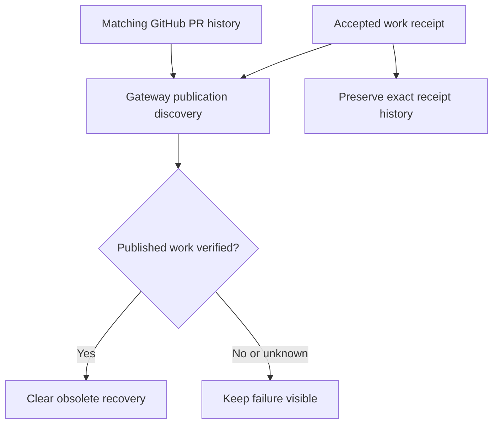

Codex review: needs maintainer review before merge. _Reviewed October 1, 2026, 12:17 AM ET / 04:17 UTC (Revision 5)._

# ClawSweeper review

## What this changes

The Gateway verifies whether failed shared publication work already appears in matching PR history, and the Control UI clears obsolete recovery warnings while preserving historical receipts.

## Merge readiness

✅ **Ready for maintainer review**

This PR remains useful: current main lacks publication reconciliation, and the earlier display-cap finding is fixed. No actionable correctness or security defect remains in the reviewed changes.

**Priority:** P2
**Reviewed head:** `00b4c519a87f6a357c562711190d942db04833e5`

## Review scores

| Measure | Result | What it means |
|---|---|---|
| **Overall readiness** | 🐚 platinum hermit **(4/6)** | A focused, well-supported repair with inspected visual proof and no remaining actionable findings. |
| **Proof confidence** | 🦞 diamond lobster **(5/6)** ✨ media proof bonus | Sufficient (screenshot): Inspected before/after Control UI screenshots directly show the obsolete disclosure disappearing while the merged PR remains. The recorded browser scenario exercises the changed controller through Gateway responses, and the body reports live GitHub comparison verification separately. Stored receipts and schemas are unchanged; browser mocks are supplemental to the visible proof. |
| **Patch quality** | 🐚 platinum hermit **(4/6)** | No actionable review findings were identified. |

## Verification

| Check | Result | Evidence |
|---|---|---|
| **Real behavior** | Verified | Sufficient (screenshot): Inspected before/after Control UI screenshots directly show the obsolete disclosure disappearing while the merged PR remains. The recorded browser scenario exercises the changed controller through Gateway responses, and the body reports live GitHub comparison verification separately. Stored receipts and schemas are unchanged; browser mocks are supplemental to the visible proof. |
| **Evidence reviewed** | 9 items | Pinned change ownership and review continuity: Reviewed the introduced merge-base-to-head changes. Comparing the previous reviewed head with the current head shows only the qualified-owner test assertion adjustment; production behavior is unchanged since that review. Conservative publication verification: Reconciliation requires matching repository/branch candidates and either an identical accepted tree or verified ancestry whose source tree matches the accepted snapshot. Unavailable candidates retain the failure; session and credential checks surround network reads. Receipt and stored-state compatibility: Only default discovery suppresses a verified obsolete failure. Exact-key discovery and by-id receipt reads remain intact, and the patch introduces no schema, serialization, or persistent-state rewrite. Tests cover both worktree and repository-only receipts. |
| **Findings** | None | None. |
| **Security** | None | None. |

## How this fits together

Shared GitHub publication records the work accepted from a session. The Gateway combines those receipts with GitHub PR history, and the Control UI uses its response to show relevant recovery actions.

## Before merge

None.

<strong>Agent review details</strong>

### Security

None.

### PR surface

Source +238, Tests +527, Docs 0. Total +765 across 19 files.

View PR surface stats

| Area | Files | Added | Removed | Net |
|---|---:|---:|---:|---:|
| Source | 9 | 248 | 10 | +238 |
| Tests | 9 | 528 | 1 | +527 |
| Docs | 1 | 1 | 1 | 0 |
| Config | 0 | 0 | 0 | 0 |
| Generated | 0 | 0 | 0 | 0 |
| Other | 0 | 0 | 0 | 0 |
| **Total** | **19** | **777** | **12** | **+765** |

### Review metrics

| Metric | Value | Why it matters |
|---|---|---|
| **Production versus regression growth** | production +238 net lines; tests +525 net lines; test routing +2 | Production growth implements authoritative coverage verification and reuses existing receipt, PR-cache, and UI-controller owners. |

### Technical review

Best possible solution:

Keep recovery decisions in Gateway discovery, retire only verified obsolete failures, and preserve immutable receipts and unverified recovery.

Do we have a high-confidence way to reproduce the issue?

Yes, from source: a failed shared receipt remains discoverable on current main after matching work is published. The supplied browser fixture demonstrates the visible warning; this review did not execute a current-main reproduction.

Is this the best way to solve the issue?

Yes. Read-only reconciliation at the existing discovery owner removes obsolete recovery without changing durable outcomes, adding dismissal state, or duplicating the decision in the UI.

AGENTS.md: found and applied where relevant.

Codex review notes: model internal, reasoning medium; reviewed against [b58f2a2c3327](https://github.com/openclaw/openclaw/commit/b58f2a2c33271f23e385df8ce645aa51c588c7bd).

### Labels

Label changes:

No label changes.

Label justifications:

- `P2`: Obsolete publication recovery creates bounded user confusion without preventing publication or losing work.
- `rating: 🐚 platinum hermit`: Overall readiness is 🐚 platinum hermit; proof is 🦞 diamond lobster and patch quality is 🐚 platinum hermit.
- `status: 👀 ready for maintainer look`: ClawSweeper has no concrete contributor-facing blocker left for this PR. Sufficient (screenshot): Inspected before/after Control UI screenshots directly show the obsolete disclosure disappearing while the merged PR remains. The recorded browser scenario exercises the changed controller through Gateway responses, and the body reports live GitHub comparison verification separately. Stored receipts and schemas are unchanged; browser mocks are supplemental to the visible proof.
- `proof: sufficient`: Contributor real behavior proof is sufficient. Inspected before/after Control UI screenshots directly show the obsolete disclosure disappearing while the merged PR remains. The recorded browser scenario exercises the changed controller through Gateway responses, and the body reports live GitHub comparison verification separately. Stored receipts and schemas are unchanged; browser mocks are supplemental to the visible proof.
- `proof: 📸 screenshot`: Contributor real behavior proof includes screenshot evidence. Inspected before/after Control UI screenshots directly show the obsolete disclosure disappearing while the merged PR remains. The recorded browser scenario exercises the changed controller through Gateway responses, and the body reports live GitHub comparison verification separately. Stored receipts and schemas are unchanged; browser mocks are supplemental to the visible proof.

### Evidence

What I checked:

- **Pinned change ownership and review continuity:** Reviewed the introduced merge-base-to-head changes. Comparing the previous reviewed head with the current head shows only the qualified-owner test assertion adjustment; production behavior is unchanged since that review. ([`src/gateway/session-utils-store-lookup.test.ts:484`](https://github.com/openclaw/openclaw/blob/00b4c519a87f6a357c562711190d942db04833e5/src/gateway/session-utils-store-lookup.test.ts#L484), [00b4c519a87f](https://github.com/openclaw/openclaw/commit/00b4c519a87f6a357c562711190d942db04833e5))
- **Conservative publication verification:** Reconciliation requires matching repository/branch candidates and either an identical accepted tree or verified ancestry whose source tree matches the accepted snapshot. Unavailable candidates retain the failure; session and credential checks surround network reads. ([`src/gateway/github-publication-relevance.ts:13`](https://github.com/openclaw/openclaw/blob/00b4c519a87f6a357c562711190d942db04833e5/src/gateway/github-publication-relevance.ts#L13), [00b4c519a87f](https://github.com/openclaw/openclaw/commit/00b4c519a87f6a357c562711190d942db04833e5))
- **Receipt and stored-state compatibility:** Only default discovery suppresses a verified obsolete failure. Exact-key discovery and by-id receipt reads remain intact, and the patch introduces no schema, serialization, or persistent-state rewrite. Tests cover both worktree and repository-only receipts. ([`src/gateway/github-publication-coordinator-methods.ts:97`](https://github.com/openclaw/openclaw/blob/00b4c519a87f6a357c562711190d942db04833e5/src/gateway/github-publication-coordinator-methods.ts#L97), [00b4c519a87f](https://github.com/openclaw/openclaw/commit/00b4c519a87f6a357c562711190d942db04833e5))
- **Earlier display-cap finding resolved:** The internal publication projection now receives every already-fetched candidate rather than the three displayed cards. The owner regression exercises a fourth merged PR, a newer-unpublished negative case, unchanged ordinary presentation, one list fetch, and no broadcast. ([`src/gateway/control-ui-session-prs-publication.test.ts:24`](https://github.com/openclaw/openclaw/blob/00b4c519a87f6a357c562711190d942db04833e5/src/gateway/control-ui-session-prs-publication.test.ts#L24), [00b4c519a87f](https://github.com/openclaw/openclaw/commit/00b4c519a87f6a357c562711190d942db04833e5))
- **Inspected visual proof:** Inspected both prepared images from the supplied before/after comment. The synthetic Control UI fixture retains the merged PR row while the obsolete failure disclosure disappears. The accompanying browser scenario covers repeated same-head observations, reload, later work, a new failure, and zero publish/confirm requests. Comment: https://github.com/openclaw/openclaw/pull/162257#issuecomment-5922884014. ([`ui/src/e2e/chat-pr-publication-state.e2e.test.ts:162`](https://github.com/openclaw/openclaw/blob/00b4c519a87f6a357c562711190d942db04833e5/ui/src/e2e/chat-pr-publication-state.e2e.test.ts#L162), [00b4c519a87f](https://github.com/openclaw/openclaw/commit/00b4c519a87f6a357c562711190d942db04833e5))
- **Current main still needs the change:** At fetched main, latestShared returns the selected receipt directly without published-work reconciliation. Latest-release inspection also found no supersession helper in the publication coordinator; no merged fixing PR was identified in the supplied related context. ([`src/gateway/github-publication-coordinator-methods.ts:97`](https://github.com/openclaw/openclaw/blob/b58f2a2c33271f23e385df8ce645aa51c588c7bd/src/gateway/github-publication-coordinator-methods.ts#L97), [b58f2a2c3327](https://github.com/openclaw/openclaw/commit/b58f2a2c33271f23e385df8ce645aa51c588c7bd))

Likely related people:

- **unknown:** The claimed source-line change could not be verified from bounded local history. (role: source history unknown; confidence: low)
- **shakkernerd:** Suggested for follow-up; no historical authorship or introduction is verified. (role: unverified routing candidate; confidence: low)

### Rating scale

| Score | Internal tier | Crab rank | Meaning |
|---:|:---:|---|---|
| **6/6** | S | 🦀 challenger crab | Exceptional readiness |
| **5/6** | A | 🦞 diamond lobster | Very strong readiness |
| **4/6** | B | 🐚 platinum hermit | Good normal PR; ordinary maintainer review |
| **3/6** | C | 🦐 gold shrimp | Useful, but confidence is limited |
| **2/6** | D | 🦪 silver shellfish | Proof or implementation needs work |
| **1/6** | F | 🧂 unranked krab | Not merge-ready |
| N/A | NA | 🌊 off-meta tidepool | Rating does not apply |

Overall follows the weaker of proof and patch quality.
Shiny media proof means a screenshot, video, or linked artifact directly shows the changed behavior. Runtime, network, CSP, and security claims still need visible diagnostics.

### Workflow

- ClawSweeper keeps one durable marker-backed review comment per issue or PR.
- Re-runs edit this comment so the latest verdict, findings, and automation markers stay together instead of adding duplicate bot comments.
- A fresh review can be triggered by eligible `@clawsweeper re-review` comments, exact-item GitHub events, scheduled/background review runs, or manual workflow dispatch.
- PR/issue authors and users with repository write access can comment `@clawsweeper re-review` or `@clawsweeper re-run` on an open PR or issue to request a fresh review only.
- Maintainers can also comment `@clawsweeper review` to request a fresh review only.
- Fresh-review commands do not start repair, autofix, rebase, CI repair, or automerge.
- Maintainer-only repair and merge flows require explicit commands such as `@clawsweeper autofix`, `@clawsweeper automerge`, `@clawsweeper fix ci`, or `@clawsweeper address review`.
- Maintainers can comment `@clawsweeper explain` to ask for more context, or `@clawsweeper stop` to stop active automation.

### History

Review history (4 earlier review cycles)

<!-- clawsweeper-review-history v=1 total=4 -->
- reviewed 2026-10-01T01:36:30.747Z sha 69b6e7831c2a06668292d22b9788ba6cd8748956 :: needs changes before merge. :: [P2] Check matching PRs beyond the three visible chips
- reviewed 2026-10-01T01:57:48.018Z sha 7e3f49519d1400fe07d02e922ae1011520ca6d1e :: needs maintainer review before merge. :: none
- reviewed 2026-10-01T02:34:37.522Z sha 7ad3a873d5e77f01244742acef3f107c31e938b8 :: needs maintainer review before merge. :: none
- reviewed 2026-10-01T04:01:12.579Z sha a1958b14a52a6c977a7ec3303a3adab2be6ca51b :: needs maintainer review before merge. :: none

<!-- clawsweeper-verdict:needs-human item=162257 sha=00b4c519a87f6a357c562711190d942db04833e5 confidence=high updated_at=2026-10-01T04:14:44Z reviewed_at=2026-10-01T04:17:54.424Z lease_owner=github-run-36814123867-1 lease_comment_id=5924607366 source_revision=b6c309eb6444fbcb5537851ee269aa8333649afda2bb491bcda95f0151871fbe live_verification=absent -->
<!-- clawsweeper-review-state:ready item=162257 sha=00b4c519a87f6a357c562711190d942db04833e5 v=1 -->

<!-- clawsweeper-review-version item=162257 reviewed_at=2026-10-01T04:17:54.424Z sha=00b4c519a87f6a357c562711190d942db04833e5 source_revision=b6c309eb6444fbcb5537851ee269aa8333649afda2bb491bcda95f0151871fbe lease_owner=github-run-36814123867-1 lease_comment_id=5924607366 v=1 -->

<!-- clawsweeper-review item=162257 -->