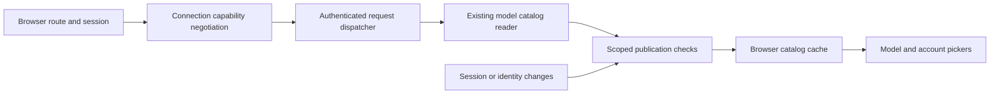

Codex review: blocked before merge. _Reviewed September 12, 2026, 1:33 PM ET / 17:33 UTC (Revision 12)._

# ClawSweeper review

## What this changes

The PR publishes model choices when the Control UI connects and prevents delayed catalog results from replacing newer session or account selections.

## Merge readiness

⛔ **Blocked before merge - 3 items remain**

This remains a useful first-open fix beyond the merged warm-cache improvement. The earlier publication-ordering findings are addressed, and no new actionable code defect was identified.

**Priority:** P2
**Reviewed head:** `7f1cbe61a4662dd5ab606fcddd988525ab6f8173`
**Owner decision:** Required. See [Decision needed](#decision-needed).

## Review scores

| Measure | Result | What it means |
|---|---|---|
| **Overall readiness** | 🐚 platinum hermit **(4/6)** | A coherent implementation with relevant reported runtime proof and no remaining actionable correctness finding. |
| **Proof confidence** | 🐚 platinum hermit **(4/6)** | Sufficient (live_output): The captured body reports real browser/Gateway first-open timings, request counts, reconnect recovery, and saved-account race results matching the changed dispatcher and cache owners; inspected test scenarios support that mapping. |
| **Patch quality** | 🐚 platinum hermit **(4/6)** | No actionable review findings were identified. |

## Verification

| Check | Result | Evidence |
|---|---|---|
| **Real behavior** | Verified | Sufficient (live_output): The captured body reports real browser/Gateway first-open timings, request counts, reconnect recovery, and saved-account race results matching the changed dispatcher and cache owners; inspected test scenarios support that mapping. |
| **Evidence reviewed** | 9 items | One authenticated catalog owner: Connection bootstrap dispatches sessions.resolve and models.list through the existing authenticated dispatcher. The response adapter runs after the dispatcher's current-client authority check; ordinary method and profile authorization remain in the request path. Prior ordering findings addressed: The connection store invalidates old metadata before reserving the initial read and notifying subscribers. Cache publication rejects retired reads, while saved-session catalog reads check the session mutation version. Browser coverage exercises delayed snapshots with replacement reads pending or complete and with the shell retained across reconnect. Current main remains distinct: Current main retains the earlier request-populated cache and has no connection snapshot publication in the inspected server, application, or connect-schema paths. The merged https://github.com/openclaw/openclaw/pull/145384 addresses warm reuse and known-default presentation, rather than this initial publication flow. |
| **Findings** | None | None. |
| **Security** | None | None. |

## How this fits together

The Gateway prepares model and account choices for the Control UI. Connection-time publication and ordinary catalog requests feed the same browser cache, which supplies the New Session and active-chat pickers.

## Decision needed

| Question | Recommendation |
|---|---|
| Can a listed security owner confirm authorship, an explicit request, or review involvement for the authenticated dispatcher change? | **Confirm security-owner involvement:** Record the qualifying owner involvement so the existing implementation can proceed through normal merge gates. |

Why: Repository policy requires this involvement, and the available public review and membership evidence does not establish it.

## Before merge

- [ ] **Resolve merge risk (P1)** - Required security-owner involvement for the authenticated dispatcher edit remains unverified.
- [ ] **Complete next step (P2)** - Confirm qualifying security-owner involvement for src/gateway/server/ws-connection/authenticated-request-dispatch.ts before merge.
- [ ] **Resolve maintainer decision** - Resolve the maintainer decision shown above before merge.

<strong>Agent review details</strong>

### Security

None.

### PR surface

Source +522, Tests +1158, Config +1, Other +39. Total +1720 across 53 files.

View PR surface stats

| Area | Files | Added | Removed | Net |
|---|---:|---:|---:|---:|
| Source | 33 | 693 | 171 | +522 |
| Tests | 15 | 1194 | 36 | +1158 |
| Docs | 0 | 0 | 0 | 0 |
| Config | 1 | 1 | 0 | +1 |
| Generated | 0 | 0 | 0 | 0 |
| Other | 4 | 42 | 3 | +39 |
| **Total** | **53** | **1930** | **210** | **+1720** |

### Review metrics

| Metric | Value | Why it matters |
|---|---|---|
| **Connection contract** | 1 optional connect field and 1 snapshot event; no protocol-version bump | Capability negotiation keeps the new field out of connections to servers that do not advertise it. |
| **Production versus validation growth** | Net production +519 lines; tests and test support +1,198; workflow/tooling +3 | Production growth supports initial publication and shared ordering checks, with most added validation covering consumer and lifecycle behavior. |

### Merge-risk options

**Maintainer options:**
1. **Decide the mitigation before merge**  
   Retain the shared catalog reader and publication owner, with security-owner involvement confirmed for the dispatcher adapter.
2. **Pause or close**  
   Do not merge this PR until maintainers decide whether the risk is worth taking.

### Technical review

Best possible solution:

Retain the shared catalog reader and publication owner, with security-owner involvement confirmed for the dispatcher adapter.

Do we have a high-confidence way to reproduce the issue?

Yes: hold the initial catalog reply while opening either picker, or delay a saved-session snapshot across an account change. Source and supplied before/after observations establish these paths; this review did not execute them.

Is this the best way to solve the issue?

Yes: reusing authenticated models.list dispatch and one scoped cache avoids a competing catalog or authorization implementation.

AGENTS.md: found and applied where relevant.

Codex review notes: model internal, reasoning medium; reviewed against [e16fc3c97374](https://github.com/openclaw/openclaw/commit/e16fc3c97374d3c0768ee6afb2e283a35c2d485c).

### Labels

Label justifications:

- `P2`: This improves model-picker latency and preserves newer account selections within a bounded Control UI workflow.
- `rating: 🐚 platinum hermit`: Overall readiness is 🐚 platinum hermit; proof is 🐚 platinum hermit and patch quality is 🐚 platinum hermit.
- `status: 👀 ready for maintainer look`: ClawSweeper has no concrete contributor-facing blocker left for this PR. Sufficient (live_output): The captured body reports real browser/Gateway first-open timings, request counts, reconnect recovery, and saved-account race results matching the changed dispatcher and cache owners; inspected test scenarios support that mapping.
- `proof: sufficient`: Contributor real behavior proof is sufficient. The captured body reports real browser/Gateway first-open timings, request counts, reconnect recovery, and saved-account race results matching the changed dispatcher and cache owners; inspected test scenarios support that mapping.

### Evidence

What I checked:

- **One authenticated catalog owner:** Connection bootstrap dispatches sessions.resolve and models.list through the existing authenticated dispatcher. The response adapter runs after the dispatcher's current-client authority check; ordinary method and profile authorization remain in the request path. ([`src/gateway/server/ws-connection/connect-model-catalog.ts:19`](https://github.com/openclaw/openclaw/blob/7f1cbe61a4662dd5ab606fcddd988525ab6f8173/src/gateway/server/ws-connection/connect-model-catalog.ts#L19), [7f1cbe61a466](https://github.com/openclaw/openclaw/commit/7f1cbe61a4662dd5ab606fcddd988525ab6f8173))
- **Prior ordering findings addressed:** The connection store invalidates old metadata before reserving the initial read and notifying subscribers. Cache publication rejects retired reads, while saved-session catalog reads check the session mutation version. Browser coverage exercises delayed snapshots with replacement reads pending or complete and with the shell retained across reconnect. ([`ui/src/app/gateway-observers.ts:118`](https://github.com/openclaw/openclaw/blob/7f1cbe61a4662dd5ab606fcddd988525ab6f8173/ui/src/app/gateway-observers.ts#L118), [7f1cbe61a466](https://github.com/openclaw/openclaw/commit/7f1cbe61a4662dd5ab606fcddd988525ab6f8173))
- **Current main remains distinct:** Current main retains the earlier request-populated cache and has no connection snapshot publication in the inspected server, application, or connect-schema paths. The merged https://github.com/openclaw/openclaw/pull/145384 addresses warm reuse and known-default presentation, rather than this initial publication flow. ([`ui/src/lib/model-catalog-cache.ts:27`](https://github.com/openclaw/openclaw/blob/e16fc3c97374d3c0768ee6afb2e283a35c2d485c/ui/src/lib/model-catalog-cache.ts#L27), [e16fc3c97374](https://github.com/openclaw/openclaw/commit/e16fc3c97374d3c0768ee6afb2e283a35c2d485c))
- **Released handshake contract:** The v2026.9.4 connect schema lacks modelCatalog. The proposed shared negotiation helper omits that field unless advertised, and native clients remain opted out; the body reports bidirectional previous-source-build connections and explicitly excludes installed-release upgrade testing. ([`packages/gateway-protocol/src/schema/frames.ts:30`](https://github.com/openclaw/openclaw/blob/3a9d69db306cd7f081e06254cb89c4bcc14a7107/packages/gateway-protocol/src/schema/frames.ts#L30), [3a9d69db306c](https://github.com/openclaw/openclaw/commit/3a9d69db306cd7f081e06254cb89c4bcc14a7107))
- **Reported real behavior proof:** The captured PR body reports a seven-second delayed-catalog comparison: corrected New Session and active-chat pickers displayed rows within 100 ms, warm reopen took 8–12 ms, and opening added no request. Its real browser/Gateway scenarios match the checked-in reconnect and saved-account race coverage. The two downloaded images were inspected but belong to the earlier merged warm-cache PR, so they are not attributed to this branch. ([`ui/src/e2e/chat-flow.catalog-bootstrap.e2e.test.ts:179`](https://github.com/openclaw/openclaw/blob/7f1cbe61a4662dd5ab606fcddd988525ab6f8173/ui/src/e2e/chat-flow.catalog-bootstrap.e2e.test.ts#L179), [7f1cbe61a466](https://github.com/openclaw/openclaw/commit/7f1cbe61a4662dd5ab606fcddd988525ab6f8173))
- **Restricted review surface:** The authenticated dispatcher matches the security ownership rule. CONTRIBUTING.md requires listed-owner authorship, an explicit request, or active review involvement for such edits; the maintainer label alone does not establish this. ([`.github/CODEOWNERS:34`](https://github.com/openclaw/openclaw/blob/7f1cbe61a4662dd5ab606fcddd988525ab6f8173/.github/CODEOWNERS#L34), [7f1cbe61a466](https://github.com/openclaw/openclaw/commit/7f1cbe61a4662dd5ab606fcddd988525ab6f8173))

Likely related people:

- **unknown:** The claimed source-line change could not be verified from bounded local history. (role: source history unknown; confidence: low)
- **openclaw/openclaw-secops:** Suggested for follow-up; no historical authorship or introduction is verified. (role: unverified routing candidate; confidence: low)

### Rating scale

| Score | Internal tier | Crab rank | Meaning |
|---:|:---:|---|---|
| **6/6** | S | 🦀 challenger crab | Exceptional readiness |
| **5/6** | A | 🦞 diamond lobster | Very strong readiness |
| **4/6** | B | 🐚 platinum hermit | Good normal PR; ordinary maintainer review |
| **3/6** | C | 🦐 gold shrimp | Useful, but confidence is limited |
| **2/6** | D | 🦪 silver shellfish | Proof or implementation needs work |
| **1/6** | F | 🧂 unranked krab | Not merge-ready |
| N/A | NA | 🌊 off-meta tidepool | Rating does not apply |

Overall follows the weaker of proof and patch quality.
Shiny media proof means a screenshot, video, or linked artifact directly shows the changed behavior. Runtime, network, CSP, and security claims still need visible diagnostics.

### Workflow

- ClawSweeper keeps one durable marker-backed review comment per issue or PR.
- Re-runs edit this comment so the latest verdict, findings, and automation markers stay together instead of adding duplicate bot comments.
- A fresh review can be triggered by eligible `@clawsweeper re-review` comments, exact-item GitHub events, scheduled/background review runs, or manual workflow dispatch.
- PR/issue authors and users with repository write access can comment `@clawsweeper re-review` or `@clawsweeper re-run` on an open PR or issue to request a fresh review only.
- Maintainers can also comment `@clawsweeper review` to request a fresh review only.
- Fresh-review commands do not start repair, autofix, rebase, CI repair, or automerge.
- Maintainer-only repair and merge flows require explicit commands such as `@clawsweeper autofix`, `@clawsweeper automerge`, `@clawsweeper fix ci`, or `@clawsweeper address review`.
- Maintainers can comment `@clawsweeper explain` to ask for more context, or `@clawsweeper stop` to stop active automation.

### History

Review history (11 earlier review cycles; latest 8 shown)

<!-- clawsweeper-review-history v=1 total=11 -->
- reviewed 2026-09-12T13:55:53.783Z sha b0c4cb2939a1910876a2eeb7698e3af642bfcf29 :: needs changes before merge. :: [P2] Preserve the initial read through hello lifecycle invalidation
- reviewed 2026-09-12T14:20:06.504Z sha a47aba19d02aee409f6ae01cc474e318f38233ea :: needs changes before merge. :: [P2] Preserve the initial read through hello lifecycle invalidation
- reviewed 2026-09-12T14:35:46.646Z sha a47aba19d02aee409f6ae01cc474e318f38233ea :: needs changes before merge. :: [P2] Preserve the initial read through hello lifecycle invalidation
- reviewed 2026-09-12T15:02:20.390Z sha c1f40f55e8b81741dbb797cf63abee0bf9c1427d :: needs maintainer review before merge. :: none
- reviewed 2026-09-12T15:26:02.701Z sha 0e0d2cb11ba0bb4ca1a26c267b7b8ca803a961eb :: blocked before merge. :: none
- reviewed 2026-09-12T16:18:08.973Z sha 3ad7dcca8f66b595cc715c6fe16f555623b04ac1 :: blocked before merge. :: none
- reviewed 2026-09-12T16:47:09.184Z sha 9043dca80b1e02873cc7ee9fdd547afa14835488 :: blocked before merge. :: none
- reviewed 2026-09-12T17:13:06.913Z sha e184933201c1256e32162af7d78fc8d980516375 :: blocked before merge. :: none

<!-- clawsweeper-verdict:needs-human item=145927 sha=7f1cbe61a4662dd5ab606fcddd988525ab6f8173 confidence=high updated_at=2026-09-12T17:30:28Z reviewed_at=2026-09-12T17:33:36.152Z lease_owner=github-run-34708325431-1 lease_comment_id=5647519555 source_revision=770ab882b2c9593ed168afecbaf3bb90753da45cfcf5102fdecc0c5418830faa live_verification=absent -->
<!-- clawsweeper-review-state:blocked item=145927 sha=7f1cbe61a4662dd5ab606fcddd988525ab6f8173 v=1 -->

<!-- clawsweeper-review-version item=145927 reviewed_at=2026-09-12T17:33:36.152Z sha=7f1cbe61a4662dd5ab606fcddd988525ab6f8173 source_revision=770ab882b2c9593ed168afecbaf3bb90753da45cfcf5102fdecc0c5418830faa lease_owner=github-run-34708325431-1 lease_comment_id=5647519555 v=1 -->

<!-- clawsweeper-review item=145927 -->