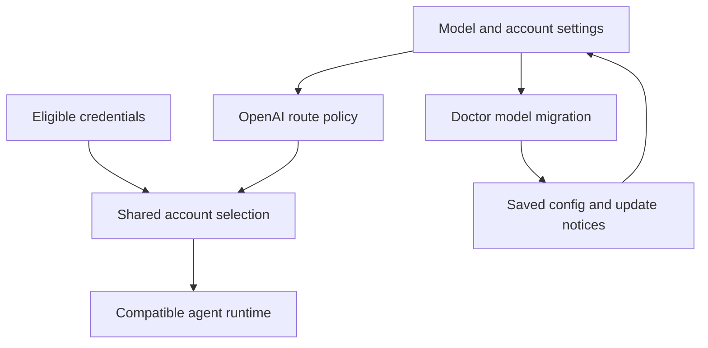

Codex review: blocked before merge. _Reviewed September 12, 2026, 2:09 AM ET / 06:09 UTC (Revision 13)._

# ClawSweeper review

## What this changes

The PR preserves subscription billing during automatic OpenAI account selection and model migrations, honors explicit authentication choices, and completes deferred model retirement after updates.

## Merge readiness

⛔ **Blocked before merge - 3 items remain**

The previous configured-auth blocker is fixed, and no remaining blocking defect was found. Current main and v2026.9.4 still retain the affected routing behavior; the related update PR does not supersede this work.

**Priority:** P1
**Reviewed head:** `1d2ba49355e088d9f78beac91bf40af6a8d16657`

## Review scores

| Measure | Result | What it means |
|---|---|---|
| **Overall readiness** | 🐚 platinum hermit **(4/6)** | A useful repair with substantial upgrade evidence and the prior blocker resolved; remaining coverage limits are explicitly disclosed. |
| **Proof confidence** | 🦞 diamond lobster **(5/6)** | Sufficient (live_output): The matching complete PR body records the published 2026.9.4 updater exercising candidate Doctor and route-selection owners on isolated Linux state, preserving both accounts and selecting subscription billing after retirement. That unchanged update path remains covered at 5167a545; the final authentication-only correction has separate failing-first owner coverage. Proof does not establish live inference or restart. |
| **Patch quality** | 🐚 platinum hermit **(4/6)** | No actionable review findings were identified. |

## Verification

| Check | Result | Evidence |
|---|---|---|
| **Real behavior** | Verified | Sufficient (live_output): The matching complete PR body records the published 2026.9.4 updater exercising candidate Doctor and route-selection owners on isolated Linux state, preserving both accounts and selecting subscription billing after retirement. That unchanged update path remains covered at 5167a545; the final authentication-only correction has separate failing-first owner coverage. Proof does not establish live inference or restart. |
| **Evidence reviewed** | 10 items | Previous blocker resolved: The exact-head commit preserves configuredAuthMode when environment fallback material exists in both preparation and availability. Its regression table exercises both owners with explicit API authentication, eligible API/OAuth profiles, and OPENAI_API_KEY without an inherited profile constraint. Shared precedence and credential boundaries: Provider preference applies only after required bindings, configured authentication, explicit ordering, readiness, and cooldown filtering. Credential materialization retains exact-route checks and stops on terminal secret or OAuth refresh failures. Durable update completion: Deferred retirement uses existing update-ledger steps. Candidate resume runs the missing Doctor pass when plugins are unchanged, and completion is recorded after successful config persistence; regression coverage retains pending status when the write is refused. |
| **Findings** | None | None. |
| **Security** | None | None. |

## How this fits together

OpenAI provider policy supplies available billing routes, and shared authentication preparation selects eligible accounts for chat, heartbeat, subagent, and auxiliary requests. Doctor repairs configured model references and records migration outcomes during updates.

## Before merge

- [ ] **Resolve merge risk (P1)** - The additive SDK preference contract intentionally changes automatic mixed-credential selection for official Completions configurations; integrations relying on API billing must express that choice through the documented authentication controls.
- [ ] **Resolve merge risk (P1)** - Upgrade observations cover synthetic mixed credentials on Linux; live provider inference, Gateway restart, and the optional empty-account updater variant were not demonstrated.
- [ ] **Add data-model compatibility proof** - Confirm migration or upgrade compatibility proof before merge.

<strong>Agent review details</strong>

### Security

None.

### PR surface

Source +759, Tests +1406, Docs +51, Other 0. Total +2216 across 63 files.

View PR surface stats

| Area | Files | Added | Removed | Net |
|---|---:|---:|---:|---:|
| Source | 38 | 988 | 229 | +759 |
| Tests | 21 | 1601 | 195 | +1406 |
| Docs | 3 | 52 | 1 | +51 |
| Config | 0 | 0 | 0 | 0 |
| Generated | 0 | 0 | 0 | 0 |
| Other | 1 | 1 | 1 | 0 |
| **Total** | **63** | **2642** | **426** | **+2216** |

### Review metrics

| Metric | Value | Why it matters |
|---|---|---|
| **Plugin contract additions** | 2 optional fields; 0 new hooks or user settings | The change extends the existing route contract without requiring older plugins to supply new fields. |
| **Precedence parity coverage** | 6 scenarios checked through 2 authentication owners | The shared table covers preparation and availability together, including the exact previously reported environment-fallback defect. |

### Stored data model

Persistent data-model change detected: `migration/backfill/repair: config/assertion-safety-baseline.txt`, `migration/backfill/repair: src/cli/program/config-guard.ts`, `migration/backfill/repair: src/cli/update-cli/update-command-fresh-doctor.ts`, `migration/backfill/repair: src/cli/update-cli/update-command-resume.ts`, `migration/backfill/repair: src/commands/doctor-config-flow.ts`, `migration/backfill/repair: src/commands/doctor-config-preflight.ts`, and 12 more. Confirm migration or upgrade compatibility proof before merge.

### Root-cause cluster

Relationship: `fixed_by_candidate`
Canonical: https://github.com/openclaw/openclaw/issues/145154
Summary: This PR is the candidate repair for the reported billing migration; the other update PR overlaps only in Doctor/update ordering.

Members:
- `canonical`: https://github.com/openclaw/openclaw/issues/145154 - The report identifies the mixed-credential billing failure addressed by this PR.
- `partial_overlap`: https://github.com/openclaw/openclaw/pull/145043 - It addresses broader migration ordering and legacy-input preservation and has not superseded this authentication-preference repair.

Proposal only: this assessment does not dispatch repair, suppress jobs, mutate sibling items, close, or merge anything.

### Merge-risk options

**Maintainer options:**
1. **Retain the documented precedence contract (recommended)**  
   Accept the intentional automatic subscription preference with explicit authentication controls preserved and the recorded published-updater qualification retained.

### Technical review

Best possible solution:

Maintain one shared authentication-precedence contract, preserve explicit account choices, and keep migration notices tied to durable Doctor writes.

Do we have a high-confidence way to reproduce the issue?

Yes, from source: official Completions configuration with both account types exposes the baseline API-only selection, and the PR records a failing subscription-preservation probe. This review did not execute the reproduction.

Is this the best way to solve the issue?

Yes. Provider-owned route preference consumed by shared authentication selection is a maintainable repair, and the latest correction preserves explicit provider authentication in both preparation and availability.

AGENTS.md: found and applied where relevant.

Codex review notes: model internal, reasoning medium; reviewed against [d5e652099074](https://github.com/openclaw/openclaw/commit/d5e652099074b5801cc7e4e3a108c035d2888e99).

### Labels

Label changes:

- add `rating: 🐚 platinum hermit`: Overall readiness is 🐚 platinum hermit; proof is 🦞 diamond lobster and patch quality is 🐚 platinum hermit.
- add `status: 👀 ready for maintainer look`: ClawSweeper has no concrete contributor-facing blocker left for this PR. Sufficient (live_output): The matching complete PR body records the published 2026.9.4 updater exercising candidate Doctor and route-selection owners on isolated Linux state, preserving both accounts and selecting subscription billing after retirement. That unchanged update path remains covered at 5167a545; the final authentication-only correction has separate failing-first owner coverage. Proof does not establish live inference or restart.
- remove `rating: 🦐 gold shrimp`: Current PR rating is `rating: 🐚 platinum hermit`, so this older rating label is no longer current.
- remove `merge-risk: 🚨 auth-provider`: Current PR review merge-risk labels are `merge-risk: 🚨 compatibility`.
- remove `status: ⏳ waiting on author`: Current PR status label is `status: 👀 ready for maintainer look`.

Label justifications:

- `P1`: The linked report describes real heartbeat and subagent traffic silently incurring metered charges after an upgrade.
- `merge-risk: 🚨 compatibility`: The optional Plugin SDK fields change automatic route preference while preserving documented explicit authentication choices.
- `rating: 🐚 platinum hermit`: Overall readiness is 🐚 platinum hermit; proof is 🦞 diamond lobster and patch quality is 🐚 platinum hermit.
- `status: 👀 ready for maintainer look`: ClawSweeper has no concrete contributor-facing blocker left for this PR. Sufficient (live_output): The matching complete PR body records the published 2026.9.4 updater exercising candidate Doctor and route-selection owners on isolated Linux state, preserving both accounts and selecting subscription billing after retirement. That unchanged update path remains covered at 5167a545; the final authentication-only correction has separate failing-first owner coverage. Proof does not establish live inference or restart.
- `proof: sufficient`: Contributor real behavior proof is sufficient. The matching complete PR body records the published 2026.9.4 updater exercising candidate Doctor and route-selection owners on isolated Linux state, preserving both accounts and selecting subscription billing after retirement. That unchanged update path remains covered at 5167a545; the final authentication-only correction has separate failing-first owner coverage. Proof does not establish live inference or restart.

### Evidence

What I checked:

- **Previous blocker resolved:** The exact-head commit preserves configuredAuthMode when environment fallback material exists in both preparation and availability. Its regression table exercises both owners with explicit API authentication, eligible API/OAuth profiles, and OPENAI_API_KEY without an inherited profile constraint. ([`src/agents/runtime-plan/prepare-auth.ts:423`](https://github.com/openclaw/openclaw/blob/1d2ba49355e088d9f78beac91bf40af6a8d16657/src/agents/runtime-plan/prepare-auth.ts#L423), [1d2ba49355e0](https://github.com/openclaw/openclaw/commit/1d2ba49355e088d9f78beac91bf40af6a8d16657))
- **Shared precedence and credential boundaries:** Provider preference applies only after required bindings, configured authentication, explicit ordering, readiness, and cooldown filtering. Credential materialization retains exact-route checks and stops on terminal secret or OAuth refresh failures. ([`src/agents/provider-model-route-auth.ts:361`](https://github.com/openclaw/openclaw/blob/1d2ba49355e088d9f78beac91bf40af6a8d16657/src/agents/provider-model-route-auth.ts#L361), [1d2ba49355e0](https://github.com/openclaw/openclaw/commit/1d2ba49355e088d9f78beac91bf40af6a8d16657))
- **Durable update completion:** Deferred retirement uses existing update-ledger steps. Candidate resume runs the missing Doctor pass when plugins are unchanged, and completion is recorded after successful config persistence; regression coverage retains pending status when the write is refused. ([`src/flows/doctor-health-contribution-runners.config.ts:308`](https://github.com/openclaw/openclaw/blob/1d2ba49355e088d9f78beac91bf40af6a8d16657/src/flows/doctor-health-contribution-runners.config.ts#L308), [1d2ba49355e0](https://github.com/openclaw/openclaw/commit/1d2ba49355e088d9f78beac91bf40af6a8d16657))
- **Complete captured proof body inspected:** The fetched full body matched the supplied 13,907-unit snapshot and SHA-256 7a26fbf98af719cb9b4e1f39b551bb2cecb627618e3205dec03878c69a848961. It records a published-2026.9.4 Linux update into head 5167a545581c74d16253e1f20005504ee0473fe1 with unchanged plugins, preserved accounts, subscription-selected auxiliary consumers, an explicit API control, visible retirement completion, and idempotent repeat Doctor. The final auth-only delta has separately reported failing-first regressions and 165 passing owner tests. ([1d2ba49355e0](https://github.com/openclaw/openclaw/commit/1d2ba49355e088d9f78beac91bf40af6a8d16657))
- **Proof scope:** The linked Testbox workflow envelope reports cancelled, so its status is not treated as a passing assertion. The assessment uses the preserved cell observations in the matching PR body, which explicitly disclose synthetic credentials, no live inference or restart, and no updater rerun for the final authentication-only delta. ([5167a545581c](https://github.com/openclaw/openclaw/commit/5167a545581c74d16253e1f20005504ee0473fe1))
- **Still necessary on main and latest release:** Direct GitHub source reads at fetched main and v2026.9.4 show authored official Completions remaining an API-only route; neither contains this branch's legacy-Completions subscription preference. The linked issue remains open, and the separate update PR remains an overlapping implementation rather than a merged replacement. ([`extensions/openai/provider-policy-api.ts:392`](https://github.com/openclaw/openclaw/blob/d5e652099074b5801cc7e4e3a108c035d2888e99/extensions/openai/provider-policy-api.ts#L392), [d5e652099074](https://github.com/openclaw/openclaw/commit/d5e652099074b5801cc7e4e3a108c035d2888e99))

Likely related people:

- **steipete:** Suggested for follow-up; no historical authorship or introduction is verified. (role: unverified routing candidate; confidence: low)
- **fuller-stack-dev:** Suggested for follow-up; no historical authorship or introduction is verified. (role: unverified routing candidate; confidence: low)

### Rating scale

| Score | Internal tier | Crab rank | Meaning |
|---:|:---:|---|---|
| **6/6** | S | 🦀 challenger crab | Exceptional readiness |
| **5/6** | A | 🦞 diamond lobster | Very strong readiness |
| **4/6** | B | 🐚 platinum hermit | Good normal PR; ordinary maintainer review |
| **3/6** | C | 🦐 gold shrimp | Useful, but confidence is limited |
| **2/6** | D | 🦪 silver shellfish | Proof or implementation needs work |
| **1/6** | F | 🧂 unranked krab | Not merge-ready |
| N/A | NA | 🌊 off-meta tidepool | Rating does not apply |

Overall follows the weaker of proof and patch quality.
Shiny media proof means a screenshot, video, or linked artifact directly shows the changed behavior. Runtime, network, CSP, and security claims still need visible diagnostics.

### Workflow

- ClawSweeper keeps one durable marker-backed review comment per issue or PR.
- Re-runs edit this comment so the latest verdict, findings, and automation markers stay together instead of adding duplicate bot comments.
- A fresh review can be triggered by eligible `@clawsweeper re-review` comments, exact-item GitHub events, scheduled/background review runs, or manual workflow dispatch.
- PR/issue authors and users with repository write access can comment `@clawsweeper re-review` or `@clawsweeper re-run` on an open PR or issue to request a fresh review only.
- Maintainers can also comment `@clawsweeper review` to request a fresh review only.
- Fresh-review commands do not start repair, autofix, rebase, CI repair, or automerge.
- Maintainer-only repair and merge flows require explicit commands such as `@clawsweeper autofix`, `@clawsweeper automerge`, `@clawsweeper fix ci`, or `@clawsweeper address review`.
- Maintainers can comment `@clawsweeper explain` to ask for more context, or `@clawsweeper stop` to stop active automation.

### History

Review history (12 earlier review cycles; latest 8 shown)

<!-- clawsweeper-review-history v=1 total=12 -->
- reviewed 2026-09-12T00:50:49.457Z sha 7ef41bf08ee8928ec87812e7af147a91d26b221b :: blocked before merge. :: [P1] Preserve configured provider auth before filtering inherited routes | [P1] Resolve provider-bound credentials before availability filters routes | [P1] Keep inherited billing intent subordinate to explicit auth order
- reviewed 2026-09-12T01:52:25.838Z sha 31f683109c6172b40bb4010acd25c03655268f8f :: blocked before merge. :: [P1] Preserve configured auth when an environment fallback is present
- reviewed 2026-09-12T03:22:09.558Z sha 31f683109c6172b40bb4010acd25c03655268f8f :: blocked before merge. :: [P1] Preserve configured auth when an environment fallback is present
- reviewed 2026-09-12T04:12:22.194Z sha bcb13b4ea91033dc521454a27667a0920e1f862c :: blocked before merge. :: [P1] Preserve configured auth when an environment fallback is present
- reviewed 2026-09-12T04:50:27.982Z sha 4e5c7641e56f0ed423cfb9f5235fc0d6b487676f :: blocked before merge. :: [P1] Preserve configured auth when an environment fallback is present
- reviewed 2026-09-12T05:35:22.491Z sha 5167a545581c74d16253e1f20005504ee0473fe1 :: blocked before merge. :: [P1] Preserve configured auth when an environment fallback is present
- reviewed 2026-09-12T05:49:58.079Z sha 5167a545581c74d16253e1f20005504ee0473fe1 :: blocked before merge. :: [P1] Preserve configured auth when an environment fallback is present
- reviewed 2026-09-12T05:57:02.674Z sha 5167a545581c74d16253e1f20005504ee0473fe1 :: blocked before merge. :: [P1] [P1] Preserve configured auth when an environment fallback is present

<!-- clawsweeper-verdict:needs-human item=145305 sha=1d2ba49355e088d9f78beac91bf40af6a8d16657 confidence=high updated_at=2026-09-12T06:05:51Z reviewed_at=2026-09-12T06:09:40.576Z lease_owner=github-run-34677167670-1 lease_comment_id=5644076083 source_revision=6a28b0d54045a22005519236d7657471d5e94f32487ae561084e5eb94ddc0ad2 live_verification=absent -->
<!-- clawsweeper-review-state:blocked item=145305 sha=1d2ba49355e088d9f78beac91bf40af6a8d16657 v=1 -->

<!-- clawsweeper-review-version item=145305 reviewed_at=2026-09-12T06:09:40.576Z sha=1d2ba49355e088d9f78beac91bf40af6a8d16657 source_revision=6a28b0d54045a22005519236d7657471d5e94f32487ae561084e5eb94ddc0ad2 lease_owner=github-run-34677167670-1 lease_comment_id=5644076083 v=1 -->

<!-- clawsweeper-review item=145305 -->