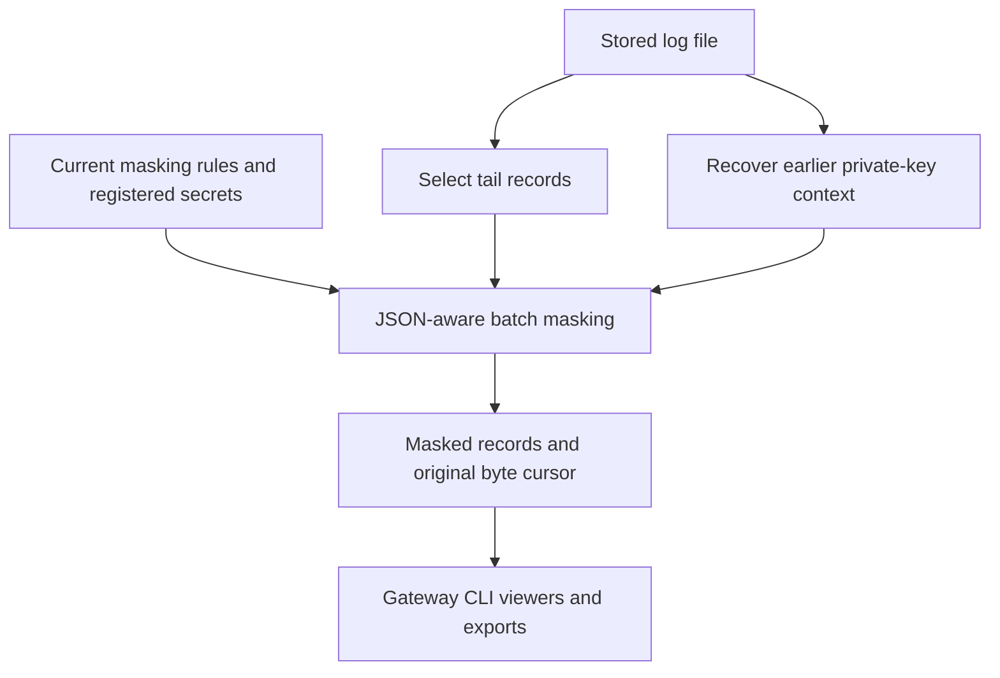

Codex review: blocked before merge. _Reviewed September 13, 2026, 10:47 AM ET / 14:47 UTC (Revision 6)._

# ClawSweeper review

## What this changes

Preserves valid JSON records while masking stored log batches, including credentials in property names and private-key bodies spanning tail selections.

## Merge readiness

⛔ **Blocked before merge - 1 item remains**

This repair remains necessary on current main. The previous property-name masking finding is resolved, and the updated PR body explicitly accepts the measured history-scan cost. No remaining actionable patch defect was found.

**Priority:** P2
**Reviewed head:** `5e8876e4fa901b7010022b8cf188231cd7cdd817`

## Review scores

| Measure | Result | What it means |
|---|---|---|
| **Overall readiness** | 🐚 platinum hermit **(4/6)** | A coherent repair with meaningful Gateway coverage, the previous defect resolved, and an explicitly accepted performance tradeoff. |
| **Proof confidence** | 🌊 off-meta tidepool | Not applicable: The repository-state MEMBER association exempts this PR from the external-contributor proof gate, and no authority-bearing change activates an exception. The body reports real logs.tail, follow-mode, channel-log, and browser checks; those executions were not independently repeated. |
| **Patch quality** | 🐚 platinum hermit **(4/6)** | No actionable review findings were identified. |

## Verification

| Check | Result | Evidence |
|---|---|---|
| **Real behavior** | Not applicable | Not applicable: The repository-state MEMBER association exempts this PR from the external-contributor proof gate, and no authority-bearing change activates an exception. The body reports real logs.tail, follow-mode, channel-log, and browser checks; those executions were not independently repeated. |
| **Evidence reviewed** | 7 items | Verified review scope: The checkout is the pinned PR head. The complete local merge-base-to-head diff matches the nine introduced paths; unrelated endpoint drift was excluded. Initial and final git status were clean, and diff whitespace validation passed. Current main still needs the read-side repair: Current main filters and limits records before masking, then applies whole-text replacement to joined lines. The merged writer repair at https://github.com/openclaw/openclaw/pull/146718 explicitly leaves tail-reader corruption as separate work. Inspection of the latest release’s redactor could not complete because its source blob was unavailable; no shipped-fix claim is made. Earlier property-name finding resolved: The editor now allows captures confined to JSON property-name contents while preserving ordinary keys crossed by larger batch spans. Authenticated Gateway regression coverage checks late registered secrets and escaped property-name captures. |
| **Findings** | None | None. |
| **Security** | None | None. |

## How this fits together

OpenClaw’s log-tail reader supplies stored diagnostics to Gateway RPC, CLI commands, and downstream viewers and exports. It applies current masking rules while retaining cursors based on the original file bytes.

## Before merge

- [ ] **Resolve merge risk (P1)** - Without a decisive earlier PEM marker, each nonempty tail can scan all preceding history. The PR accepts the measured diagnostic-read cost, but cold-storage and concurrent-reader latency remain unmeasured.

<strong>Agent review details</strong>

### Security

None.

### PR surface

Source +452, Tests +280. Total +732 across 9 files.

View PR surface stats

| Area | Files | Added | Removed | Net |
|---|---:|---:|---:|---:|
| Source | 7 | 649 | 197 | +452 |
| Tests | 2 | 288 | 8 | +280 |
| Docs | 0 | 0 | 0 | 0 |
| Config | 0 | 0 | 0 | 0 |
| Generated | 0 | 0 | 0 | 0 |
| Other | 0 | 0 | 0 | 0 |
| **Total** | **9** | **937** | **205** | **+732** |

### Review metrics

| Metric | Value | Why it matters |
|---|---|---|
| **Reported history-scan latency** | 118.5 MB: 32.29 ms median / 42.16 ms p95; 52.63× baseline median | The warm-run measurement makes the accepted cost concrete but does not establish cold-storage or concurrent-reader limits. |

### Merge-risk options

**Maintainer options:**
1. **Retain the documented scan tradeoff (recommended)**  
   Proceed under the PR’s explicit acceptance of history-dependent diagnostic latency while retaining masking across old PEM boundaries.

### Technical review

Best possible solution:

Keep one JSON-aware masking owner for stored-log consumers, preserving source-byte cursors and complete PEM context under the explicitly documented performance tradeoff.

Do we have a high-confidence way to reproduce the issue?

Yes, from source: current main masks joined serialized records after selection, allowing cross-record replacements to damage JSON and selection cuts to discard PEM context. No target code was executed during this review.

Is this the best way to solve the issue?

Yes. Extending the existing scalar editor and reconstructing context in the tail owner preserves ordered masking and original-byte cursors without introducing a second masking implementation.

AGENTS.md: found and applied where relevant.

Codex review notes: model internal, reasoning medium; reviewed against [a891c3fb955e](https://github.com/openclaw/openclaw/commit/a891c3fb955e129f3baf109b62d5d30a4492ce01).

### Labels

Label justifications:

- `P2`: Repairs stored diagnostic masking and parseability without evidence of an ongoing core-runtime outage.
- `merge-risk: 🚨 availability`: The new context reconstruction can turn a small tail poll into a scan of all preceding log history.
- `rating: 🐚 platinum hermit`: Overall readiness is 🐚 platinum hermit; proof is 🌊 off-meta tidepool and patch quality is 🐚 platinum hermit.
- `status: 👀 ready for maintainer look`: ClawSweeper has no concrete contributor-facing blocker left for this PR. Not applicable: The repository-state MEMBER association exempts this PR from the external-contributor proof gate, and no authority-bearing change activates an exception. The body reports real logs.tail, follow-mode, channel-log, and browser checks; those executions were not independently repeated.

### Evidence

What I checked:

- **Verified review scope:** The checkout is the pinned PR head. The complete local merge-base-to-head diff matches the nine introduced paths; unrelated endpoint drift was excluded. Initial and final git status were clean, and diff whitespace validation passed. ([5e8876e4fa90](https://github.com/openclaw/openclaw/commit/5e8876e4fa901b7010022b8cf188231cd7cdd817))
- **Current main still needs the read-side repair:** Current main filters and limits records before masking, then applies whole-text replacement to joined lines. The merged writer repair at https://github.com/openclaw/openclaw/pull/146718 explicitly leaves tail-reader corruption as separate work. Inspection of the latest release’s redactor could not complete because its source blob was unavailable; no shipped-fix claim is made. ([`src/logging/redact.ts:1577`](https://github.com/openclaw/openclaw/blob/a891c3fb955e129f3baf109b62d5d30a4492ce01/src/logging/redact.ts#L1577), [a891c3fb955e](https://github.com/openclaw/openclaw/commit/a891c3fb955e129f3baf109b62d5d30a4492ce01))
- **Earlier property-name finding resolved:** The editor now allows captures confined to JSON property-name contents while preserving ordinary keys crossed by larger batch spans. Authenticated Gateway regression coverage checks late registered secrets and escaped property-name captures. ([`src/logging/redact-json.ts:485`](https://github.com/openclaw/openclaw/blob/5e8876e4fa901b7010022b8cf188231cd7cdd817/src/logging/redact-json.ts#L485), [5e8876e4fa90](https://github.com/openclaw/openclaw/commit/5e8876e4fa901b7010022b8cf188231cd7cdd817))
- **Selection and cursor invariants:** The reader reconstructs earlier PEM context with bounded buffers, masks before final selection, and computes cursors from original bytes. Gateway tests cover raw and JSON records, byte and line cuts, separate cursor polls, ordered rules, and unchanged stored files. ([`src/logging/log-tail.ts:169`](https://github.com/openclaw/openclaw/blob/5e8876e4fa901b7010022b8cf188231cd7cdd817/src/logging/log-tail.ts#L169), [5e8876e4fa90](https://github.com/openclaw/openclaw/commit/5e8876e4fa901b7010022b8cf188231cd7cdd817))
- **Recorded performance disposition:** The supplied PR body, captured under sourceRevision a933713c51f5ef199e5d64c9f097f6f956fcde2f4e2127157081b59f51926374, reports real Gateway, follow-mode, channel-log, and browser checks. It explicitly accepts history scanning: 118.5 MB with no decisive PEM marker measured 32.29 ms median and 42.16 ms p95, versus 0.61/0.93 ms baseline. These are contributor-reported warm measurements, not reviewer executions. ([5e8876e4fa90](https://github.com/openclaw/openclaw/commit/5e8876e4fa901b7010022b8cf188231cd7cdd817))
- **Related merged history and routing:** Main history identifies Ayaan Zaidi’s merged JSON writer work at https://github.com/openclaw/openclaw/pull/146718 and Peter Steinberger’s repeated log-tail maintenance. Exact line blame could not complete because historical blobs were unavailable, so no introducing-author claim or source-line history pointer is supplied. ([`src/logging/redact-json.ts`](https://github.com/openclaw/openclaw/blob/48864504990b2b67e659d61858bcbb976c5ec4ca/src/logging/redact-json.ts), [48864504990b](https://github.com/openclaw/openclaw/commit/48864504990b2b67e659d61858bcbb976c5ec4ca))

Likely related people:

- **obviyus:** Suggested for follow-up; no historical authorship or introduction is verified. (role: unverified routing candidate; confidence: low)
- **Peter Steinberger:** Suggested for follow-up; no historical authorship or introduction is verified. (role: unverified routing candidate; confidence: low)

### Rating scale

| Score | Internal tier | Crab rank | Meaning |
|---:|:---:|---|---|
| **6/6** | S | 🦀 challenger crab | Exceptional readiness |
| **5/6** | A | 🦞 diamond lobster | Very strong readiness |
| **4/6** | B | 🐚 platinum hermit | Good normal PR; ordinary maintainer review |
| **3/6** | C | 🦐 gold shrimp | Useful, but confidence is limited |
| **2/6** | D | 🦪 silver shellfish | Proof or implementation needs work |
| **1/6** | F | 🧂 unranked krab | Not merge-ready |
| N/A | NA | 🌊 off-meta tidepool | Rating does not apply |

Overall follows the weaker of proof and patch quality.
Shiny media proof means a screenshot, video, or linked artifact directly shows the changed behavior. Runtime, network, CSP, and security claims still need visible diagnostics.

### Workflow

- ClawSweeper keeps one durable marker-backed review comment per issue or PR.
- Re-runs edit this comment so the latest verdict, findings, and automation markers stay together instead of adding duplicate bot comments.
- A fresh review can be triggered by eligible `@clawsweeper re-review` comments, exact-item GitHub events, scheduled/background review runs, or manual workflow dispatch.
- PR/issue authors and users with repository write access can comment `@clawsweeper re-review` or `@clawsweeper re-run` on an open PR or issue to request a fresh review only.
- Maintainers can also comment `@clawsweeper review` to request a fresh review only.
- Fresh-review commands do not start repair, autofix, rebase, CI repair, or automerge.
- Maintainer-only repair and merge flows require explicit commands such as `@clawsweeper autofix`, `@clawsweeper automerge`, `@clawsweeper fix ci`, or `@clawsweeper address review`.
- Maintainers can comment `@clawsweeper explain` to ask for more context, or `@clawsweeper stop` to stop active automation.

### History

Review history (5 earlier review cycles)

<!-- clawsweeper-review-history v=1 total=5 -->
- reviewed 2026-09-13T07:31:04.065Z sha edbe6263a0742222cf856b95fbd68fdc4088eb79 :: needs maintainer review before merge. :: none
- reviewed 2026-09-13T10:19:30.734Z sha 64b3f40dc1c62e404e3065c05bb27b140e514bbb :: blocked before merge. :: [P1] [P1] Preserve credential masking inside JSON property names
- reviewed 2026-09-13T12:09:16.862Z sha 221d0225f91ed7afe633534e6be8223fac1bb1af :: blocked before merge. :: [P1] [P1] Preserve credential masking inside JSON property names
- reviewed 2026-09-13T12:26:55.409Z sha 221d0225f91ed7afe633534e6be8223fac1bb1af :: blocked before merge. :: [P1] [P1] Preserve credential masking inside JSON property names
- reviewed 2026-09-13T14:24:17.519Z sha 5e8876e4fa901b7010022b8cf188231cd7cdd817 :: blocked before merge. :: none

<!-- clawsweeper-verdict:needs-human item=146850 sha=5e8876e4fa901b7010022b8cf188231cd7cdd817 confidence=high updated_at=2026-09-13T14:44:17Z reviewed_at=2026-09-13T14:47:22.348Z lease_owner=github-run-34763415247-1 lease_comment_id=5653963343 source_revision=a933713c51f5ef199e5d64c9f097f6f956fcde2f4e2127157081b59f51926374 live_verification=absent -->
<!-- clawsweeper-review-state:blocked item=146850 sha=5e8876e4fa901b7010022b8cf188231cd7cdd817 v=1 -->

<!-- clawsweeper-review-version item=146850 reviewed_at=2026-09-13T14:47:22.348Z sha=5e8876e4fa901b7010022b8cf188231cd7cdd817 source_revision=a933713c51f5ef199e5d64c9f097f6f956fcde2f4e2127157081b59f51926374 lease_owner=github-run-34763415247-1 lease_comment_id=5653963343 v=1 -->

<!-- clawsweeper-review item=146850 -->