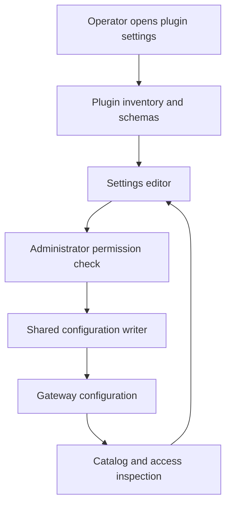

Codex review: blocked before merge. _Reviewed September 9, 2026, 5:18 PM ET / 21:18 UTC (Revision 35)._

# ClawSweeper review

## What this changes

Adds dedicated installed-plugin settings pages for schema-backed configuration, access inspection, and lifecycle actions, replacing overlapping administration views.

## Merge readiness

⛔ **Blocked before merge - 6 items remain**

Keep open: this remains useful, protected work that current main does not replace. Both previous P2 findings remain in the reviewed head; earlier host-control and editor-remount concerns are addressed.

**Priority:** P2
**Reviewed head:** `9f88dee44b72515ce17312832c5aa284d15294cd`
**Owner decision:** Required. See [Decision needed](#decision-needed).

## Review scores

| Measure | Result | What it means |
|---|---|---|
| **Overall readiness** | 🦐 gold shrimp **(3/6)** | Useful consolidation with visible UI proof, but two persistent correctness defects prevent merge readiness. |
| **Proof confidence** | 🐚 platinum hermit **(4/6)** ✨ media proof bonus | Sufficient (screenshot): Inspected before/after screenshots demonstrate the dedicated plugin detail presentation, breadcrumbs, switch, access summaries, and lifecycle layout. This preserves the visual proof assessment; it does not establish recovery, post-save grant freshness, or upgrade preservation, which remain separate repair and validation requirements. |
| **Patch quality** | 🦐 gold shrimp **(3/6)** | 2 actionable review findings remain. |

## Verification

| Check | Result | Evidence |
|---|---|---|
| **Real behavior** | Verified | Sufficient (screenshot): Inspected before/after screenshots demonstrate the dedicated plugin detail presentation, breadcrumbs, switch, access summaries, and lifecycle layout. This preserves the visual proof assessment; it does not establish recovery, post-save grant freshness, or upgrade preservation, which remain separate repair and validation requirements. |
| **Evidence reviewed** | 10 items | Pinned patch and live identity: The introduced comparison is 613b06f9e4312c956f7df16a21ec94e6596a30b5..9f88dee44b72515ce17312832c5aa284d15294cd. GitHub REST confirmed the PR remains open at that head. The supplied test merge is stale and was not used to infer removals from main. Read recovery still invokes write retry: The shared error callback invokes runtimeConfig.retry() and refreshSchema(). The configuration patch coordinator implements retry as a failed patch retry or save(); neither reloads a missing initial configuration snapshot. Submission without a snapshot hash fails, while a schema-only failure with a loaded snapshot can submit an unnecessary config.set. Configuration retry contract: The production retry owner falls back to save(), confirming that it is a mutation-recovery operation rather than a configuration-read retry. |
| **Findings** | 2 actionable findings | [P2] Retry configuration reads separately from failed writes [P2] Refresh inspection after saving host access controls |
| **Security** | None | None. |

## How this fits together

The Control UI reads plugin inventory, configuration schemas, and access inspections from the Gateway. Its settings pages send administrator edits through the shared configuration writer and display the resulting plugin state.

## Decision needed

| Question | Recommendation |
|---|---|
| After the two repairs and upgrade validation, may the foundation and settings layers land together under the stated Gate 1 boundary? | **Approve paired landing after repairs:** Accept the foundation and administration layers together once the defects, upgrade evidence, and foundation authorization are resolved. |

Why: The PR explicitly conditions landing on paired-stack approval and foundation dependency authorization; this review cannot supply that authorization.

## Before merge

- [ ] **Retry configuration reads separately from failed writes (P2)** - The previous finding remains. This callback handles initial `config.get` failures, but `runtimeConfig.retry()` retries a failed patch or calls `save()`. With no loaded snapshot, Try again cannot recover configuration and instead reaches the missing-hash failure; a schema-only failure can trigger an unnecessary write. Retry missing configuration and schema reads independently, preserve pending input, and reserve mutation retry for failed writes.
- [ ] **Refresh inspection after saving host access controls (P2)** - The previous finding remains. Saving a hook or model-access control refreshes only the catalog. Its completion handler skips `showDetails()` when the plugin ID is unchanged, while Access & capabilities still reads the old `detail.inspection.grants`. An operator can save Deny and continue seeing Allowed until leaving and reopening the page. Refresh the selected plugin's inspection after a successful save without unmounting the editor or discarding pending input.
- [ ] **Resolve merge risk (P1)** - Fresh defaults and preservation of v2026.9.3 host-control overrides remain unproven for the relocated editor; the supplied browser fixture does not exercise those controls.
- [ ] **Resolve merge risk (P1)** - The paired foundation/settings landing and foundation dependency authorization remain explicit approval conditions in the PR body.
- [ ] **Complete next step (P2)** - Fix read/write retry selection and post-save inspection refresh, validate inherited and existing host-control values, and obtain the stated paired-stack approval before landing.
- [ ] **Resolve maintainer decision** - Resolve the maintainer decision shown above before merge.

## Findings

- [P2] Retry configuration reads separately from failed writes — `ui/src/pages/plugins/plugins-page.ts:555-557`
- [P2] Refresh inspection after saving host access controls — `ui/src/pages/plugins/plugins-page.ts:200-202`

<strong>Agent review details</strong>

### Security

None.

### PR surface

Source -1087, Tests -654, Docs +1, Other -2. Total -1742 across 46 files.

View PR surface stats

| Area | Files | Added | Removed | Net |
|---|---:|---:|---:|---:|
| Source | 21 | 1434 | 2521 | -1087 |
| Tests | 21 | 1098 | 1752 | -654 |
| Docs | 2 | 17 | 16 | +1 |
| Config | 0 | 0 | 0 | 0 |
| Generated | 0 | 0 | 0 | 0 |
| Other | 2 | 0 | 2 | -2 |
| **Total** | **46** | **2549** | **4291** | **-1742** |

### Review metrics

None.

### Merge-risk options

**Maintainer options:**
1. **Verify relocated controls preserve existing intent (recommended)**  
   Cover fresh inherited values and released explicit overrides through save, retry, refresh, and reopen before approving the settings migration.
2. **Pause the paired landing**  
   Keep the stack open until its acceptance and foundation authorization conditions are satisfied.

### Technical review

Best possible solution:

Keep one schema-backed settings surface with operation-specific recovery, authoritative post-save access summaries, and verified preservation of existing overrides.

Do we have a high-confidence way to reproduce the issue?

Yes, from source: fail the initial config.get and select Try again, or save a hook grant while its detail page remains open. The reviewed callbacks cannot recover the first read or refresh the second inspection; no runtime tests were executed.

Is this the best way to solve the issue?

The shared schema editor and configuration writer are the right foundation, but the implementation still conflates read and write recovery and leaves access summaries stale.

Full review comments:

- [P2] Retry configuration reads separately from failed writes — `ui/src/pages/plugins/plugins-page.ts:555-557`
  The previous finding remains. This callback handles initial `config.get` failures, but `runtimeConfig.retry()` retries a failed patch or calls `save()`. With no loaded snapshot, Try again cannot recover configuration and instead reaches the missing-hash failure; a schema-only failure can trigger an unnecessary write. Retry missing configuration and schema reads independently, preserve pending input, and reserve mutation retry for failed writes.
  Confidence: 0.99
- [P2] Refresh inspection after saving host access controls — `ui/src/pages/plugins/plugins-page.ts:200-202`
  The previous finding remains. Saving a hook or model-access control refreshes only the catalog. Its completion handler skips `showDetails()` when the plugin ID is unchanged, while Access & capabilities still reads the old `detail.inspection.grants`. An operator can save Deny and continue seeing Allowed until leaving and reopening the page. Refresh the selected plugin's inspection after a successful save without unmounting the editor or discarding pending input.
  Confidence: 0.99

Overall correctness: patch is incorrect
Overall confidence: 0.98

AGENTS.md: found and applied where relevant.

Codex review notes: model internal, reasoning medium; reviewed against [30ce57e5e3f7](https://github.com/openclaw/openclaw/commit/30ce57e5e3f7533b2531d0cb3fd0a25f96c2b93a).

### Labels

Label justifications:

- `P2`: This is a bounded administration improvement with two reproducible source-level recovery and stale-display defects.
- `merge-risk: 🚨 compatibility`: Existing plugin controls move out of Automation, and preservation of released host-control overrides has not been demonstrated.
- `rating: 🦐 gold shrimp`: Overall readiness is 🦐 gold shrimp; proof is 🐚 platinum hermit and patch quality is 🦐 gold shrimp.
- `status: ⏳ waiting on author`: ClawSweeper has contributor-facing work open and is waiting for author action. Sufficient (screenshot): Inspected before/after screenshots demonstrate the dedicated plugin detail presentation, breadcrumbs, switch, access summaries, and lifecycle layout. This preserves the visual proof assessment; it does not establish recovery, post-save grant freshness, or upgrade preservation, which remain separate repair and validation requirements.
- `proof: sufficient`: Contributor real behavior proof is sufficient. Inspected before/after screenshots demonstrate the dedicated plugin detail presentation, breadcrumbs, switch, access summaries, and lifecycle layout. This preserves the visual proof assessment; it does not establish recovery, post-save grant freshness, or upgrade preservation, which remain separate repair and validation requirements.
- `proof: 📸 screenshot`: Contributor real behavior proof includes screenshot evidence. Inspected before/after screenshots demonstrate the dedicated plugin detail presentation, breadcrumbs, switch, access summaries, and lifecycle layout. This preserves the visual proof assessment; it does not establish recovery, post-save grant freshness, or upgrade preservation, which remain separate repair and validation requirements.

### Evidence

What I checked:

- **Pinned patch and live identity:** The introduced comparison is 613b06f9e4312c956f7df16a21ec94e6596a30b5..9f88dee44b72515ce17312832c5aa284d15294cd. GitHub REST confirmed the PR remains open at that head. The supplied test merge is stale and was not used to infer removals from main. ([9f88dee44b72](https://github.com/openclaw/openclaw/commit/9f88dee44b72515ce17312832c5aa284d15294cd))
- **Read recovery still invokes write retry:** The shared error callback invokes runtimeConfig.retry() and refreshSchema(). The configuration patch coordinator implements retry as a failed patch retry or save(); neither reloads a missing initial configuration snapshot. Submission without a snapshot hash fails, while a schema-only failure with a loaded snapshot can submit an unnecessary config.set. ([`ui/src/pages/plugins/plugins-page.ts:555`](https://github.com/openclaw/openclaw/blob/9f88dee44b72515ce17312832c5aa284d15294cd/ui/src/pages/plugins/plugins-page.ts#L555), [9f88dee44b72](https://github.com/openclaw/openclaw/commit/9f88dee44b72515ce17312832c5aa284d15294cd))
- **Configuration retry contract:** The production retry owner falls back to save(), confirming that it is a mutation-recovery operation rather than a configuration-read retry. ([`ui/src/lib/config/config-patch-coordinator.ts:63`](https://github.com/openclaw/openclaw/blob/9f88dee44b72515ce17312832c5aa284d15294cd/ui/src/lib/config/config-patch-coordinator.ts#L63), [9f88dee44b72](https://github.com/openclaw/openclaw/commit/9f88dee44b72515ce17312832c5aa284d15294cd))
- **Access inspection remains stale after saving:** Successful plugin autosave refreshes plugins.list. Catalog completion calls showDetails only when the selected plugin ID changes, so an already-open detail retains its previous inspection-backed effective grants. ([`ui/src/pages/plugins/plugins-page.ts:200`](https://github.com/openclaw/openclaw/blob/9f88dee44b72515ce17312832c5aa284d15294cd/ui/src/pages/plugins/plugins-page.ts#L200), [9f88dee44b72](https://github.com/openclaw/openclaw/commit/9f88dee44b72515ce17312832c5aa284d15294cd))
- **Regression coverage misses the failing recovery action:** The browser recovery test repairs config.get using Reload, whereas the displayed Try again button uses a different callback. The routing test mocks retry and refreshSchema and checks calls without exercising their production behavior. ([`ui/src/e2e/plugins-settings-admin.e2e.test.ts:677`](https://github.com/openclaw/openclaw/blob/9f88dee44b72515ce17312832c5aa284d15294cd/ui/src/e2e/plugins-settings-admin.e2e.test.ts#L677), [9f88dee44b72](https://github.com/openclaw/openclaw/commit/9f88dee44b72515ce17312832c5aa284d15294cd))
- **Current-main and released behavior:** Fetched main still renders the combined plugin administration view with the MCP controller. The v2026.9.3 configuration sections still place plugins under Automation. These checks do not establish a merged replacement for this dedicated settings implementation. ([`ui/src/pages/config/config-sections.ts:15`](https://github.com/openclaw/openclaw/blob/1391f7cd2d40ab5bbcf2f5f831d3a64f520e72d7/ui/src/pages/config/config-sections.ts#L15), [1391f7cd2d40](https://github.com/openclaw/openclaw/commit/1391f7cd2d40ab5bbcf2f5f831d3a64f520e72d7))

Likely related people:

- **Patrick-Erichsen:** Suggested for follow-up; no historical authorship or introduction is verified. (role: unverified routing candidate; confidence: low)
- **Peter Steinberger:** Suggested for follow-up; no historical authorship or introduction is verified. (role: unverified routing candidate; confidence: low)

### Rank-up moves

Optional improvements that raise the rating; they are not merge blockers.

- Exercise initial configuration-read failure, schema-read failure, and failed-save retry through the production configuration capability while preserving pending input.
- Verify that saving a host grant updates its inspection-backed summary without remounting the editor.
- Demonstrate fresh defaults and v2026.9.3 override preservation for the relocated host controls.

### Rating scale

| Score | Internal tier | Crab rank | Meaning |
|---:|:---:|---|---|
| **6/6** | S | 🦀 challenger crab | Exceptional readiness |
| **5/6** | A | 🦞 diamond lobster | Very strong readiness |
| **4/6** | B | 🐚 platinum hermit | Good normal PR; ordinary maintainer review |
| **3/6** | C | 🦐 gold shrimp | Useful, but confidence is limited |
| **2/6** | D | 🦪 silver shellfish | Proof or implementation needs work |
| **1/6** | F | 🧂 unranked krab | Not merge-ready |
| N/A | NA | 🌊 off-meta tidepool | Rating does not apply |

Overall follows the weaker of proof and patch quality.
Shiny media proof means a screenshot, video, or linked artifact directly shows the changed behavior. Runtime, network, CSP, and security claims still need visible diagnostics.

### Workflow

- ClawSweeper keeps one durable marker-backed review comment per issue or PR.
- Re-runs edit this comment so the latest verdict, findings, and automation markers stay together instead of adding duplicate bot comments.
- A fresh review can be triggered by eligible `@clawsweeper re-review` comments, exact-item GitHub events, scheduled/background review runs, or manual workflow dispatch.
- PR/issue authors and users with repository write access can comment `@clawsweeper re-review` or `@clawsweeper re-run` on an open PR or issue to request a fresh review only.
- Maintainers can also comment `@clawsweeper review` to request a fresh review only.
- Fresh-review commands do not start repair, autofix, rebase, CI repair, or automerge.
- Maintainer-only repair and merge flows require explicit commands such as `@clawsweeper autofix`, `@clawsweeper automerge`, `@clawsweeper fix ci`, or `@clawsweeper address review`.
- Maintainers can comment `@clawsweeper explain` to ask for more context, or `@clawsweeper stop` to stop active automation.

### History

Review history (34 earlier review cycles; latest 8 shown)

<!-- clawsweeper-review-history v=1 total=34 -->
- reviewed 2026-09-09T16:59:26.899Z sha ae20a91d42be98caf3c3973fd32eeac83320d138 :: blocked before merge. :: [P1] Preserve editable host controls when moving plugin settings | [P2] Retry the schema request when configuration loading fails | [P2] Retry failed saves without discarding the pending draft | [P2] Keep the editor mounted during post-autosave catalog refresh | [P3] Restore the unrelated route-table entries
- reviewed 2026-09-09T17:33:29.290Z sha a1e62c2653dbc6c9a84e143006d3943e4fbd7723 :: blocked before merge. :: [P1] Preserve editable host controls when moving plugin settings | [P2] Retry the schema request when configuration loading fails | [P2] Retry failed saves without discarding the pending draft | [P2] Keep the editor mounted during post-autosave catalog refresh | [P3] Restore the unrelated route-table entries
- reviewed 2026-09-09T18:10:31.392Z sha 6a2c92d3628559d9ff4004f60eea4431206f7cb0 :: blocked before merge. :: [P1] Preserve editable host controls when moving plugin settings | [P2] Retry the schema request when configuration loading fails | [P2] Retry failed saves without discarding the pending draft | [P2] Keep the editor mounted during post-autosave catalog refresh | [P3] Restore the unrelated route-table entries
- reviewed 2026-09-09T18:28:42.575Z sha bfc937e86ebf7d7d75dece1623f77add63ee9189 :: blocked before merge. :: [P1] Preserve editable host controls when moving plugin settings | [P2] Retry the schema request when configuration loading fails | [P2] Retry failed saves without discarding the pending draft | [P2] Keep the editor mounted during post-autosave catalog refresh | [P3] Restore the unrelated route-table entries
- reviewed 2026-09-09T18:41:58.993Z sha 55cd2926a020ccd6b89bc5530444169191d68557 :: blocked before merge. :: [P1] Preserve editable host controls when moving plugin settings | [P2] Retry the schema request when configuration loading fails | [P2] Retry failed saves without discarding the pending draft | [P2] Keep the editor mounted during post-autosave catalog refresh
- reviewed 2026-09-09T19:03:31.152Z sha f2936db1ec8a17e9835be69c4118cdc5b71269c7 :: blocked before merge. :: [P1] Preserve editable host controls when moving plugin settings | [P2] Retry the schema request when configuration loading fails | [P2] Retry failed saves without discarding the pending draft | [P2] Keep the editor mounted during post-autosave catalog refresh
- reviewed 2026-09-09T19:39:55.028Z sha 883f9e40483d2be49c81df909ee9a49781553124 :: blocked before merge. :: [P2] Retry configuration reads separately from failed writes | [P2] Refresh inspection after saving host access controls
- reviewed 2026-09-09T20:23:11.485Z sha 33c8aa83702c6fc1125bc9fdcc9172ea6c55c0cc :: blocked before merge. :: [P2] Retry configuration reads separately from failed writes | [P2] Refresh inspection after saving host access controls

<!-- clawsweeper-verdict:needs-human item=135840 sha=9f88dee44b72515ce17312832c5aa284d15294cd confidence=high updated_at=2026-09-09T21:15:09Z reviewed_at=2026-09-09T21:18:09.030Z lease_owner=github-run-34405707404-1 lease_comment_id=5608850221 source_revision=115fd60bd664a48a317225481efb3e182fd58e07a6ef88ed4490531acda1a774 live_verification=absent -->
<!-- clawsweeper-review-state:blocked item=135840 sha=9f88dee44b72515ce17312832c5aa284d15294cd v=1 -->

<!-- clawsweeper-review-version item=135840 reviewed_at=2026-09-09T21:18:09.030Z sha=9f88dee44b72515ce17312832c5aa284d15294cd source_revision=115fd60bd664a48a317225481efb3e182fd58e07a6ef88ed4490531acda1a774 lease_owner=github-run-34405707404-1 lease_comment_id=5608850221 v=1 -->

<!-- clawsweeper-review item=135840 -->