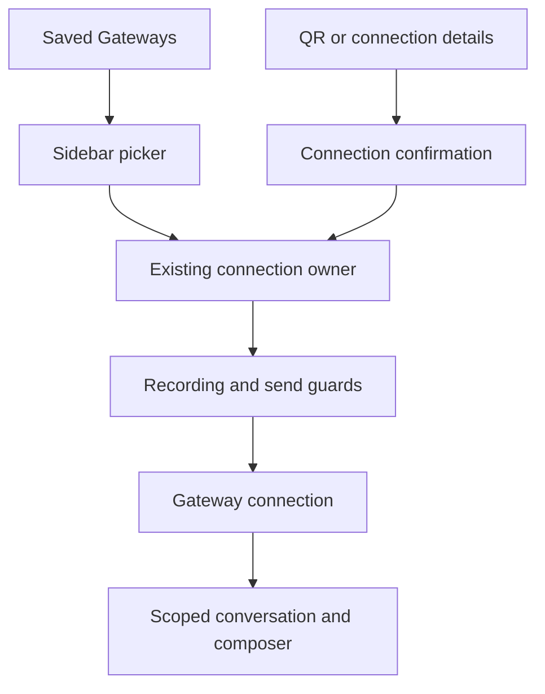

Codex review: blocked before merge. _Reviewed September 15, 2026, 10:55 PM ET / September 16, 2026, 02:55 UTC (Revision 15)._

# ClawSweeper review

## What this changes

Adds a searchable Android sidebar Gateway picker and cancellable connection dialog, protects conversation state during switching, and updates documentation and regression coverage.

## Merge readiness

⛔ **Blocked before merge - 3 items remain**

This remains useful Android work and is not superseded by current main or the merged iOS implementation. No blocking code defect was established; the previously identified installed-app acceptance gap remains.

**Priority:** P3
**Reviewed head:** `e90798f0c96eefcfb680a6fff5599b5b25155dff`

## Review scores

| Measure | Result | What it means |
|---|---|---|
| **Overall readiness** | 🦐 gold shrimp **(3/6)** | The implementation and focused coverage are useful, but native acceptance does not yet cover the complete changed behavior. |
| **Proof confidence** | 🦐 gold shrimp **(3/6)** | Not applicable: Real behavior proof is not required for maintainer- or bot-authored pull requests. |
| **Patch quality** | 🐚 platinum hermit **(4/6)** | No actionable review findings were identified. |

## Verification

| Check | Result | Evidence |
|---|---|---|
| **Real behavior** | Not applicable | Not applicable: Real behavior proof is not required for maintainer- or bot-authored pull requests. |
| **Evidence reviewed** | 9 items | Current main and release still lack the sidebar picker: Current main retains the status-only sidebar footer. The latest supplied release also renders connectionLabel rather than the new Gateway control. The Android request remains distinct from the merged iOS implementation. Release comparison: The v2026.9.4 sidebar contains the existing connectionLabel presentation; this check does not establish release inclusion of the proposed feature. Connection admission and saved credentials: The new dialog rejects stale requests, requires explicit confirmation, and selects an already saved endpoint without replacing its credentials. Quick switching delegates to the existing runtime and its lifecycle/audio admission guards. |
| **Findings** | None | None. |
| **Security** | None | None. |

## How this fits together

The Android companion app connects to saved OpenClaw Gateways for conversations and device capabilities. Sidebar selections and setup codes enter the existing connection runtime, which controls connection handoff and the active conversation.

## Before merge

- [ ] **Resolve merge risk (P1)** - The changed local-hydration handoff is not covered by installed-app recovery evidence using existing saved conversations; the screenshot fixture bypasses the production transcript cache.
- [ ] **Resolve merge risk (P1)** - The new camera/gallery dialog and keyboard-open search remain unverified on the installed Android app, as explicitly recorded in the PR body.
- [ ] **Complete next step (P2)** - Provide installed-app acceptance evidence for the new Add Gateway flow and recovery of an existing saved conversation before merge.

<strong>Agent review details</strong>

### Security

None.

### PR surface

Tests +956, Docs +19, Other +787. Total +1762 across 17 files.

View PR surface stats

| Area | Files | Added | Removed | Net |
|---|---:|---:|---:|---:|
| Source | 0 | 0 | 0 | 0 |
| Tests | 3 | 959 | 3 | +956 |
| Docs | 1 | 19 | 0 | +19 |
| Config | 0 | 0 | 0 | 0 |
| Generated | 0 | 0 | 0 | 0 |
| Other | 13 | 894 | 107 | +787 |
| **Total** | **17** | **1872** | **110** | **+1762** |

### Review metrics

| Metric | Value | Why it matters |
|---|---|---|
| **Production and test growth** | production +769 lines net; tests +956 lines net | Production growth principally adds native presentation while retaining the existing connection owner; tests cover admission, cancellation, ownership, and layout. |

### Root-cause cluster

Relationship: `fixed_by_candidate`
Canonical: https://github.com/openclaw/openclaw/issues/148205
Summary: This PR implements the open Android request; the merged iOS work is adjacent and does not supersede it.

Members:
- `canonical`: https://github.com/openclaw/openclaw/issues/148205 - The linked request defines the Android sidebar interaction and conversation-preservation requirements.
- `adjacent_distinct`: https://github.com/openclaw/openclaw/pull/146641 - Merged iOS implementation with separate platform code and draft-switching behavior.

Proposal only: this assessment does not dispatch repair, suppress jobs, mutate sibling items, close, or merge anything.

### Merge-risk options

**Maintainer options:**
1. **Verify existing conversation recovery (recommended)**  
   Provide installed-app evidence that switching away and back restores the correct cached conversation, draft, and attachments before accepting the changed hydration handoff.

### Technical review

Best possible solution:

Keep the existing connection and composer owners, with native acceptance demonstrating that new and existing Gateway setups preserve conversation state.

Do we have a high-confidence way to reproduce the issue?

Not applicable: this is a navigation feature request, and current main still has the status-only sidebar footer.

Is this the best way to solve the issue?

Yes, the implementation extends the existing connection runtime and composer ownership rather than adding competing state; native acceptance remains necessary to validate the platform-dependent paths.

AGENTS.md: found and applied where relevant.

Codex review notes: model internal, reasoning medium; reviewed against [b68264d1d7c3](https://github.com/openclaw/openclaw/commit/b68264d1d7c3a62c4edf010b16e043622867418f).

### Labels

Label changes:

- add `merge-risk: 🚨 session-state`: The patch changes when conversation hydration releases handoff protection, but its fixture omits the production transcript cache.
- remove `proof: 📸 screenshot`: Current real behavior proof evidence kind is not_applicable.

Label justifications:

- `P3`: This improves optional multi-Gateway navigation; the existing Settings workflow remains available.
- `merge-risk: 🚨 session-state`: The patch changes when conversation hydration releases handoff protection, but its fixture omits the production transcript cache.
- `rating: 🦐 gold shrimp`: Overall readiness is 🦐 gold shrimp; proof is 🦐 gold shrimp and patch quality is 🐚 platinum hermit.
- `status: 👀 ready for maintainer look`: ClawSweeper has no concrete contributor-facing blocker left for this PR. Not applicable: Real behavior proof is not required for maintainer- or bot-authored pull requests.

### Evidence

What I checked:

- **Current main and release still lack the sidebar picker:** Current main retains the status-only sidebar footer. The latest supplied release also renders connectionLabel rather than the new Gateway control. The Android request remains distinct from the merged iOS implementation. ([`apps/android/app/src/main/java/ai/openclaw/app/ui/SidebarContent.kt:943`](https://github.com/openclaw/openclaw/blob/b68264d1d7c3a62c4edf010b16e043622867418f/apps/android/app/src/main/java/ai/openclaw/app/ui/SidebarContent.kt#L943), [b68264d1d7c3](https://github.com/openclaw/openclaw/commit/b68264d1d7c3a62c4edf010b16e043622867418f))
- **Release comparison:** The v2026.9.4 sidebar contains the existing connectionLabel presentation; this check does not establish release inclusion of the proposed feature. ([`apps/android/app/src/main/java/ai/openclaw/app/ui/SidebarContent.kt:950`](https://github.com/openclaw/openclaw/blob/3a9d69db306cd7f081e06254cb89c4bcc14a7107/apps/android/app/src/main/java/ai/openclaw/app/ui/SidebarContent.kt#L950), [3a9d69db306c](https://github.com/openclaw/openclaw/commit/3a9d69db306cd7f081e06254cb89c4bcc14a7107))
- **Connection admission and saved credentials:** The new dialog rejects stale requests, requires explicit confirmation, and selects an already saved endpoint without replacing its credentials. Quick switching delegates to the existing runtime and its lifecycle/audio admission guards. ([`apps/android/app/src/main/java/ai/openclaw/app/MainViewModel.kt:813`](https://github.com/openclaw/openclaw/blob/e90798f0c96eefcfb680a6fff5599b5b25155dff/apps/android/app/src/main/java/ai/openclaw/app/MainViewModel.kt#L813), [e90798f0c96e](https://github.com/openclaw/openclaw/commit/e90798f0c96eefcfb680a6fff5599b5b25155dff))
- **Production cache recovery differs from the screenshot fixture:** The introduced handoff waits for local chat restoration. Live ChatController receives the transcript cache and dynamic Gateway scope, while ScreenshotFixture omits that cache and supplies a fixed scope. The fixture coverage therefore cannot establish recovery of existing persisted conversations. ([`apps/android/app/src/main/java/ai/openclaw/app/NodeRuntime.kt:2183`](https://github.com/openclaw/openclaw/blob/e90798f0c96eefcfb680a6fff5599b5b25155dff/apps/android/app/src/main/java/ai/openclaw/app/NodeRuntime.kt#L2183), [e90798f0c96e](https://github.com/openclaw/openclaw/commit/e90798f0c96eefcfb680a6fff5599b5b25155dff))
- **Captured proof and complete body identity:** Read the full GitHub body and verified SHA-256 5c962ff99380b9037da3b4d6a75618a66c76d5924a31bf64ee06a2731885d352, matching the supplied snapshot. Inspected all four prepared images: settings before, scanner entry after, explicit confirmation, and retained selection after cancellation. The body and https://github.com/openclaw/openclaw/pull/148209#issuecomment-5686787980 identify these as Compose/Robolectric captures and expressly leave installed-app camera/gallery and conversation recovery unproven. Earlier phone media remains supporting historical evidence; it was not included in the prepared manifest. ([e90798f0c96e](https://github.com/openclaw/openclaw/commit/e90798f0c96eefcfb680a6fff5599b5b25155dff))
- **Review continuity and introduction boundary:** The previous completed review examined this same head and recorded no findings plus one installed-app evidence request. The independently inspected merge-base-to-head diff preserves that assessment. The stale test-merge record cannot establish removal of current-main work; base-only Codex and update tests are excluded from PR ownership. ([e90798f0c96e](https://github.com/openclaw/openclaw/commit/e90798f0c96eefcfb680a6fff5599b5b25155dff))

Likely related people:

- **unknown:** The claimed source-line change could not be verified from bounded local history. (role: source history unknown; confidence: low)
- **vincentkoc:** Suggested for follow-up; no historical authorship or introduction is verified. (role: unverified routing candidate; confidence: low)

### Rank-up moves

Optional improvements that raise the rating; they are not merge blockers.

- Add installed-app evidence for Add Gateway camera/gallery confirmation and cancellation, plus recovery of an existing saved conversation with its draft and attachments; redact private details.
- Update the PR body with the evidence and retain inspected before/after screenshots in the originating chat and PR; the update should trigger review, or a maintainer can request @clawsweeper re-review.

### Rating scale

| Score | Internal tier | Crab rank | Meaning |
|---:|:---:|---|---|
| **6/6** | S | 🦀 challenger crab | Exceptional readiness |
| **5/6** | A | 🦞 diamond lobster | Very strong readiness |
| **4/6** | B | 🐚 platinum hermit | Good normal PR; ordinary maintainer review |
| **3/6** | C | 🦐 gold shrimp | Useful, but confidence is limited |
| **2/6** | D | 🦪 silver shellfish | Proof or implementation needs work |
| **1/6** | F | 🧂 unranked krab | Not merge-ready |
| N/A | NA | 🌊 off-meta tidepool | Rating does not apply |

Overall follows the weaker of proof and patch quality.
Shiny media proof means a screenshot, video, or linked artifact directly shows the changed behavior. Runtime, network, CSP, and security claims still need visible diagnostics.

### Workflow

- ClawSweeper keeps one durable marker-backed review comment per issue or PR.
- Re-runs edit this comment so the latest verdict, findings, and automation markers stay together instead of adding duplicate bot comments.
- A fresh review can be triggered by eligible `@clawsweeper re-review` comments, exact-item GitHub events, scheduled/background review runs, or manual workflow dispatch.
- PR/issue authors and users with repository write access can comment `@clawsweeper re-review` or `@clawsweeper re-run` on an open PR or issue to request a fresh review only.
- Maintainers can also comment `@clawsweeper review` to request a fresh review only.
- Fresh-review commands do not start repair, autofix, rebase, CI repair, or automerge.
- Maintainer-only repair and merge flows require explicit commands such as `@clawsweeper autofix`, `@clawsweeper automerge`, `@clawsweeper fix ci`, or `@clawsweeper address review`.
- Maintainers can comment `@clawsweeper explain` to ask for more context, or `@clawsweeper stop` to stop active automation.

### History

Review history (14 earlier review cycles; latest 8 shown)

<!-- clawsweeper-review-history v=1 total=14 -->
- reviewed 2026-09-15T13:10:14.495Z sha 3153a1c366c6a7a281291c73c7cf3502fc049d7a :: blocked before merge. :: none
- reviewed 2026-09-15T13:35:30.980Z sha 3153a1c366c6a7a281291c73c7cf3502fc049d7a :: blocked before merge. :: none
- reviewed 2026-09-15T14:53:23.929Z sha 3153a1c366c6a7a281291c73c7cf3502fc049d7a :: blocked before merge. :: none
- reviewed 2026-09-15T16:48:10.497Z sha a200b48aa0c418e89507896380f215bf998ae27a :: blocked before merge. :: none
- reviewed 2026-09-15T19:41:17.063Z sha 7e58451ce095458390727fe6e9eb53ffe71bf9ed :: blocked before merge. :: none
- reviewed 2026-09-15T22:41:57.806Z sha 6129e6d77dbf1d306827bef74aaa35d843fdfa5c :: blocked before merge. :: none
- reviewed 2026-09-16T00:18:14.993Z sha 802de6dd70becbd62800f20a357844bfbc042501 :: needs maintainer review before merge. :: none
- reviewed 2026-09-16T02:20:18.180Z sha e90798f0c96eefcfb680a6fff5599b5b25155dff :: blocked before merge. :: none

<!-- clawsweeper-verdict:needs-human item=148209 sha=e90798f0c96eefcfb680a6fff5599b5b25155dff confidence=high updated_at=2026-09-16T02:52:09Z reviewed_at=2026-09-16T02:55:35.689Z lease_owner=github-run-35049514011-1 lease_comment_id=5691324837 source_revision=af526ee212b35c94a3423e3a50307996ca8eeaf815156c2ed3b7c456514ed86c live_verification=absent -->
<!-- clawsweeper-review-state:blocked item=148209 sha=e90798f0c96eefcfb680a6fff5599b5b25155dff v=1 -->

<!-- clawsweeper-review-version item=148209 reviewed_at=2026-09-16T02:55:35.689Z sha=e90798f0c96eefcfb680a6fff5599b5b25155dff source_revision=af526ee212b35c94a3423e3a50307996ca8eeaf815156c2ed3b7c456514ed86c lease_owner=github-run-35049514011-1 lease_comment_id=5691324837 v=1 -->

<!-- clawsweeper-review item=148209 -->