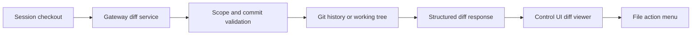

Codex review: needs changes before merge. _Reviewed August 12, 2026, 4:07 AM ET / 08:07 UTC._

# ClawSweeper review

## What this changes

Adds selectable session-diff scopes plus a richer Control UI viewer with file actions, sync instructions, and persisted layout controls.

## Merge readiness

⚠️ **Ready for maintainer review - 2 items remain**

Keep open: the prior commit-history boundary finding is fixed, but commit-scoped file actions still open the live working tree rather than the selected historical revision.

**Priority:** P2
**Reviewed head:** `7b2934bc8c836260f736b79a38ba2cbebbcde1cf`

## Review scores

| Measure | Result | What it means |
|---|---|---|
| **Overall readiness** | 🦐 gold shrimp **(3/6)** | Useful, well-evidenced feature work with one bounded correctness issue in historical file actions. |
| **Proof confidence** | 🌊 off-meta tidepool | Not applicable: This member-authored PR is exempt from the external-contributor proof gate; its body nevertheless includes UI screenshots and mock-Gateway browser evidence. |
| **Patch quality** | 🦐 gold shrimp **(3/6)** | 1 actionable review finding remain. |

## Verification

| Check | Result | Evidence |
|---|---|---|
| **Real behavior** | Not applicable | Not applicable: This member-authored PR is exempt from the external-contributor proof gate; its body nevertheless includes UI screenshots and mock-Gateway browser evidence. |
| **Evidence reviewed** | 7 items | Current main behavior: Current main has a single no-argument diff loader, so it does not already provide the proposed commit and uncommitted scopes. Historical diff fence: The PR resolves a commit and permits it only when it is reachable from HEAD but not from the resolved merge base, then diffs its parent-to-commit object range. Prior finding regression coverage: Real temporary-git-repository coverage accepts a feature commit and rejects sibling, merge-base, and invalid commits with unknown_commit. |
| **Findings** | 1 actionable finding | [P2] Disable working-tree actions in commit scope |
| **Security** | None | None. |

## How this fits together

The Control UI requests a session checkout diff from the Gateway and renders its files in the chat sidebar. The Gateway selects either working-tree state or a fenced commit diff before returning the result.

## Before merge

- [ ] **Disable working-tree actions in commit scope (P2)** - Commit diffs are read from the selected Git object, but these actions pass only a path to the live workspace reader/editor. A file deleted by that commit cannot open, and a file changed later opens HEAD rather than the revision being displayed. Hide those actions for commit scope, or add a revision-aware reader behind the same history fence.
- [ ] **Complete next step (P2)** - A narrow UI guard and browser regression test can repair the remaining mismatch without changing the Gateway protocol.

## Findings

- [P2] Disable working-tree actions in commit scope — `ui/src/pages/chat/components/session-diff-panel.ts:230-237`

<strong>Agent review details</strong>

### Security

None.

### PR surface

Source +1286, Tests +222, Docs 0, Generated 0, Other +44. Total +1552 across 40 files.

View PR surface stats

| Area | Files | Added | Removed | Net |
|---|---:|---:|---:|---:|
| Source | 15 | 1444 | 158 | +1286 |
| Tests | 4 | 263 | 41 | +222 |
| Docs | 1 | 1 | 1 | 0 |
| Config | 0 | 0 | 0 | 0 |
| Generated | 19 | 19 | 19 | 0 |
| Other | 1 | 45 | 1 | +44 |
| **Total** | **40** | **1772** | **220** | **+1552** |

### Review metrics

| Metric | Value | Why it matters |
|---|---|---|
| **Production versus test LOC** | production +1,489/-159 (net +1,330); tests +263/-41 (net +222); generated/docs net 0 | The substantial feature growth is purposeful, but the historical-action boundary needs correction before merge. |
| **Gateway protocol surface** | 1 optional scope parameter, 1 optional commit selector, 3 optional response metadata fields | The additive contract preserves existing callers while exposing scope and branch metadata to the Control UI. |

### Stored data model

Persistent data-model change detected: `serialized state: packages/gateway-protocol/src/schema/sessions.ts`, `serialized state: src/gateway/server-methods/sessions-diff.test.ts`, `serialized state: src/gateway/server-methods/sessions-diff.ts`, `serialized state: src/sessions/session-diff-revisions.ts`, `serialized state: src/sessions/session-diff.ts`, `serialized state: ui/src/lib/chat/session-diff-split.test.ts`, and 12 more. Confirm migration or upgrade compatibility proof before merge.

### Technical review

Best possible solution:

In commit scope, hide working-tree-only actions while retaining Copy Path, and add a browser regression test; introduce a revision-aware file API only if historic file opening is explicitly required.

Do we have a high-confidence way to reproduce the issue?

Yes, source-reproducible: select a commit that deletes a file or predates a later edit, then choose a file action; the action reads the live workspace path rather than the selected commit.

Is this the best way to solve the issue?

No. The object-database diff is correctly revision-scoped, but its working-tree file actions contradict that scope; hide them for commit views unless a fenced revision reader is deliberately added.

Full review comments:

- [P2] Disable working-tree actions in commit scope — `ui/src/pages/chat/components/session-diff-panel.ts:230-237`
  Commit diffs are read from the selected Git object, but these actions pass only a path to the live workspace reader/editor. A file deleted by that commit cannot open, and a file changed later opens HEAD rather than the revision being displayed. Hide those actions for commit scope, or add a revision-aware reader behind the same history fence.
  Confidence: 0.98

Overall correctness: patch is incorrect
Overall confidence: 0.98

AGENTS.md: found and applied where relevant.

Codex review notes: model internal, reasoning high; reviewed against [5a643e354310](https://github.com/openclaw/openclaw/commit/5a643e35431061f7bcbfcdb338d33441ec45bd92).

### Labels

Label changes:

- add `P2`: Commit-scoped actions can show live workspace content or fail for deleted historical files, a bounded but user-visible correctness defect.
- remove `P1`: Current review triage priority is P2, so this older priority label is no longer current.
- remove `merge-risk: 🚨 security-boundary`: Current PR review selected no merge-risk labels.

Label justifications:

- `P2`: Commit-scoped actions can show live workspace content or fail for deleted historical files, a bounded but user-visible correctness defect.
- `rating: 🦐 gold shrimp`: Overall readiness is 🦐 gold shrimp; proof is 🌊 off-meta tidepool and patch quality is 🦐 gold shrimp.
- `status: ⏳ waiting on author`: ClawSweeper has contributor-facing work open and is waiting for author action. Not applicable: This member-authored PR is exempt from the external-contributor proof gate; its body nevertheless includes UI screenshots and mock-Gateway browser evidence.

### Evidence

Acceptance criteria:

- [P1] node scripts/run-vitest.mjs ui/src/e2e/chat-session-diff.e2e.test.ts.
- [P1] node scripts/run-vitest.mjs src/gateway/server-methods/sessions-diff.test.ts.

What I checked:

- **Current main behavior:** Current main has a single no-argument diff loader, so it does not already provide the proposed commit and uncommitted scopes. ([`src/gateway/server-methods/sessions-diff.ts:54`](https://github.com/openclaw/openclaw/blob/5a643e354310/src/gateway/server-methods/sessions-diff.ts#L54), [5a643e354310](https://github.com/openclaw/openclaw/commit/5a643e354310))
- **Historical diff fence:** The PR resolves a commit and permits it only when it is reachable from HEAD but not from the resolved merge base, then diffs its parent-to-commit object range. ([`src/sessions/session-diff.ts:424`](https://github.com/openclaw/openclaw/blob/7b2934bc8c83/src/sessions/session-diff.ts#L424), [7b2934bc8c83](https://github.com/openclaw/openclaw/commit/7b2934bc8c83))
- **Prior finding regression coverage:** Real temporary-git-repository coverage accepts a feature commit and rejects sibling, merge-base, and invalid commits with unknown_commit. ([`src/gateway/server-methods/sessions-diff.test.ts:219`](https://github.com/openclaw/openclaw/blob/7b2934bc8c83/src/gateway/server-methods/sessions-diff.test.ts#L219), [7b2934bc8c83](https://github.com/openclaw/openclaw/commit/7b2934bc8c83))
- **File-action mismatch:** The panel dispatches Open File and Open in Editor with only a path, while its loader sends scope only to sessions.diff; no revision is carried to the file reader. ([`ui/src/pages/chat/components/session-diff-panel.ts:230`](https://github.com/openclaw/openclaw/blob/7b2934bc8c83/ui/src/pages/chat/components/session-diff-panel.ts#L230), [7b2934bc8c83](https://github.com/openclaw/openclaw/commit/7b2934bc8c83))
- **Live-workspace file contract:** sessions.files.get accepts only sessionKey, path, and agentId, then resolves and reads the current session workspace, not a Git revision. ([`src/gateway/server-methods/sessions-files.ts:792`](https://github.com/openclaw/openclaw/blob/7b2934bc8c83/src/gateway/server-methods/sessions-files.ts#L792), [7b2934bc8c83](https://github.com/openclaw/openclaw/commit/7b2934bc8c83))
- **Git contract:** Installed Git 2.52 documents merge-base --is-ancestor and two-commit diff forms used by the fenced commit path. ([`src/sessions/session-diff.ts:427`](https://github.com/openclaw/openclaw/blob/7b2934bc8c83/src/sessions/session-diff.ts#L427), [7b2934bc8c83](https://github.com/openclaw/openclaw/commit/7b2934bc8c83))

Likely related people:

- **steipete:** Current-main blame assigns the existing session-diff owner path to this contributor, who also authored the feature and its boundary repair. (role: current area owner and recent contributor; confidence: high; commits: [b82ad646a515](https://github.com/openclaw/openclaw/commit/b82ad646a5151e5fb6378e72dbbe257fd5012813), [871bc1f2c410](https://github.com/openclaw/openclaw/commit/871bc1f2c4109503151c1b7e0a24ff0ca68b9165), [7b2934bc8c83](https://github.com/openclaw/openclaw/commit/7b2934bc8c836260f736b79a38ba2cbebbcde1cf); files: `src/sessions/session-diff.ts`, `src/gateway/server-methods/sessions-diff.ts`, `ui/src/pages/chat/components/session-diff-panel.ts`)

### Rank-up moves

Optional improvements that raise the rating; they are not merge blockers.

- Hide Open File, Reveal, and Open in Editor while a commit scope is active, then cover that behavior in the session-diff browser test.

### Rating scale

| Score | Internal tier | Crab rank | Meaning |
|---:|:---:|---|---|
| **6/6** | S | 🦀 challenger crab | Exceptional readiness |
| **5/6** | A | 🦞 diamond lobster | Very strong readiness |
| **4/6** | B | 🐚 platinum hermit | Good normal PR; ordinary maintainer review |
| **3/6** | C | 🦐 gold shrimp | Useful, but confidence is limited |
| **2/6** | D | 🦪 silver shellfish | Proof or implementation needs work |
| **1/6** | F | 🧂 unranked krab | Not merge-ready |
| N/A | NA | 🌊 off-meta tidepool | Rating does not apply |

Overall follows the weaker of proof and patch quality.
Shiny media proof means a screenshot, video, or linked artifact directly shows the changed behavior. Runtime, network, CSP, and security claims still need visible diagnostics.

### Workflow

- ClawSweeper keeps one durable marker-backed review comment per issue or PR.
- Re-runs edit this comment so the latest verdict, findings, and automation markers stay together instead of adding duplicate bot comments.
- A fresh review can be triggered by eligible `@clawsweeper re-review` comments, exact-item GitHub events, scheduled/background review runs, or manual workflow dispatch.
- PR/issue authors and users with repository write access can comment `@clawsweeper re-review` or `@clawsweeper re-run` on an open PR or issue to request a fresh review only.
- Maintainers can also comment `@clawsweeper review` to request a fresh review only.
- Fresh-review commands do not start repair, autofix, rebase, CI repair, or automerge.
- Maintainer-only repair and merge flows require explicit commands such as `@clawsweeper autofix`, `@clawsweeper automerge`, `@clawsweeper fix ci`, or `@clawsweeper address review`.
- Maintainers can comment `@clawsweeper explain` to ask for more context, or `@clawsweeper stop` to stop active automation.

### History

Review history (2 earlier review cycles)

<!-- clawsweeper-review-history v=1 total=2 -->
- reviewed 2026-08-12T06:05:38.264Z sha ad965fe1c9e23598ee45a026c216a01ea766bd1d :: found issues before merge. :: [P1] Fence commit diffs to the session history
- reviewed 2026-08-12T07:18:53.973Z sha a42c74252b40e2aa59d3b65347867dbf80e38a7f :: found issues before merge. :: [P1] Fence commit diffs to the advertised session history

<!-- clawsweeper-verdict:needs-human item=122470 sha=7b2934bc8c836260f736b79a38ba2cbebbcde1cf confidence=high updated_at=2026-08-12T08:01:07Z reviewed_at=2026-08-12T08:07:30.718Z lease_owner=github-run-31576152821-1 lease_comment_id=5263984499 source_revision=162af704acfea7484328f300f9ed41628e0bcf3b27cda5bf7768776f2bea51c5 -->

<!-- clawsweeper-review-version item=122470 reviewed_at=2026-08-12T08:07:30.718Z sha=7b2934bc8c836260f736b79a38ba2cbebbcde1cf source_revision=162af704acfea7484328f300f9ed41628e0bcf3b27cda5bf7768776f2bea51c5 lease_owner=github-run-31576152821-1 lease_comment_id=5263984499 v=1 -->

<!-- clawsweeper-review item=122470 -->