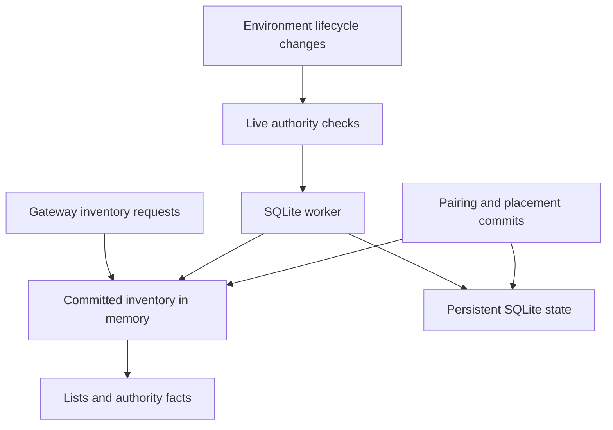

Codex review: blocked before merge. _Reviewed September 21, 2026, 7:25 PM ET / 23:25 UTC (Revision 8)._

# ClawSweeper review

## What this changes

Moves worker inventory reads and mutations into background database workers, publishes committed records into memory, and updates lifecycle callers to await completion.

## Merge readiness

⛔ **Blocked before merge - 2 items remain**

This optimization remains useful: current main and the latest release still execute inventory queries synchronously. No blocking introduced defect was found, and the prior config/default warning is unsupported by the shrink-only baseline changes.

**Priority:** P2
**Reviewed head:** `33dcf4dc067c3ce820bb39425ce0408e97570e4f`

## Review scores

| Measure | Result | What it means |
|---|---|---|
| **Overall readiness** | 🐚 platinum hermit **(4/6)** | A coherent optimization with measured gains, meaningful boundary proof, and no remaining actionable finding. |
| **Proof confidence** | 🦞 diamond lobster **(5/6)** ✨ media proof bonus | Sufficient (linked_artifact): Recorded Testbox proof exercises the real inventory broker and HTTP transfer path across delayed committed publication: valid transfers return exact bytes and revocation prevents response headers. Pairing recovery and registered inference checks cover the related authority consumers; no live deployment is claimed. |
| **Patch quality** | 🐚 platinum hermit **(4/6)** | No actionable review findings were identified. |

## Verification

| Check | Result | Evidence |
|---|---|---|
| **Real behavior** | Verified | Sufficient (linked_artifact): Recorded Testbox proof exercises the real inventory broker and HTTP transfer path across delayed committed publication: valid transfers return exact bytes and revocation prevents response headers. Pairing recovery and registered inference checks cover the related authority consumers; no live deployment is claimed. |
| **Evidence reviewed** | 10 items | Pinned introduction and merge ownership: Reviewed the introduced delta from d3e512906b63ca2ba9107aae99cf648ac817deaa to 33dcf4dc067c3ce820bb39425ce0408e97570e4f. Raw test-merge metadata confirms b9421f4fa69f10404d21c5d55d07fdb0e86dff16 followed by the pinned head as its parents; base-only workflow changes were not attributed to this PR. Still necessary on main: At the fetched main revision, list and listForReconcile still call listRows through the synchronous SQLite reader. The inventory store is unchanged between the pinned merge base and fetched main. Latest release retains the original path: GitHub contents inspection of v2026.9.5 confirms synchronous inventory queries and listForReconcile calling listRows; release metadata reports publication on September 19, 2026. |
| **Findings** | None | None. |
| **Security** | None | None. |

## How this fits together

The Gateway uses worker inventory to provision remote environments, authorize credentials and transfers, and reconcile cleanup. SQLite remains authoritative; committed in-memory records serve Gateway reads.

## Before merge

- [ ] **Review config compatibility** - Confirm compatibility and upgrade impact for the changed config or default surface before merge.
- [ ] **Add data-model compatibility proof** - Confirm migration or upgrade compatibility proof before merge.

<strong>Agent review details</strong>

### Security

None.

### PR surface

PR surface statistics unavailable: the file list is incomplete.

### Review metrics

| Metric | Value | Why it matters |
|---|---|---|
| **Production versus test growth** | Production net +1,989 lines; tests and support net +2,685 lines | The growth has a concrete justification: committed projection ownership, asynchronous publication and recovery, and boundary regressions. |
| **Recorded inventory benchmark** | 5,000 environments: list CPU −62.9%; reconcile-selection CPU −56.0% | The same-lease comparison reports identical serialized results and measures the intended main-thread reduction. |

### Stored data model

Persistent data-model change detected: `unknown-truncated-pull-files`. Confirm migration or upgrade compatibility proof before merge.

### Technical review

Best possible solution:

Keep one committed inventory projection backed by the existing SQLite workers, preserving live authority, atomic parent transactions, and recovery without changing stored contracts.

Do we have a high-confidence way to reproduce the issue?

Yes, from source: current-main inventory listing directly executes synchronous SQLite queries, and the PR records a matched 5,000-environment benchmark. This review did not rerun it.

Is this the best way to solve the issue?

Yes. Reusing the existing database workers and publishing through one inventory owner addresses the blocking work while retaining transactional authority and stored compatibility.

AGENTS.md: found and applied where relevant.

Codex review notes: model internal, reasoning medium; reviewed against [06ce6c415dd2](https://github.com/openclaw/openclaw/commit/06ce6c415dd293f139181085c9518abe5d47ce36).

### Labels

Label justifications:

- `P2`: A measured Gateway responsiveness improvement for large worker inventories, without evidence of an urgent user-facing outage.
- `rating: 🐚 platinum hermit`: Overall readiness is 🐚 platinum hermit; proof is 🦞 diamond lobster and patch quality is 🐚 platinum hermit.
- `status: 👀 ready for maintainer look`: ClawSweeper has no concrete contributor-facing blocker left for this PR. Sufficient (linked_artifact): Recorded Testbox proof exercises the real inventory broker and HTTP transfer path across delayed committed publication: valid transfers return exact bytes and revocation prevents response headers. Pairing recovery and registered inference checks cover the related authority consumers; no live deployment is claimed.
- `proof: sufficient`: Contributor real behavior proof is sufficient. Recorded Testbox proof exercises the real inventory broker and HTTP transfer path across delayed committed publication: valid transfers return exact bytes and revocation prevents response headers. Pairing recovery and registered inference checks cover the related authority consumers; no live deployment is claimed.

### Evidence

What I checked:

- **Pinned introduction and merge ownership:** Reviewed the introduced delta from d3e512906b63ca2ba9107aae99cf648ac817deaa to 33dcf4dc067c3ce820bb39425ce0408e97570e4f. Raw test-merge metadata confirms b9421f4fa69f10404d21c5d55d07fdb0e86dff16 followed by the pinned head as its parents; base-only workflow changes were not attributed to this PR. ([33dcf4dc067c](https://github.com/openclaw/openclaw/commit/33dcf4dc067c3ce820bb39425ce0408e97570e4f))
- **Still necessary on main:** At the fetched main revision, list and listForReconcile still call listRows through the synchronous SQLite reader. The inventory store is unchanged between the pinned merge base and fetched main. ([`src/gateway/worker-environments/store.ts:939`](https://github.com/openclaw/openclaw/blob/06ce6c415dd293f139181085c9518abe5d47ce36/src/gateway/worker-environments/store.ts#L939), [06ce6c415dd2](https://github.com/openclaw/openclaw/commit/06ce6c415dd293f139181085c9518abe5d47ce36))
- **Latest release retains the original path:** GitHub contents inspection of v2026.9.5 confirms synchronous inventory queries and listForReconcile calling listRows; release metadata reports publication on September 19, 2026. ([`src/gateway/worker-environments/store.ts:972`](https://github.com/openclaw/openclaw/blob/ec9c1a13db8938e5a3eaa51fca2e981cde2395a9/src/gateway/worker-environments/store.ts#L972), [ec9c1a13db89](https://github.com/openclaw/openclaw/commit/ec9c1a13db8938e5a3eaa51fca2e981cde2395a9))
- **Authority and publication ordering:** Mutations serialize through the projection owner, recheck caller authority at transaction and commit admission, fence changed bindings, and install acknowledged facts before notifications. Lost outcomes recover receipts or reconcile rows without replaying writes. ([`src/gateway/worker-environments/store.ts:159`](https://github.com/openclaw/openclaw/blob/33dcf4dc067c3ce820bb39425ce0408e97570e4f/src/gateway/worker-environments/store.ts#L159), [33dcf4dc067c](https://github.com/openclaw/openclaw/commit/33dcf4dc067c3ce820bb39425ce0408e97570e4f))
- **Earlier functional findings addressed:** Record-authority digests exclude only diagnostic fields; transfer equality preserves the existing independent capability lifetime. Pairing receipts publish environment bindings on the host before observers, including lost-result recovery. Extracted inventory helpers use distinct names. ([`src/gateway/worker-environments/store-commit-authority.ts:9`](https://github.com/openclaw/openclaw/blob/33dcf4dc067c3ce820bb39425ce0408e97570e4f/src/gateway/worker-environments/store-commit-authority.ts#L9), [33dcf4dc067c](https://github.com/openclaw/openclaw/commit/33dcf4dc067c3ce820bb39425ce0408e97570e4f))
- **Config and upgrade warning resolved:** The two config changes remove obsolete static-analysis exemptions. No operator setting, default, durable schema, or serialized record format changes. Store schema edits make initialization bookkeeping rollback-aware; documented reopening waits for inventory admission. Public docs: [`docs/reference/database-schemas/storage-changes.md`](https://docs.openclaw.ai/reference/database-schemas/storage-changes). ([`docs/reference/database-schemas/storage-changes.md:36`](https://docs.openclaw.ai/reference/database-schemas/storage-changes), [33dcf4dc067c](https://github.com/openclaw/openclaw/commit/33dcf4dc067c3ce820bb39425ce0408e97570e4f))

Likely related people:

- **steipete:** Suggested for follow-up; no historical authorship or introduction is verified. (role: unverified routing candidate; confidence: low)
- **eleqtrizit:** Suggested for follow-up; no historical authorship or introduction is verified. (role: unverified routing candidate; confidence: low)

### Rating scale

| Score | Internal tier | Crab rank | Meaning |
|---:|:---:|---|---|
| **6/6** | S | 🦀 challenger crab | Exceptional readiness |
| **5/6** | A | 🦞 diamond lobster | Very strong readiness |
| **4/6** | B | 🐚 platinum hermit | Good normal PR; ordinary maintainer review |
| **3/6** | C | 🦐 gold shrimp | Useful, but confidence is limited |
| **2/6** | D | 🦪 silver shellfish | Proof or implementation needs work |
| **1/6** | F | 🧂 unranked krab | Not merge-ready |
| N/A | NA | 🌊 off-meta tidepool | Rating does not apply |

Overall follows the weaker of proof and patch quality.
Shiny media proof means a screenshot, video, or linked artifact directly shows the changed behavior. Runtime, network, CSP, and security claims still need visible diagnostics.

### Workflow

- ClawSweeper keeps one durable marker-backed review comment per issue or PR.
- Re-runs edit this comment so the latest verdict, findings, and automation markers stay together instead of adding duplicate bot comments.
- A fresh review can be triggered by eligible `@clawsweeper re-review` comments, exact-item GitHub events, scheduled/background review runs, or manual workflow dispatch.
- PR/issue authors and users with repository write access can comment `@clawsweeper re-review` or `@clawsweeper re-run` on an open PR or issue to request a fresh review only.
- Maintainers can also comment `@clawsweeper review` to request a fresh review only.
- Fresh-review commands do not start repair, autofix, rebase, CI repair, or automerge.
- Maintainer-only repair and merge flows require explicit commands such as `@clawsweeper autofix`, `@clawsweeper automerge`, `@clawsweeper fix ci`, or `@clawsweeper address review`.
- Maintainers can comment `@clawsweeper explain` to ask for more context, or `@clawsweeper stop` to stop active automation.

### History

Review history (7 earlier review cycles)

<!-- clawsweeper-review-history v=1 total=7 -->
- reviewed 2026-09-21T12:23:01.834Z sha b9b0cb3dcf9825f27a10a05958a4c10a920f864e :: blocked before merge. :: [P2] Preserve valid transfers during non-authority inventory writes
- reviewed 2026-09-21T13:05:01.503Z sha 009a3e92671eb74ee1b74f4ff9c5b9e7a277cbd8 :: blocked before merge. :: [P2] Preserve valid transfers during non-authority inventory writes
- reviewed 2026-09-21T13:56:59.021Z sha 5dea3e0b8497ec768a3c67082418b14bbc8cd115 :: blocked before merge. :: [P1] Publish pairing completion back to the Gateway inventory | [P2] Preserve active inference during diagnostic publication
- reviewed 2026-09-21T17:15:55.809Z sha ef5d91b5aa9da3ff168f40dfa89fd245206c0ef0 :: blocked before merge. :: [P2] Give extracted inventory helpers unique exported names
- reviewed 2026-09-21T18:17:56.393Z sha 03e284eb60a9d7cd5a15f53150f3ad280fe54b52 :: blocked before merge. :: none
- reviewed 2026-09-21T22:06:39.919Z sha 93953674c346fca0b4dfe6f2872dfca923c4674d :: blocked before merge. :: none
- reviewed 2026-09-21T22:33:55.062Z sha e1d6fce4fda078e823d23dc673f739ab1c7c3b00 :: blocked before merge. :: none

<!-- clawsweeper-verdict:needs-human item=154804 sha=33dcf4dc067c3ce820bb39425ce0408e97570e4f confidence=high updated_at=2026-09-21T23:20:22Z reviewed_at=2026-09-21T23:25:24.977Z lease_owner=github-run-35666895279-1 lease_comment_id=5768865337 source_revision=6c97127dbda0f68d9a44fb977c91685b044193362717630708b4027ed871955d live_verification=absent -->
<!-- clawsweeper-review-state:blocked item=154804 sha=33dcf4dc067c3ce820bb39425ce0408e97570e4f v=1 -->

<!-- clawsweeper-review-version item=154804 reviewed_at=2026-09-21T23:25:24.977Z sha=33dcf4dc067c3ce820bb39425ce0408e97570e4f source_revision=6c97127dbda0f68d9a44fb977c91685b044193362717630708b4027ed871955d lease_owner=github-run-35666895279-1 lease_comment_id=5768865337 v=1 -->

<!-- clawsweeper-review item=154804 -->