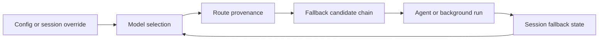

Codex review: needs real behavior proof before merge. _Reviewed July 27, 2026, 2:11 AM ET / 06:11 UTC._

# ClawSweeper review

## What this changes

This PR preserves the provider/model route selected for a fallback across reply, command, queue, cron, plugin, and session-persistence paths so a colliding alias cannot silently redirect it to another provider.

## Merge readiness

⛔ **Blocked until real behavior proof from a real setup is added - 5 items remain**

Keep this PR open for explicit maintainer review. The proposed provenance boundary addresses the reported route-collision bug across fallback execution and persisted sessions, but it introduces a compatibility-sensitive persisted session marker and the supplied evidence does not include an inspectable after-fix runtime transcript demonstrating the collision path end-to-end.

**Priority:** P2
**Reviewed head:** `9f671788e1006ba66f1d70e2c8342bc77f5ed753`
**Owner decision:** Required. See [Decision needed](#decision-needed).

## Review scores

| Measure | Result | What it means |
|---|---|---|
| **Overall readiness** | 🦪 silver shellfish **(2/6)** | The implementation and automated coverage are substantial, but real after-fix behavior proof is still not inspectable from the supplied PR evidence. |
| **Proof confidence** | 🦪 silver shellfish **(2/6)** | Needs real behavior proof before merge: The PR body and checks report reproduction, focused tests, and broad CI, but the supplied context does not contain an inspectable redacted after-fix runtime log, terminal transcript, recording, or artifact directly showing the selected provider surviving the alias collision. Add redacted live output, then update the PR body for automatic re-review or ask a maintainer to comment `@clawsweeper re-review`. |
| **Patch quality** | 🐚 platinum hermit **(4/6)** | No actionable review findings were identified. |

## Verification

| Check | Result | Evidence |
|---|---|---|
| **Real behavior** | Needs proof | Needs real behavior proof before merge: The PR body and checks report reproduction, focused tests, and broad CI, but the supplied context does not contain an inspectable redacted after-fix runtime log, terminal transcript, recording, or artifact directly showing the selected provider surviving the alias collision. Add redacted live output, then update the PR body for automatic re-review or ask a maintainer to comment `@clawsweeper re-review`. |
| **Evidence reviewed** | 5 items | Reported behavior and canonical bug: The linked report gives a concrete alias-collision configuration and shows a resolved Cloudflare route being rewritten to Google only when the fallback-candidate builder reinterprets the bare model identifier. Route provenance through fallback execution: The branch changes candidate construction to attach both route origin and raw/resolved state, then makes the runner identify the requested candidate by origin instead of positional index. Persisted-session upgrade handling: The new session helper treats existing automatic fallback provenance as resolved when the new marker is absent, while unmarked legacy manual overrides remain raw; targeted tests cover both cases. |
| **Findings** | None | None. |
| **Security** | None | None. |

## How this fits together

OpenClaw resolves a requested model route from configuration or session state, then builds an ordered fallback chain for agent runs. The selected route and its provenance pass through reply and background-run paths, and automatic fallback state is persisted for later session recovery.

## Decision needed

| Question | Recommendation |
|---|---|
| Should this persisted route-provenance contract be accepted after reviewing a real upgrade scenario that distinguishes a legacy raw manual alias from a legacy automatic fallback pin? | **Accept after upgrade proof:** Review a redacted runtime transcript for the reported collision plus a persisted legacy-session recovery case, then merge the single canonical routing contract. |

Why: The code deliberately assigns meaning to a new persisted marker and to its absence; automated tests cover the intended cases, but the compatibility contract and rollout acceptance require the owner’s judgment.

## Before merge

- [ ] **Add real behavior proof** - Needs real behavior proof before merge: The PR body and checks report reproduction, focused tests, and broad CI, but the supplied context does not contain an inspectable redacted after-fix runtime log, terminal transcript, recording, or artifact directly showing the selected provider surviving the alias collision. Add redacted live output, then update the PR body for automatic re-review or ask a maintainer to comment `@clawsweeper re-review`.
- [ ] **Resolve merge risk (P2)** - The PR adds a persisted session-route marker whose absence has semantic meaning; upgrades with legacy manual aliases and legacy automatic fallback pins need an inspectable end-to-end upgrade proof before merge.
- [ ] **Resolve merge risk (P1)** - The branch changes 65 files across routing, queues, cron, plugins, doctor repair, and session recovery, so the maintainer-labelled PR needs owner review even though the current diff shows focused propagation and broad automated coverage.
- [ ] **Complete next step (P2)** - This maintainer-labelled PR needs owner acceptance of the persisted-session compatibility contract and inspectable real-behavior proof; there is no narrow mechanical repair to dispatch independently.

<strong>Agent review details</strong>

### Security

None.

### PR surface

Source +335, Tests +388. Total +723 across 65 files.

View PR surface stats

| Area | Files | Added | Removed | Net |
|---|---:|---:|---:|---:|
| Source | 48 | 476 | 141 | +335 |
| Tests | 17 | 397 | 9 | +388 |
| Docs | 0 | 0 | 0 | 0 |
| Config | 0 | 0 | 0 | 0 |
| Generated | 0 | 0 | 0 | 0 |
| Other | 0 | 0 | 0 | 0 |
| **Total** | **65** | **873** | **150** | **+723** |

### Review metrics

| Metric | Value | Why it matters |
|---|---|---|
| **Persisted route state** | 1 session-route marker added | The new marker changes how existing session overrides are interpreted on upgrade, so compatibility proof matters independently of ordinary test coverage. |

### Stored data model

Persistent data-model change detected: `serialized state: src/agents/session-model-auto-revert.ts`, `serialized state: src/auto-reply/reply/queue/state.ts`, `serialized state: src/auto-reply/reply/session.ts`, `serialized state: src/config/sessions/session-entry-selection.ts`, `serialized state: src/config/sessions/session-model-fallback.ts`, `serialized state: src/gateway/session-create-service.ts`, and 1 more. Migration or upgrade compatibility proof is recorded; maintainers should verify it before merge.

### Root-cause cluster

Relationship: `fixed_by_candidate`
Canonical: https://github.com/openclaw/openclaw/issues/112289
Summary: This PR is the broader candidate fix for the reported fallback alias-collision bug; it explicitly supersedes an earlier narrow PR for the same underlying behavior.

Members:
- `canonical`: https://github.com/openclaw/openclaw/issues/112289 - The issue provides the concrete configuration, expected provider route, observed silent reroute, and focused root-cause analysis.
- `superseded`: https://github.com/openclaw/openclaw/pull/112328 - This PR explicitly states it supersedes the earlier narrower implementation and carries the route invariant through additional runtime and persistence boundaries.

Proposal only: this assessment does not dispatch repair, suppress jobs, mutate sibling items, close, or merge anything.

### Merge-risk options

**Maintainer options:**
1. **Add route and upgrade proof (recommended)**  
   Before merge, attach a redacted terminal transcript that shows the same alias collision retaining the selected provider and shows legacy stored fallback state recovering with the intended route semantics.
2. **Accept the rollout risk**  
   Merge with the current unit and CI coverage while explicitly accepting that the persisted-session compatibility contract has not been demonstrated in a real upgraded runtime.

### Technical review

Best possible solution:

Land one canonical provenance contract: raw user/config alias input remains resolvable once, while routes that model selection or fallback already resolved remain immutable through execution and persisted-session recovery; demonstrate that contract with a redacted before/after runtime transcript including a legacy-session upgrade case.

Do we have a high-confidence way to reproduce the issue?

Yes for source reproduction: the linked report supplies a concrete two-provider alias-collision configuration, and the branch adds focused regression coverage for the fallback-candidate path. I did not independently execute the runtime scenario in this read-only review.

Is this the best way to solve the issue?

Yes, conditionally: carrying explicit route provenance is a cleaner shared-boundary fix than adding more precedence exceptions to alias parsing, provided the persisted-session upgrade contract is proven in a real runtime.

AGENTS.md: found and applied where relevant.

Codex review notes: model internal, reasoning high; reviewed against [0406e6636916](https://github.com/openclaw/openclaw/commit/0406e663691612d5dd88584d93de5d371a8141e1).

### Labels

Label changes:

- add `P2`: This is a deterministic provider-routing bug with limited blast radius for configurations that combine explicit routes and colliding aliases.
- add `merge-risk: 🚨 compatibility`: Existing persisted overrides without the marker must retain their prior raw-alias behavior while automatic fallback pins must be inferred as resolved.
- add `merge-risk: 🚨 session-state`: The branch writes, copies, clears, resets, and repairs a new field in persisted session model-selection state.
- add `rating: 🦪 silver shellfish`: Overall readiness is 🦪 silver shellfish; proof is 🦪 silver shellfish and patch quality is 🐚 platinum hermit.
- add `status: 📣 needs proof`: The PR needs real behavior proof before ClawSweeper can clear the contributor ask. Needs real behavior proof before merge: The PR body and checks report reproduction, focused tests, and broad CI, but the supplied context does not contain an inspectable redacted after-fix runtime log, terminal transcript, recording, or artifact directly showing the selected provider surviving the alias collision. Add redacted live output, then update the PR body for automatic re-review or ask a maintainer to comment `@clawsweeper re-review`.

Label justifications:

- `P2`: This is a deterministic provider-routing bug with limited blast radius for configurations that combine explicit routes and colliding aliases.
- `merge-risk: 🚨 compatibility`: Existing persisted overrides without the marker must retain their prior raw-alias behavior while automatic fallback pins must be inferred as resolved.
- `merge-risk: 🚨 session-state`: The branch writes, copies, clears, resets, and repairs a new field in persisted session model-selection state.
- `rating: 🦪 silver shellfish`: Overall readiness is 🦪 silver shellfish; proof is 🦪 silver shellfish and patch quality is 🐚 platinum hermit.
- `status: 📣 needs proof`: The PR needs real behavior proof before ClawSweeper can clear the contributor ask. Needs real behavior proof before merge: The PR body and checks report reproduction, focused tests, and broad CI, but the supplied context does not contain an inspectable redacted after-fix runtime log, terminal transcript, recording, or artifact directly showing the selected provider surviving the alias collision. Add redacted live output, then update the PR body for automatic re-review or ask a maintainer to comment `@clawsweeper re-review`.

### Evidence

What I checked:

- **Reported behavior and canonical bug:** The linked report gives a concrete alias-collision configuration and shows a resolved Cloudflare route being rewritten to Google only when the fallback-candidate builder reinterprets the bare model identifier. ([`src/agents/model-fallback-candidates.ts:29`](https://github.com/openclaw/openclaw/blob/9f671788e100/src/agents/model-fallback-candidates.ts#L29), [9f671788e100](https://github.com/openclaw/openclaw/commit/9f671788e100))
- **Route provenance through fallback execution:** The branch changes candidate construction to attach both route origin and raw/resolved state, then makes the runner identify the requested candidate by origin instead of positional index. ([`src/agents/model-fallback-runner.ts:157`](https://github.com/openclaw/openclaw/blob/9f671788e100/src/agents/model-fallback-runner.ts#L157), [9f671788e100](https://github.com/openclaw/openclaw/commit/9f671788e100))
- **Persisted-session upgrade handling:** The new session helper treats existing automatic fallback provenance as resolved when the new marker is absent, while unmarked legacy manual overrides remain raw; targeted tests cover both cases. ([`src/config/sessions/model-override-provenance.ts:25`](https://github.com/openclaw/openclaw/blob/9f671788e100/src/config/sessions/model-override-provenance.ts#L25), [9f671788e100](https://github.com/openclaw/openclaw/commit/9f671788e100))
- **Related implementation history:** The branch explicitly supersedes the narrower open implementation at https://github.com/openclaw/openclaw/pull/112328 and broadens the fix from the heartbeat symptom to shared runtime and persistence boundaries. ([`src/agents/model-fallback.types.ts:10`](https://github.com/openclaw/openclaw/blob/9f671788e100/src/agents/model-fallback.types.ts#L10), [9f671788e100](https://github.com/openclaw/openclaw/commit/9f671788e100))
- **Automated validation evidence:** The hydrated PR checks show the broad quality, boundary, security, and QA smoke lanes succeeding; two compact Node lanes were still in progress in the supplied check state. ([9f671788e100](https://github.com/openclaw/openclaw/commit/9f671788e100))

Likely related people:

- **1052326311:** Authored the narrower open route-collision fix that this PR explicitly supersedes and whose tests target the same fallback-candidate behavior. (role: earlier implementation author; confidence: medium; commits: [65dc6b39d336](https://github.com/openclaw/openclaw/commit/65dc6b39d3362974e80a071e62a9c14f6e43be6e); files: `src/agents/model-fallback-candidates.ts`, `src/agents/model-fallback.test.ts`)
- **steipete:** Authored the maintainer-owned replacement that expands the route-collision repair across runtime, session, doctor, queue, cron, and plugin paths. (role: replacement-branch author; confidence: medium; commits: [9f671788e100](https://github.com/openclaw/openclaw/commit/9f671788e1006ba66f1d70e2c8342bc77f5ed753); files: `src/agents/model-fallback-candidates.ts`, `src/auto-reply/reply/model-selection.ts`, `src/config/sessions/model-override-provenance.ts`)

### Rank-up moves

Optional improvements that raise the rating; they are not merge blockers.

- Attach a redacted before/after terminal transcript for the provider-alias collision.
- Include a legacy persisted-session recovery run that demonstrates the raw-versus-resolved upgrade contract.
- Wait for the two in-progress compact Node lanes to finish before merge.

### Rating scale

| Score | Internal tier | Crab rank | Meaning |
|---:|:---:|---|---|
| **6/6** | S | 🦀 challenger crab | Exceptional readiness |
| **5/6** | A | 🦞 diamond lobster | Very strong readiness |
| **4/6** | B | 🐚 platinum hermit | Good normal PR; ordinary maintainer review |
| **3/6** | C | 🦐 gold shrimp | Useful, but confidence is limited |
| **2/6** | D | 🦪 silver shellfish | Proof or implementation needs work |
| **1/6** | F | 🧂 unranked krab | Not merge-ready |
| N/A | NA | 🌊 off-meta tidepool | Rating does not apply |

Overall follows the weaker of proof and patch quality.
Shiny media proof means a screenshot, video, or linked artifact directly shows the changed behavior. Runtime, network, CSP, and security claims still need visible diagnostics.

### Workflow

- ClawSweeper keeps one durable marker-backed review comment per issue or PR.
- Re-runs edit this comment so the latest verdict, findings, and automation markers stay together instead of adding duplicate bot comments.
- A fresh review can be triggered by eligible `@clawsweeper re-review` comments, exact-item GitHub events, scheduled/background review runs, or manual workflow dispatch.
- PR/issue authors and users with repository write access can comment `@clawsweeper re-review` or `@clawsweeper re-run` on an open PR or issue to request a fresh review only.
- Maintainers can also comment `@clawsweeper review` to request a fresh review only.
- Fresh-review commands do not start repair, autofix, rebase, CI repair, or automerge.
- Maintainer-only repair and merge flows require explicit commands such as `@clawsweeper autofix`, `@clawsweeper automerge`, `@clawsweeper fix ci`, or `@clawsweeper address review`.
- Maintainers can comment `@clawsweeper explain` to ask for more context, or `@clawsweeper stop` to stop active automation.

### History

Review history (1 earlier review cycle)

<!-- clawsweeper-review-history v=1 total=1 -->
- reviewed 2026-07-27T06:03:38.668Z sha 9f671788e1006ba66f1d70e2c8342bc77f5ed753 :: needs real behavior proof before merge. :: none

<!-- clawsweeper-verdict:needs-human item=114360 sha=9f671788e1006ba66f1d70e2c8342bc77f5ed753 confidence=medium updated_at=2026-07-27T06:09:42Z reviewed_at=2026-07-27T06:11:15.288Z lease_owner=github-run-30241619375-1 lease_comment_id=5087866954 source_revision=d0cce9183ceac73398a3404723b5cf1df0cedb436b2ab8731dd30da395891707 -->

<!-- clawsweeper-review-version item=114360 reviewed_at=2026-07-27T06:11:15.288Z sha=9f671788e1006ba66f1d70e2c8342bc77f5ed753 source_revision=d0cce9183ceac73398a3404723b5cf1df0cedb436b2ab8731dd30da395891707 lease_owner=github-run-30241619375-1 lease_comment_id=5087866954 v=1 -->

<!-- clawsweeper-review item=114360 -->