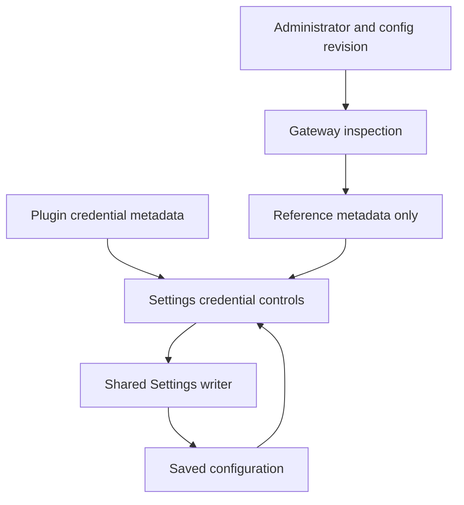

Codex review: blocked before merge. _Reviewed September 16, 2026, 6:56 PM ET / 22:56 UTC (Revision 11)._

# ClawSweeper review

## What this changes

Adds masked plugin credential controls and administrator-only secret-reference inspection and editing, with acknowledged saves and field-specific cancellation.

## Merge readiness

⛔ **Blocked before merge - 1 item remains**

Keep open: this remains useful work absent from current main, with no blocking defect found. The previous migration checklist is not applicable: the added schema describes RPC messages, while saved configuration retains its existing format.

**Priority:** P2
**Reviewed head:** `e724660eda23f4695a1120bf85d80b80c8d2d3a7`

## Review scores

| Measure | Result | What it means |
|---|---|---|
| **Overall readiness** | 🐚 platinum hermit **(4/6)** | Useful, coherent implementation with strong supplied behavior evidence and no remaining actionable finding. |
| **Proof confidence** | 🦞 diamond lobster **(5/6)** ✨ media proof bonus | Sufficient (linked_artifact): The supplied production browser→authenticated Gateway results cover saved references surviving reload and sibling writes, with separate denial and stale-revision scenarios; inspected desktop/mobile screenshots support the visible layout change. Screenshot inspection alone is not the basis for the authorization assessment. |
| **Patch quality** | 🐚 platinum hermit **(4/6)** | No actionable review findings were identified. |

## Verification

| Check | Result | Evidence |
|---|---|---|
| **Real behavior** | Verified | Sufficient (linked_artifact): The supplied production browser→authenticated Gateway results cover saved references surviving reload and sibling writes, with separate denial and stale-revision scenarios; inspected desktop/mobile screenshots support the visible layout change. Screenshot inspection alone is not the basis for the authorization assessment. |
| **Evidence reviewed** | 9 items | Current main still lacks credential inspection: The fetched main method table contains plugin inspection and management methods but no plugins.credentials.inspect; neither fetched main nor the supplied latest release contains the new credential editor or inspection module. The merged grouped-settings predecessor therefore does not supersede this capability. Inspection preserves the authorization boundary: The handler requires current administrator access before and after the snapshot read, checks the public config revision, and restricts inspection to the installed plugin's advertised credential path. Its projection returns reference metadata or credential kind, never resolved secret values; loader errors are bounded. Final response retains live authority: The production WebSocket dispatcher supplies hasCurrentClientAuthority, checks shared-auth generation and invalidation, and suppresses responses from retired clients. The new handler consumes that existing authority rather than creating a transferable authorization token. |
| **Findings** | None | None. |
| **Security** | None | None. |

## How this fits together

Plugin Settings combines plugin-declared metadata with Gateway configuration to render credential controls. Inspection returns reference metadata without resolving secrets, while edits pass through the existing Settings writer.

## Before merge

- [ ] **Add data-model compatibility proof** - Confirm migration or upgrade compatibility proof before merge.

<strong>Agent review details</strong>

### Security

None.

### PR surface

Source +1213, Tests +1231, Docs +18, Other +5. Total +2467 across 63 files.

View PR surface stats

| Area | Files | Added | Removed | Net |
|---|---:|---:|---:|---:|
| Source | 33 | 1505 | 292 | +1213 |
| Tests | 25 | 1268 | 37 | +1231 |
| Docs | 1 | 18 | 0 | +18 |
| Config | 0 | 0 | 0 | 0 |
| Generated | 0 | 0 | 0 | 0 |
| Other | 4 | 7 | 2 | +5 |
| **Total** | **63** | **2798** | **331** | **+2467** |

### Review metrics

| Metric | Value | Why it matters |
|---|---|---|
| **Credential API** | 1 administrator-only inspection RPC; 0 new credential-write RPCs | Editing continues through the existing configuration contract. |
| **Production versus test growth** | Production/tooling +1,218 net; tests/support +1,231 net | Growth includes moved functions and is justified by credential inspection, editing, and field-specific draft recovery. |

### Stored data model

Persistent data-model change detected: `database schema: packages/gateway-protocol/src/schema/plugin-credentials.ts`, `unknown-data-model-change: packages/gateway-protocol/src/schema/plugin-credentials.ts`. Confirm migration or upgrade compatibility proof before merge.

### Technical review

Best possible solution:

Retain one Settings writer and the canonical SecretRef contract, with metadata-only inspection and acknowledged, field-scoped recovery.

Do we have a high-confidence way to reproduce the issue?

Not applicable to the primary feature request. The rejected-save cancellation sequence has concrete regression coverage and reported before/after results; this review did not execute it.

Is this the best way to solve the issue?

Yes: the patch extends existing plugin metadata and Settings ownership, reuses SecretRef validation, and avoids a second credential store or write path.

AGENTS.md: found and applied where relevant.

Codex review notes: model internal, reasoning medium; reviewed against [57beb816a813](https://github.com/openclaw/openclaw/commit/57beb816a81323d59967890f8199446af46c4f36).

### Labels

Label justifications:

- `P2`: This is a bounded improvement to plugin credential settings and cancellation behavior.
- `rating: 🐚 platinum hermit`: Overall readiness is 🐚 platinum hermit; proof is 🦞 diamond lobster and patch quality is 🐚 platinum hermit.
- `status: 👀 ready for maintainer look`: ClawSweeper has no concrete contributor-facing blocker left for this PR. Sufficient (linked_artifact): The supplied production browser→authenticated Gateway results cover saved references surviving reload and sibling writes, with separate denial and stale-revision scenarios; inspected desktop/mobile screenshots support the visible layout change. Screenshot inspection alone is not the basis for the authorization assessment.
- `proof: sufficient`: Contributor real behavior proof is sufficient. The supplied production browser→authenticated Gateway results cover saved references surviving reload and sibling writes, with separate denial and stale-revision scenarios; inspected desktop/mobile screenshots support the visible layout change. Screenshot inspection alone is not the basis for the authorization assessment.

### Evidence

What I checked:

- **Current main still lacks credential inspection:** The fetched main method table contains plugin inspection and management methods but no plugins.credentials.inspect; neither fetched main nor the supplied latest release contains the new credential editor or inspection module. The merged grouped-settings predecessor therefore does not supersede this capability. ([`src/gateway/methods/core-descriptors.ts:588`](https://github.com/openclaw/openclaw/blob/57beb816a81323d59967890f8199446af46c4f36/src/gateway/methods/core-descriptors.ts#L588), [57beb816a813](https://github.com/openclaw/openclaw/commit/57beb816a81323d59967890f8199446af46c4f36))
- **Inspection preserves the authorization boundary:** The handler requires current administrator access before and after the snapshot read, checks the public config revision, and restricts inspection to the installed plugin's advertised credential path. Its projection returns reference metadata or credential kind, never resolved secret values; loader errors are bounded. ([`src/gateway/server-methods/plugins.credentials.ts:32`](https://github.com/openclaw/openclaw/blob/e724660eda23f4695a1120bf85d80b80c8d2d3a7/src/gateway/server-methods/plugins.credentials.ts#L32), [e724660eda23](https://github.com/openclaw/openclaw/commit/e724660eda23f4695a1120bf85d80b80c8d2d3a7))
- **Final response retains live authority:** The production WebSocket dispatcher supplies hasCurrentClientAuthority, checks shared-auth generation and invalidation, and suppresses responses from retired clients. The new handler consumes that existing authority rather than creating a transferable authorization token. ([`src/gateway/server/ws-connection/authenticated-request-dispatch.ts:111`](https://github.com/openclaw/openclaw/blob/e724660eda23f4695a1120bf85d80b80c8d2d3a7/src/gateway/server/ws-connection/authenticated-request-dispatch.ts#L111), [e724660eda23](https://github.com/openclaw/openclaw/commit/e724660eda23f4695a1120bf85d80b80c8d2d3a7))
- **Prior cancellation concern addressed:** Cancel serializes behind existing writes, refreshes authoritative configuration, rejects uncertain outcomes without confirmation, and removes only the selected field's intent. Reviewed regressions cover rejected Save→Cancel→sibling save, pending acknowledgements, overlapping edits, reconnects, and redacted unknown outcomes. ([`ui/src/lib/config/config-field-discard.ts:54`](https://github.com/openclaw/openclaw/blob/e724660eda23f4695a1120bf85d80b80c8d2d3a7/ui/src/lib/config/config-field-discard.ts#L54), [e724660eda23](https://github.com/openclaw/openclaw/commit/e724660eda23f4695a1120bf85d80b80c8d2d3a7))
- **Migration checklist resolved by source:** The new TypeBox schema validates an additive inspection RPC. The UI adapter still stages changes through the existing configuration capability, and the editor imports the canonical SecretRef validator. No stored schema, credential format, default, or new credential-write RPC is introduced; the author's compatibility explanations match the diff. ([`ui/src/pages/plugins/plugin-settings-controller.ts:49`](https://github.com/openclaw/openclaw/blob/e724660eda23f4695a1120bf85d80b80c8d2d3a7/ui/src/pages/plugins/plugin-settings-controller.ts#L49), [e724660eda23](https://github.com/openclaw/openclaw/commit/e724660eda23f4695a1120bf85d80b80c8d2d3a7))
- **Visual and real Gateway evidence:** Inspected all four prepared images: desktop and phone before/after pairs visibly show readable credential rows and the reference-edit action. The captured PR body separately reports 12 authenticated loopback scenarios, read-only denial, stale-revision rejection, nonactivation, and a production browser flow with three config.set acknowledgements and reference persistence after reload. Its tested build is cf4b66819ade; file/exec/store resolution is not claimed as live proof. Later editor/reload images were not included in the prepared manifest and were not independently inspected.

Likely related people:

- **Patrick Erichsen:** Raw commit 1710fede5dfa100e4879d6c9e0efc51663331587 adds ui/src/pages/plugins/settings-editor.ts:37 relative to its recorded parents. This identifies author metadata, not feature responsibility or a PR merger. (role: source-line author; confidence: high; commits: [1710fede5dfa](https://github.com/openclaw/openclaw/commit/1710fede5dfa100e4879d6c9e0efc51663331587); files: `ui/src/pages/plugins/settings-editor.ts`)
- **Peter Steinberger:** Suggested for follow-up; no historical authorship or introduction is verified. (role: unverified routing candidate; confidence: low)

### Rating scale

| Score | Internal tier | Crab rank | Meaning |
|---:|:---:|---|---|
| **6/6** | S | 🦀 challenger crab | Exceptional readiness |
| **5/6** | A | 🦞 diamond lobster | Very strong readiness |
| **4/6** | B | 🐚 platinum hermit | Good normal PR; ordinary maintainer review |
| **3/6** | C | 🦐 gold shrimp | Useful, but confidence is limited |
| **2/6** | D | 🦪 silver shellfish | Proof or implementation needs work |
| **1/6** | F | 🧂 unranked krab | Not merge-ready |
| N/A | NA | 🌊 off-meta tidepool | Rating does not apply |

Overall follows the weaker of proof and patch quality.
Shiny media proof means a screenshot, video, or linked artifact directly shows the changed behavior. Runtime, network, CSP, and security claims still need visible diagnostics.

### Workflow

- ClawSweeper keeps one durable marker-backed review comment per issue or PR.
- Re-runs edit this comment so the latest verdict, findings, and automation markers stay together instead of adding duplicate bot comments.
- A fresh review can be triggered by eligible `@clawsweeper re-review` comments, exact-item GitHub events, scheduled/background review runs, or manual workflow dispatch.
- PR/issue authors and users with repository write access can comment `@clawsweeper re-review` or `@clawsweeper re-run` on an open PR or issue to request a fresh review only.
- Maintainers can also comment `@clawsweeper review` to request a fresh review only.
- Fresh-review commands do not start repair, autofix, rebase, CI repair, or automerge.
- Maintainer-only repair and merge flows require explicit commands such as `@clawsweeper autofix`, `@clawsweeper automerge`, `@clawsweeper fix ci`, or `@clawsweeper address review`.
- Maintainers can comment `@clawsweeper explain` to ask for more context, or `@clawsweeper stop` to stop active automation.

### History

Review history (10 earlier review cycles; latest 8 shown)

<!-- clawsweeper-review-history v=1 total=10 -->
- reviewed 2026-09-15T20:56:04.970Z sha 6973f0553290abb68a02e7f745acb1ced17ea5ef :: blocked before merge. :: none
- reviewed 2026-09-15T22:47:10.518Z sha a9527f38ece26f112eb69d42bfc68b68dda34fb8 :: blocked before merge. :: none
- reviewed 2026-09-16T18:39:58.643Z sha 660dbce03bf492fd67fa7151d574a6a05bd4e89e :: blocked before merge. :: none
- reviewed 2026-09-16T18:52:27.907Z sha 660dbce03bf492fd67fa7151d574a6a05bd4e89e :: blocked before merge. :: none
- reviewed 2026-09-16T19:27:04.845Z sha 0113824a7fff825e74dfab4302c840a80b46f778 :: blocked before merge. :: none
- reviewed 2026-09-16T19:54:52.301Z sha 2c7934f2712d9d2a98ba7f77dfcffcfdbbefe853 :: blocked before merge. :: none
- reviewed 2026-09-16T20:27:18.918Z sha 3100d9e6a3ede7d2f965411b6f15a6cf66d6be27 :: blocked before merge. :: none
- reviewed 2026-09-16T20:50:19.897Z sha e724660eda23f4695a1120bf85d80b80c8d2d3a7 :: blocked before merge. :: none

<!-- clawsweeper-verdict:needs-human item=149286 sha=e724660eda23f4695a1120bf85d80b80c8d2d3a7 confidence=high updated_at=2026-09-16T22:53:01Z reviewed_at=2026-09-16T22:56:41.644Z lease_owner=github-run-35159615928-1 lease_comment_id=5705685326 source_revision=908d612b3a20ad70fbfed50c0e03d5acd6ed5fc5e38bbae8fd4305d8532304d9 live_verification=absent -->
<!-- clawsweeper-review-state:blocked item=149286 sha=e724660eda23f4695a1120bf85d80b80c8d2d3a7 v=1 -->

<!-- clawsweeper-review-version item=149286 reviewed_at=2026-09-16T22:56:41.644Z sha=e724660eda23f4695a1120bf85d80b80c8d2d3a7 source_revision=908d612b3a20ad70fbfed50c0e03d5acd6ed5fc5e38bbae8fd4305d8532304d9 lease_owner=github-run-35159615928-1 lease_comment_id=5705685326 v=1 -->

<!-- clawsweeper-review item=149286 -->