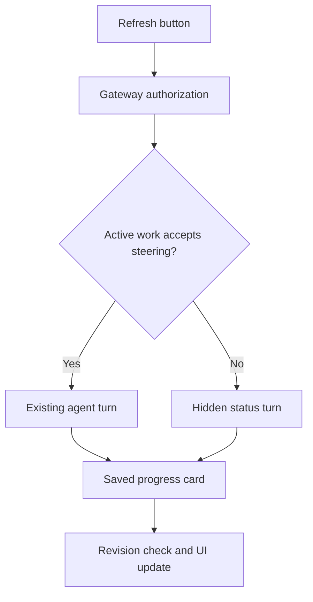

Codex review: needs changes before merge. _Reviewed September 20, 2026, 6:37 PM ET / 22:37 UTC (Revision 3)._

# ClawSweeper review

## What this changes

Adds a progress-card refresh button and authorized Gateway request that updates task status without inserting a visible chat message.

## Merge readiness

⛔ **Needs changes before merge - 3 items remain**

The feature remains useful and absent from main. Earlier retry repairs address normal completion and missed updates, but idle refresh admission and queued cancellation still have concrete correctness defects.

**Priority:** P2
**Reviewed head:** `fc8765eef0886dbb5923746fbf9c2fce6564d63c`

## Review scores

| Measure | Result | What it means |
|---|---|---|
| **Overall readiness** | 🦐 gold shrimp **(3/6)** | Useful visual evidence and focused coverage accompany two unresolved runtime lifecycle defects. |
| **Proof confidence** | 🐚 platinum hermit **(4/6)** | Not applicable: The maintainer-author exemption applies. Inspected screenshots support control placement and preserved draft/transcript; controlled browser and dispatch-mocked integration evidence does not establish successful agent-driven refresh through the real session-preparation callback. |
| **Patch quality** | 🦐 gold shrimp **(3/6)** | 2 actionable review findings remain. |

## Verification

| Check | Result | Evidence |
|---|---|---|
| **Real behavior** | Not applicable | Not applicable: The maintainer-author exemption applies. Inspected screenshots support control placement and preserved draft/transcript; controlled browser and dispatch-mocked integration evidence does not establish successful agent-driven refresh through the real session-preparation callback. |
| **Evidence reviewed** | 10 items | Introduced scope and checkout identity: Reviewed the merge-base-to-head changes at fc8765eef0886dbb5923746fbf9c2fce6564d63c. The raw head parent matches the supplied original-head record. Base-only changes and the stale test merge were not attributed to this PR. Feature remains absent from current main: The progress-card handler at fetched main implements get and put, without refresh. The related merged UI PRs address collaborator scrolling and people-picker caching, rather than this capability. Release capability check: The v2026.9.5 method registry advertises progressCard.get and progressCard.put, without progressCard.refresh. Some local historical blobs were unavailable through the promisor remote; bounded GitHub contents reads supplied the main and release checks. |
| **Findings** | 2 actionable findings | [P1] Keep hidden refresh runs eligible for session preparation [P2] Retire cancelled queued refresh receipts before removing their owner |
| **Security** | None | None. |

## How this fits together

The Control UI displays progress cards saved by the agent through the Gateway. Refresh requests enter the existing chat admission and steering pipeline, while saved-card revisions determine whether the UI reports success.

## Before merge

- [ ] **Keep hidden refresh runs eligible for session preparation (P1)** - Setting `projectSessionActive: false` here makes `onSessionPrepared` in this same module reject every matching refresh binding at line 624. Idle refreshes and rejected-steer fallback enter real reply resolution, which invokes that callback through `dispatch-from-config.gather.ts` and `get-reply.ts:761`, so they abort before the agent can update the card. Separate hidden presentation from admission liveness while preserving cancellation and replacement checks. The registered integration fixture mocks dispatch before this callback. This is a late discovery: the admission file is byte-identical to the earlier reviewed head.
- [ ] **Retire cancelled queued refresh receipts before removing their owner (P2)** - After the initial dispatch settles with a queued refresh, cancelling that queued turn removes its map entry through the controller's abort listener. `completeQueuedChatTurn` then returns false here, so even abandonment cannot replace the cached `status: "ok"`. The queued abort handler does not update that receipt either. Retry therefore keeps returning `accepted` for cancelled work until dedupe expiry. Record cancellation against the exact queued owner before removal, retaining the successor-controller protection, and cover abort followed by retry.
- [ ] **Complete next step (P2)** - Repair hidden refresh admission and cancelled queue receipts, with regressions exercising the real preparation callback and queued abort path.

## Findings

- [P1] Keep hidden refresh runs eligible for session preparation — `src/gateway/server-methods/chat-send-admission.ts:397-399`
- [P2] Retire cancelled queued refresh receipts before removing their owner — `src/gateway/server-methods/chat-send-turn-adoption.ts:108-118`

<strong>Agent review details</strong>

### Security

None.

### PR surface

Source +700, Tests +1947, Docs +12, Other +45. Total +2704 across 55 files.

View PR surface stats

| Area | Files | Added | Removed | Net |
|---|---:|---:|---:|---:|
| Source | 36 | 831 | 131 | +700 |
| Tests | 16 | 2105 | 158 | +1947 |
| Docs | 1 | 14 | 2 | +12 |
| Config | 0 | 0 | 0 | 0 |
| Generated | 0 | 0 | 0 | 0 |
| Other | 2 | 45 | 0 | +45 |
| **Total** | **55** | **2995** | **291** | **+2704** |

### Review metrics

| Metric | Value | Why it matters |
|---|---|---|
| **New request contract** | 1 write RPC; 0 new configuration options | The fixed-prompt refresh operation reuses existing session authorization and saved-card storage. |
| **Production versus test growth** | Production +745 net lines; tests +1,947 net lines | The stated production growth supports hidden dispatch and retry ownership, but the mocked dispatch boundary misses the idle-path failure. |

### Technical review

Best possible solution:

Keep saved cards authoritative, separate hidden presentation from run liveness, and settle refresh retry identities on both completion and cancellation.

Do we have a high-confidence way to reproduce the issue?

Yes, source establishes deterministic PR-head paths: an idle refresh reaches the rejecting session-preparation callback, and queued cancellation removes the receipt owner before settlement. Neither path was executed during this read-only review.

Is this the best way to solve the issue?

The existing Gateway admission and card-storage owners are the right integration points, but the patch must distinguish presentation visibility from execution liveness and terminalize cancelled queued refreshes.

Full review comments:

- [P1] Keep hidden refresh runs eligible for session preparation — `src/gateway/server-methods/chat-send-admission.ts:397-399`
  Setting `projectSessionActive: false` here makes `onSessionPrepared` in this same module reject every matching refresh binding at line 624. Idle refreshes and rejected-steer fallback enter real reply resolution, which invokes that callback through `dispatch-from-config.gather.ts` and `get-reply.ts:761`, so they abort before the agent can update the card. Separate hidden presentation from admission liveness while preserving cancellation and replacement checks. The registered integration fixture mocks dispatch before this callback. This is a late discovery: the admission file is byte-identical to the earlier reviewed head.
  Confidence: 0.99
  Late finding: first raised on code an earlier review cycle already covered.
- [P2] Retire cancelled queued refresh receipts before removing their owner — `src/gateway/server-methods/chat-send-turn-adoption.ts:108-118`
  After the initial dispatch settles with a queued refresh, cancelling that queued turn removes its map entry through the controller's abort listener. `completeQueuedChatTurn` then returns false here, so even abandonment cannot replace the cached `status: "ok"`. The queued abort handler does not update that receipt either. Retry therefore keeps returning `accepted` for cancelled work until dedupe expiry. Record cancellation against the exact queued owner before removal, retaining the successor-controller protection, and cover abort followed by retry.
  Confidence: 0.95

Overall correctness: patch is incorrect
Overall confidence: 0.97

AGENTS.md: found and applied where relevant.

Codex review notes: model internal, reasoning medium; reviewed against [0a9d65e3b7b6](https://github.com/openclaw/openclaw/commit/0a9d65e3b7b6ccd57edb2e70cd030aee3bee5b86).

### Labels

Label justifications:

- `P2`: This is a bounded task-status improvement with correctness blockers in the proposed refresh workflow.
- `rating: 🦐 gold shrimp`: Overall readiness is 🦐 gold shrimp; proof is 🐚 platinum hermit and patch quality is 🦐 gold shrimp.
- `status: ⏳ waiting on author`: ClawSweeper has contributor-facing work open and is waiting for author action. Not applicable: The maintainer-author exemption applies. Inspected screenshots support control placement and preserved draft/transcript; controlled browser and dispatch-mocked integration evidence does not establish successful agent-driven refresh through the real session-preparation callback.
- `proof: 📸 screenshot`: Contributor real behavior proof includes screenshot evidence. The maintainer-author exemption applies. Inspected screenshots support control placement and preserved draft/transcript; controlled browser and dispatch-mocked integration evidence does not establish successful agent-driven refresh through the real session-preparation callback.

### Evidence

What I checked:

- **Introduced scope and checkout identity:** Reviewed the merge-base-to-head changes at fc8765eef0886dbb5923746fbf9c2fce6564d63c. The raw head parent matches the supplied original-head record. Base-only changes and the stale test merge were not attributed to this PR. ([fc8765eef088](https://github.com/openclaw/openclaw/commit/fc8765eef0886dbb5923746fbf9c2fce6564d63c))
- **Feature remains absent from current main:** The progress-card handler at fetched main implements get and put, without refresh. The related merged UI PRs address collaborator scrolling and people-picker caching, rather than this capability. ([`src/gateway/server-methods/progress-card.ts:49`](https://github.com/openclaw/openclaw/blob/0a9d65e3b7b6ccd57edb2e70cd030aee3bee5b86/src/gateway/server-methods/progress-card.ts#L49), [0a9d65e3b7b6](https://github.com/openclaw/openclaw/commit/0a9d65e3b7b6ccd57edb2e70cd030aee3bee5b86))
- **Release capability check:** The v2026.9.5 method registry advertises progressCard.get and progressCard.put, without progressCard.refresh. Some local historical blobs were unavailable through the promisor remote; bounded GitHub contents reads supplied the main and release checks. ([`src/gateway/methods/core-descriptors.ts`](https://github.com/openclaw/openclaw/blob/ec9c1a13db8938e5a3eaa51fca2e981cde2395a9/src/gateway/methods/core-descriptors.ts), [ec9c1a13db89](https://github.com/openclaw/openclaw/commit/ec9c1a13db8938e5a3eaa51fca2e981cde2395a9))
- **Hidden projection rejects session preparation:** Refresh registration sets projectSessionActive=false. The same module's onSessionPrepared callback rejects that value at line 624. Real reply resolution invokes this callback through dispatch-from-config.gather.ts and get-reply.ts:761, before agent execution. The integration fixture replaces dispatch and never invokes this callback. ([`src/gateway/server-methods/chat-send-admission.ts:398`](https://github.com/openclaw/openclaw/blob/fc8765eef0886dbb5923746fbf9c2fce6564d63c/src/gateway/server-methods/chat-send-admission.ts#L398), [fc8765eef088](https://github.com/openclaw/openclaw/commit/fc8765eef0886dbb5923746fbf9c2fce6564d63c))
- **Late-finding continuity verified:** A read-only byte comparison against GitHub's exact 83ed099edf0c99f08105f1b0bbcb925ac950c0a4 admission-module blob returned true. Both the hidden projection assignment and rejecting preparation guard were present at the earlier reviewed head. ([`src/gateway/server-methods/chat-send-admission.ts:398`](https://github.com/openclaw/openclaw/blob/83ed099edf0c99f08105f1b0bbcb925ac950c0a4/src/gateway/server-methods/chat-send-admission.ts#L398), [83ed099edf0c](https://github.com/openclaw/openclaw/commit/83ed099edf0c99f08105f1b0bbcb925ac950c0a4))
- **Queued completion repair and cancellation gap:** The new settlement callback updates the original dedupe receipt only when completeQueuedChatTurn removes the matching controller. Normal completion and overflow abandonment are covered. Queued abort removes that entry first through chat-queued-turns.ts; the queued branch in chat-abort-handler.ts does not replace its cached response, leaving settlement unable to retire the refresh receipt. ([`src/gateway/server-methods/chat-send-turn-adoption.ts:116`](https://github.com/openclaw/openclaw/blob/fc8765eef0886dbb5923746fbf9c2fce6564d63c/src/gateway/server-methods/chat-send-turn-adoption.ts#L116), [fc8765eef088](https://github.com/openclaw/openclaw/commit/fc8765eef0886dbb5923746fbf9c2fce6564d63c))

Likely related people:

- **Peter Steinberger:** Suggested for follow-up; no historical authorship or introduction is verified. (role: unverified routing candidate; confidence: low)
- **Vyctor H. Brzezowski:** Suggested for follow-up; no historical authorship or introduction is verified. (role: unverified routing candidate; confidence: low)

### Rank-up moves

Optional improvements that raise the rating; they are not merge blockers.

- Repair hidden-run admission and cover idle refresh through the real session-preparation callback.
- Cover queued cancellation followed by refresh retry without allowing stale owners to overwrite successor receipts.

### Rating scale

| Score | Internal tier | Crab rank | Meaning |
|---:|:---:|---|---|
| **6/6** | S | 🦀 challenger crab | Exceptional readiness |
| **5/6** | A | 🦞 diamond lobster | Very strong readiness |
| **4/6** | B | 🐚 platinum hermit | Good normal PR; ordinary maintainer review |
| **3/6** | C | 🦐 gold shrimp | Useful, but confidence is limited |
| **2/6** | D | 🦪 silver shellfish | Proof or implementation needs work |
| **1/6** | F | 🧂 unranked krab | Not merge-ready |
| N/A | NA | 🌊 off-meta tidepool | Rating does not apply |

Overall follows the weaker of proof and patch quality.
Shiny media proof means a screenshot, video, or linked artifact directly shows the changed behavior. Runtime, network, CSP, and security claims still need visible diagnostics.

### Workflow

- ClawSweeper keeps one durable marker-backed review comment per issue or PR.
- Re-runs edit this comment so the latest verdict, findings, and automation markers stay together instead of adding duplicate bot comments.
- A fresh review can be triggered by eligible `@clawsweeper re-review` comments, exact-item GitHub events, scheduled/background review runs, or manual workflow dispatch.
- PR/issue authors and users with repository write access can comment `@clawsweeper re-review` or `@clawsweeper re-run` on an open PR or issue to request a fresh review only.
- Maintainers can also comment `@clawsweeper review` to request a fresh review only.
- Fresh-review commands do not start repair, autofix, rebase, CI repair, or automerge.
- Maintainer-only repair and merge flows require explicit commands such as `@clawsweeper autofix`, `@clawsweeper automerge`, `@clawsweeper fix ci`, or `@clawsweeper address review`.
- Maintainers can comment `@clawsweeper explain` to ask for more context, or `@clawsweeper stop` to stop active automation.

### History

Review history (2 earlier review cycles)

<!-- clawsweeper-review-history v=1 total=2 -->
- reviewed 2026-09-20T20:34:17.179Z sha 2152a9ca912ee186aaa12eaa3fb2b6a1894cbc03 :: needs changes before merge. :: [P2] Allow retry after a completed refresh produces no card update | [P2] Reload authoritative card state when retrying a refresh
- reviewed 2026-09-20T22:06:13.334Z sha 83ed099edf0c99f08105f1b0bbcb925ac950c0a4 :: needs changes before merge. :: [P2] Retire queued refresh receipts when their actual turn finishes

<!-- clawsweeper-verdict:needs-human item=154044 sha=fc8765eef0886dbb5923746fbf9c2fce6564d63c confidence=high updated_at=2026-09-20T22:32:40Z reviewed_at=2026-09-20T22:37:38.125Z lease_owner=github-run-35541917672-1 lease_comment_id=5753153318 source_revision=31f39109a1d520c3c300d8750c152a8cb4dad5fdfdcffccf7575f8181f5ba355 live_verification=absent -->
<!-- clawsweeper-review-state:needs-changes item=154044 sha=fc8765eef0886dbb5923746fbf9c2fce6564d63c v=1 -->

<!-- clawsweeper-review-version item=154044 reviewed_at=2026-09-20T22:37:38.125Z sha=fc8765eef0886dbb5923746fbf9c2fce6564d63c source_revision=31f39109a1d520c3c300d8750c152a8cb4dad5fdfdcffccf7575f8181f5ba355 lease_owner=github-run-35541917672-1 lease_comment_id=5753153318 v=1 -->

<!-- clawsweeper-review item=154044 -->