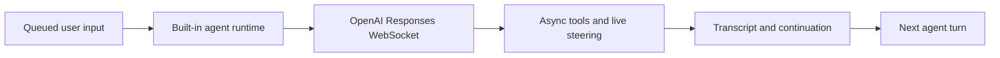

Codex review: blocked before merge. _Reviewed September 4, 2026, 5:30 AM ET / 09:30 UTC._

# ClawSweeper review

## What this changes

Adds Astra-only asynchronous function tools, mid-turn steering over cached OpenAI Responses WebSockets, and cache-preserving reasoning-effort updates to OpenClaw’s built-in runtime.

## Merge readiness

⛔ **Blocked before merge - 4 items remain**

Keep this PR open for its intended feature work. The current agent and transport boundaries appear coherent, but no inspectable authenticated Astra trace independently verifies the new OpenAI protocol path; recent Responses-runtime history makes steipete a likely routing candidate.

**Priority:** P2
**Reviewed head:** `2025d133d6acf1b00e1fcf94151265fb5abd8227`

## Review scores

| Measure | Result | What it means |
|---|---|---|
| **Overall readiness** | 🦐 gold shrimp **(3/6)** | The owner-boundary implementation and focused coverage are solid, but external-provider behavior lacks inspectable real-path evidence. |
| **Proof confidence** | 🦐 gold shrimp **(3/6)** | Not applicable: Real behavior proof is not required for maintainer- or bot-authored pull requests. |
| **Patch quality** | 🐚 platinum hermit **(4/6)** | No actionable review findings were identified. |

## Verification

| Check | Result | Evidence |
|---|---|---|
| **Real behavior** | Not applicable | Not applicable: Real behavior proof is not required for maintainer- or bot-authored pull requests. |
| **Evidence reviewed** | 8 items | Astra activation is narrowly scoped: Async tool marking is enabled only for gpt-6-astra, an official OpenAI Responses endpoint, host support, and a non-Code-Mode tool surface. Official endpoint gate: The WebSocket capability accepts only the OpenAI provider, Responses API, and exact official HTTPS /v1 base URL. Agent ownership boundary: The streamed agent-response owner persists an async tool fragment before dispatch, settles tool execution, and then completes steering lifecycle handling. |
| **Findings** | None | None. |
| **Security** | None | None. |

## How this fits together

OpenClaw’s built-in agent runtime streams model responses, runs admitted tools, and stores conversation state for subsequent turns. The change extends the official OpenAI Responses path while feeding results and accepted user input back through the normal transcript and continuation flow.

## Before merge

- [ ] **Resolve merge risk (P1)** - The new response.steer and configuration_update behavior depends on the current official OpenAI Responses contract, which could not be independently rechecked from this read-only environment; no inspectable authenticated Astra trace accompanies the available review evidence.
- [ ] **Complete next step (P2)** - Attach redacted authenticated Astra evidence for async tools, live steering, and reasoning-effort updates against the official Responses endpoint.
- [ ] **Resolve review confidence** - ClawSweeper must reach high confidence before merge readiness is known.
- [ ] **Add data-model compatibility proof** - Confirm migration or upgrade compatibility proof before merge.

<strong>Agent review details</strong>

### Security

None.

### PR surface

Source +1236, Tests +2632, Docs +51, Other 0. Total +3919 across 31 files.

View PR surface stats

| Area | Files | Added | Removed | Net |
|---|---:|---:|---:|---:|
| Source | 20 | 1563 | 327 | +1236 |
| Tests | 9 | 2635 | 3 | +2632 |
| Docs | 1 | 52 | 1 | +51 |
| Config | 0 | 0 | 0 | 0 |
| Generated | 0 | 0 | 0 | 0 |
| Other | 1 | 1 | 1 | 0 |
| **Total** | **31** | **4251** | **332** | **+3919** |

### Review metrics

| Metric | Value | Why it matters |
|---|---|---|
| **Production versus test delta** | production +1,236 net, tests +2,632 net, docs +51 net | The substantial runtime growth implements a new provider capability and is accompanied by focused lifecycle and transport coverage. |

### Stored data model

Persistent data-model change detected: `serialized state: packages/ai/src/transports/openai-responses-steering.ts`, `unknown-data-model-change: packages/ai/src/transports/openai-responses-replay-messages-internal.ts`, `unknown-data-model-change: packages/ai/src/transports/openai-responses-steering.ts`. Confirm migration or upgrade compatibility proof before merge.

### Merge-risk options

**Maintainer options:**
1. **Capture the real provider boundary (recommended)**  
   Attach a redacted authenticated Astra trace that demonstrates the three newly sent protocol paths against the official endpoint before merging.
2. **Pause pending provider verification**  
   Pause the PR if current Astra protocol access cannot be demonstrated, because mocked transport coverage cannot establish external API compatibility.

### Technical review

Best possible solution:

Retain the narrow Astra and official-endpoint gates, and attach a redacted authenticated Astra trace covering an async tool, accepted steering, and an effort update before merge.

Do we have a high-confidence way to reproduce the issue?

Not applicable: this PR adds a new provider-runtime capability rather than repairing a reported current-main defect.

Is this the best way to solve the issue?

Unclear: the feature is implemented at the stream, transcript, and continuation owners rather than through a downstream workaround, but the external API contract has not been independently verified.

AGENTS.md: found and applied where relevant.

Codex review notes: model internal, reasoning high; reviewed against [e0c230789b33](https://github.com/openclaw/openclaw/commit/e0c230789b33d4a59a8cda1f7b0858c4af0d5e7a).

### Labels

Label changes:

- add `P2`: This is a bounded provider-runtime enhancement with no evidence of an active outage.
- add `merge-risk: 🚨 compatibility`: The new WebSocket events and input item depend on an external Responses API contract that was not independently exercised or rechecked in this environment.
- add `rating: 🦐 gold shrimp`: Overall readiness is 🦐 gold shrimp; proof is 🦐 gold shrimp and patch quality is 🐚 platinum hermit.
- add `status: 👀 ready for maintainer look`: ClawSweeper has no concrete contributor-facing blocker left for this PR. Not applicable: Real behavior proof is not required for maintainer- or bot-authored pull requests.

Label justifications:

- `P2`: This is a bounded provider-runtime enhancement with no evidence of an active outage.
- `merge-risk: 🚨 compatibility`: The new WebSocket events and input item depend on an external Responses API contract that was not independently exercised or rechecked in this environment.
- `rating: 🦐 gold shrimp`: Overall readiness is 🦐 gold shrimp; proof is 🦐 gold shrimp and patch quality is 🐚 platinum hermit.
- `status: 👀 ready for maintainer look`: ClawSweeper has no concrete contributor-facing blocker left for this PR. Not applicable: Real behavior proof is not required for maintainer- or bot-authored pull requests.

### Evidence

Acceptance criteria:

- [P1] Run the focused Responses transport and agent-stream suites in an approved environment.
- [P1] Capture and inspect a redacted authenticated Astra trace for the three new protocol paths.

What I checked:

- **Astra activation is narrowly scoped:** Async tool marking is enabled only for gpt-6-astra, an official OpenAI Responses endpoint, host support, and a non-Code-Mode tool surface. ([`packages/ai/src/transports/openai-responses-client.ts:246`](https://github.com/openclaw/openclaw/blob/2025d133d6acf1b00e1fcf94151265fb5abd8227/packages/ai/src/transports/openai-responses-client.ts#L246), [2025d133d6ac](https://github.com/openclaw/openclaw/commit/2025d133d6acf1b00e1fcf94151265fb5abd8227))
- **Official endpoint gate:** The WebSocket capability accepts only the OpenAI provider, Responses API, and exact official HTTPS /v1 base URL. ([`packages/ai/src/transports/openai-responses-websocket.ts:95`](https://github.com/openclaw/openclaw/blob/2025d133d6acf1b00e1fcf94151265fb5abd8227/packages/ai/src/transports/openai-responses-websocket.ts#L95), [2025d133d6ac](https://github.com/openclaw/openclaw/commit/2025d133d6acf1b00e1fcf94151265fb5abd8227))
- **Agent ownership boundary:** The streamed agent-response owner persists an async tool fragment before dispatch, settles tool execution, and then completes steering lifecycle handling. ([`packages/agent-core/src/agent-stream-response.ts:301`](https://github.com/openclaw/openclaw/blob/2025d133d6acf1b00e1fcf94151265fb5abd8227/packages/agent-core/src/agent-stream-response.ts#L301), [2025d133d6ac](https://github.com/openclaw/openclaw/commit/2025d133d6acf1b00e1fcf94151265fb5abd8227))
- **Continuation and ordering coverage:** Added unit and transport-integration coverage exercises effort-update ordering, accepted steering, required input, late failures, and deferred async-result delivery. ([`packages/ai/src/transports/openai-responses-steering.integration.test.ts:458`](https://github.com/openclaw/openclaw/blob/2025d133d6acf1b00e1fcf94151265fb5abd8227/packages/ai/src/transports/openai-responses-steering.integration.test.ts#L458), [2025d133d6ac](https://github.com/openclaw/openclaw/commit/2025d133d6acf1b00e1fcf94151265fb5abd8227))
- **Current main does not supersede the feature:** The fetched main context lacks the new streamed-response owner and active-response options; the PR adds and modifies these surfaces. ([`packages/agent-core/src/agent-stream-response.ts`](https://github.com/openclaw/openclaw/blob/e0c230789b33d4a59a8cda1f7b0858c4af0d5e7a/packages/agent-core/src/agent-stream-response.ts), [e0c230789b33](https://github.com/openclaw/openclaw/commit/e0c230789b33d4a59a8cda1f7b0858c4af0d5e7a))
- **Documented runtime boundary:** The documentation supplies an explicit built-in-runtime enablement path and states that the native Codex harness owns a separate Responses loop. Public docs: [`docs/providers/openai.md`](https://docs.openclaw.ai/providers/openai). ([`docs/providers/openai.md:86`](https://docs.openclaw.ai/providers/openai), [2025d133d6ac](https://github.com/openclaw/openclaw/commit/2025d133d6acf1b00e1fcf94151265fb5abd8227))

Likely related people:

- **steipete:** Suggested for follow-up; no historical authorship or introduction is verified. (role: unverified routing candidate; confidence: low)

### Rank-up moves

Optional improvements that raise the rating; they are not merge blockers.

- Attach a redacted authenticated Astra protocol trace covering async tools, steering, and effort updates.

### Rating scale

| Score | Internal tier | Crab rank | Meaning |
|---:|:---:|---|---|
| **6/6** | S | 🦀 challenger crab | Exceptional readiness |
| **5/6** | A | 🦞 diamond lobster | Very strong readiness |
| **4/6** | B | 🐚 platinum hermit | Good normal PR; ordinary maintainer review |
| **3/6** | C | 🦐 gold shrimp | Useful, but confidence is limited |
| **2/6** | D | 🦪 silver shellfish | Proof or implementation needs work |
| **1/6** | F | 🧂 unranked krab | Not merge-ready |
| N/A | NA | 🌊 off-meta tidepool | Rating does not apply |

Overall follows the weaker of proof and patch quality.
Shiny media proof means a screenshot, video, or linked artifact directly shows the changed behavior. Runtime, network, CSP, and security claims still need visible diagnostics.

### Workflow

- ClawSweeper keeps one durable marker-backed review comment per issue or PR.
- Re-runs edit this comment so the latest verdict, findings, and automation markers stay together instead of adding duplicate bot comments.
- A fresh review can be triggered by eligible `@clawsweeper re-review` comments, exact-item GitHub events, scheduled/background review runs, or manual workflow dispatch.
- PR/issue authors and users with repository write access can comment `@clawsweeper re-review` or `@clawsweeper re-run` on an open PR or issue to request a fresh review only.
- Maintainers can also comment `@clawsweeper review` to request a fresh review only.
- Fresh-review commands do not start repair, autofix, rebase, CI repair, or automerge.
- Maintainer-only repair and merge flows require explicit commands such as `@clawsweeper autofix`, `@clawsweeper automerge`, `@clawsweeper fix ci`, or `@clawsweeper address review`.
- Maintainers can comment `@clawsweeper explain` to ask for more context, or `@clawsweeper stop` to stop active automation.

<!-- clawsweeper-verdict:needs-human item=138046 sha=2025d133d6acf1b00e1fcf94151265fb5abd8227 confidence=medium updated_at=2026-09-04T09:24:01Z reviewed_at=2026-09-04T09:30:45.275Z lease_owner=github-run-33857518063-1 lease_comment_id=5538403969 source_revision=28a3f76f220b23e043afd6395dd8d590f7c2c7e8cf5e49f9c8e5f70399991310 live_verification=absent -->
<!-- clawsweeper-review-state:blocked item=138046 sha=2025d133d6acf1b00e1fcf94151265fb5abd8227 v=1 -->

<!-- clawsweeper-review-version item=138046 reviewed_at=2026-09-04T09:30:45.275Z sha=2025d133d6acf1b00e1fcf94151265fb5abd8227 source_revision=28a3f76f220b23e043afd6395dd8d590f7c2c7e8cf5e49f9c8e5f70399991310 lease_owner=github-run-33857518063-1 lease_comment_id=5538403969 v=1 -->

<!-- clawsweeper-review item=138046 -->