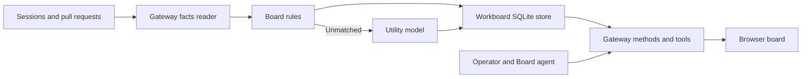

Codex review: needs real behavior proof before merge. _Reviewed September 30, 2026, 4:05 PM ET / 20:05 UTC (Revision 9)._

# ClawSweeper review

## What this changes

Adds Sessions boards to the Workboard plugin, using Gateway facts and a utility model to group conversations in editable columns, with browser views, Board agent tools, RPCs, and SQLite storage.

> [!WARNING]
> **SQLite table change**
>
> This PR modifies persisted SQLite tables in `extensions/workboard/src/sqlite-store-kernel.ts`, `extensions/workboard/src/sqlite-store-schema.ts`. Prefer a design that avoids changing persisted SQLite tables. Migration or upgrade compatibility proof is recorded, but maintainers should still confirm that the schema change is necessary.

## Merge readiness

⛔ **Blocked before merge - 9 items remain**

Keep open. Current main and the latest release have only Cards boards, while this PR provides a distinct Sessions-board capability. The latest push resolves the prior draft-session finding, but the branch is not yet merge-ready.

**Priority:** P2
**Reviewed head:** `a5ab434107550ef1aa646bd47004d17ed0180278`

## Review scores

| Measure | Result | What it means |
|---|---|---|
| **Overall readiness** | 🦪 silver shellfish **(2/6)** | The visible workflow has direct screenshot proof, but a final-write authority defect and an upgrade-proof gap prevent merge readiness. |
| **Proof confidence** | 🦐 gold shrimp **(3/6)** | Needs stronger real behavior proof before merge: Authority-chain proof required: inspected dev-Gateway screenshots show the new board, classified sessions, and docked agent, but the revocation tests pause before worker dispatch and do not show rejection before SQLite commit. A worker-boundary trace must show an allowed edit committing and a caller revoked after dispatch leaving the stored board unchanged. The prior-schema reopen test and reported passing run support forward stored-data compatibility; the documented older-reader rollback behavior was explicitly accepted. The fifth linked image was absent from the prepared manifest, a reviewer inspection gap. After adding proof, update the PR body; ClawSweeper should re-review automatically. If it does not, the PR author or someone with repository write access can comment `@clawsweeper re-review`. |
| **Patch quality** | 🦪 silver shellfish **(2/6)** | Security review found an item that needs attention. |

## Verification

| Check | Result | Evidence |
|---|---|---|
| **Real behavior** | Needs proof | Needs stronger real behavior proof before merge: Authority-chain proof required: inspected dev-Gateway screenshots show the new board, classified sessions, and docked agent, but the revocation tests pause before worker dispatch and do not show rejection before SQLite commit. A worker-boundary trace must show an allowed edit committing and a caller revoked after dispatch leaving the stored board unchanged. The prior-schema reopen test and reported passing run support forward stored-data compatibility; the documented older-reader rollback behavior was explicitly accepted. The fifth linked image was absent from the prepared manifest, a reviewer inspection gap. After adding proof, update the PR body; ClawSweeper should re-review automatically. If it does not, the PR author or someone with repository write access can comment `@clawsweeper re-review`. |
| **Evidence reviewed** | 13 items | Current main lacks Sessions boards: The current-main Workboard guide describes card boards, and the searched Workboard, Gateway, plugin runtime, and guide paths have no Sessions-board or session-facts API match. Latest release remains card-oriented: The v2026.9.7 Workboard guide describes cards and has no Sessions-board section. Latest draft-session repair: The latest commit excludes drafts before transcript preview enrichment and again during final facts presentation; its regression case checks a foreign draft is absent from a service-scoped read. |
| **Findings** | 1 actionable finding | [P1] Recheck caller authority at the native Sessions-board commit |
| **Security** | Needs attention | Revoked caller can reach a later board commit: The new worker write path checks authority before dispatch and has no check at its synchronous SQLite commit, allowing a role or connection revoked in between to retain write effect. |

## How this fits together

Workboard is an optional Control UI plugin for organizing agent work. The Gateway supplies session and pull-request facts; Workboard classifies them, stores placements, and presents the board to operators and agents.

## Before merge

- [ ] **Add real behavior proof** - Needs stronger real behavior proof before merge: Authority-chain proof required: inspected dev-Gateway screenshots show the new board, classified sessions, and docked agent, but the revocation tests pause before worker dispatch and do not show rejection before SQLite commit. A worker-boundary trace must show an allowed edit committing and a caller revoked after dispatch leaving the stored board unchanged. The prior-schema reopen test and reported passing run support forward stored-data compatibility; the documented older-reader rollback behavior was explicitly accepted. The fifth linked image was absent from the prepared manifest, a reviewer inspection gap. After adding proof, update the PR body; ClawSweeper should re-review automatically. If it does not, the PR author or someone with repository write access can comment `@clawsweeper re-review`.
- [ ] **Recheck caller authority at the native Sessions-board commit (P1)** - The new update and placement writes use `execute(..., true)`, which checks the caller before worker dispatch but supplies no native transaction or commit admission. Revocation after `postMessage` can therefore precede a durable board write. The supplied tests pause before dispatch. Bind these writes to native admission and prove a revoked caller leaves SQLite unchanged.
- [ ] **Resolve security concern: Revoked caller can reach a later board commit** - The new worker write path checks authority before dispatch and has no check at its synchronous SQLite commit, allowing a role or connection revoked in between to retain write effect.
- [ ] **Resolve merge risk (P1)** - A caller revoked after a Sessions-board write is dispatched to the SQLite worker may still have its board change committed; the supplied tests do not cover that final-effect window.
- [ ] **Resolve merge risk (P1)** - Plugin service startup changes without a published-driver × candidate update run on existing operator state, leaving upgrade behavior unverified.
- [ ] **Complete next step (P2)** - Guard both interactive Sessions-board writes at native SQLite commit, prove post-dispatch revocation at the final effect, and provide a published-driver × candidate update result.
- [ ] **Improve patch quality** - Add final-effect proof that a revoked operator after worker dispatch cannot commit a Sessions-board update or move.
- [ ] **Improve patch quality** - Run a published-driver × candidate update with an existing Workboard database and record the resulting service startup and board state.
- [ ] **Review config compatibility** - Confirm compatibility and upgrade impact for the changed config or default surface before merge.

## Findings

- [P1] Recheck caller authority at the native Sessions-board commit — `extensions/workboard/src/sqlite-store.ts:227-234`
- [high] Revoked caller can reach a later board commit — `extensions/workboard/src/sqlite-store.ts:228`

<strong>Agent review details</strong>

### Security

Needs attention: The diff adds no dependency or workflow supply-chain change, but interactive board writes have a final-effect caller-authority gap.

### PR surface

PR surface statistics unavailable: the file list is incomplete.

### Review metrics

| Metric | Value | Why it matters |
|---|---|---|
| **New agent surface** | 1 trusted Gateway facts method; 3 default-on tools | Enabling Workboard makes the new board tools available to agents without a tool allowlist entry. |
| **Stored model** | 2 nullable columns; 1 placement table | The additive schema has forward-reopen proof and an explicitly accepted older-reader rollback limitation. |
| **Net code growth** | production +3252 lines; tests +2085 lines | The distinct board implementation explains the growth, while its size warrants focused owner review. |

### Stored data model

Persistent data-model change detected: `database schema: extensions/workboard/browser/i18n/locales/en.ts`, `database schema: extensions/workboard/src/sqlite-store-schema.ts`, `migration/backfill/repair: src/gateway/server-plugin-session-facts.ts`, `serialized state: extensions/workboard/src/persistence-types.ts`, `serialized state: extensions/workboard/src/tools-orchestration.ts`, `unknown-data-model-change: extensions/workboard/src/sqlite-store-kernel.ts`, and 1 more. Migration or upgrade compatibility proof is recorded; maintainers should verify it before merge.

### Merge-risk options

**Maintainer options:**
1. **Guard the final write (recommended)**  
   Add native transaction and commit admission for interactive Sessions-board writes, prove post-dispatch revocation leaves SQLite unchanged, and run the required seeded upgrade cell.
2. **Pause landing**  
   Keep the feature branch open while the authority boundary and installed-update behavior are resolved.

### Technical review

Best possible solution:

Keep Sessions boards in Workboard, admit interactive writes through a native commit guard, and verify a seeded installed-release update before landing.

Do we have a high-confidence way to reproduce the issue?

No current-main reproduction applies to this new feature. The post-dispatch revocation window follows from source, but no supplied final-effect test exercises it.

Is this the best way to solve the issue?

No. A separate plugin-owned Sessions board fits the existing Workboard boundary, but its interactive writes need authority checked at the native commit before this patch is safe to land.

Full review comments:

- [P1] Recheck caller authority at the native Sessions-board commit — `extensions/workboard/src/sqlite-store.ts:227-234`
  The new update and placement writes use `execute(..., true)`, which checks the caller before worker dispatch but supplies no native transaction or commit admission. Revocation after `postMessage` can therefore precede a durable board write. The supplied tests pause before dispatch. Bind these writes to native admission and prove a revoked caller leaves SQLite unchanged.
  Confidence: 0.9

Overall correctness: patch is incorrect
Overall confidence: 0.87

AGENTS.md: found and applied where relevant.

Codex review notes: model internal, reasoning high; reviewed against [bce6b857a41d](https://github.com/openclaw/openclaw/commit/bce6b857a41dc2694e557a6c751369d8bc030098).

### Labels

Label changes:

No label changes.

Label justifications:

- `P2`: This is a substantial optional Workboard improvement with a merge blocker, rather than a current user regression.
- `merge-risk: 🚨 security-boundary`: The new interactive writes can outlive a caller-authority check before their final SQLite effect.
- `merge-risk: 🚨 compatibility`: The changed plugin service startup path still needs installed-update proof; the separate rollback limitation was explicitly accepted.
- `rating: 🦪 silver shellfish`: Overall readiness is 🦪 silver shellfish; proof is 🦐 gold shrimp and patch quality is 🦪 silver shellfish.
- `status: 📣 needs proof`: The PR needs real behavior proof before ClawSweeper can clear the contributor ask. Needs stronger real behavior proof before merge: Authority-chain proof required: inspected dev-Gateway screenshots show the new board, classified sessions, and docked agent, but the revocation tests pause before worker dispatch and do not show rejection before SQLite commit. A worker-boundary trace must show an allowed edit committing and a caller revoked after dispatch leaving the stored board unchanged. The prior-schema reopen test and reported passing run support forward stored-data compatibility; the documented older-reader rollback behavior was explicitly accepted. The fifth linked image was absent from the prepared manifest, a reviewer inspection gap. After adding proof, update the PR body; ClawSweeper should re-review automatically. If it does not, the PR author or someone with repository write access can comment `@clawsweeper re-review`.
- `proof: 📸 screenshot`: Contributor real behavior proof includes screenshot evidence. Authority-chain proof required: inspected dev-Gateway screenshots show the new board, classified sessions, and docked agent, but the revocation tests pause before worker dispatch and do not show rejection before SQLite commit. A worker-boundary trace must show an allowed edit committing and a caller revoked after dispatch leaving the stored board unchanged. The prior-schema reopen test and reported passing run support forward stored-data compatibility; the documented older-reader rollback behavior was explicitly accepted. The fifth linked image was absent from the prepared manifest, a reviewer inspection gap.

### Evidence

Security concerns:

- [high] Revoked caller can reach a later board commit — `extensions/workboard/src/sqlite-store.ts:228`
  The new worker write path checks authority before dispatch and has no check at its synchronous SQLite commit, allowing a role or connection revoked in between to retain write effect.
  Confidence: 0.9

What I checked:

- **Current main lacks Sessions boards:** The current-main Workboard guide describes card boards, and the searched Workboard, Gateway, plugin runtime, and guide paths have no Sessions-board or session-facts API match. Public docs: [`docs/plugins/workboard.md`](https://docs.openclaw.ai/plugins/workboard). ([`docs/plugins/workboard.md:10`](https://docs.openclaw.ai/plugins/workboard), [bce6b857a41d](https://github.com/openclaw/openclaw/commit/bce6b857a41dc2694e557a6c751369d8bc030098))
- **Latest release remains card-oriented:** The v2026.9.7 Workboard guide describes cards and has no Sessions-board section. Public docs: [`docs/plugins/workboard.md`](https://docs.openclaw.ai/plugins/workboard). ([`docs/plugins/workboard.md:11`](https://docs.openclaw.ai/plugins/workboard), [c074824a27c9](https://github.com/openclaw/openclaw/commit/c074824a27c96d3983043f9eeb33823cd1772d8c))
- **Latest draft-session repair:** The latest commit excludes drafts before transcript preview enrichment and again during final facts presentation; its regression case checks a foreign draft is absent from a service-scoped read. ([`src/gateway/server-plugin-session-facts.ts:172`](https://github.com/openclaw/openclaw/blob/a5ab434107550ef1aa646bd47004d17ed0180278/src/gateway/server-plugin-session-facts.ts#L172), [a5ab43410755](https://github.com/openclaw/openclaw/commit/a5ab434107550ef1aa646bd47004d17ed0180278))
- **New writes use dispatch admission:** Both new Sessions-board writes pass through execute with writes=true. That path supplies assertCurrent to runSqliteWorkerStoreOperation, but supplies no native transaction or commit admission. ([`extensions/workboard/src/sqlite-store.ts:227`](https://github.com/openclaw/openclaw/blob/a5ab434107550ef1aa646bd47004d17ed0180278/extensions/workboard/src/sqlite-store.ts#L227), [a5ab43410755](https://github.com/openclaw/openclaw/commit/a5ab434107550ef1aa646bd47004d17ed0180278))
- **Dispatch precedes worker execution:** The broker checks authority before postMessage. The repository also provides runSqliteWorkerStoreWrite for authority requests after transaction start and immediately before commit. ([`src/infra/sqlite-worker-broker-reply.ts:47`](https://github.com/openclaw/openclaw/blob/a5ab434107550ef1aa646bd47004d17ed0180278/src/infra/sqlite-worker-broker-reply.ts#L47), [a5ab43410755](https://github.com/openclaw/openclaw/commit/a5ab434107550ef1aa646bd47004d17ed0180278))
- **Worker transaction has no final guard:** The new Sessions-board store calls synchronous SQLite transactions without a commit guard; the worker backend directly invokes those store methods. ([`extensions/workboard/src/sqlite-store-sessions-board.ts:49`](https://github.com/openclaw/openclaw/blob/a5ab434107550ef1aa646bd47004d17ed0180278/extensions/workboard/src/sqlite-store-sessions-board.ts#L49), [a5ab43410755](https://github.com/openclaw/openclaw/commit/a5ab434107550ef1aa646bd47004d17ed0180278))

Likely related people:

- **steipete:** Suggested for follow-up; no historical authorship or introduction is verified. (role: unverified routing candidate; confidence: low)
- **vyctorbrzezowski:** Suggested for follow-up; no historical authorship or introduction is verified. (role: unverified routing candidate; confidence: low)
- **joshavant:** Suggested for follow-up; no historical authorship or introduction is verified. (role: unverified routing candidate; confidence: low)

### Rating scale

| Score | Internal tier | Crab rank | Meaning |
|---:|:---:|---|---|
| **6/6** | S | 🦀 challenger crab | Exceptional readiness |
| **5/6** | A | 🦞 diamond lobster | Very strong readiness |
| **4/6** | B | 🐚 platinum hermit | Good normal PR; ordinary maintainer review |
| **3/6** | C | 🦐 gold shrimp | Useful, but confidence is limited |
| **2/6** | D | 🦪 silver shellfish | Proof or implementation needs work |
| **1/6** | F | 🧂 unranked krab | Not merge-ready |
| N/A | NA | 🌊 off-meta tidepool | Rating does not apply |

Overall follows the weaker of proof and patch quality.
Shiny media proof means a screenshot, video, or linked artifact directly shows the changed behavior. Runtime, network, CSP, and security claims still need visible diagnostics.

### Workflow

- ClawSweeper keeps one durable marker-backed review comment per issue or PR.
- Re-runs edit this comment so the latest verdict, findings, and automation markers stay together instead of adding duplicate bot comments.
- A fresh review can be triggered by eligible `@clawsweeper re-review` comments, exact-item GitHub events, scheduled/background review runs, or manual workflow dispatch.
- PR/issue authors and users with repository write access can comment `@clawsweeper re-review` or `@clawsweeper re-run` on an open PR or issue to request a fresh review only.
- Maintainers can also comment `@clawsweeper review` to request a fresh review only.
- Fresh-review commands do not start repair, autofix, rebase, CI repair, or automerge.
- Maintainer-only repair and merge flows require explicit commands such as `@clawsweeper autofix`, `@clawsweeper automerge`, `@clawsweeper fix ci`, or `@clawsweeper address review`.
- Maintainers can comment `@clawsweeper explain` to ask for more context, or `@clawsweeper stop` to stop active automation.

### History

Review history (8 earlier review cycles)

<!-- clawsweeper-review-history v=1 total=8 -->
- reviewed 2026-09-30T15:51:44.286Z sha e8d81e6856bb5f2c6613a7a7de337d90a77e26de :: needs real behavior proof before merge. :: [P2] Clear the busy state after a disconnected write
- reviewed 2026-09-30T16:04:46.076Z sha e8d81e6856bb5f2c6613a7a7de337d90a77e26de :: needs real behavior proof before merge. :: none
- reviewed 2026-09-30T17:00:42.958Z sha db838aa4e9927eef47204f6db85e1617f2b206fd :: needs real behavior proof before merge. :: [P1] [P1] Carry the edit caller's authority to the final board write
- reviewed 2026-09-30T17:24:09.527Z sha ea71bf5c1a03ae6f0f05086d40eba48ae1cfafc2 :: needs real behavior proof before merge. :: [P1] Carry full operator authority to the final Sessions-board write
- reviewed 2026-09-30T17:44:27.536Z sha c487ce5147f38bcbe6b000192e02b06864b20376 :: needs real behavior proof before merge. :: [P1] Keep private draft text out of shared model classification | [P1] Recheck caller authority at native SQLite commit | [P1] Preserve board meaning when rolling back to the released reader
- reviewed 2026-09-30T18:10:22.580Z sha 260644644037959a9f3c539181f27b12b8af7fea :: needs real behavior proof before merge. :: [P1] Exclude private drafts from service-owned model requests | [P1] Require native commit admission for interactive board writes | [P1] Keep Sessions rows out of the released Cards reader
- reviewed 2026-09-30T18:31:44.270Z sha 67f5ec3102c190b5c2bf052367cb9afeed87e9c1 :: needs real behavior proof before merge. :: [P1] Exclude draft sessions before utility-model I/O | [P1] Gate Sessions-board writes at native SQLite commit | [P1] Keep Sessions rows out of the released Cards reader
- reviewed 2026-09-30T18:42:10.339Z sha c2045635c0d0cf646460b10a6f71dd16dbe50ea6 :: needs real behavior proof before merge. :: [P1] Exclude draft sessions before utility-model I/O | [P1] Gate Sessions-board writes at native SQLite commit | [P1] Keep Sessions rows out of the released Cards reader

<!-- clawsweeper-security:security-sensitive item=161958 sha=a5ab434107550ef1aa646bd47004d17ed0180278 confidence=high updated_at=2026-09-30T19:59:46Z reviewed_at=2026-09-30T20:05:22.608Z lease_owner=github-run-36769412935-1 lease_comment_id=5918655983 source_revision=e74aa152a1c30a31c2753847a9f2c925b56e2afc2f02061063aefab56dc0accb live_verification=absent -->
<!-- clawsweeper-verdict:needs-human item=161958 sha=a5ab434107550ef1aa646bd47004d17ed0180278 confidence=high updated_at=2026-09-30T19:59:46Z reviewed_at=2026-09-30T20:05:22.608Z lease_owner=github-run-36769412935-1 lease_comment_id=5918655983 source_revision=e74aa152a1c30a31c2753847a9f2c925b56e2afc2f02061063aefab56dc0accb live_verification=absent -->
<!-- clawsweeper-review-state:blocked item=161958 sha=a5ab434107550ef1aa646bd47004d17ed0180278 v=1 -->

<!-- clawsweeper-review-version item=161958 reviewed_at=2026-09-30T20:05:22.608Z sha=a5ab434107550ef1aa646bd47004d17ed0180278 source_revision=e74aa152a1c30a31c2753847a9f2c925b56e2afc2f02061063aefab56dc0accb lease_owner=github-run-36769412935-1 lease_comment_id=5918655983 v=1 -->

<!-- clawsweeper-review item=161958 -->