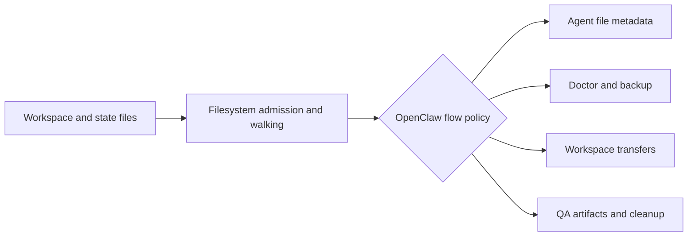

Codex review: blocked before merge. _Reviewed September 25, 2026, 9:49 PM ET / September 26, 2026, 01:49 UTC (Revision 7)._

# ClawSweeper review

## What this changes

The branch delegates filesystem reads, walks, and cleanup across Gateway, Doctor, backup, skills, and QA Lab to fs-safe, and settles failed inbound workspace transfers before returning.

## Merge readiness

⛔ **Blocked before merge - 1 item remains**

Current main still has the reported filesystem behavior, so this PR remains useful. The latest head addresses the prior Mantis cleanup identity finding; this review found no further discrete patch defect.

**Priority:** P2
**Reviewed head:** `0279f766e20b98900c1290ba1c7f82ab86760c00`

## Review scores

| Measure | Result | What it means |
|---|---|---|
| **Overall readiness** | 🐚 platinum hermit **(4/6)** | The branch has substantial reported real-path proof and focused regressions, with no remaining actionable finding from this read-only review. |
| **Proof confidence** | 🦞 diamond lobster **(5/6)** | Sufficient (terminal): The PR body reports after-change published-version update, Doctor, backup, Linux transfer, and Windows metadata observations for the changed production paths. The latest Mantis identity change has real-directory forbidden-receipt cases that reject before the injected Git runner; no stored-data format changes were found. |
| **Patch quality** | 🐚 platinum hermit **(4/6)** | No actionable review findings were identified. |

## Verification

| Check | Result | Evidence |
|---|---|---|
| **Real behavior** | Verified | Sufficient (terminal): The PR body reports after-change published-version update, Doctor, backup, Linux transfer, and Windows metadata observations for the changed production paths. The latest Mantis identity change has real-directory forbidden-receipt cases that reject before the injected Git runner; no stored-data format changes were found. |
| **Evidence reviewed** | 10 items | Current-main transfer behavior: On fetched main, a directory-scan rejection can leave the transfer promise unjoined because the scan occurs outside the transfer-settlement try block. Current-main metadata fallback: Fetched main retries a rejected guarded file-stat operation with a direct filesystem stat, so the branch's removal of that fallback remains a distinct change. Transfer settlement at PR head: The introduced catch aborts the active transfer and then awaits its settlement before returning the scan failure. |
| **Findings** | None | None. |
| **Security** | None | None. |

## How this fits together

OpenClaw uses filesystem admission when the Gateway, Doctor, backup, and QA Lab inspect or change workspace and state files. Those operations produce file metadata, recovery artifacts, transfer results, and QA artifacts.

## Before merge

- [ ] **Add data-model compatibility proof** - Confirm migration or upgrade compatibility proof before merge.

<strong>Agent review details</strong>

### Security

None.

### PR surface

Source -366, Tests +153, Config +1, Other +1. Total -211 across 39 files.

View PR surface stats

| Area | Files | Added | Removed | Net |
|---|---:|---:|---:|---:|
| Source | 20 | 276 | 642 | -366 |
| Tests | 15 | 258 | 105 | +153 |
| Docs | 0 | 0 | 0 | 0 |
| Config | 1 | 1 | 0 | +1 |
| Generated | 0 | 0 | 0 | 0 |
| Other | 3 | 3 | 2 | +1 |
| **Total** | **39** | **538** | **749** | **-211** |

### Review metrics

| Metric | Value | Why it matters |
|---|---|---|
| **QA Lab dependency** | 1 declaration added; fs-safe remains at 0.18.2 | The plugin now owns its direct import without introducing a new dependency version. |

### Stored data model

Persistent data-model change detected: `migration/backfill/repair: src/commands/doctor-session-transcripts.ts`, `migration/backfill/repair: src/commands/doctor-tools-md-migration.ts`, `migration/backfill/repair: src/commands/doctor-usage-cost-cache.ts`, `serialized state: src/commands/doctor-tools-md-migration.ts`, `serialized state: src/skills/library/bundle.ts`, `serialized state: src/transcripts/store-export-ownership.ts`, and 1 more. Confirm migration or upgrade compatibility proof before merge.

### Technical review

Best possible solution:

Use the shared filesystem admission primitives while retaining OpenClaw's flow-specific durability, retention, and exact authority checks for destructive cleanup.

Do we have a high-confidence way to reproduce the issue?

Yes. Current-main source shows a directory-scan error can exit before the active transfer is joined; the PR also reports a real child-writer probe. This read-only review did not run target code.

Is this the best way to solve the issue?

Yes. The branch uses the existing pinned filesystem owner and retains application-owned recovery and cleanup checks; the latest head restores the exact identity comparison required for destructive cleanup.

AGENTS.md: found and applied where relevant.

Codex review notes: model internal, reasoning high; reviewed against [dc8bfda016a0](https://github.com/openclaw/openclaw/commit/dc8bfda016a01e52b36b36c00742ebea7c88be5f).

### Labels

Label changes:

No label changes.

Label justifications:

- `P2`: The branch repairs a bounded workspace-transfer failure and consolidates filesystem behavior across several established paths.
- `rating: 🐚 platinum hermit`: Overall readiness is 🐚 platinum hermit; proof is 🦞 diamond lobster and patch quality is 🐚 platinum hermit.
- `status: 👀 ready for maintainer look`: ClawSweeper has no concrete contributor-facing blocker left for this PR. Sufficient (terminal): The PR body reports after-change published-version update, Doctor, backup, Linux transfer, and Windows metadata observations for the changed production paths. The latest Mantis identity change has real-directory forbidden-receipt cases that reject before the injected Git runner; no stored-data format changes were found.
- `proof: sufficient`: Contributor real behavior proof is sufficient. The PR body reports after-change published-version update, Doctor, backup, Linux transfer, and Windows metadata observations for the changed production paths. The latest Mantis identity change has real-directory forbidden-receipt cases that reject before the injected Git runner; no stored-data format changes were found.

### Evidence

What I checked:

- **Current-main transfer behavior:** On fetched main, a directory-scan rejection can leave the transfer promise unjoined because the scan occurs outside the transfer-settlement try block. ([`src/gateway/worker-environments/workspace-sync-helpers.ts:455`](https://github.com/openclaw/openclaw/blob/dc8bfda016a01e52b36b36c00742ebea7c88be5f/src/gateway/worker-environments/workspace-sync-helpers.ts#L455), [dc8bfda016a0](https://github.com/openclaw/openclaw/commit/dc8bfda016a01e52b36b36c00742ebea7c88be5f))
- **Current-main metadata fallback:** Fetched main retries a rejected guarded file-stat operation with a direct filesystem stat, so the branch's removal of that fallback remains a distinct change. ([`src/gateway/server-methods/agents-files.ts:131`](https://github.com/openclaw/openclaw/blob/dc8bfda016a01e52b36b36c00742ebea7c88be5f/src/gateway/server-methods/agents-files.ts#L131), [dc8bfda016a0](https://github.com/openclaw/openclaw/commit/dc8bfda016a01e52b36b36c00742ebea7c88be5f))
- **Transfer settlement at PR head:** The introduced catch aborts the active transfer and then awaits its settlement before returning the scan failure. ([`src/gateway/worker-environments/workspace-sync-helpers.ts:441`](https://github.com/openclaw/openclaw/blob/0279f766e20b98900c1290ba1c7f82ab86760c00/src/gateway/worker-environments/workspace-sync-helpers.ts#L441), [0279f766e20b](https://github.com/openclaw/openclaw/commit/0279f766e20b98900c1290ba1c7f82ab86760c00))
- **Exact cleanup identity at PR head:** Both the parent and target device/inode pairs are compared exactly before Mantis cleanup proceeds. ([`extensions/qa-lab/src/mantis/run-cleanup.runtime.ts:142`](https://github.com/openclaw/openclaw/blob/0279f766e20b98900c1290ba1c7f82ab86760c00/extensions/qa-lab/src/mantis/run-cleanup.runtime.ts#L142), [0279f766e20b](https://github.com/openclaw/openclaw/commit/0279f766e20b98900c1290ba1c7f82ab86760c00))
- **Prior finding regression coverage:** Four real-directory receipt cases inject an unknown Windows identity and assert rejection before the Git runner is called, addressing the previous review's specific forbidden case. ([`extensions/qa-lab/src/mantis/run-cleanup.runtime.test.ts:104`](https://github.com/openclaw/openclaw/blob/0279f766e20b98900c1290ba1c7f82ab86760c00/extensions/qa-lab/src/mantis/run-cleanup.runtime.test.ts#L104), [0279f766e20b](https://github.com/openclaw/openclaw/commit/0279f766e20b98900c1290ba1c7f82ab86760c00))
- **Dependency boundary:** QA Lab directly imports fs-safe and now declares version 0.18.2, matching OpenClaw's existing root dependency; the lockfile adds a QA Lab importer entry rather than a new fs-safe version. ([`extensions/qa-lab/package.json:11`](https://github.com/openclaw/openclaw/blob/0279f766e20b98900c1290ba1c7f82ab86760c00/extensions/qa-lab/package.json#L11), [0279f766e20b](https://github.com/openclaw/openclaw/commit/0279f766e20b98900c1290ba1c7f82ab86760c00))

Likely related people:

- **steipete:** Suggested for follow-up; no historical authorship or introduction is verified. (role: unverified routing candidate; confidence: low)
- **Vincent Koc:** Suggested for follow-up; no historical authorship or introduction is verified. (role: unverified routing candidate; confidence: low)
- **Ayaan Zaidi:** Suggested for follow-up; no historical authorship or introduction is verified. (role: unverified routing candidate; confidence: low)
- **xingzhou:** Suggested for follow-up; no historical authorship or introduction is verified. (role: unverified routing candidate; confidence: low)

### Rating scale

| Score | Internal tier | Crab rank | Meaning |
|---:|:---:|---|---|
| **6/6** | S | 🦀 challenger crab | Exceptional readiness |
| **5/6** | A | 🦞 diamond lobster | Very strong readiness |
| **4/6** | B | 🐚 platinum hermit | Good normal PR; ordinary maintainer review |
| **3/6** | C | 🦐 gold shrimp | Useful, but confidence is limited |
| **2/6** | D | 🦪 silver shellfish | Proof or implementation needs work |
| **1/6** | F | 🧂 unranked krab | Not merge-ready |
| N/A | NA | 🌊 off-meta tidepool | Rating does not apply |

Overall follows the weaker of proof and patch quality.
Shiny media proof means a screenshot, video, or linked artifact directly shows the changed behavior. Runtime, network, CSP, and security claims still need visible diagnostics.

### Workflow

- ClawSweeper keeps one durable marker-backed review comment per issue or PR.
- Re-runs edit this comment so the latest verdict, findings, and automation markers stay together instead of adding duplicate bot comments.
- A fresh review can be triggered by eligible `@clawsweeper re-review` comments, exact-item GitHub events, scheduled/background review runs, or manual workflow dispatch.
- PR/issue authors and users with repository write access can comment `@clawsweeper re-review` or `@clawsweeper re-run` on an open PR or issue to request a fresh review only.
- Maintainers can also comment `@clawsweeper review` to request a fresh review only.
- Fresh-review commands do not start repair, autofix, rebase, CI repair, or automerge.
- Maintainer-only repair and merge flows require explicit commands such as `@clawsweeper autofix`, `@clawsweeper automerge`, `@clawsweeper fix ci`, or `@clawsweeper address review`.
- Maintainers can comment `@clawsweeper explain` to ask for more context, or `@clawsweeper stop` to stop active automation.

### History

Review history (6 earlier review cycles)

<!-- clawsweeper-review-history v=1 total=6 -->
- reviewed 2026-09-25T20:38:20.131Z sha 59f6663b578662a9c0409d0cedf496e25261f7cf :: blocked before merge. :: none
- reviewed 2026-09-25T21:54:27.824Z sha 59f6663b578662a9c0409d0cedf496e25261f7cf :: blocked before merge. :: none
- reviewed 2026-09-25T23:00:24.165Z sha 2957a251daa306455a5f01432ed688d80a01d0ed :: blocked before merge. :: none
- reviewed 2026-09-25T23:21:38.126Z sha a2de9a72b5e1f0af5d71bde0cbf2bd0da854e882 :: blocked before merge. :: none
- reviewed 2026-09-26T00:31:28.661Z sha 8a36436e01e260f20926ada16452f91cbc846cd4 :: blocked before merge. :: none
- reviewed 2026-09-26T01:09:09.676Z sha 768160eb2af4e61423c40bee1e14759b506a38d8 :: needs real behavior proof before merge. :: [P2] Restore exact identity checks before Mantis worktree cleanup

<!-- clawsweeper-verdict:needs-human item=158313 sha=0279f766e20b98900c1290ba1c7f82ab86760c00 confidence=high updated_at=2026-09-26T01:44:52Z reviewed_at=2026-09-26T01:49:48.796Z lease_owner=github-run-36209355696-1 lease_comment_id=5842078800 source_revision=b6496baa0b73e3e83eeb74eaa91e297d2497833702892d611d85eb31ce720687 live_verification=absent -->
<!-- clawsweeper-review-state:blocked item=158313 sha=0279f766e20b98900c1290ba1c7f82ab86760c00 v=1 -->

<!-- clawsweeper-review-version item=158313 reviewed_at=2026-09-26T01:49:48.796Z sha=0279f766e20b98900c1290ba1c7f82ab86760c00 source_revision=b6496baa0b73e3e83eeb74eaa91e297d2497833702892d611d85eb31ce720687 lease_owner=github-run-36209355696-1 lease_comment_id=5842078800 v=1 -->

<!-- clawsweeper-review item=158313 -->