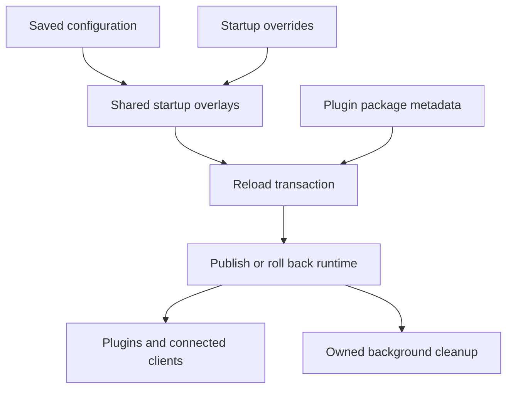

Codex review: blocked before merge. _Reviewed September 12, 2026, 3:59 PM ET / 19:59 UTC (Revision 4)._

# ClawSweeper review

## What this changes

The PR makes Gateway startup and reload apply configuration overrides consistently, consolidates plugin cleanup and loader caches, and shares CLI update selection and rollback.

## Merge readiness

⛔ **Blocked before merge - 1 item remains**

The PR remains useful and has no actionable correctness findings. The final-head upgrade evidence resolves the earlier compatibility-proof blocker; source inspection confirms no persisted-format migration is introduced.

**Priority:** P2
**Reviewed head:** `76f41cfa7ada5f3a52d0cdb868bf07e9def69c25`

## Review scores

| Measure | Result | What it means |
|---|---|---|
| **Overall readiness** | 🐚 platinum hermit **(4/6)** | A coherent repair with relevant runtime and upgrade observations, retained regression coverage, and no blocking findings. |
| **Proof confidence** | 🐚 platinum hermit **(4/6)** | Sufficient (live_output): The captured final-head observations exercise real Gateway reload, recovery, cleanup, contention, and source-only publication on Node and both Bun versions, plus a published-2026.9.4 upgrade preserving existing synthetic state. Coverage matches the changed owners; managed-service restart and provider inference are expressly outside the demonstrated scope. |
| **Patch quality** | 🐚 platinum hermit **(4/6)** | No actionable review findings were identified. |

## Verification

| Check | Result | Evidence |
|---|---|---|
| **Real behavior** | Verified | Sufficient (live_output): The captured final-head observations exercise real Gateway reload, recovery, cleanup, contention, and source-only publication on Node and both Bun versions, plus a published-2026.9.4 upgrade preserving existing synthetic state. Coverage matches the changed owners; managed-service restart and provider inference are expressly outside the demonstrated scope. |
| **Evidence reviewed** | 9 items | Current main still has the configuration-shape mismatch: At fetched main, startup always constructs both auth and Tailscale properties when either override exists, while reload conditionally constructs them. The reviewed branch shares the sparse merger and preserves generated-token mode only when the candidate omits it. Source publication has one rollback owner: The reload transaction retains the publication handle, rolls it back on acceptance or checkpoint failure, and commits it after successful baseline acceptance. The managed restart adapter no longer duplicates that rollback. Metadata refactor does not change stored formats: The changed scope cache stores lazy functions in a Map and reuses the existing parsed manifest record. Existing captured-file copying, manifest bytes, source-boundary checks, and disposal remain in their established owners; the patch adds no schema or serialized-format change. |
| **Findings** | None | None. |
| **Security** | None | None. |

## How this fits together

The Gateway turns saved configuration and startup overrides into the runtime used by plugins and connected clients. Its reload and cleanup owners coordinate replacement, rollback, and shutdown while preserving active connections.

## Before merge

- [ ] **Add data-model compatibility proof** - Confirm migration or upgrade compatibility proof before merge.

<strong>Agent review details</strong>

### Security

None.

### PR surface

Source -197, Tests +24, Docs +1. Total -172 across 43 files.

View PR surface stats

| Area | Files | Added | Removed | Net |
|---|---:|---:|---:|---:|
| Source | 21 | 298 | 495 | -197 |
| Tests | 21 | 541 | 517 | +24 |
| Docs | 1 | 6 | 5 | +1 |
| Config | 0 | 0 | 0 | 0 |
| Generated | 0 | 0 | 0 | 0 |
| Other | 0 | 0 | 0 | 0 |
| **Total** | **43** | **845** | **1017** | **-172** |

### Review metrics

| Metric | Value | Why it matters |
|---|---|---|
| **Published-updater compatibility** | 2026.9.4 → final candidate: 12 steps passed in 123.5 seconds | The supplied existing-state upgrade result addresses the previous review's compatibility-proof request. |

### Stored data model

Persistent data-model change detected: `serialized state: src/plugins/plugin-package-metadata-capture.ts`, `unknown-data-model-change: src/plugins/plugin-package-metadata-capture.ts`. Confirm migration or upgrade compatibility proof before merge.

### Technical review

Best possible solution:

Use the shared sparse overlay merger and lifecycle-owned publication, cleanup, and metadata caches while preserving explicit operator choices.

Do we have a high-confidence way to reproduce the issue?

Yes: current-main startup and reload construct different override shapes, and the supplied real-Gateway reproduction identifies source-only publication rejection. This review verified the mechanism from source without executing it.

Is this the best way to solve the issue?

Yes: sharing the existing overlay helper and consolidating transaction ownership repairs the mismatch without adding configuration or migration machinery.

AGENTS.md: found and applied where relevant.

Codex review notes: model internal, reasoning medium; reviewed against [63bafe6492ec](https://github.com/openclaw/openclaw/commit/63bafe6492ec448c640f817b975c4f532ee5deaf).

### Labels

Label changes:

- add `proof: sufficient`: Contributor real behavior proof is sufficient. The captured final-head observations exercise real Gateway reload, recovery, cleanup, contention, and source-only publication on Node and both Bun versions, plus a published-2026.9.4 upgrade preserving existing synthetic state. Coverage matches the changed owners; managed-service restart and provider inference are expressly outside the demonstrated scope.
- remove `merge-risk: 🚨 compatibility`: Current PR review selected no merge-risk labels.

Label justifications:

- `P2`: The PR repairs source-only configuration publication under startup overrides and simplifies the associated reload lifecycle.
- `rating: 🐚 platinum hermit`: Overall readiness is 🐚 platinum hermit; proof is 🐚 platinum hermit and patch quality is 🐚 platinum hermit.
- `status: 👀 ready for maintainer look`: ClawSweeper has no concrete contributor-facing blocker left for this PR. Sufficient (live_output): The captured final-head observations exercise real Gateway reload, recovery, cleanup, contention, and source-only publication on Node and both Bun versions, plus a published-2026.9.4 upgrade preserving existing synthetic state. Coverage matches the changed owners; managed-service restart and provider inference are expressly outside the demonstrated scope.
- `proof: sufficient`: Contributor real behavior proof is sufficient. The captured final-head observations exercise real Gateway reload, recovery, cleanup, contention, and source-only publication on Node and both Bun versions, plus a published-2026.9.4 upgrade preserving existing synthetic state. Coverage matches the changed owners; managed-service restart and provider inference are expressly outside the demonstrated scope.

### Evidence

What I checked:

- **Current main still has the configuration-shape mismatch:** At fetched main, startup always constructs both auth and Tailscale properties when either override exists, while reload conditionally constructs them. The reviewed branch shares the sparse merger and preserves generated-token mode only when the candidate omits it. ([`src/gateway/server-startup-config-helpers.ts:216`](https://github.com/openclaw/openclaw/blob/63bafe6492ec448c640f817b975c4f532ee5deaf/src/gateway/server-startup-config-helpers.ts#L216), [63bafe6492ec](https://github.com/openclaw/openclaw/commit/63bafe6492ec448c640f817b975c4f532ee5deaf))
- **Source publication has one rollback owner:** The reload transaction retains the publication handle, rolls it back on acceptance or checkpoint failure, and commits it after successful baseline acceptance. The managed restart adapter no longer duplicates that rollback. ([`src/gateway/config-reload.ts:730`](https://github.com/openclaw/openclaw/blob/76f41cfa7ada5f3a52d0cdb868bf07e9def69c25/src/gateway/config-reload.ts#L730), [76f41cfa7ada](https://github.com/openclaw/openclaw/commit/76f41cfa7ada5f3a52d0cdb868bf07e9def69c25))
- **Metadata refactor does not change stored formats:** The changed scope cache stores lazy functions in a Map and reuses the existing parsed manifest record. Existing captured-file copying, manifest bytes, source-boundary checks, and disposal remain in their established owners; the patch adds no schema or serialized-format change. ([`src/plugins/plugin-package-metadata-capture.ts:581`](https://github.com/openclaw/openclaw/blob/76f41cfa7ada5f3a52d0cdb868bf07e9def69c25/src/plugins/plugin-package-metadata-capture.ts#L581), [76f41cfa7ada](https://github.com/openclaw/openclaw/commit/76f41cfa7ada5f3a52d0cdb868bf07e9def69c25))
- **Cleanup ownership and caller cutover:** The stop owner now holds its own inventory while retaining single-flight stopping, late publication, bounded retries, and failed-handle retention. Startup producers publish through that owner; searches found no remaining references to the removed setters, npm-record helper, or merged-alias cache. ([`src/gateway/server-sidecar-owners.ts:5`](https://github.com/openclaw/openclaw/blob/76f41cfa7ada5f3a52d0cdb868bf07e9def69c25/src/gateway/server-sidecar-owners.ts#L5), [76f41cfa7ada](https://github.com/openclaw/openclaw/commit/76f41cfa7ada5f3a52d0cdb868bf07e9def69c25))
- **Regression coverage preserves meaningful contracts:** The kernel scenario checks explicit-token, auth-none, generated-token, and Tailscale-only startup against reload candidates, including source-byte preservation and a later explicit mode change. Publication coverage extends the existing scenario to acceptance and rollback failures. ([`src/gateway/server-kernel.test.ts:350`](https://github.com/openclaw/openclaw/blob/76f41cfa7ada5f3a52d0cdb868bf07e9def69c25/src/gateway/server-kernel.test.ts#L350), [76f41cfa7ada](https://github.com/openclaw/openclaw/commit/76f41cfa7ada5f3a52d0cdb868bf07e9def69c25))
- **Final-head runtime and published-updater evidence:** The captured PR body and https://github.com/openclaw/openclaw/pull/146275#issuecomment-5648288550 report six isolated real-Gateway scenarios on Node 26.5.0 and Bun 1.4.2/1.4.0. Source-only publication completed in 545 ms with runtime identity, PID, socket, registration, and listener preserved. The published 2026.9.4 updater completed all 12 steps to this candidate in 123.5 seconds, preserved synthetic operator state, and passed installed-Gateway health, exact-build RPC, shutdown, and CLI lock checks. Proof explicitly excludes managed-service restart and provider inference and records the earlier cold-cache timeout without weakening its deadline. These are supplied observations, not executions performed by this review. ([76f41cfa7ada](https://github.com/openclaw/openclaw/commit/76f41cfa7ada5f3a52d0cdb868bf07e9def69c25))

Likely related people:

- **steipete:** Suggested for follow-up; no historical authorship or introduction is verified. (role: unverified routing candidate; confidence: low)

### Rating scale

| Score | Internal tier | Crab rank | Meaning |
|---:|:---:|---|---|
| **6/6** | S | 🦀 challenger crab | Exceptional readiness |
| **5/6** | A | 🦞 diamond lobster | Very strong readiness |
| **4/6** | B | 🐚 platinum hermit | Good normal PR; ordinary maintainer review |
| **3/6** | C | 🦐 gold shrimp | Useful, but confidence is limited |
| **2/6** | D | 🦪 silver shellfish | Proof or implementation needs work |
| **1/6** | F | 🧂 unranked krab | Not merge-ready |
| N/A | NA | 🌊 off-meta tidepool | Rating does not apply |

Overall follows the weaker of proof and patch quality.
Shiny media proof means a screenshot, video, or linked artifact directly shows the changed behavior. Runtime, network, CSP, and security claims still need visible diagnostics.

### Workflow

- ClawSweeper keeps one durable marker-backed review comment per issue or PR.
- Re-runs edit this comment so the latest verdict, findings, and automation markers stay together instead of adding duplicate bot comments.
- A fresh review can be triggered by eligible `@clawsweeper re-review` comments, exact-item GitHub events, scheduled/background review runs, or manual workflow dispatch.
- PR/issue authors and users with repository write access can comment `@clawsweeper re-review` or `@clawsweeper re-run` on an open PR or issue to request a fresh review only.
- Maintainers can also comment `@clawsweeper review` to request a fresh review only.
- Fresh-review commands do not start repair, autofix, rebase, CI repair, or automerge.
- Maintainer-only repair and merge flows require explicit commands such as `@clawsweeper autofix`, `@clawsweeper automerge`, `@clawsweeper fix ci`, or `@clawsweeper address review`.
- Maintainers can comment `@clawsweeper explain` to ask for more context, or `@clawsweeper stop` to stop active automation.

### History

Review history (3 earlier review cycles)

<!-- clawsweeper-review-history v=1 total=3 -->
- reviewed 2026-09-12T18:07:55.295Z sha eb0fa4e3d444fce318ac3123c2cd02c05c3b7452 :: blocked before merge. :: none
- reviewed 2026-09-12T19:14:21.364Z sha 02de894f9b03f9100d012350db4e0288b5d19589 :: blocked before merge. :: none
- reviewed 2026-09-12T19:53:33.529Z sha 76f41cfa7ada5f3a52d0cdb868bf07e9def69c25 :: blocked before merge. :: none

<!-- clawsweeper-verdict:needs-human item=146275 sha=76f41cfa7ada5f3a52d0cdb868bf07e9def69c25 confidence=high updated_at=2026-09-12T19:56:35Z reviewed_at=2026-09-12T19:59:28.285Z lease_owner=github-run-34715537217-1 lease_comment_id=5648313773 source_revision=622de0c3786b94a74b1953440fba5382abafcdb7cdc84f1f882efdb57f1446e0 live_verification=absent -->
<!-- clawsweeper-review-state:blocked item=146275 sha=76f41cfa7ada5f3a52d0cdb868bf07e9def69c25 v=1 -->

<!-- clawsweeper-review-version item=146275 reviewed_at=2026-09-12T19:59:28.285Z sha=76f41cfa7ada5f3a52d0cdb868bf07e9def69c25 source_revision=622de0c3786b94a74b1953440fba5382abafcdb7cdc84f1f882efdb57f1446e0 lease_owner=github-run-34715537217-1 lease_comment_id=5648313773 v=1 -->

<!-- clawsweeper-review item=146275 -->