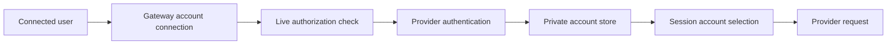

Codex review: blocked before merge. _Reviewed September 3, 2026, 8:52 AM ET / 12:52 UTC._

# ClawSweeper review

## What this changes

The PR adds provider-neutral, identity-scoped model accounts so users can connect personal provider credentials and select them for chats without exposing account identifiers to collaborators.

## Merge readiness

⛔ **Blocked before merge - 8 items remain**

Keep open for manual maintainer review. The examined authority chain addresses the earlier provider-I/O concern, but this large identity-scoped credential and routing feature still needs an explicit product/security contract decision and the required Codex runtime-source inspection before merge.

**Priority:** P1
**Reviewed head:** `926fae23b475389021e4fa8077f331fc3aa84e0c`
**Owner decision:** Required. See [Decision needed](#decision-needed).

## Review scores

| Measure | Result | What it means |
|---|---|---|
| **Overall readiness** | 🦐 gold shrimp **(3/6)** | The inspected implementation has coherent owner-boundary fences and substantial validation, but the unusually broad credential feature still lacks the required Codex contract check and maintainer contract decision. |
| **Proof confidence** | 🦐 gold shrimp **(3/6)** | Not applicable: Real behavior proof is not required for maintainer- or bot-authored pull requests. |
| **Patch quality** | 🐚 platinum hermit **(4/6)** | Security review found an item that needs attention. |

## Verification

| Check | Result | Evidence |
|---|---|---|
| **Real behavior** | Not applicable | Not applicable: Real behavior proof is not required for maintainer- or bot-authored pull requests. |
| **Evidence reviewed** | 8 items | Gateway authority owner: The new connection service retains the original action, revokes terminal operations before cancellation, passes a live assertion into provider authentication, rechecks it after the provider returns, and passes it into the private-store commit. Private credential ownership: Personal credentials are identity-scoped secret-store records; selection checks canonical ownership, and credential plus default-link writes occur together after the live assertion inside the synchronous transaction. Final HTTP request fence: The guarded fetch contract invokes a synchronous before-request callback after DNS and dispatcher preparation and immediately before every request; its loop repeats that sequence for redirects. |
| **Findings** | None | None. |
| **Security** | Needs attention | Codex app-server contract remains uninspected: The introduced Codex adapter carries authorization assertions into app-server requests, but the repository policy requires direct inspection of the sibling Codex source for this dependency contract; that checkout was unavailable in this read-only review. |

## How this fits together

Gateway account-connect operations obtain and store a user’s provider credential, then session creation resolves a selected personal or shared account into the provider profile used for a chat. Provider plugins perform the final OAuth, device-code, API-key, or app-server exchanges while Gateway maintains the caller’s live authorization.

## Decision needed

| Question | Recommendation |
|---|---|
| Should OpenClaw adopt this persistent provider-neutral personal-account contract, including sticky per-chat selection and documented same-provider shared fallback behavior? | **Sponsor the contract:** Approve the documented account, routing, and fallback semantics after exact-head gates and the Codex contract inspection. |

Why: The feature changes durable credential ownership and model routing across Gateway, provider plugins, sessions, protocol clients, CLI, and UI; account selection is not merely an internal refactor.

## Before merge

- [ ] **Resolve security concern: Codex app-server contract remains uninspected** - The introduced Codex adapter carries authorization assertions into app-server requests, but the repository policy requires direct inspection of the sibling Codex source for this dependency contract; that checkout was unavailable in this read-only review.
- [ ] **Resolve merge risk (P2)** - This creates persistent personal credential links and sticky session routing, including same-provider fallback behavior; maintainers must explicitly accept the operator and billing semantics across upgrades.
- [ ] **Resolve merge risk (P1)** - The exact-head merge gate remains incomplete: required CI/native validation and the repository-required direct Codex runtime-source inspection have not been established in this read-only environment.
- [ ] **Complete next step (P2)** - Maintainers must approve the persistent personal-account and provider-fallback contract, then complete exact-head CI/native gates and the required Codex contract inspection before merge.
- [ ] **Resolve review confidence** - ClawSweeper must reach high confidence before merge readiness is known.
- [ ] **Resolve maintainer decision** - Resolve the maintainer decision shown above before merge.
- [ ] **Review config compatibility** - Confirm compatibility and upgrade impact for the changed config or default surface before merge.
- [ ] **Add data-model compatibility proof** - Confirm migration or upgrade compatibility proof before merge.

## Findings

- [low] Codex app-server contract remains uninspected

<strong>Agent review details</strong>

### Security

Needs attention: No concrete bypass was found in the inspected Gateway, OpenAI, and xAI paths, but the PR changes credential authority and the required direct Codex runtime contract check could not be completed.

### PR surface

PR surface statistics unavailable: the file list is incomplete.

### Review metrics

| Metric | Value | Why it matters |
|---|---|---|
| **Production versus test scope** | production +6597/-1440; tests/support +10184/-1327; docs +221/-35; generated/native +809/-0 | This is a large feature and authority-boundary expansion, so merge review must assess cross-surface semantics rather than rely on individual test shards. |
| **Changed files** | 327 files affected | Gateway, state, provider plugins, protocol clients, CLI, documentation, and Control UI all participate in the proposed account contract. |

### Stored data model

Persistent data-model change detected: `serialized state: ui/src/lib/chat/chat-metadata-store.ts`, `unknown-data-model-change: ui/src/lib/chat/chat-metadata-store.ts`, `unknown-truncated-pull-files`. Confirm migration or upgrade compatibility proof before merge.

### Merge-risk options

**Maintainer options:**
1. **Approve and validate the account contract (recommended)**  
   Record owner acceptance for personal-account routing and fallback semantics, then complete exact-head validation and the required Codex contract review.
2. **Pause pending product ownership**  
   Defer the feature if maintainers do not want durable personal-account selection and its fallback behavior in the current product surface.

### Technical review

Best possible solution:

Approve one documented personal-account, routing, and fallback contract, then complete exact-head validation and the direct Codex runtime inspection before merge.

Do we have a high-confidence way to reproduce the issue?

Not applicable: this is a new feature; the supplied authorization scenarios are validation evidence rather than reproduction of a current-main defect.

Is this the best way to solve the issue?

Unclear: the implementation reuses generic provider-auth and secret-store seams, but maintainers have not yet accepted the durable account-routing and fallback contract it implements.

AGENTS.md: found and applied where relevant.

Codex review notes: model internal, reasoning high; reviewed against [a5f3623302fd](https://github.com/openclaw/openclaw/commit/a5f3623302fd31f917bd83a5abeac56a09a7c737).

### Labels

Label changes:

- add `rating: 🦐 gold shrimp`: Overall readiness is 🦐 gold shrimp; proof is 🦐 gold shrimp and patch quality is 🐚 platinum hermit.
- add `status: ⏳ waiting on author`: ClawSweeper has contributor-facing work open and is waiting for author action. Not applicable: Real behavior proof is not required for maintainer- or bot-authored pull requests.
- remove `rating: 🦪 silver shellfish`: Current PR rating is `rating: 🦐 gold shrimp`, so this older rating label is no longer current.
- remove `status: 📣 needs proof`: Current PR status label is `status: ⏳ waiting on author`.

Label justifications:

- `P1`: The PR changes active provider credential and model-routing behavior for real multi-user operator workflows.
- `merge-risk: 🚨 compatibility`: Persistent links and sticky session pins alter account-selection behavior for existing sessions and upgrades.
- `merge-risk: 🚨 auth-provider`: Provider authentication methods and selected credentials are newly carried through Gateway, plugin, and session routing.
- `merge-risk: 🚨 security-boundary`: The change creates identity-scoped credentials and carries connection-bound authorization to final provider I/O and private persistence.
- `rating: 🦐 gold shrimp`: Overall readiness is 🦐 gold shrimp; proof is 🦐 gold shrimp and patch quality is 🐚 platinum hermit.
- `status: ⏳ waiting on author`: ClawSweeper has contributor-facing work open and is waiting for author action. Not applicable: Real behavior proof is not required for maintainer- or bot-authored pull requests.

### Evidence

Security concerns:

- [low] Codex app-server contract remains uninspected
  The introduced Codex adapter carries authorization assertions into app-server requests, but the repository policy requires direct inspection of the sibling Codex source for this dependency contract; that checkout was unavailable in this read-only review.
  Confidence: 0.98

What I checked:

- **Gateway authority owner:** The new connection service retains the original action, revokes terminal operations before cancellation, passes a live assertion into provider authentication, rechecks it after the provider returns, and passes it into the private-store commit. ([`src/gateway/model-account-connect.ts:109`](https://github.com/openclaw/openclaw/blob/926fae23b475389021e4fa8077f331fc3aa84e0c/src/gateway/model-account-connect.ts#L109), [926fae23b475](https://github.com/openclaw/openclaw/commit/926fae23b475389021e4fa8077f331fc3aa84e0c))
- **Private credential ownership:** Personal credentials are identity-scoped secret-store records; selection checks canonical ownership, and credential plus default-link writes occur together after the live assertion inside the synchronous transaction. ([`src/state/user-model-accounts.ts:361`](https://github.com/openclaw/openclaw/blob/926fae23b475389021e4fa8077f331fc3aa84e0c/src/state/user-model-accounts.ts#L361), [926fae23b475](https://github.com/openclaw/openclaw/commit/926fae23b475389021e4fa8077f331fc3aa84e0c))
- **Final HTTP request fence:** The guarded fetch contract invokes a synchronous before-request callback after DNS and dispatcher preparation and immediately before every request; its loop repeats that sequence for redirects. ([`src/infra/net/fetch-guard.ts:686`](https://github.com/openclaw/openclaw/blob/926fae23b475389021e4fa8077f331fc3aa84e0c/src/infra/net/fetch-guard.ts#L686), [926fae23b475](https://github.com/openclaw/openclaw/commit/926fae23b475389021e4fa8077f331fc3aa84e0c))
- **Session pin behavior:** Personal links apply only when a session is new, while explicit personal pins remain strict and an unavailable personal account fails closed rather than allowing another participant to inherit it. ([`src/agents/auth-profiles/session-override.ts:356`](https://github.com/openclaw/openclaw/blob/926fae23b475389021e4fa8077f331fc3aa84e0c/src/agents/auth-profiles/session-override.ts#L356), [926fae23b475](https://github.com/openclaw/openclaw/commit/926fae23b475389021e4fa8077f331fc3aa84e0c))
- **Protocol privacy boundary:** The additive account-selection schema limits account lists to 50 and omits personal credential identifiers from collaborator-facing selection metadata. ([`packages/gateway-protocol/src/schema/users.ts:120`](https://github.com/openclaw/openclaw/blob/926fae23b475389021e4fa8077f331fc3aa84e0c/packages/gateway-protocol/src/schema/users.ts#L120), [926fae23b475](https://github.com/openclaw/openclaw/commit/926fae23b475389021e4fa8077f331fc3aa84e0c))
- **Current-main necessity:** The checked current-main context does not contain the new Gateway account-connect owner, so current main has not already implemented this feature. ([`src/gateway/model-account-connect.ts`](https://github.com/openclaw/openclaw/blob/a5f3623302fd31f917bd83a5abeac56a09a7c737/src/gateway/model-account-connect.ts), [a5f3623302fd](https://github.com/openclaw/openclaw/commit/a5f3623302fd31f917bd83a5abeac56a09a7c737))

Likely related people:

- **steipete:** Suggested for follow-up; no historical authorship or introduction is verified. (role: unverified routing candidate; confidence: low)

### Rank-up moves

Optional improvements that raise the rating; they are not merge blockers.

- Record owner acceptance of personal-account routing, shared fallback, and billing semantics.
- Complete exact-head CI/native validation and inspect the applicable sibling Codex runtime source in a permitted checkout.

### Rating scale

| Score | Internal tier | Crab rank | Meaning |
|---:|:---:|---|---|
| **6/6** | S | 🦀 challenger crab | Exceptional readiness |
| **5/6** | A | 🦞 diamond lobster | Very strong readiness |
| **4/6** | B | 🐚 platinum hermit | Good normal PR; ordinary maintainer review |
| **3/6** | C | 🦐 gold shrimp | Useful, but confidence is limited |
| **2/6** | D | 🦪 silver shellfish | Proof or implementation needs work |
| **1/6** | F | 🧂 unranked krab | Not merge-ready |
| N/A | NA | 🌊 off-meta tidepool | Rating does not apply |

Overall follows the weaker of proof and patch quality.
Shiny media proof means a screenshot, video, or linked artifact directly shows the changed behavior. Runtime, network, CSP, and security claims still need visible diagnostics.

### Workflow

- ClawSweeper keeps one durable marker-backed review comment per issue or PR.
- Re-runs edit this comment so the latest verdict, findings, and automation markers stay together instead of adding duplicate bot comments.
- A fresh review can be triggered by eligible `@clawsweeper re-review` comments, exact-item GitHub events, scheduled/background review runs, or manual workflow dispatch.
- PR/issue authors and users with repository write access can comment `@clawsweeper re-review` or `@clawsweeper re-run` on an open PR or issue to request a fresh review only.
- Maintainers can also comment `@clawsweeper review` to request a fresh review only.
- Fresh-review commands do not start repair, autofix, rebase, CI repair, or automerge.
- Maintainer-only repair and merge flows require explicit commands such as `@clawsweeper autofix`, `@clawsweeper automerge`, `@clawsweeper fix ci`, or `@clawsweeper address review`.
- Maintainers can comment `@clawsweeper explain` to ask for more context, or `@clawsweeper stop` to stop active automation.

### History

Review history (24 earlier review cycles; latest 8 shown)

<!-- clawsweeper-review-history v=1 total=24 -->
- reviewed 2026-09-03T05:22:07.434Z sha 2778c084b14665743da5df2991095005ab1fc65c :: needs real behavior proof before merge. :: [P1] Reserve only canonical generated personal-account IDs
- reviewed 2026-09-03T08:00:13.334Z sha c58f44f0f5e467fbf9212c9b26cec6beca73c5dc :: blocked before merge. :: none
- reviewed 2026-09-03T08:36:38.400Z sha ae5e3d235138ef7d32f306ea4a66e6b98e941424 :: blocked before merge. :: [P2] Use the shipped Connected accounts navigation label
- reviewed 2026-09-03T09:12:09.862Z sha bcfcdc5212121b1f39264eed6d96627057384a47 :: needs real behavior proof before merge. :: [P2] Use the Connected accounts navigation label
- reviewed 2026-09-03T09:28:18.980Z sha bc6011ae79fbb4a466cea3d6b2cfd2aa705cfa62 :: blocked before merge. :: [P2] Use the Connected accounts navigation label
- reviewed 2026-09-03T09:56:47.630Z sha a8751eb95436390d0412740f40cf14b7215a3578 :: blocked before merge. :: [P1] Revalidate authority before OAuth token exchange
- reviewed 2026-09-03T10:28:56.422Z sha 27a577564c8c40aea21f973d83d4319e542ac2ad :: needs real behavior proof before merge. :: [P1] Revalidate authority before provider I/O
- reviewed 2026-09-03T11:16:07.319Z sha 2841e6e2957e791dea89fddf24d3f5529f56704c :: needs real behavior proof before merge. :: [P1] Revalidate authority inside provider authentication

<!-- clawsweeper-security:security-sensitive item=134970 sha=926fae23b475389021e4fa8077f331fc3aa84e0c confidence=medium updated_at=2026-09-03T12:47:59Z reviewed_at=2026-09-03T12:52:27.319Z lease_owner=github-run-33757039067-1 lease_comment_id=5525999956 source_revision=28981ca34f5c7fae120deb5983a3d2213a74848571ca8a22fe270f83bb8190a5 live_verification=absent -->
<!-- clawsweeper-verdict:needs-human item=134970 sha=926fae23b475389021e4fa8077f331fc3aa84e0c confidence=medium updated_at=2026-09-03T12:47:59Z reviewed_at=2026-09-03T12:52:27.319Z lease_owner=github-run-33757039067-1 lease_comment_id=5525999956 source_revision=28981ca34f5c7fae120deb5983a3d2213a74848571ca8a22fe270f83bb8190a5 live_verification=absent -->
<!-- clawsweeper-review-state:blocked item=134970 sha=926fae23b475389021e4fa8077f331fc3aa84e0c v=1 -->

<!-- clawsweeper-review-version item=134970 reviewed_at=2026-09-03T12:52:27.319Z sha=926fae23b475389021e4fa8077f331fc3aa84e0c source_revision=28981ca34f5c7fae120deb5983a3d2213a74848571ca8a22fe270f83bb8190a5 lease_owner=github-run-33757039067-1 lease_comment_id=5525999956 v=1 -->

<!-- clawsweeper-review item=134970 -->