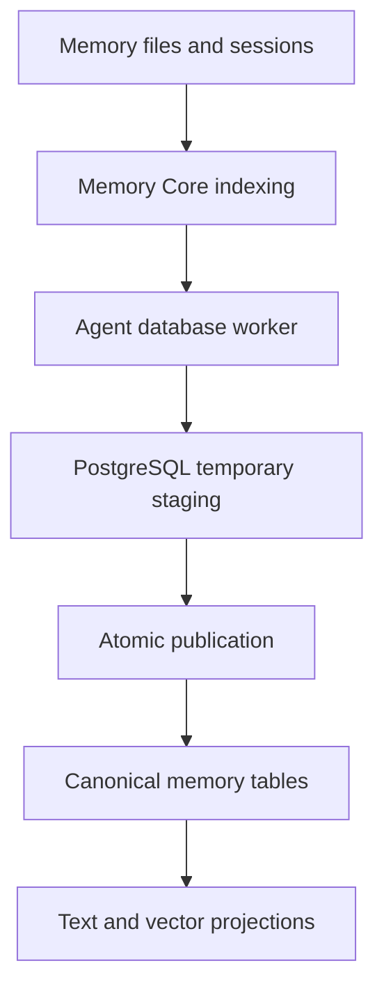

Codex review: needs changes before merge.

## What this changes

This PR adds PostgreSQL memory indexing and atomic publication through the existing agent database worker.

**Example:** Index memory/orchid.md into a fresh PostgreSQL agent store.
- **Before:** The publication backend rejects source-index writes.
- **After:** Internal indexing can publish canonical chunks and derived search projections; public memory search remains disabled.

## Review scores

| Measure | Result | What it means |
|---|---|---|
| **Overall readiness** | 🦐 gold shrimp **(3/6)** | The patch has a coherent owner boundary and no established production defect; evidence is strongest at the real-database conformance layer. |
| **Proof confidence** | 🦐 gold shrimp **(3/6)** | This maintainer-authored PR is outside the ordinary contributor proof gate; its PostgreSQL 17.11 and pgvector 0.8.7 conformance report covers indexing, restart, rollback, stale revisions, and cache staging through in-process production backends. |
| **Patch quality** | 🐚 platinum hermit **(4/6)** | No actionable review findings were identified. |

## Product

**Kind:** Feature · **Worth it:** Yes · **Fix scope:** Complete
**User problem:** PostgreSQL agent stores cannot yet index and publish memory through the existing memory owner.
**Reason:** The maintainer-directed foundation completes its stated publication scope and explicitly defers public retrieval and lifecycle activation.

## Merge readiness

⛔ **Needs changes before merge - 1 item remains**

Keep open as a useful, maintainer-directed PostgreSQL publication foundation; no definite introduced production defect was established.

**Priority:** P2
**Reviewed head:** `f15737feec5816bd92447932389fea19e5907f74`

## Before merge

- [ ] **Complete next step** - Classify the failed SQLite session-lookup and baseline-ratchet checks using base or comparative evidence, assigning repairs only where this diff causes the failure.

## Findings

None.

### Tests

- Missing end-to-end proof: Supplied conformance coverage does not exercise full reindex followed by streamed publication through the production worker-store dispatch.

<strong>Agent review details</strong>

### How this fits together

Memory Core prepares source chunks and embeddings, then the agent database worker stages and commits them to canonical tables and engine-owned search projections.

### Technical review

Best possible solution:

Land the publication foundation once CI failures are classified, retaining the public-search refusal until the coordinated lifecycle implementation is ready.

Do we have a high-confidence way to reproduce the issue?

This is a foundation feature; current-main source confirms the missing PostgreSQL publication path, and no target code was executed during this review.

Is this the best way to solve the issue?

The implementation fits the existing agent worker and engine-owned projections, with connection-local staging instead of a competing persistent publication owner.

AGENTS.md: found and applied where relevant.

Codex review notes: model internal, reasoning medium; reviewed against [ce9d859d68ab](https://github.com/openclaw/openclaw/commit/ce9d859d68abc213d9c82990ae4d75afc566a830).

### Provenance checked

- `PostgreSQL memory admission and refusal` changes intended behavior with a stated reason (a5d66c59b39786837e35dd8d3b3b9f79b91969ef: Admit owner-registered search definitions first, leaving memory indexing and retrieval to later stages.)
- `Worker-owned publication and shadow rebuilds` keeps the original intent (91eff279daa0d6dbf9cd44a9440355ffad9564f1: Keep writable memory operations off the Gateway thread and preserve publication and cleanup custody.)
- `Canonical PostgreSQL vector projections` keeps the original intent (bf4637941b401e9b280722420d66d72540cda27d: Derive native vector search rows transactionally from authoritative binary64 embeddings.)
- `Batched chunk writes, cache operations, and source reads` keeps the original intent (a00f58286faef449e914f4153ff399bdf30bfd48: Bound database work and preserve existing indexing results while reducing repeated writes.)

### Testing

Proof path: in-process harness.

### Security

None.

### Evidence

What I checked:

- **Introduced scope and repository policy:** Reviewed the pinned introduction diff and applicable root, docs, extensions, scripts, and test instructions; the maintainer-notes directory is absent, and the checkout remains clean. ([`AGENTS.md:1`](https://github.com/openclaw/openclaw/blob/f15737feec5816bd92447932389fea19e5907f74/AGENTS.md#L1), [f15737feec58](https://github.com/openclaw/openclaw/commit/f15737feec5816bd92447932389fea19e5907f74))
- **Current main still lacks publication:** Fetched main admits memory search definitions but rejects other PostgreSQL publication commands; this PR supplies distinct missing implementation. ([`extensions/memory-core/src/memory/manager-publication.worker.ts:176`](https://github.com/openclaw/openclaw/blob/ce9d859d68abc213d9c82990ae4d75afc566a830/extensions/memory-core/src/memory/manager-publication.worker.ts#L176), [ce9d859d68ab](https://github.com/openclaw/openclaw/commit/ce9d859d68abc213d9c82990ae4d75afc566a830))
- **Atomic publication and current admission:** Publication checks the expected revision, rechecks session tombstones, and obtains transaction and commit admission around the canonical replacement. ([`extensions/memory-core/src/memory/manager-publication-postgres.ts:311`](https://github.com/openclaw/openclaw/blob/f15737feec5816bd92447932389fea19e5907f74/extensions/memory-core/src/memory/manager-publication-postgres.ts#L311), [f15737feec58](https://github.com/openclaw/openclaw/commit/f15737feec5816bd92447932389fea19e5907f74))
- **Existing spool finding does not establish a production failure:** The connector discussion at https://github.com/openclaw/openclaw/pull/174183#discussion_r4294528353 assumes a long-lived backend after publication; production scalar commands create a fresh binding and close it through command cleanup, while streamed writes retain a separate bounded run scope. ([`src/state/openclaw-agent-worker-store.ts:504`](https://github.com/openclaw/openclaw/blob/f15737feec5816bd92447932389fea19e5907f74/src/state/openclaw-agent-worker-store.ts#L504), [f15737feec58](https://github.com/openclaw/openclaw/commit/f15737feec5816bd92447932389fea19e5907f74))
- **Production binding cleanup:** The execution worker invokes domain cleanup after each database.domain.publish command, which retires the binding rather than retaining its spool closure for the next scalar command. ([`src/state/openclaw-agent-execution.worker.ts:658`](https://github.com/openclaw/openclaw/blob/f15737feec5816bd92447932389fea19e5907f74/src/state/openclaw-agent-execution.worker.ts#L658), [f15737feec58](https://github.com/openclaw/openclaw/commit/f15737feec5816bd92447932389fea19e5907f74))
- **Accepted staged rollout:** The maintainer-authored direction continues https://github.com/openclaw/openclaw/pull/174085 and explicitly leaves public search and forget/status activation for subsequent work; the documented support boundary remains intact. Public docs: [`docs/reference/database-engines.md`](https://docs.openclaw.ai/reference/database-engines). ([`docs/reference/database-engines.md:260`](https://docs.openclaw.ai/reference/database-engines), [f15737feec58](https://github.com/openclaw/openclaw/commit/f15737feec5816bd92447932389fea19e5907f74))

Likely related people:

- **Peter Steinberger:** Raw commit 483b0d3cbaf264ff5bc8add6c96c918764d49b2a adds extensions/memory-core/src/memory/manager-sync-ops.ts:510 relative to its recorded parents. This identifies author metadata, not feature responsibility or a PR merger. (role: source-line author; confidence: high; commits: [483b0d3cbaf2](https://github.com/openclaw/openclaw/commit/483b0d3cbaf264ff5bc8add6c96c918764d49b2a); files: `extensions/memory-core/src/memory/manager-sync-ops.ts`)

### PR surface

Source +640, Tests +1073, Docs +7, Other +14. Total +1734 across 30 files. Added test files: 4.

View PR surface stats

| Area | Files | Added | Removed | Net |
|---|---:|---:|---:|---:|
| Source | 18 | 751 | 111 | +640 |
| Tests | 7 | 1073 | 0 | +1073 |
| Docs | 1 | 7 | 0 | +7 |
| Config | 0 | 0 | 0 | 0 |
| Generated | 0 | 0 | 0 | 0 |
| Other | 4 | 14 | 0 | +14 |
| **Total** | **30** | **1845** | **111** | **+1734** |

### Review metrics

| Metric | Value | Why it matters |
|---|---|---|
| **Production versus test growth** | Production +640 net lines; tests +1,072 net lines | Growth primarily supplies the PostgreSQL publication adapter and real-database conformance coverage while reusing the existing worker owner. |

### Labels

Label changes:

- add `P2`: This is an experimental storage capability with limited current user exposure, rather than an urgent released regression.
- add `rating: 🦐 gold shrimp`: Overall readiness is 🦐 gold shrimp; proof is 🦐 gold shrimp and patch quality is 🐚 platinum hermit.
- add `status: ⏳ waiting on author`: ClawSweeper has contributor-facing work open and is waiting for author action.

Label justifications:

- `P2`: This is an experimental storage capability with limited current user exposure, rather than an urgent released regression.
- `rating: 🦐 gold shrimp`: Overall readiness is 🦐 gold shrimp; proof is 🦐 gold shrimp and patch quality is 🐚 platinum hermit.
- `status: ⏳ waiting on author`: ClawSweeper has contributor-facing work open and is waiting for author action.

### Rank-up moves

Optional improvements that raise the rating; they are not merge blockers.

- Exercise full reindex and subsequent streamed publication through the actual agent worker-store dispatch.

### Rating scale

6/6 🦀 challenger crab · 5/6 🦞 diamond lobster · 4/6 🐚 platinum hermit · 3/6 🦐 gold shrimp · 2/6 🦪 silver shellfish · 1/6 🧂 unranked krab. Overall follows the weaker of proof and patch quality; ✨ marks media proof (a screenshot, video, or linked artifact) that directly shows the changed behavior.

### Workflow

ClawSweeper edits this one comment on every review. Comment `@clawsweeper re-review` for a fresh review only. Repair and merge execution lanes are retired.

_Reviewed October 16, 2026, 8:25 AM ET / 12:25 UTC._

<!-- clawsweeper-verdict:needs-changes item=174183 sha=f15737feec5816bd92447932389fea19e5907f74 confidence=high updated_at=2026-10-16T12:20:21Z reviewed_at=2026-10-16T12:25:08.596Z lease_owner=github-run-38899662179-1 lease_comment_id=6215357074 source_revision=0ffe7da239b8675d003d03a0f89bb41133be480556c10844111f113d33804a1f -->
<!-- clawsweeper-review-state:needs-changes item=174183 sha=f15737feec5816bd92447932389fea19e5907f74 v=1 -->

<!-- clawsweeper-review-version item=174183 reviewed_at=2026-10-16T12:25:08.596Z sha=f15737feec5816bd92447932389fea19e5907f74 source_revision=0ffe7da239b8675d003d03a0f89bb41133be480556c10844111f113d33804a1f lease_owner=github-run-38899662179-1 lease_comment_id=6215357074 v=1 -->

<!-- clawsweeper-review item=174183 -->