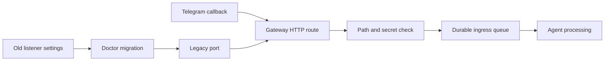

Codex review: blocked before merge. _Reviewed September 26, 2026, 10:01 AM ET / 14:01 UTC (Revision 8)._

# ClawSweeper review

## What this changes

The branch moves Telegram webhook reception onto Gateway HTTP routes, retains forwarding on the old port, migrates explicit listener settings through Doctor, and updates tests and documentation.

## Merge readiness

⛔ **Blocked before merge - 5 items remain**

Keep this PR open. The merged Gateway listener foundation does not move Telegram reception, and current main still uses Telegram’s private server. This branch is a distinct, coherent part of the open HTTP ingress work.

**Priority:** P2
**Reviewed head:** `e0adfaed2439822bf599b4ce9ba537aa234b72f5`

## Review scores

| Measure | Result | What it means |
|---|---|---|
| **Overall readiness** | 🦐 gold shrimp **(3/6)** | The route cutover and focused coverage are coherent, but live Telegram and published-updater compatibility proof remain merge gates. |
| **Proof confidence** | 🦐 gold shrimp **(3/6)** | Not applicable: Real behavior proof is not required for maintainer- or bot-authored pull requests. |
| **Patch quality** | 🐚 platinum hermit **(4/6)** | No actionable review findings were identified. |

## Verification

| Check | Result | Evidence |
|---|---|---|
| **Real behavior** | Not applicable | Not applicable: Real behavior proof is not required for maintainer- or bot-authored pull requests. |
| **Evidence reviewed** | 10 items | Current main still uses a private Telegram server: The fetched main implementation creates a Telegram-owned HTTP server and has no Gateway route registration in this path. Introduced Gateway route cutover: The pinned merge-base-to-head patch registers Telegram’s handler with the Gateway route owner and retains an optional compatibility listener. Request authentication boundary: The route filters live targets, selects one by a constant-time secret comparison, rejects absent or ambiguous matches before reading the body, and only then calls the target handler. |
| **Findings** | None | None. |
| **Security** | None | None. |

## How this fits together

Telegram’s webhook plugin receives Bot API callbacks through an HTTP listener. It checks the webhook secret, commits accepted updates to durable ingress, and lets downstream agent processing handle them.

## Before merge

- [ ] **Resolve merge risk (P1)** - Existing installations with explicit webhookPort or webhookHost depend on Doctor migrating stored config before the strict new schema is used. A published-updater run showing backup, restart, old-port delivery, and rollback has not been demonstrated.
- [ ] **Resolve merge risk (P1)** - The Gateway rehearsal uses synthetic callbacks; the scoped Telegram transport policy still requires Test Server userbot delivery through the changed route and retained legacy path.
- [ ] **Complete next step (P2)** - Add redacted Telegram Test Server delivery evidence for the Gateway and retained old-port paths, then demonstrate a published-updater upgrade of explicit webhookPort/webhookHost settings with backup, restart, and rollback. After updating the PR body, request @clawsweeper re-review through a maintainer if a fresh review does not start automatically.
- [ ] **Review config compatibility** - Confirm compatibility and upgrade impact for the changed config or default surface before merge.
- [ ] **Add data-model compatibility proof** - Confirm migration or upgrade compatibility proof before merge.

<strong>Agent review details</strong>

### Security

None.

### PR surface

Source +206, Tests +759, Docs +72, Generated 0. Total +1037 across 36 files.

View PR surface stats

| Area | Files | Added | Removed | Net |
|---|---:|---:|---:|---:|
| Source | 18 | 455 | 249 | +206 |
| Tests | 10 | 1125 | 366 | +759 |
| Docs | 5 | 79 | 7 | +72 |
| Config | 0 | 0 | 0 | 0 |
| Generated | 3 | 8 | 8 | 0 |
| Other | 0 | 0 | 0 | 0 |
| **Total** | **36** | **1667** | **630** | **+1037** |

### Review metrics

| Metric | Value | Why it matters |
|---|---|---|
| **Configuration transition** | 1 new setting; 2 deprecated inputs | Operators gain legacyWebhook while webhookPort and webhookHost require Doctor migration. |
| **Production versus test growth** | production +206 net; tests and helpers +759 net | The stated production growth supports the route cutover and retained listener contract; most net growth is validation. |

### Stored data model

Persistent data-model change detected: `migration/backfill/repair: extensions/telegram/src/doctor-contract.ts`, `migration/backfill/repair: extensions/telegram/src/doctor.ts`, `migration/backfill/repair: src/commands/doctor-config-flow.ts`, `migration/backfill/repair: src/plugin-sdk/legacy-webhook-listener-migration.ts`, `migration/backfill/repair: src/plugin-sdk/runtime-doctor-migrations.ts`, `migration/backfill/repair: src/plugins/compat/registry-records.ts`, and 2 more. Confirm migration or upgrade compatibility proof before merge.

### Root-cause cluster

Relationship: `fixed_by_candidate`
Canonical: https://github.com/openclaw/openclaw/issues/157553
Summary: The open umbrella issue tracks four channel migrations; this PR is its Telegram implementation slice.

Members:
- `canonical`: https://github.com/openclaw/openclaw/issues/157553 - It explicitly requests the Telegram Gateway-route migration alongside three other channels.
- `partial_overlap`: https://github.com/openclaw/openclaw/pull/158360 - This merged PR provides the Gateway compatibility-listener foundation consumed by the Telegram slice.
- `adjacent_distinct`: https://github.com/openclaw/openclaw/pull/158861 - The open Feishu slice implements the same stack design for a different channel.

Proposal only: this assessment does not dispatch repair, suppress jobs, mutate sibling items, close, or merge anything.

### Merge-risk options

**Maintainer options:**
1. **Complete the transport and upgrade proof (recommended)**  
   Show Telegram Test Server delivery on both paths and run the published updater against copied explicit old settings with backup, restart, and rollback observations.

### Technical review

Best possible solution:

Use one Gateway route owner with Telegram-local secret checks and durable admission, while preserving old listener settings through Doctor and retaining the documented opt-out.

Do we have a high-confidence way to reproduce the issue?

Not applicable as a bug reproduction: this is a transport migration. Current-main source clearly shows the separate Telegram HTTP server that the PR replaces.

Is this the best way to solve the issue?

Yes, the existing Gateway route and compatibility-listener owner is the appropriate boundary, with Telegram retaining secret verification and durable admission. Its upgrade and live-service behavior still need the required proof.

AGENTS.md: found and applied where relevant.

Codex review notes: model internal, reasoning high; reviewed against [b4bcfe29678a](https://github.com/openclaw/openclaw/commit/b4bcfe29678a41b48b2e205d3602fef7bc44e863).

### Labels

Label changes:

No label changes.

Label justifications:

- `P2`: This is a bounded Telegram transport improvement with upgrade and delivery proof still needed.
- `merge-risk: 🚨 compatibility`: Strict config admission now depends on migrating existing listener keys before an upgraded Gateway starts.
- `merge-risk: 🚨 message-delivery`: Callbacks move to Gateway routing, and live Telegram delivery across both ports remains unproven.
- `rating: 🦐 gold shrimp`: Overall readiness is 🦐 gold shrimp; proof is 🦐 gold shrimp and patch quality is 🐚 platinum hermit.
- `status: 👀 ready for maintainer look`: ClawSweeper has no concrete contributor-facing blocker left for this PR. Not applicable: Real behavior proof is not required for maintainer- or bot-authored pull requests.
- `proof: telegram-e2e`: This PR needs Telegram Test Server proof with the repository E2E skill. The changed Telegram webhook transport must be shown delivering a real chat update through its new Gateway path.

### Evidence

What I checked:

- **Current main still uses a private Telegram server:** The fetched main implementation creates a Telegram-owned HTTP server and has no Gateway route registration in this path. ([`extensions/telegram/src/webhook.ts:442`](https://github.com/openclaw/openclaw/blob/b4bcfe29678a41b48b2e205d3602fef7bc44e863/extensions/telegram/src/webhook.ts#L442), [b4bcfe29678a](https://github.com/openclaw/openclaw/commit/b4bcfe29678a41b48b2e205d3602fef7bc44e863))
- **Introduced Gateway route cutover:** The pinned merge-base-to-head patch registers Telegram’s handler with the Gateway route owner and retains an optional compatibility listener. ([`extensions/telegram/src/webhook.ts:488`](https://github.com/openclaw/openclaw/blob/e0adfaed2439822bf599b4ce9ba537aa234b72f5/extensions/telegram/src/webhook.ts#L488), [e0adfaed2439](https://github.com/openclaw/openclaw/commit/e0adfaed2439822bf599b4ce9ba537aa234b72f5))
- **Request authentication boundary:** The route filters live targets, selects one by a constant-time secret comparison, rejects absent or ambiguous matches before reading the body, and only then calls the target handler. ([`extensions/telegram/src/webhook.ts:179`](https://github.com/openclaw/openclaw/blob/e0adfaed2439822bf599b4ce9ba537aa234b72f5/extensions/telegram/src/webhook.ts#L179), [e0adfaed2439](https://github.com/openclaw/openclaw/commit/e0adfaed2439822bf599b4ce9ba537aa234b72f5))
- **Stored configuration transition:** Doctor moves explicit webhookPort and webhookHost values to legacyWebhook and removes the old keys; the new strict runtime schema accepts legacyWebhook. ([`src/plugin-sdk/legacy-webhook-listener-migration.ts:47`](https://github.com/openclaw/openclaw/blob/e0adfaed2439822bf599b4ce9ba537aa234b72f5/src/plugin-sdk/legacy-webhook-listener-migration.ts#L47), [e0adfaed2439](https://github.com/openclaw/openclaw/commit/e0adfaed2439822bf599b4ce9ba537aa234b72f5))
- **Deprecated source inputs retained:** TelegramAccountConfig retains the two old optional TypeScript inputs as deprecated properties, while the runtime schema uses the new field. ([`src/config/types.telegram.ts:113`](https://github.com/openclaw/openclaw/blob/e0adfaed2439822bf599b4ce9ba537aa234b72f5/src/config/types.telegram.ts#L113), [e0adfaed2439](https://github.com/openclaw/openclaw/commit/e0adfaed2439822bf599b4ce9ba537aa234b72f5))
- **Upgrade proof requirement:** Repository policy requires a published updater running against the candidate for changes to Doctor or config migration; the PR body schedules that cell for later and does not report its result. ([`AGENTS.md:83`](https://github.com/openclaw/openclaw/blob/e0adfaed2439822bf599b4ce9ba537aa234b72f5/AGENTS.md#L83), [e0adfaed2439](https://github.com/openclaw/openclaw/commit/e0adfaed2439822bf599b4ce9ba537aa234b72f5))

Likely related people:

- **Peter Steinberger:** Suggested for follow-up; no historical authorship or introduction is verified. (role: unverified routing candidate; confidence: low)
- **Dallin Romney:** Suggested for follow-up; no historical authorship or introduction is verified. (role: unverified routing candidate; confidence: low)

### Rank-up moves

Optional improvements that raise the rating; they are not merge blockers.

- Capture redacted Telegram Test Server delivery through the Gateway route and retained old port.
- Show a published-updater upgrade of explicit old listener settings, including backup, restart, and rollback.

### Rating scale

| Score | Internal tier | Crab rank | Meaning |
|---:|:---:|---|---|
| **6/6** | S | 🦀 challenger crab | Exceptional readiness |
| **5/6** | A | 🦞 diamond lobster | Very strong readiness |
| **4/6** | B | 🐚 platinum hermit | Good normal PR; ordinary maintainer review |
| **3/6** | C | 🦐 gold shrimp | Useful, but confidence is limited |
| **2/6** | D | 🦪 silver shellfish | Proof or implementation needs work |
| **1/6** | F | 🧂 unranked krab | Not merge-ready |
| N/A | NA | 🌊 off-meta tidepool | Rating does not apply |

Overall follows the weaker of proof and patch quality.
Shiny media proof means a screenshot, video, or linked artifact directly shows the changed behavior. Runtime, network, CSP, and security claims still need visible diagnostics.

### Workflow

- ClawSweeper keeps one durable marker-backed review comment per issue or PR.
- Re-runs edit this comment so the latest verdict, findings, and automation markers stay together instead of adding duplicate bot comments.
- A fresh review can be triggered by eligible `@clawsweeper re-review` comments, exact-item GitHub events, scheduled/background review runs, or manual workflow dispatch.
- PR/issue authors and users with repository write access can comment `@clawsweeper re-review` or `@clawsweeper re-run` on an open PR or issue to request a fresh review only.
- Maintainers can also comment `@clawsweeper review` to request a fresh review only.
- Fresh-review commands do not start repair, autofix, rebase, CI repair, or automerge.
- Maintainer-only repair and merge flows require explicit commands such as `@clawsweeper autofix`, `@clawsweeper automerge`, `@clawsweeper fix ci`, or `@clawsweeper address review`.
- Maintainers can comment `@clawsweeper explain` to ask for more context, or `@clawsweeper stop` to stop active automation.

### History

Review history (7 earlier review cycles)

<!-- clawsweeper-review-history v=1 total=7 -->
- reviewed September 26, 2026, 3:53 AM ET / 07:53 UTC sha unknown :: blocked before merge. :: [P1] Preserve the shipped Telegram config fields through a versioned transition
- reviewed 2026-09-26T09:59:04.967Z sha cb0dea59251fc6272140f9658256501f0c32cbd4 :: blocked before merge. :: [P1] Preserve the shipped Telegram config fields through a versioned transition
- reviewed 2026-09-26T11:11:49.278Z sha e0c536d0eb81e374abbccdd6c4eed34204e19f97 :: blocked before merge. :: [P1] Preserve the shipped Telegram config fields through a versioned transition
- reviewed 2026-09-26T11:47:42.548Z sha 5a5b3f052e7f93920192d6aa41f4e8e9f035c09a :: blocked before merge. :: [P1] Preserve the shipped Telegram webhook config fields
- reviewed 2026-09-26T12:18:01.832Z sha 3b4b23f54f5a6149bfe8942470a2d1a15f6557ae :: blocked before merge. :: none
- reviewed 2026-09-26T12:37:12.891Z sha c9dcccbc8e315e28699bee6fef18231e6d8b63fd :: blocked before merge. :: none
- reviewed 2026-09-26T13:11:15.351Z sha c06fbf2ad5b9b257f7d116efb4476c53817e0092 :: blocked before merge. :: none

<!-- clawsweeper-verdict:needs-human item=158732 sha=e0adfaed2439822bf599b4ce9ba537aa234b72f5 confidence=high updated_at=2026-09-26T13:57:30Z reviewed_at=2026-09-26T14:01:29.952Z lease_owner=github-run-36246752320-1 lease_comment_id=5846843818 source_revision=cbb53207a93c7936bf085c9beae2487e377f3e175493f93705e08f0a912b26d9 live_verification=absent -->
<!-- clawsweeper-review-state:blocked item=158732 sha=e0adfaed2439822bf599b4ce9ba537aa234b72f5 v=1 -->

<!-- clawsweeper-review-version item=158732 reviewed_at=2026-09-26T14:01:29.952Z sha=e0adfaed2439822bf599b4ce9ba537aa234b72f5 source_revision=cbb53207a93c7936bf085c9beae2487e377f3e175493f93705e08f0a912b26d9 lease_owner=github-run-36246752320-1 lease_comment_id=5846843818 v=1 -->

<!-- clawsweeper-review item=158732 -->