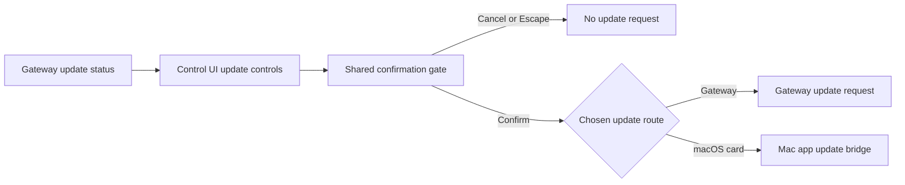

Codex review: needs maintainer review before merge. _Reviewed August 9, 2026, 5:53 PM ET / 21:53 UTC._

# ClawSweeper review

## What this changes

Adds one lazy-loaded confirmation gate before Control UI sidebar, floating-card, Settings-sidebar, and Settings-page controls start Gateway or macOS-app updates.

## Merge readiness

⚠️ **Ready for maintainer review - 3 items remain**

Keep open for maintainer scope review: the patch has no concrete correctness finding, but it intentionally delivers only the Control UI/macOS-card portion of the broader first-party confirmation policy.

**Priority:** P2
**Reviewed head:** `5297e18bf01fe7edf9cbcf63741f7a95d924e93e`
**Owner decision:** Required. See [Decision needed](#decision-needed).

## Review scores

| Measure | Result | What it means |
|---|---|---|
| **Overall readiness** | 🦞 diamond lobster **(5/6)** | The patch centralizes the intended policy with thorough focused coverage and no supported correctness finding; only maintainer scope acceptance remains. |
| **Proof confidence** | 🦞 diamond lobster **(5/6)** | Not applicable: This MEMBER-authored PR is exempt from the external-contributor proof gate; its body nevertheless supplies after-change UI captures and mocked-Gateway E2E evidence. |
| **Patch quality** | 🦞 diamond lobster **(5/6)** | No actionable review findings were identified. |

## Verification

| Check | Result | Evidence |
|---|---|---|
| **Real behavior** | Not applicable | Not applicable: This MEMBER-authored PR is exempt from the external-contributor proof gate; its body nevertheless supplies after-change UI captures and mocked-Gateway E2E evidence. |
| **Evidence reviewed** | 8 items | Current-main sidebar path: Current main sends a first card click directly to the macOS bridge or Gateway update callback, with no confirmation boundary. Current-main Settings path: The Settings update row likewise delegates directly to the Gateway overlay update action. Canonical proposed owner: The PR routes both card and Settings entry points through one gate; only confirmation proceeds to the existing Gateway or macOS bridge dispatch. |
| **Findings** | None | None. |
| **Security** | None | None. |

## How this fits together

The Control UI receives update availability and exposes manual update controls. Those controls either invoke the Gateway update RPC or, for an app-owned local Gateway, hand the confirmed request to the signed macOS app.

## Decision needed

| Question | Recommendation |
|---|---|
| Should OpenClaw land confirmation for the Control UI and its macOS-card handoff now, while leaving Android and iOS controls to https://github.com/openclaw/openclaw/issues/117178? | **Land the Control UI scope:** Accept the focused operator-safety improvement now and retain the linked issue for the remaining native surfaces. |

Why: The implementation is coherent, but accepting a staged first-party safety policy is a product-scope choice that the protected maintainer review path must make.

## Before merge

- [ ] **Resolve merge risk (P1)** - Landing this deliberately stages the safety policy: Android and iOS graphical controls remain outside the diff and stay owned by https://github.com/openclaw/openclaw/issues/117178.
- [ ] **Complete next step (P2)** - A protected, MEMBER-authored PR needs maintainer acceptance of its intentionally partial first-party-app scope before merge.

<strong>Agent review details</strong>

### Security

None.

### PR surface

Source +122, Tests +489, Docs +11. Total +622 across 16 files.

View PR surface stats

| Area | Files | Added | Removed | Net |
|---|---:|---:|---:|---:|
| Source | 7 | 128 | 6 | +122 |
| Tests | 7 | 494 | 5 | +489 |
| Docs | 2 | 11 | 0 | +11 |
| Config | 0 | 0 | 0 | 0 |
| Generated | 0 | 0 | 0 | 0 |
| Other | 0 | 0 | 0 | 0 |
| **Total** | **16** | **633** | **11** | **+622** |

### Review metrics

| Metric | Value | Why it matters |
|---|---|---|
| **Production versus test LOC** | production +109/-5; tests +513/-6; docs +11/-0 | The production growth establishes one shared owner for confirmation policy, while the larger test delta covers all affected operator paths. |

### Merge-risk options

**Maintainer options:**
1. **Decide the mitigation before merge**  
   Land one canonical Control UI confirmation boundary if maintainers accept the staged rollout, while keeping the remaining native-app policy work tracked separately.
2. **Pause or close**  
   Do not merge this PR until maintainers decide whether the risk is worth taking.

### Technical review

Best possible solution:

Land one canonical Control UI confirmation boundary if maintainers accept the staged rollout, while keeping the remaining native-app policy work tracked separately.

Do we have a high-confidence way to reproduce the issue?

Yes—source-reproducible: current main directly dispatches from the sidebar and Settings controls, and the PR adds focused mocked-Gateway E2E coverage for the changed flow.

Is this the best way to solve the issue?

Yes: one shared gate at the Control UI owner boundary prevents per-affordance drift while preserving the existing noninteractive API, CLI, and automation paths.

AGENTS.md: found and applied where relevant.

Codex review notes: model internal, reasoning high; reviewed against [0dbdf994b38e](https://github.com/openclaw/openclaw/commit/0dbdf994b38e2615c98dfb86a8c46fc23ab84d4a).

### Labels

Label justifications:

- `P2`: This improves a consequential manual update workflow but is a bounded, non-emergency operator-safety change.
- `rating: 🦞 diamond lobster`: Overall readiness is 🦞 diamond lobster; proof is 🦞 diamond lobster and patch quality is 🦞 diamond lobster.
- `status: 👀 ready for maintainer look`: ClawSweeper has no concrete contributor-facing blocker left for this PR. Not applicable: This MEMBER-authored PR is exempt from the external-contributor proof gate; its body nevertheless supplies after-change UI captures and mocked-Gateway E2E evidence.

### Evidence

What I checked:

- **Current-main sidebar path:** Current main sends a first card click directly to the macOS bridge or Gateway update callback, with no confirmation boundary. ([`ui/src/components/sidebar-update-card.ts:211`](https://github.com/openclaw/openclaw/blob/0dbdf994b38e/ui/src/components/sidebar-update-card.ts#L211), [0dbdf994b38e](https://github.com/openclaw/openclaw/commit/0dbdf994b38e))
- **Current-main Settings path:** The Settings update row likewise delegates directly to the Gateway overlay update action. ([`ui/src/pages/config/config-page.ts:1008`](https://github.com/openclaw/openclaw/blob/0dbdf994b38e/ui/src/pages/config/config-page.ts#L1008), [0dbdf994b38e](https://github.com/openclaw/openclaw/commit/0dbdf994b38e))
- **Canonical proposed owner:** The PR routes both card and Settings entry points through one gate; only confirmation proceeds to the existing Gateway or macOS bridge dispatch. ([`ui/src/app/update-confirmation.runtime.ts:40`](https://github.com/openclaw/openclaw/blob/5297e18bf01f/ui/src/app/update-confirmation.runtime.ts#L40), [5297e18bf01f](https://github.com/openclaw/openclaw/commit/5297e18bf01f))
- **macOS bridge contract:** The signed macOS app accepts only the start-update bridge payload and emits the decline event that returns an already-confirmed action to the Gateway route. ([`apps/macos/Sources/OpenClaw/DashboardWindowController.swift:598`](https://github.com/openclaw/openclaw/blob/0dbdf994b38e/apps/macos/Sources/OpenClaw/DashboardWindowController.swift#L598), [0dbdf994b38e](https://github.com/openclaw/openclaw/commit/0dbdf994b38e))
- **Behavior coverage:** The proposed E2E covers no request on first click, cancellation, keyboard focus, one confirmed request, visible version/impact copy, compact/dark rendering, and the Settings row. ([`ui/src/e2e/update-confirmation.e2e.test.ts:29`](https://github.com/openclaw/openclaw/blob/5297e18bf01f/ui/src/e2e/update-confirmation.e2e.test.ts#L29), [5297e18bf01f](https://github.com/openclaw/openclaw/commit/5297e18bf01f))
- **Feature-history provenance:** The current update-card behavior traces through Peter Steinberger's update-card and macOS-routing work; blame attributes the exact current dispatch lines to the recent surrounding refactor. ([`ui/src/components/sidebar-update-card.ts:211`](https://github.com/openclaw/openclaw/blob/ec78d365062d/ui/src/components/sidebar-update-card.ts#L211), [ec78d365062d](https://github.com/openclaw/openclaw/commit/ec78d365062d))

Likely related people:

- **Peter Steinberger:** Introduced the update-card/macOS routing area and authored the current-main commits blamed for its direct-dispatch paths. (role: feature owner and recent area contributor; confidence: high; commits: [ebc848deec3d](https://github.com/openclaw/openclaw/commit/ebc848deec3df220ee0abf847fe6d4e00b120ed2), [6f8903bc4dc5](https://github.com/openclaw/openclaw/commit/6f8903bc4dc5d88485cd9ddc4c1c49dd279ad600), [ec78d365062d](https://github.com/openclaw/openclaw/commit/ec78d365062d7984f9b40e3ae229bcbc8e480ec7); files: `ui/src/components/sidebar-update-card.ts`, `ui/src/app/native-link-routing.ts`, `apps/macos/Sources/OpenClaw/DashboardWindowController.swift`)

### Rating scale

| Score | Internal tier | Crab rank | Meaning |
|---:|:---:|---|---|
| **6/6** | S | 🦀 challenger crab | Exceptional readiness |
| **5/6** | A | 🦞 diamond lobster | Very strong readiness |
| **4/6** | B | 🐚 platinum hermit | Good normal PR; ordinary maintainer review |
| **3/6** | C | 🦐 gold shrimp | Useful, but confidence is limited |
| **2/6** | D | 🦪 silver shellfish | Proof or implementation needs work |
| **1/6** | F | 🧂 unranked krab | Not merge-ready |
| N/A | NA | 🌊 off-meta tidepool | Rating does not apply |

Overall follows the weaker of proof and patch quality.
Shiny media proof means a screenshot, video, or linked artifact directly shows the changed behavior. Runtime, network, CSP, and security claims still need visible diagnostics.

### Workflow

- ClawSweeper keeps one durable marker-backed review comment per issue or PR.
- Re-runs edit this comment so the latest verdict, findings, and automation markers stay together instead of adding duplicate bot comments.
- A fresh review can be triggered by eligible `@clawsweeper re-review` comments, exact-item GitHub events, scheduled/background review runs, or manual workflow dispatch.
- PR/issue authors and users with repository write access can comment `@clawsweeper re-review` or `@clawsweeper re-run` on an open PR or issue to request a fresh review only.
- Maintainers can also comment `@clawsweeper review` to request a fresh review only.
- Fresh-review commands do not start repair, autofix, rebase, CI repair, or automerge.
- Maintainer-only repair and merge flows require explicit commands such as `@clawsweeper autofix`, `@clawsweeper automerge`, `@clawsweeper fix ci`, or `@clawsweeper address review`.
- Maintainers can comment `@clawsweeper explain` to ask for more context, or `@clawsweeper stop` to stop active automation.

### History

Review history (1 earlier review cycle)

<!-- clawsweeper-review-history v=1 total=1 -->
- reviewed 2026-08-09T21:47:26.770Z sha 5297e18bf01fe7edf9cbcf63741f7a95d924e93e :: needs maintainer review before merge. :: none

<!-- clawsweeper-verdict:needs-human item=121234 sha=5297e18bf01fe7edf9cbcf63741f7a95d924e93e confidence=high updated_at=2026-08-09T21:50:34Z reviewed_at=2026-08-09T21:53:55.372Z lease_owner=github-run-31337812546-1 lease_comment_id=5234020110 source_revision=c15247c64c69dae04e277006e55a03876d64776ddc7704ab9a1204ea6e111d15 -->

<!-- clawsweeper-review-version item=121234 reviewed_at=2026-08-09T21:53:55.372Z sha=5297e18bf01fe7edf9cbcf63741f7a95d924e93e source_revision=c15247c64c69dae04e277006e55a03876d64776ddc7704ab9a1204ea6e111d15 lease_owner=github-run-31337812546-1 lease_comment_id=5234020110 v=1 -->

<!-- clawsweeper-review item=121234 -->