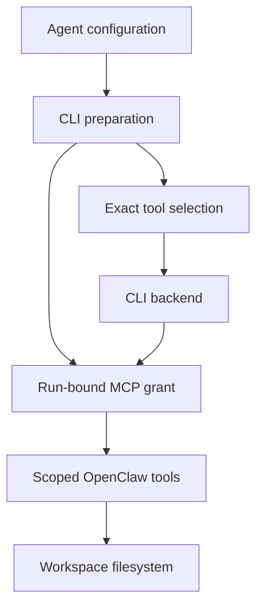

Codex review: needs real behavior proof before merge.

## What this changes

Route workspace-only CLI turns through scoped OpenClaw MCP tools and reject backends that cannot enforce that restriction.

**Example:** An agent rooted at /workspace/main has tools.fs.workspaceOnly enabled and requests /workspace/other/note.txt.
- **Before:** Native CLI file tools can admit the outside-workspace operation.
- **After:** Native file tools are disabled and the scoped OpenClaw file tool rejects the path.

## Review scores

| Measure | Result | What it means |
|---|---|---|
| **Overall readiness** | 🧂 unranked krab **(1/6)** | The repair is focused and the prior question-capability defect is fixed, but authority proof and existing-setting upgrade evidence remain incomplete. |
| **Proof confidence** | 🧂 unranked krab **(1/6)** | Real behavior proof is necessary before merge. See [Before merge](#before-merge). |
| **Patch quality** | 🦐 gold shrimp **(3/6)** | Security review found an item that needs attention. |

## Product

**Kind:** Bug fix · **Worth it:** Yes · **Fix scope:** Complete
**User problem:** CLI-backed agents can access files outside their workspace despite an enabled workspace-only restriction.
**Reason:** The documented restriction has concrete user value, and the maintainer-authored direction selects existing filesystem enforcement with explicit backend requirements.

## Merge readiness

⛔ **Blocked before merge - 5 items remain**

Keep this PR open: it addresses a current filesystem-policy gap, preserves question capability after the correction, and retains one actionable recovery-message defect.

**Priority:** P2
**Reviewed head:** `93b6f473c00df485dfafbddf22a9f2bf1cb642ce`

## Before merge

- [ ] **Add real behavior proof** - Authority-chain proof required: supplied tests run real OpenClaw filesystem tools behind a substituted backend and grant lifecycle, rather than a real CLI client through MCP; provide redacted terminal output or logs showing allowed workspace operations, outside and distinct-agent workspace rejection, and revoked or replaced grants rejected before I/O, removing credentials, IPs, and non-public endpoints. After adding proof, update the PR body, then request a new review with `@clawsweeper re-review`. The PR author or someone with repository write access can request it.
- [ ] **Explain recovery when workspace-only execution is refused (P3)** - When workspaceOnly is enabled on a backend without bundled MCP or exact selection, or on a node-hosted session, preparation now stops with only “cannot enforce workspace-only tool policy.” The user cannot tell which requirement failed or how to resume safely. Preserve the refusal, identify the unsupported requirement, and name a supported recovery such as selecting a backend with bundled MCP and exact tool selection. This prior P3 finding remains unresolved.
- [ ] **Resolve security concern: Verify workspace identity and grant retirement** - The mediation path carries an execution workspace alongside a potentially different policy identity and can transfer authority onto a reusable CLI process bearer; supplied tests substitute the grant lifecycle and cannot establish isolation or revocation at the final filesystem effect.
- [ ] **Resolve merge risk** - Workspace isolation now depends on MCP grant scoping and current authority across CLI process reuse, including runs whose execution and policy agents differ.
- [ ] **Add data-model compatibility proof** - The review found that existing stored data may not work after upgrade. Show that existing data still loads and works with this change.

## Findings

- [P3] Explain recovery when workspace-only execution is refused — `src/agents/cli-runner/prepare-tool-policy.ts:105-106`
- [medium] Verify workspace identity and grant retirement — `src/agents/cli-runner/prepare.ts:318`

### Tests

- Missing end-to-end proof: Supply real-client MCP filesystem results, nearest-forbidden workspace and revoked-grant rejection before I/O, and a latest-stable upgrade run preserving existing settings and session data.

<strong>Agent review details</strong>

### How this fits together

CLI preparation converts configured tool restrictions into backend tool selections and run-bound MCP grants; the Gateway resolves those grants into policy-filtered tools that perform filesystem operations.

### Technical review

Best possible solution:

Keep filesystem enforcement with the existing scoped tool owners and make unsupported-backend refusals actionable.

Do we have a high-confidence way to reproduce the issue?

Current-main source permits ordinary native CLI file admission without applying workspaceOnly; the linked report supplies affected releases and outside-workspace read steps, but no live reproduction was run during this review.

Is this the best way to solve the issue?

Reusing scoped OpenClaw tools is a focused repair that avoids duplicating containment logic in native permission handlers.

Full review comments:

- [P3] Explain recovery when workspace-only execution is refused — `src/agents/cli-runner/prepare-tool-policy.ts:105-106`
  When workspaceOnly is enabled on a backend without bundled MCP or exact selection, or on a node-hosted session, preparation now stops with only “cannot enforce workspace-only tool policy.” The user cannot tell which requirement failed or how to resume safely. Preserve the refusal, identify the unsupported requirement, and name a supported recovery such as selecting a backend with bundled MCP and exact tool selection. This prior P3 finding remains unresolved.
  Confidence: 0.98

Overall correctness: patch is correct
Overall confidence: 0.9

AGENTS.md: found and applied where relevant.

Codex review notes: model internal, reasoning medium; reviewed against [9828bcfff7e9](https://github.com/openclaw/openclaw/commit/9828bcfff7e9aae0a49c523b658df57282dcb4e8).

### Merge-risk options

**Maintainer options:**
1. **Validate the existing grant boundary (recommended)**  
   Demonstrate that the mediated execution workspace remains authoritative across differing agent identities and CLI process reuse, with retired grants rejected before filesystem I/O.

### Provenance checked

- `CLI completion and restricted-turn mediation` keeps the original intent (72f5840c11922793dfacad33c9fc1c0bd3e8b175: Restore policy-filtered completion tools through MCP because native CLI tools cannot enforce captured restrictions.)
- `Sender and delegated execution restrictions` keeps the original intent (5e0066bbf9213366406f1a081868f29a530b5af4: Keep inherited restrictions and explicit delegated authority enforced during CLI execution.)
- `Anthropic native capability projection` keeps the original intent (82d2c992a25bc38336e1a5d49e1ef15d03798f19: Translate equivalent observed native capabilities into canonical authority for scheduled work.)

### Testing

Proof path: in-process harness.

### Security

Needs attention: No concrete introduced bypass was established, but the changed grant boundary still needs final-effect authority evidence.

### Evidence

Security concerns:

- [medium] Verify workspace identity and grant retirement — `src/agents/cli-runner/prepare.ts:318`
  The mediation path carries an execution workspace alongside a potentially different policy identity and can transfer authority onto a reusable CLI process bearer; supplied tests substitute the grant lifecycle and cannot establish isolation or revocation at the final filesystem effect.
  Confidence: 0.95

What I checked:

- **Introduced change:** The pinned introduction diff adds workspace-only mediation, exact native-capability projection, backend requirements, and regression coverage; endpoint drift was excluded. ([`src/agents/cli-runner/prepare-tool-policy.ts:90`](https://github.com/openclaw/openclaw/blob/93b6f473c00df485dfafbddf22a9f2bf1cb642ce/src/agents/cli-runner/prepare-tool-policy.ts#L90), [93b6f473c00d](https://github.com/openclaw/openclaw/commit/93b6f473c00df485dfafbddf22a9f2bf1cb642ce))
- **Current main still needs the repair:** Fetched main mediates completion, sender-restricted, and delegated turns but has no workspaceOnly condition in this policy owner. ([`src/agents/cli-runner/prepare-tool-policy.ts:85`](https://github.com/openclaw/openclaw/blob/9828bcfff7e9aae0a49c523b658df57282dcb4e8/src/agents/cli-runner/prepare-tool-policy.ts#L85), [9828bcfff7e9](https://github.com/openclaw/openclaw/commit/9828bcfff7e9aae0a49c523b658df57282dcb4e8))
- **Previous findings checked:** The correction maps AskUserQuestion to ask_user, addressing the prior P2 finding; the refusal message is unchanged and still supplies no recovery action. ([`extensions/anthropic/cli-backend.ts:63`](https://github.com/openclaw/openclaw/blob/93b6f473c00df485dfafbddf22a9f2bf1cb642ce/extensions/anthropic/cli-backend.ts#L63), [93b6f473c00d](https://github.com/openclaw/openclaw/commit/93b6f473c00df485dfafbddf22a9f2bf1cb642ce))
- **Proof boundary:** The added tests exercise real filesystem tools, but substitute the backend, grant minting, admission binding, and revocation; they do not exercise a real CLI-to-MCP request. ([`src/agents/cli-runner/prepare.completion-tools.test.ts:89`](https://github.com/openclaw/openclaw/blob/93b6f473c00df485dfafbddf22a9f2bf1cb642ce/src/agents/cli-runner/prepare.completion-tools.test.ts#L89), [93b6f473c00d](https://github.com/openclaw/openclaw/commit/93b6f473c00df485dfafbddf22a9f2bf1cb642ce))
- **Existing authority owners:** CLI grants carry the execution workspace and optional runtime-policy identity; MCP checks current grant authority and passes that check into tool resolution. ([`src/gateway/mcp-http.ts:310`](https://github.com/openclaw/openclaw/blob/93b6f473c00df485dfafbddf22a9f2bf1cb642ce/src/gateway/mcp-http.ts#L310), [93b6f473c00d](https://github.com/openclaw/openclaw/commit/93b6f473c00df485dfafbddf22a9f2bf1cb642ce))
- **Accepted backend requirement:** The maintainer-authored body explicitly requires bundled MCP and exact tool selection, accepting refusal of unsupported workspace-only turns; the documentation records that requirement at https://docs.openclaw.ai/gateway/cli-backends. ([`docs/gateway/cli-backends.md:129`](https://docs.openclaw.ai/gateway/cli-backends), [93b6f473c00d](https://github.com/openclaw/openclaw/commit/93b6f473c00df485dfafbddf22a9f2bf1cb642ce))

Likely related people:

- **Peter Steinberger:** Raw commit 82d2c992a25bc38336e1a5d49e1ef15d03798f19 adds extensions/anthropic/cli-backend.ts:63 relative to its recorded parents. This identifies author metadata, not feature responsibility or a PR merger. (role: source-line author; confidence: high; commits: [82d2c992a25b](https://github.com/openclaw/openclaw/commit/82d2c992a25bc38336e1a5d49e1ef15d03798f19); files: `extensions/anthropic/cli-backend.ts`)
- **Stronggenetics:** Raw commit 72f5840c11922793dfacad33c9fc1c0bd3e8b175 adds src/agents/cli-runner/prepare-tool-policy.ts:68 relative to its recorded parents. This identifies author metadata, not feature responsibility or a PR merger. (role: source-line author; confidence: medium; commits: [72f5840c1192](https://github.com/openclaw/openclaw/commit/72f5840c11922793dfacad33c9fc1c0bd3e8b175); files: `src/agents/cli-runner/prepare-tool-policy.ts`)

### PR surface

Source +22, Tests +208, Docs +5. Total +235 across 7 files. Added test files: 0.

View PR surface stats

| Area | Files | Added | Removed | Net |
|---|---:|---:|---:|---:|
| Source | 3 | 29 | 7 | +22 |
| Tests | 3 | 208 | 0 | +208 |
| Docs | 1 | 5 | 0 | +5 |
| Config | 0 | 0 | 0 | 0 |
| Generated | 0 | 0 | 0 | 0 |
| Other | 0 | 0 | 0 | 0 |
| **Total** | **7** | **242** | **7** | **+235** |

### Labels

Label changes:

No label changes.

Label justifications:

- `P2`: This restores a configured filesystem restriction on CLI-backed turns without evidence of a broader runtime outage.
- `merge-risk: 🚨 compatibility`: Existing workspace-only configurations on unsupported or node-hosted backends now refuse execution; the maintainer-authored direction explicitly accepts this restriction.
- `merge-risk: 🚨 security-boundary`: File operations move from native CLI execution to run-bound MCP authority, making workspace identity and grant retirement security-relevant.
- `rating: 🧂 unranked krab`: Overall readiness is 🧂 unranked krab; proof is 🧂 unranked krab and patch quality is 🦐 gold shrimp.
- `status: 📣 needs proof`: The PR needs real behavior proof before ClawSweeper can clear the contributor ask.

### Rank-up moves

Optional improvements that raise the rating; they are not merge blockers.

- Add final-effect proof through a real CLI client for the nearest unauthorized workspace and verify revocation invalidates the grant before I/O.

### Rating scale

6/6 🦀 challenger crab · 5/6 🦞 diamond lobster · 4/6 🐚 platinum hermit · 3/6 🦐 gold shrimp · 2/6 🦪 silver shellfish · 1/6 🧂 unranked krab. Overall follows the weaker of proof and patch quality; ✨ marks media proof (a screenshot, video, or linked artifact) that directly shows the changed behavior.

### Workflow

ClawSweeper edits this one comment on every review. Comment `@clawsweeper re-review` for a fresh review only. Repair and merge execution lanes are retired.

### History

Review history (1 earlier review cycle)

<!-- clawsweeper-review-history v=1 total=1 -->
- reviewed 2026-10-16T22:24:35.280Z sha 83e60fa702168dd4bfb194c8949e9f26515a9bc5 :: needs real behavior proof before merge. :: [P2] Preserve exact non-file native capabilities | [P3] Explain recovery when workspace-only execution is refused

_Reviewed October 16, 2026, 6:34 PM ET / 22:34 UTC (Revision 2)._

<!-- clawsweeper-security:security-sensitive item=174740 sha=93b6f473c00df485dfafbddf22a9f2bf1cb642ce confidence=high updated_at=2026-10-16T22:30:44Z reviewed_at=2026-10-16T22:34:09.822Z lease_owner=github-run-38976080192-1 lease_comment_id=6225910018 source_revision=e205d1aefd9b70f6a00fdfd0539749260289b175538bbd7c74f1713eecd97e79 -->
<!-- clawsweeper-verdict:needs-human item=174740 sha=93b6f473c00df485dfafbddf22a9f2bf1cb642ce confidence=high updated_at=2026-10-16T22:30:44Z reviewed_at=2026-10-16T22:34:09.822Z lease_owner=github-run-38976080192-1 lease_comment_id=6225910018 source_revision=e205d1aefd9b70f6a00fdfd0539749260289b175538bbd7c74f1713eecd97e79 hold=security findings=1 -->
<!-- clawsweeper-review-state:blocked item=174740 sha=93b6f473c00df485dfafbddf22a9f2bf1cb642ce v=1 -->

<!-- clawsweeper-review-version item=174740 reviewed_at=2026-10-16T22:34:09.822Z sha=93b6f473c00df485dfafbddf22a9f2bf1cb642ce source_revision=e205d1aefd9b70f6a00fdfd0539749260289b175538bbd7c74f1713eecd97e79 lease_owner=github-run-38976080192-1 lease_comment_id=6225910018 v=1 -->

<!-- clawsweeper-review item=174740 -->