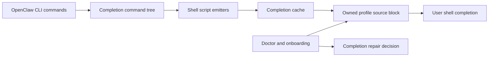

Codex review: needs real behavior proof before merge. _Reviewed July 31, 2026, 11:47 AM ET / 15:47 UTC._

# ClawSweeper review

## What this changes

The branch changes shell-completion installation and generation so OpenClaw preserves unrelated shell-profile content, detects broken completion blocks for repair, and completes Commander option values and choices across Bash, Zsh, Fish, and PowerShell.

## Merge readiness

⛔ **Blocked until stronger real behavior proof is added - 6 items remain**

Keep this PR open for human review. It has a protected `maintainer` label, its stated cross-shell proof does not cover Fish or PowerShell, and the supplied evidence names an earlier candidate SHA rather than the current force-pushed head; local read-only inspection was unavailable because the execution sandbox rejected the command before repository access.

**Priority:** P1
**Reviewed head:** `c1fd22c1fc1370fd9c0a234d6d02c8c59b468c78`
**Owner decision:** Required. See [Decision needed](#decision-needed).

## Review scores

| Measure | Result | What it means |
|---|---|---|
| **Overall readiness** | 🦪 silver shellfish **(2/6)** | The intended repair is substantively tested in the supplied summary, but current-head cross-shell real behavior proof and independent source review are incomplete. |
| **Proof confidence** | 🦪 silver shellfish **(2/6)** | Needs stronger real behavior proof before merge: The body reports Bash and Zsh terminal checks, but cites an earlier candidate SHA and explicitly lacks real Fish and PowerShell runs; post redacted current-head terminal output or recordings, without private paths, keys, endpoints, or other sensitive data. After adding proof, update the PR body; ClawSweeper should re-review automatically. If it does not, the PR author or someone with repository write access can comment `@clawsweeper re-review`. |
| **Patch quality** | 🦐 gold shrimp **(3/6)** | No actionable review findings were identified. |

## Verification

| Check | Result | Evidence |
|---|---|---|
| **Real behavior** | Needs proof | Needs stronger real behavior proof before merge: The body reports Bash and Zsh terminal checks, but cites an earlier candidate SHA and explicitly lacks real Fish and PowerShell runs; post redacted current-head terminal output or recordings, without private paths, keys, endpoints, or other sensitive data. After adding proof, update the PR body; ClawSweeper should re-review automatically. If it does not, the PR author or someone with repository write access can comment `@clawsweeper re-review`. |
| **Evidence reviewed** | 5 items | Local repository inspection failed before access: The only attempted read-only inspection command was rejected by the sandbox with `bwrap: loopback: Failed RTM_NEWADDR: Operation not permitted`; no current-main files, scoped policies, history, or maintainer notes could be independently read. Proof is not tied to the current head: The PR body calls `444dc08ca52be1c314a1c94ac24b672753452fad` the exact candidate, while supplied PR metadata identifies current head `c1fd22c1fc1370fd9c0a234d6d02c8c59b468c78` after a force-push; without a diff or refreshed evidence, the claimed proof cannot be attributed to the current head. Cross-shell behavior remains unproven: The submitted body explicitly says Fish and PowerShell executables were unavailable and that 76 optional real-shell cases were skipped; generated-script tests and inspected shell contracts are useful supplemental evidence but do not establish after-fix behavior in those changed shell runtimes. |
| **Findings** | None | None. |
| **Security** | None | None. |

## How this fits together

OpenClaw’s completion CLI turns its Commander command tree into shell-specific completion scripts and installs an owned source line in a user shell profile. Doctor and onboarding use that profile/cache state to decide whether the completion setup is healthy or needs repair.

## Decision needed

| Question | Recommendation |
|---|---|
| After refreshed current-head evidence, should OpenClaw accept this broader cross-shell completion and profile-replacement compatibility change? | **Require current-head cross-shell proof:** Keep the PR open until redacted Fish and PowerShell real-shell proof and profile upgrade evidence are posted for the current head. |

Why: The protected maintainer label and persisted shell-profile compatibility surface require an explicit owner decision; the current review environment could not inspect the full implementation or history.

## Before merge

- [ ] **Add real behavior proof** - Needs stronger real behavior proof before merge: The body reports Bash and Zsh terminal checks, but cites an earlier candidate SHA and explicitly lacks real Fish and PowerShell runs; post redacted current-head terminal output or recordings, without private paths, keys, endpoints, or other sensitive data. After adding proof, update the PR body; ClawSweeper should re-review automatically. If it does not, the PR author or someone with repository write access can comment `@clawsweeper re-review`.
- [ ] **Resolve merge risk (P1)** - Merging profile-recognition changes without current-head upgrade proof could replace or misclassify an existing user’s shell-profile completion block.
- [ ] **Resolve merge risk (P1)** - The branch changes all four supported shell emitters, but supplied real-shell evidence is incomplete for Fish and PowerShell.
- [ ] **Resolve merge risk (P1)** - The PR is reported as behind its base, and repository inspection could not verify the three-way merge result against supplied current main.
- [ ] **Complete next step (P2)** - A protected maintainer label, incomplete current-head real behavior proof, and an unavailable source/history inspection environment make this unsuitable for automated repair routing.

<strong>Agent review details</strong>

### Security

None.

### PR surface

Source +306, Tests +589. Total +895 across 9 files.

View PR surface stats

| Area | Files | Added | Removed | Net |
|---|---:|---:|---:|---:|
| Source | 4 | 331 | 25 | +306 |
| Tests | 5 | 594 | 5 | +589 |
| Docs | 0 | 0 | 0 | 0 |
| Config | 0 | 0 | 0 | 0 |
| Generated | 0 | 0 | 0 | 0 |
| Other | 0 | 0 | 0 | 0 |
| **Total** | **9** | **925** | **30** | **+895** |

### Review metrics

| Metric | Value | Why it matters |
|---|---|---|
| **Shell compatibility surface** | 4 shell emitters plus shared profile installation state changed | A profile-detection or argument-contract mistake can affect existing interactive CLI users differently by shell and during upgrades. |

### Stored data model

Persistent data-model change detected: `migration/backfill/repair: src/commands/doctor-completion.test.ts`, `persistent cache schema: src/cli/completion-runtime.test.ts`, `serialized state: src/cli/completion-runtime.test.ts`, `serialized state: src/commands/doctor-completion.test.ts`. Confirm migration or upgrade compatibility proof before merge.

### Merge-risk options

**Maintainer options:**
1. **Prove current-head shell upgrades (recommended)**  
   Rebase or refresh to current main and post redacted terminal evidence showing the current head preserves unrelated profile content and works in Fish and PowerShell.
2. **Accept bounded platform risk**  
   A maintainer may explicitly accept the missing live Fish and PowerShell proof if generated-script coverage is judged adequate for this compatibility change.
3. **Pause for a narrower repair**  
   Pause this branch if the compatibility behavior cannot be verified across the supported shell matrix at the current head.

### Technical review

Best possible solution:

Refresh the branch against current main, then provide redacted current-head terminal or recording evidence for Fish and PowerShell plus upgrade-profile cases showing that only OpenClaw-owned source lines are replaced; a maintainer should then decide whether the compatibility boundary is ready to merge.

Do we have a high-confidence way to reproduce the issue?

No. The sandbox rejected the read-only repository command before source inspection; the PR body reports Bash and Zsh checks but its current-head evidence could not be independently verified and it explicitly lacks Fish and PowerShell runtime proof.

Is this the best way to solve the issue?

Unclear. Carrying Commander facts through the shared completion tree is a plausible canonical approach, but the full changed modules, callers, history, and current-main merge result could not be inspected, and cross-shell upgrade safety is not yet demonstrated at the current head.

AGENTS.md: unclear because the file could not be read completely.

Codex review notes: model internal, reasoning high; reviewed against [0687ab73f101](https://github.com/openclaw/openclaw/commit/0687ab73f101a13143073195dda0952451631bbb).

### Labels

Label justifications:

- `P1`: The PR targets completion installation and argument guidance used by existing CLI operators, where regressions can disrupt normal shell workflows.
- `merge-risk: 🚨 compatibility`: It changes how persisted shell-profile completion blocks and previous cache locations are recognized and replaced.
- `rating: 🦪 silver shellfish`: Overall readiness is 🦪 silver shellfish; proof is 🦪 silver shellfish and patch quality is 🦐 gold shrimp.
- `status: 📣 needs proof`: The PR needs real behavior proof before ClawSweeper can clear the contributor ask. Needs stronger real behavior proof before merge: The body reports Bash and Zsh terminal checks, but cites an earlier candidate SHA and explicitly lacks real Fish and PowerShell runs; post redacted current-head terminal output or recordings, without private paths, keys, endpoints, or other sensitive data. After adding proof, update the PR body; ClawSweeper should re-review automatically. If it does not, the PR author or someone with repository write access can comment `@clawsweeper re-review`.

### Evidence

What I checked:

- **Local repository inspection failed before access:** The only attempted read-only inspection command was rejected by the sandbox with `bwrap: loopback: Failed RTM_NEWADDR: Operation not permitted`; no current-main files, scoped policies, history, or maintainer notes could be independently read.
- **Proof is not tied to the current head:** The PR body calls `444dc08ca52be1c314a1c94ac24b672753452fad` the exact candidate, while supplied PR metadata identifies current head `c1fd22c1fc1370fd9c0a234d6d02c8c59b468c78` after a force-push; without a diff or refreshed evidence, the claimed proof cannot be attributed to the current head. ([c1fd22c1fc13](https://github.com/openclaw/openclaw/commit/c1fd22c1fc13))
- **Cross-shell behavior remains unproven:** The submitted body explicitly says Fish and PowerShell executables were unavailable and that 76 optional real-shell cases were skipped; generated-script tests and inspected shell contracts are useful supplemental evidence but do not establish after-fix behavior in those changed shell runtimes. ([`src/cli/completion-fish.ts`](https://github.com/openclaw/openclaw/blob/c1fd22c1fc13/src/cli/completion-fish.ts), [c1fd22c1fc13](https://github.com/openclaw/openclaw/commit/c1fd22c1fc13))
- **Compatibility-sensitive persisted user state:** The supplied diff changes profile-line recognition and replacement in the completion installer, affecting existing user-managed shell profile files and prior completion cache locations. ([`src/cli/completion-runtime.ts`](https://github.com/openclaw/openclaw/blob/c1fd22c1fc13/src/cli/completion-runtime.ts), [c1fd22c1fc13](https://github.com/openclaw/openclaw/commit/c1fd22c1fc13))
- **Protected review routing:** Supplied PR metadata includes the `maintainer` label, which requires explicit maintainer handling rather than automated cleanup or closure.

Likely related people:

- **steipete:** The supplied PR metadata attributes the current head commit and proposed completion changes to this contributor; no current-main history mapping could be performed after the sandbox rejected repository reads. (role: PR proposer and recent completion-path author; confidence: low; commits: [c1fd22c1fc13](https://github.com/openclaw/openclaw/commit/c1fd22c1fc1370fd9c0a234d6d02c8c59b468c78); files: `src/cli/completion-cli.ts`, `src/cli/completion-runtime.ts`, `src/cli/completion-command-tree.ts`)

### Rank-up moves

Optional improvements that raise the rating; they are not merge blockers.

- Refresh evidence against `c1fd22c1fc1370fd9c0a234d6d02c8c59b468c78` after rebasing or merge refresh.
- Post redacted Fish and PowerShell real-shell completion output or recordings.
- Show an upgrade-profile case proving unrelated exports, aliases, redirects, and sources survive replacement.

### Rating scale

| Score | Internal tier | Crab rank | Meaning |
|---:|:---:|---|---|
| **6/6** | S | 🦀 challenger crab | Exceptional readiness |
| **5/6** | A | 🦞 diamond lobster | Very strong readiness |
| **4/6** | B | 🐚 platinum hermit | Good normal PR; ordinary maintainer review |
| **3/6** | C | 🦐 gold shrimp | Useful, but confidence is limited |
| **2/6** | D | 🦪 silver shellfish | Proof or implementation needs work |
| **1/6** | F | 🧂 unranked krab | Not merge-ready |
| N/A | NA | 🌊 off-meta tidepool | Rating does not apply |

Overall follows the weaker of proof and patch quality.
Shiny media proof means a screenshot, video, or linked artifact directly shows the changed behavior. Runtime, network, CSP, and security claims still need visible diagnostics.

### Workflow

- ClawSweeper keeps one durable marker-backed review comment per issue or PR.
- Re-runs edit this comment so the latest verdict, findings, and automation markers stay together instead of adding duplicate bot comments.
- A fresh review can be triggered by eligible `@clawsweeper re-review` comments, exact-item GitHub events, scheduled/background review runs, or manual workflow dispatch.
- PR/issue authors and users with repository write access can comment `@clawsweeper re-review` or `@clawsweeper re-run` on an open PR or issue to request a fresh review only.
- Maintainers can also comment `@clawsweeper review` to request a fresh review only.
- Fresh-review commands do not start repair, autofix, rebase, CI repair, or automerge.
- Maintainer-only repair and merge flows require explicit commands such as `@clawsweeper autofix`, `@clawsweeper automerge`, `@clawsweeper fix ci`, or `@clawsweeper address review`.
- Maintainers can comment `@clawsweeper explain` to ask for more context, or `@clawsweeper stop` to stop active automation.

### History

Review history (1 earlier review cycle)

<!-- clawsweeper-review-history v=1 total=1 -->
- reviewed 2026-07-31T15:18:08.220Z sha 444dc08ca52be1c314a1c94ac24b672753452fad :: needs real behavior proof before merge. :: none

<!-- clawsweeper-verdict:needs-human item=116906 sha=c1fd22c1fc1370fd9c0a234d6d02c8c59b468c78 confidence=medium updated_at=2026-07-31T15:46:20Z reviewed_at=2026-07-31T15:47:38.748Z lease_owner=github-run-30644212370-1 lease_comment_id=5144752822 source_revision=cf53e6ef44ea4b4e923493cc544490ca7802c6e9e3a986c3f2d49ac4ab45687f -->

<!-- clawsweeper-review-version item=116906 reviewed_at=2026-07-31T15:47:38.748Z sha=c1fd22c1fc1370fd9c0a234d6d02c8c59b468c78 source_revision=cf53e6ef44ea4b4e923493cc544490ca7802c6e9e3a986c3f2d49ac4ab45687f lease_owner=github-run-30644212370-1 lease_comment_id=5144752822 v=1 -->

<!-- clawsweeper-review item=116906 -->