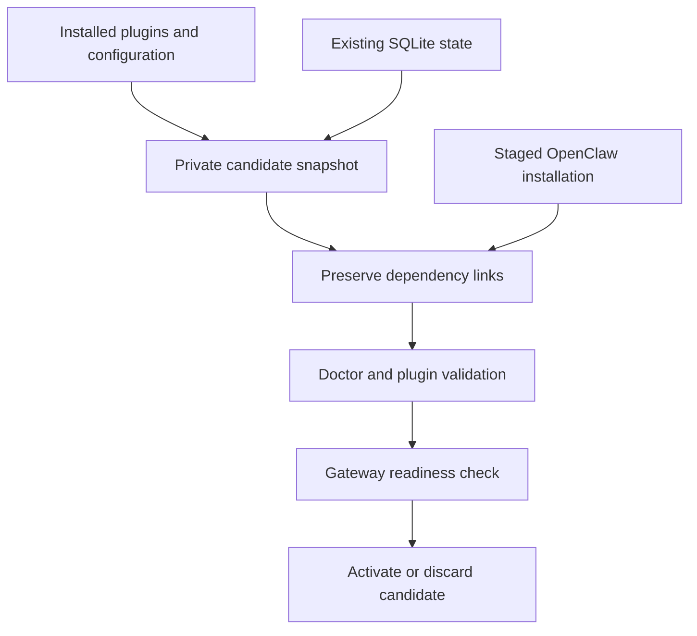

Codex review: blocked before merge. _Reviewed September 7, 2026, 12:33 PM ET / 16:33 UTC._

# ClawSweeper review

## What this changes

The PR copies installed plugins and their dependency links into disposable update-validation state so they can load against the staged OpenClaw installation.

## Merge readiness

⛔ **Blocked before merge - 3 items remain**

The repair remains necessary on current main. The earlier pnpm blocker is addressed, and this review found no new blocking code defect.

**Priority:** P1
**Reviewed head:** `8b8b3f368eff2b2a2e71b1d7363368c4b06a32f0`

## Review scores

| Measure | Result | What it means |
|---|---|---|
| **Overall readiness** | 🐚 platinum hermit **(4/6)** | The focused repair resolves the prior finding with meaningful production-worker coverage; packaged qualification remains the material confidence reducer. |
| **Proof confidence** | 🌊 off-meta tidepool | Not applicable: The ordinary external-contributor gate does not apply to this MEMBER-authored PR. The captured body reports packaged canary success for the original projection repair and explicitly leaves rebuilt-package qualification of the topology follow-up outstanding. |
| **Patch quality** | 🐚 platinum hermit **(4/6)** | No actionable review findings were identified. |

## Verification

| Check | Result | Evidence |
|---|---|---|
| **Real behavior** | Not applicable | Not applicable: The ordinary external-contributor gate does not apply to this MEMBER-authored PR. The captured body reports packaged canary success for the original projection repair and explicitly leaves rebuilt-package qualification of the topology follow-up outstanding. |
| **Evidence reviewed** | 8 items | Current main still needs the repair: The fetched main revision clones configuration without projecting plugin locators and consumes a snapshot containing only schema versions. Earlier pnpm finding addressed: The introduced implementation copies dependency owners with verbatim symlinks, relocates their graph using the existing runtime helper, and verifies copied links remain private. This replaces the flattening mechanism identified in the previous review. Behavioral regression coverage: The tests exercise the production snapshot worker, import a transitive dependency under relative, absolute, external-store, and cyclic layouts, execute a copied launcher, and mutate a copied dependency while confirming the source still imports its original value. These tests were inspected, not executed during this read-only review. |
| **Findings** | None | None. |
| **Security** | None | None. |

## How this fits together

The updater validates a staged installation while the existing Gateway keeps serving. Candidate rehearsal combines copied configuration, databases, and plugin files before running Doctor, plugin resolution, and Gateway readiness checks.

## Before merge

- [ ] **Resolve merge risk (P1)** - The topology follow-up has not yet received the rebuilt-package qualification identified in the PR body, leaving packaged installed-plugin compatibility unverified for that revision.
- [ ] **Complete next step (P2)** - Complete rebuilt-package qualification for the topology follow-up, confirming candidate validation succeeds while serving plugin files and host links remain unchanged.
- [ ] **Add data-model compatibility proof** - Confirm migration or upgrade compatibility proof before merge.

<strong>Agent review details</strong>

### Security

None.

### PR surface

Source +508, Tests +413, Docs +3. Total +924 across 10 files.

View PR surface stats

| Area | Files | Added | Removed | Net |
|---|---:|---:|---:|---:|
| Source | 6 | 515 | 7 | +508 |
| Tests | 3 | 419 | 6 | +413 |
| Docs | 1 | 5 | 2 | +3 |
| Config | 0 | 0 | 0 | 0 |
| Generated | 0 | 0 | 0 | 0 |
| Other | 0 | 0 | 0 | 0 |
| **Total** | **10** | **939** | **15** | **+924** |

### Review metrics

None.

### Stored data model

Persistent data-model change detected: `migration/backfill/repair: src/cli/update-cli/update-command-repair.ts`. Confirm migration or upgrade compatibility proof before merge.

### Merge-risk options

**Maintainer options:**
1. **Complete package qualification (recommended)**  
   Finish the acknowledged rebuilt-package validation of the topology follow-up before landing.

### Technical review

Best possible solution:

Keep one private plugin generation owned by candidate rehearsal, preserving dependency resolution and serving-state immutability through package qualification.

Do we have a high-confidence way to reproduce the issue?

Yes, source inspection identifies the path: current main rehearses copied state without privately projecting installed plugin payloads and host links. No runtime reproduction was executed in this read-only review.

Is this the best way to solve the issue?

Yes. Repairing the snapshot owner and reusing the existing relocation helper preserves one canonical dependency-copy flow; the prior flattening defect is addressed.

AGENTS.md: found and applied where relevant.

Codex review notes: model internal, reasoning medium; reviewed against [64e65c816044](https://github.com/openclaw/openclaw/commit/64e65c816044aa02d617a798af6344a01679741f).

### Labels

Label changes:

- add `rating: 🐚 platinum hermit`: Overall readiness is 🐚 platinum hermit; proof is 🌊 off-meta tidepool and patch quality is 🐚 platinum hermit.
- add `status: 👀 ready for maintainer look`: ClawSweeper has no concrete contributor-facing blocker left for this PR. Not applicable: The ordinary external-contributor gate does not apply to this MEMBER-authored PR. The captured body reports packaged canary success for the original projection repair and explicitly leaves rebuilt-package qualification of the topology follow-up outstanding.
- remove `rating: 🦐 gold shrimp`: Current PR rating is `rating: 🐚 platinum hermit`, so this older rating label is no longer current.
- remove `status: ⏳ waiting on author`: Current PR status label is `status: 👀 ready for maintainer look`.

Label justifications:

- `P1`: The repair addresses installed plugins blocking the updater's candidate-validation workflow.
- `merge-risk: 🚨 compatibility`: Dependency-tree copying and host rebinding affect existing plugin installations, and the latest topology revision still lacks its acknowledged packaged qualification.
- `rating: 🐚 platinum hermit`: Overall readiness is 🐚 platinum hermit; proof is 🌊 off-meta tidepool and patch quality is 🐚 platinum hermit.
- `status: 👀 ready for maintainer look`: ClawSweeper has no concrete contributor-facing blocker left for this PR. Not applicable: The ordinary external-contributor gate does not apply to this MEMBER-authored PR. The captured body reports packaged canary success for the original projection repair and explicitly leaves rebuilt-package qualification of the topology follow-up outstanding.

### Evidence

What I checked:

- **Current main still needs the repair:** The fetched main revision clones configuration without projecting plugin locators and consumes a snapshot containing only schema versions. ([`src/infra/update-candidate-rehearsal.ts:47`](https://github.com/openclaw/openclaw/blob/64e65c816044aa02d617a798af6344a01679741f/src/infra/update-candidate-rehearsal.ts#L47), [64e65c816044](https://github.com/openclaw/openclaw/commit/64e65c816044aa02d617a798af6344a01679741f))
- **Earlier pnpm finding addressed:** The introduced implementation copies dependency owners with verbatim symlinks, relocates their graph using the existing runtime helper, and verifies copied links remain private. This replaces the flattening mechanism identified in the previous review. ([`src/infra/update-candidate-plugin-tree.ts:196`](https://github.com/openclaw/openclaw/blob/8b8b3f368eff2b2a2e71b1d7363368c4b06a32f0/src/infra/update-candidate-plugin-tree.ts#L196), [8b8b3f368eff](https://github.com/openclaw/openclaw/commit/8b8b3f368eff2b2a2e71b1d7363368c4b06a32f0))
- **Behavioral regression coverage:** The tests exercise the production snapshot worker, import a transitive dependency under relative, absolute, external-store, and cyclic layouts, execute a copied launcher, and mutate a copied dependency while confirming the source still imports its original value. These tests were inspected, not executed during this read-only review. ([`src/infra/update-candidate-state.test.ts:623`](https://github.com/openclaw/openclaw/blob/8b8b3f368eff2b2a2e71b1d7363368c4b06a32f0/src/infra/update-candidate-state.test.ts#L623), [8b8b3f368eff](https://github.com/openclaw/openclaw/commit/8b8b3f368eff2b2a2e71b1d7363368c4b06a32f0))
- **Private state and host-link ownership:** Plugin records are read and rewritten in the copied SQLite database; host rebinding receives copied plugin directories. The existing record reader explicitly permits canonical install records to remain usable when derived index metadata is invalidated. ([`src/infra/update-candidate-plugins.ts:183`](https://github.com/openclaw/openclaw/blob/8b8b3f368eff2b2a2e71b1d7363368c4b06a32f0/src/infra/update-candidate-plugins.ts#L183), [8b8b3f368eff](https://github.com/openclaw/openclaw/commit/8b8b3f368eff2b2a2e71b1d7363368c4b06a32f0))
- **Captured proof and qualification limit:** The supplied PR body reports successful packaged migration, Doctor, plugin-resolution, and Gateway-canary checks for d9287bbc620390781584ce75d82572f6c37dcfc7, including a 26.8-second canary. It explicitly says the topology follow-up has source-level coverage and still needs rebuilt-package qualification. This assessment preserves the supplied snapshot rather than substituting a newer body.
- **Related merged work and release boundary:** The supplied GitHub context identifies https://github.com/openclaw/openclaw/pull/138839 as the merged candidate-validation foundation, not a replacement for this repair. Its commit is dated September 6; the latest release's tree does not contain the candidate-rehearsal file. ([`src/infra/update-candidate-rehearsal.ts`](https://github.com/openclaw/openclaw/blob/3928bad9badfcb6c7d140530435e806fb8092190/src/infra/update-candidate-rehearsal.ts), [3928bad9badf](https://github.com/openclaw/openclaw/commit/3928bad9badfcb6c7d140530435e806fb8092190))

Likely related people:

- **steipete:** Suggested for follow-up; no historical authorship or introduction is verified. (role: unverified routing candidate; confidence: low)
- **Vincent Koc:** Suggested for follow-up; no historical authorship or introduction is verified. (role: unverified routing candidate; confidence: low)

### Rank-up moves

Optional improvements that raise the rating; they are not merge blockers.

- Complete the rebuilt-package qualification already identified for the topology follow-up.

### Rating scale

| Score | Internal tier | Crab rank | Meaning |
|---:|:---:|---|---|
| **6/6** | S | 🦀 challenger crab | Exceptional readiness |
| **5/6** | A | 🦞 diamond lobster | Very strong readiness |
| **4/6** | B | 🐚 platinum hermit | Good normal PR; ordinary maintainer review |
| **3/6** | C | 🦐 gold shrimp | Useful, but confidence is limited |
| **2/6** | D | 🦪 silver shellfish | Proof or implementation needs work |
| **1/6** | F | 🧂 unranked krab | Not merge-ready |
| N/A | NA | 🌊 off-meta tidepool | Rating does not apply |

Overall follows the weaker of proof and patch quality.
Shiny media proof means a screenshot, video, or linked artifact directly shows the changed behavior. Runtime, network, CSP, and security claims still need visible diagnostics.

### Workflow

- ClawSweeper keeps one durable marker-backed review comment per issue or PR.
- Re-runs edit this comment so the latest verdict, findings, and automation markers stay together instead of adding duplicate bot comments.
- A fresh review can be triggered by eligible `@clawsweeper re-review` comments, exact-item GitHub events, scheduled/background review runs, or manual workflow dispatch.
- PR/issue authors and users with repository write access can comment `@clawsweeper re-review` or `@clawsweeper re-run` on an open PR or issue to request a fresh review only.
- Maintainers can also comment `@clawsweeper review` to request a fresh review only.
- Fresh-review commands do not start repair, autofix, rebase, CI repair, or automerge.
- Maintainer-only repair and merge flows require explicit commands such as `@clawsweeper autofix`, `@clawsweeper automerge`, `@clawsweeper fix ci`, or `@clawsweeper address review`.
- Maintainers can comment `@clawsweeper explain` to ask for more context, or `@clawsweeper stop` to stop active automation.

### History

Review history (2 earlier review cycles)

<!-- clawsweeper-review-history v=1 total=2 -->
- reviewed 2026-09-07T11:10:51.114Z sha 99f8aa953ebb71b22116334bcc59a8c69fa90c11 :: blocked before merge. :: [P1] Preserve pnpm dependency links inside the private copy
- reviewed 2026-09-07T13:26:13.956Z sha 322e9f994ea766d8e7d5add34a81d9aa3584fb2d :: blocked before merge. :: [P1] Preserve pnpm dependency links inside the private copy

<!-- clawsweeper-verdict:needs-human item=141175 sha=8b8b3f368eff2b2a2e71b1d7363368c4b06a32f0 confidence=high updated_at=2026-09-07T16:30:19Z reviewed_at=2026-09-07T16:33:14.463Z lease_owner=github-run-34143417295-1 lease_comment_id=5573437317 source_revision=a20a39b1da0d5acaf270eb7977286bb4858e9b9d6a6b28971154b1c166eeafd0 live_verification=absent -->
<!-- clawsweeper-review-state:blocked item=141175 sha=8b8b3f368eff2b2a2e71b1d7363368c4b06a32f0 v=1 -->

<!-- clawsweeper-review-version item=141175 reviewed_at=2026-09-07T16:33:14.463Z sha=8b8b3f368eff2b2a2e71b1d7363368c4b06a32f0 source_revision=a20a39b1da0d5acaf270eb7977286bb4858e9b9d6a6b28971154b1c166eeafd0 lease_owner=github-run-34143417295-1 lease_comment_id=5573437317 v=1 -->

<!-- clawsweeper-review item=141175 -->